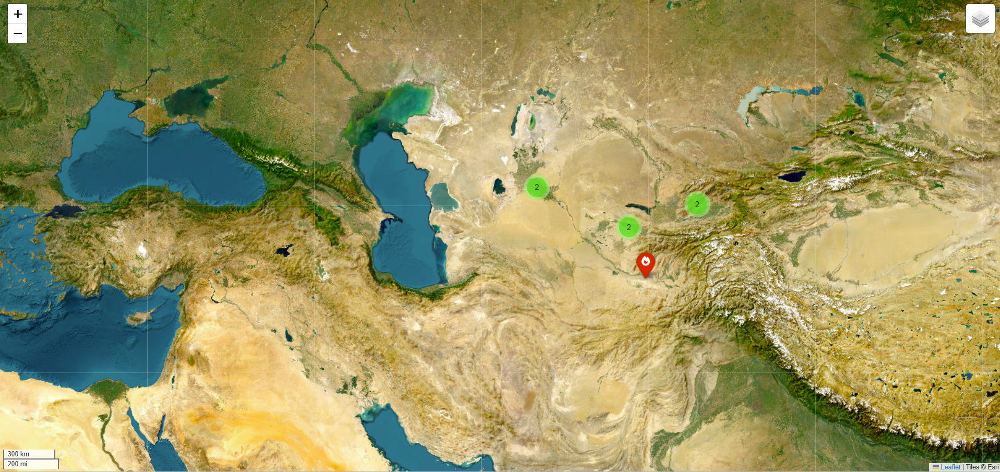
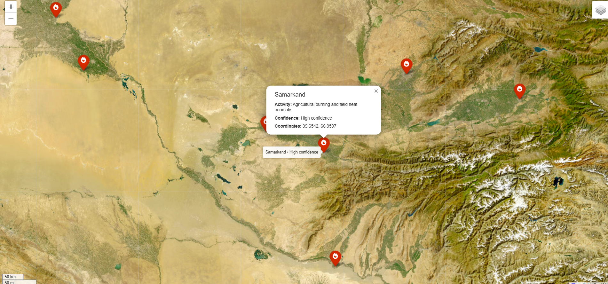

# Fire hotspots of Uzbekistan

**Author:** Ayat · GitHub: [AyatBadwan](https://github.com/AyatBadwan)
**Theme:** Day 01 Points · #30DayMapChallenge 2026
**Tools:** Leaflet web map on Esri satellite imagery

Fire hotspots across Uzbekistan shown as markers on a satellite basemap. Clicking a marker opens a popup with the region, the type of activity (e.g. agricultural burning), the detection confidence and the coordinates.

| Overview | Zoomed in, with popup |
|---|---|
|  |  |

*Data source: to be added by the author.*
