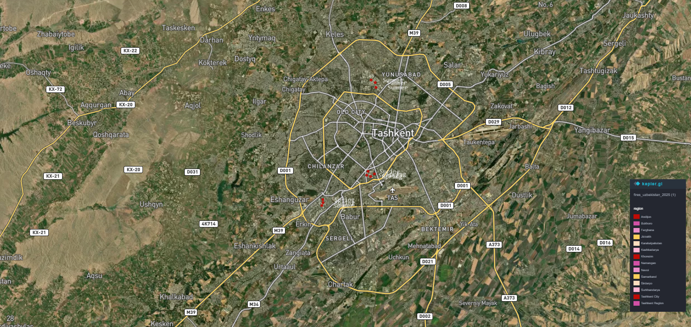

# Fires in Tashkent City

**Author:** Ziynat · GitHub: [oktabrovaziynat3-cell](https://github.com/oktabrovaziynat3-cell)
**Theme:** Day 01 Points · #30DayMapChallenge 2026
**Data:** NASA FIRMS MODIS fire detections, 2025 (`fires_uzbekistan_2025.csv` from the [Day 01 tutorial](../tutorial/README.md))
**Tools:** kepler.gl

Satellite-detected fires in and around Tashkent City on a satellite basemap, with the points labelled by season.

