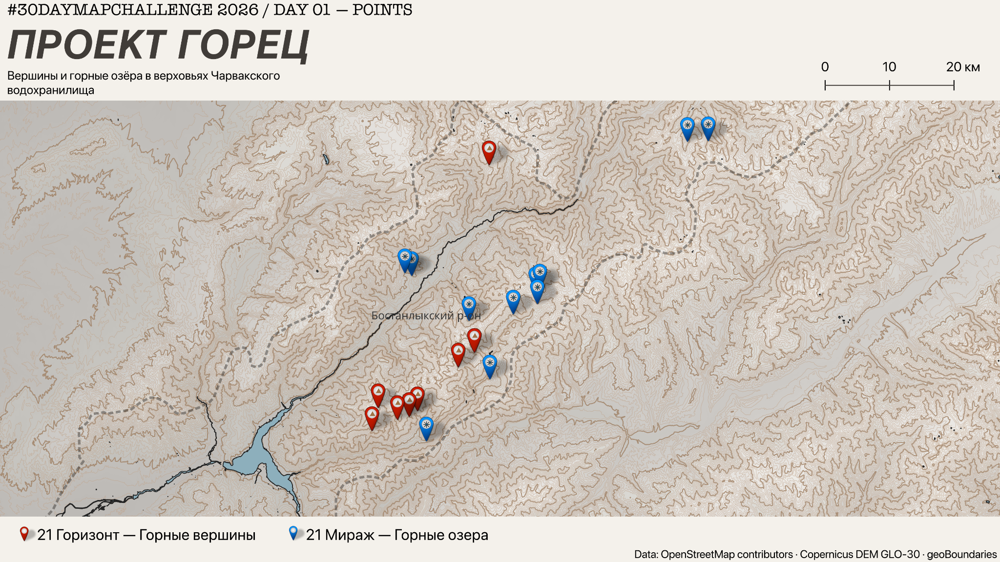

# Day 01 — Points | Project Gorets

A map of mountain **peaks** from *21 Gorizont* and alpine **lakes** from *21 Mirazh*, two hiking challenges around the Charvak Reservoir in Tashkent Region, Uzbekistan.

**Data:** OsmAnd GPX waypoints, OpenStreetMap / OpenTopoMap, Copernicus DEM GLO-30, administrative boundaries.  
**Tools:** QGIS.

## Files

- `report.png` — finished map.
- `day01_points.qgz` — editable QGIS map and print layout.

## Open or recreate in QGIS

1. Open `day01_points.qgz` in **QGIS 3.44+** (recommended).
2. The QGIS project **does not embed its data**. If prompted to repair sources, get the GPX files, `gorets_points.gpkg`, `tashkent_districts.gpkg`, hillshade, water layer and custom SVG icons from the [original project](https://github.com/mmirshod/30daymapchallenge-2026/tree/main/projects/day01_points), then relink them in QGIS.
3. The **100 m contour layer** in this `.qgz` points to a temporary local shapefile. Recreate the contours from a DEM in QGIS, or remove that broken layer if not needed.
4. Open the existing QGIS **Print Layout** to edit or export the map.

The separate [interactive web map](https://github.com/mmirshod/30daymapchallenge-2026/tree/main/docs/day01) is also available in the source repository.
