# Day 01 · Points – Fires Seen From Space 🛰️🔥

In this tutorial you'll make a map of every fire that NASA satellites spotted in Uzbekistan in 2025, **without installing anything and without writing any code**. Everyone starts with the same data, but you'll each pick a different way to show it, so every map in our group comes out different.

| ⏱️ Time | 💻 You need | 🧰 Tool |
|---|---|---|
| 30–45 minutes | A computer with Chrome, Edge or Firefox | [kepler.gl](https://kepler.gl/demo) (free, runs in the browser) |

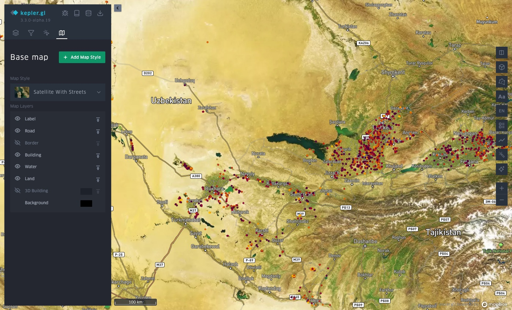

---

## 🛰️ Part 0 – Meet the data: NASA FIRMS fire detections

**Where does it come from?**
Two NASA satellites, **Terra** and **Aqua**, orbit the Earth about 700 km up. Each one carries a camera-like sensor called **MODIS**. MODIS doesn't only take normal photos. It also measures **heat** (thermal infrared).

**How does a satellite "see" a fire?**
MODIS splits the ground into squares of about **1 km × 1 km** (called *pixels*). When one square is much hotter than the squares around it, NASA's computers mark it as a **hotspot**. Each hotspot becomes **one point** in our file, placed at the centre of that 1 km square.

> 💡 So a point means *"something was burning somewhere inside this 1 km square at that moment"*. It isn't the exact spot of the fire.

**When does it look?**
Between them, the two satellites pass over Uzbekistan about **4 times a day**: Terra around 10:30 and 22:30, Aqua around 13:30 and 01:30. That's why the data has both **day** and **night** detections.

**Not every hotspot is a wildfire.**
Gas flares at oil and gas fields and some factories are hot all the time. NASA labels these as *static sources*. In our file they're called **"Gas flare / industry"**.

**This system is called [FIRMS](https://firms.modaps.eosdis.nasa.gov/)** (Fire Information for Resource Management System). Firefighters, farmers and scientists around the world use it every day.

### What's inside our file

We prepared the 2025 data for Uzbekistan as one table: [`data/fires_uzbekistan_2025.csv`](data/fires_uzbekistan_2025.csv). Each row is one point (**4,649 points** in total).

| Column | What it means | Example |
|---|---|---|
| `latitude`, `longitude` | Where the point is | 41.25, 69.21 |
| `date` | Day it was detected | 2025-03-14 |
| `region` | Which viloyat it falls in | Surkhandarya |
| `fire_type` | Vegetation fire, or gas flare / industry | Vegetation fire |
| `day_night` | Seen during the day or at night | Day |
| `season` | Winter / Spring / Summer / Autumn | Spring |
| `month` | Month of the year | 03 Mar |
| `satellite` | Which satellite saw it | Terra or Aqua |
| `confidence_level` | How sure NASA is that it's a real fire | Low / Nominal / High |
| `fire_power_mw` | How strong the heat was, in megawatts | 21.3 |

**A few facts to get you curious:**
- 🌾 **March** had the most detections of any month (924). Many farmers burn fields in early spring.
- 🏭 **2,000 of the 4,649 points** are gas flares or industry, not wildfires.
- 🌙 About **1 in 3** detections happened **at night**.

---

## Part 1 – Open kepler.gl and load the data

**Step 1.** Open **[kepler.gl/demo](https://kepler.gl/demo)**. An **"Add Data To Map"** window opens by itself. Find the box that says **"Enter your dataset URL"**.

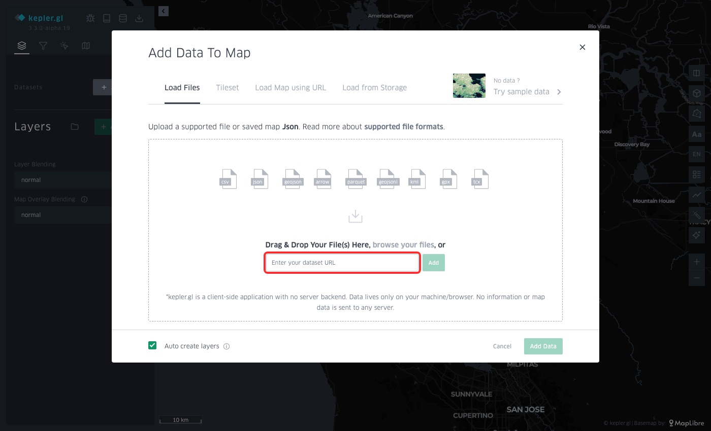

**Step 2.** Copy this link and paste it into that box, then click **Add**:

```
https://raw.githubusercontent.com/NodiraTillayeva/30DayMapChallengeUzbekistan/main/2026/Day%2001%20Points/tutorial/data/fires_uzbekistan_2025.csv
```

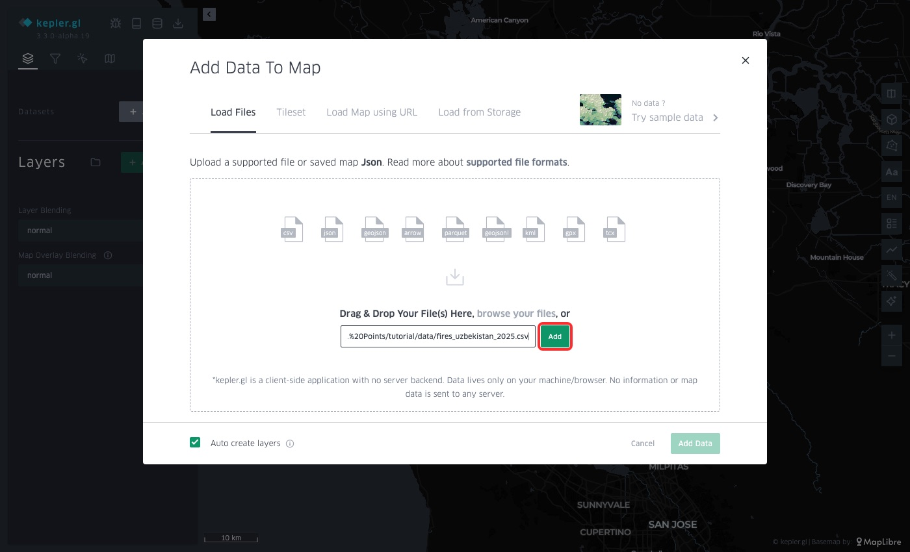

> 📁 **Prefer to use a file?** Open [the CSV on GitHub](data/fires_uzbekistan_2025.csv), click the **Download raw file** button (⬇️ icon, top right), then drag the file into the kepler.gl window instead.

**Step 3.** The file appears on the right. Click the green **Add Data** button.

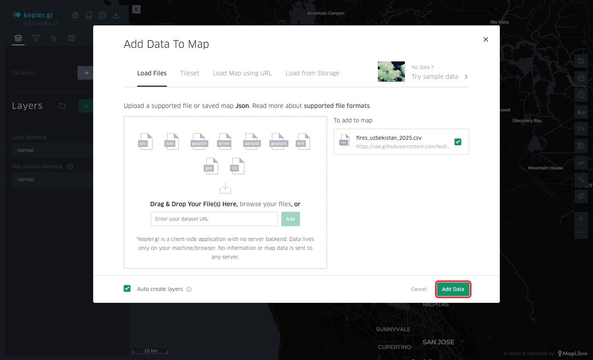

**Step 4.** 🎉 **Your points are on the map!** Each dot is one fire seen from space. The panel on the left says **4,649 rows**, one for each point.

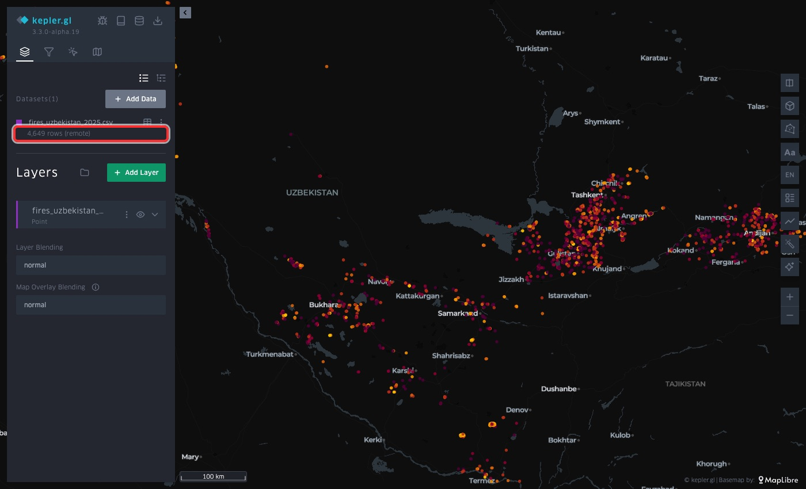

> 🖱️ **Moving around:** drag the map to move it, scroll your mouse wheel to zoom in and out, and hold **right-click** while dragging to tilt or rotate.
>
> ❌ If a pop-up about "DuckDB" or a survey shows up, close it with its **×**. Otherwise it will appear in your final image.

---

## Part 2 – Put a satellite photo underneath

**Step 5.** Click the **map icon** (the 4th tab at the top of the left panel). Then click the **Map Style** box, which says *DarkMatter*.

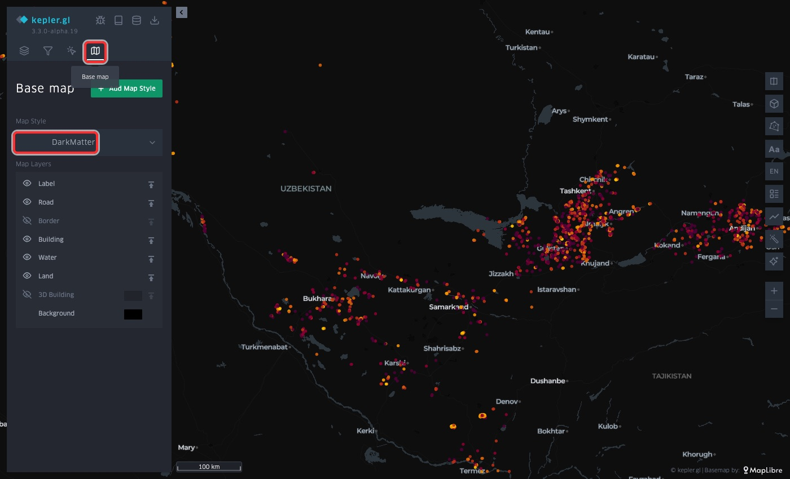

**Step 6.** Choose **Satellite With Streets**.

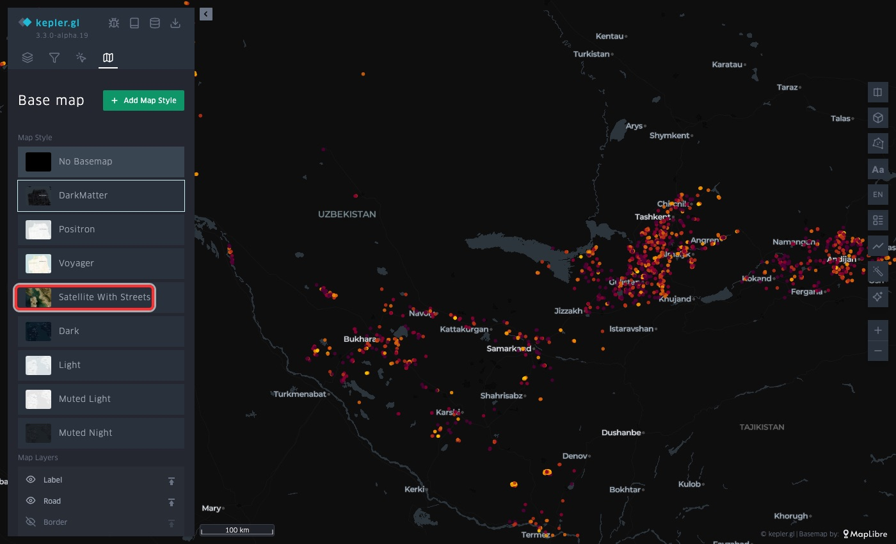

**Step 7.** Now you can see the deserts, mountains, rivers and green farmland of Uzbekistan under your points. Notice how most fires sit on the **green farmland**, not in the desert.


> 🎨 Not a fan of the satellite look? *Dark*, *Light* or *Voyager* also look great. Choosing a different background is an easy way to make your map yours.

---

## Part 3 – Color the points by category

Right now the points are colored by brightness. Let's color them by something more meaningful.

**Step 8.** Go back to the **layers icon** (the 1st tab). Click the small **arrow ⌄** next to the layer name to open its settings.

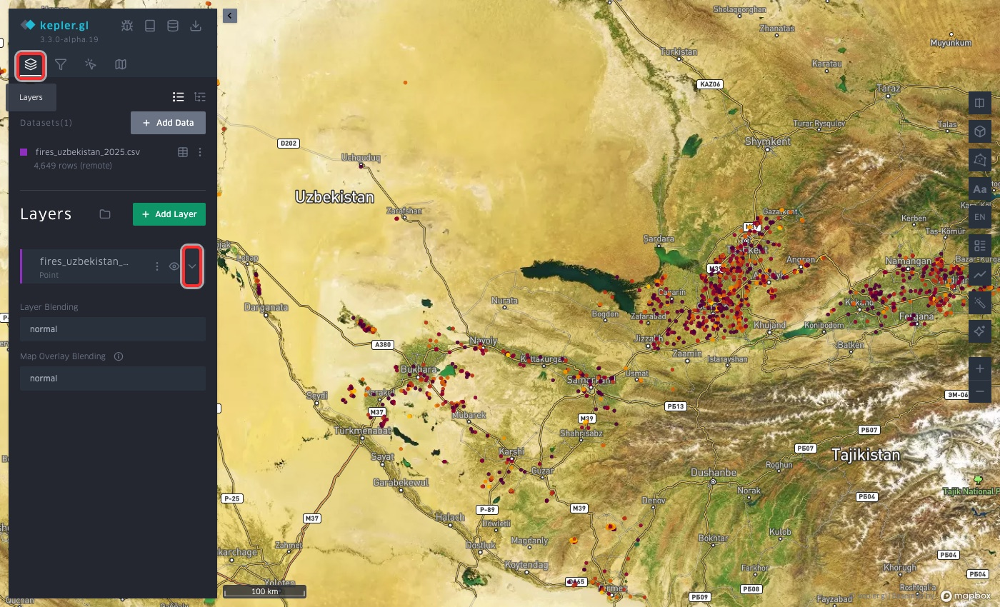

**Step 9.** Under **Fill Color**, click the box under **Color Based On**.

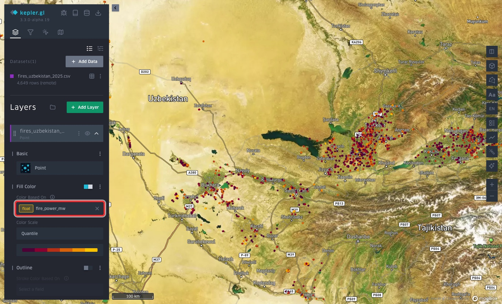

**Step 10.** Type the name of a column in the search box. In this example we use **`fire_type`**. Click it in the list.

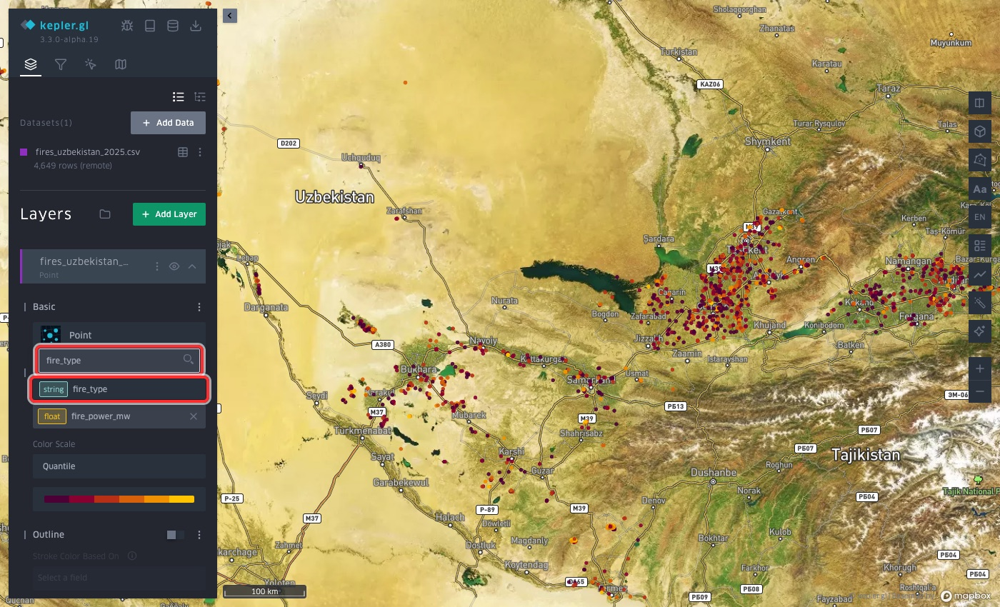

> 👉 **This is the step where your map becomes different from everyone else's.** See [Part 5](#-part-5--make-it-yours) and pick your own column.

**Step 11.** The two categories may get colors that look almost the same. To fix this, click the **colored bar** under *Color Scale*.

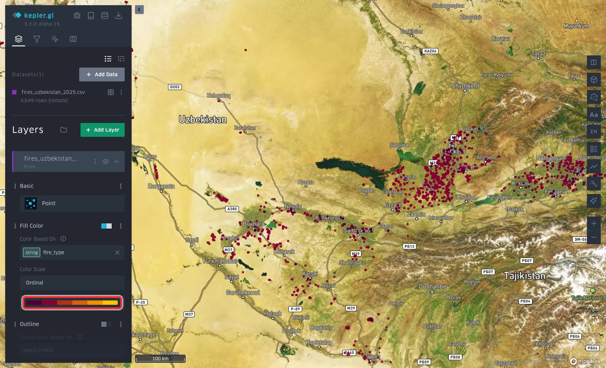

**Step 12.** Next to **Type**, click **All** and choose **Qualitative**. Qualitative palettes give every category a clearly different color.

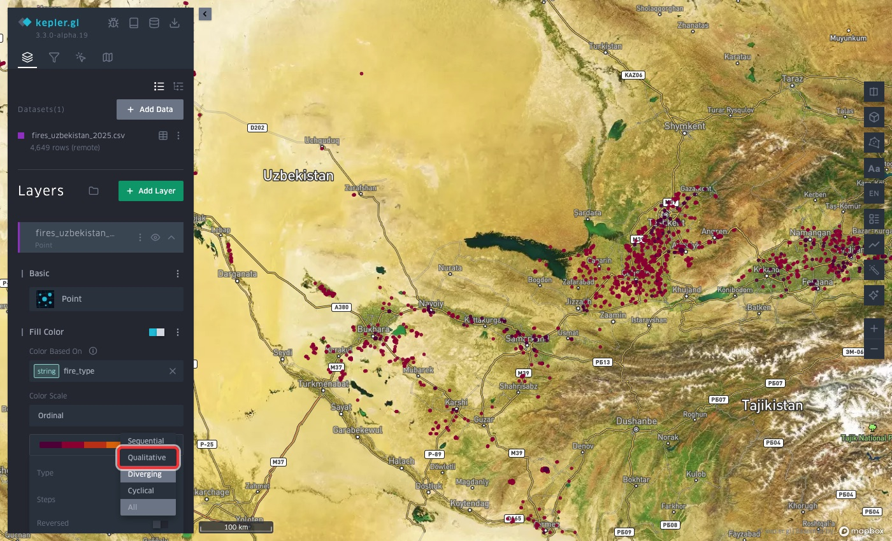

**Step 13.** Click any palette you like in the list.

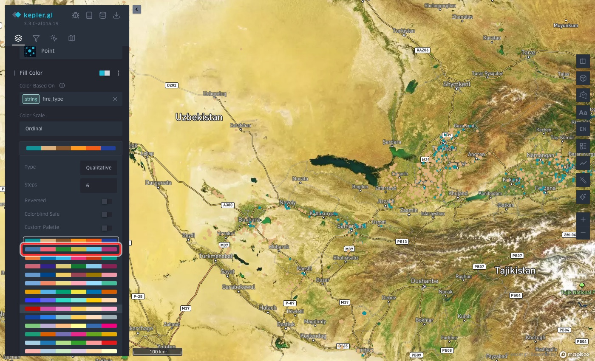

> 🔢 **Lots of categories?** (`region` has 14!) Change **Steps** from 6 to **12** so the colors don't repeat.

---

## Part 4 – Add a legend and save your map as an image

**Step 14.** Click the **legend button** on the right side of the map. A small box now explains your colors. *Gas flare / industry* and *Vegetation fire* now show up as clearly different colors.

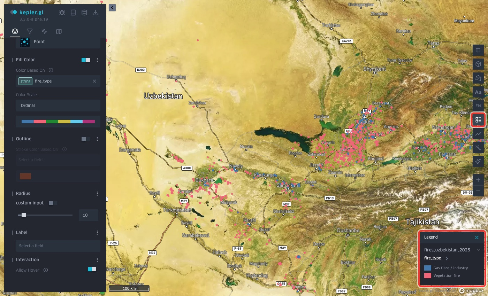

**Step 15.** Zoom and move the map until it looks the way you want. Then click the **download icon** (top of the left panel) and choose **Export Image**.

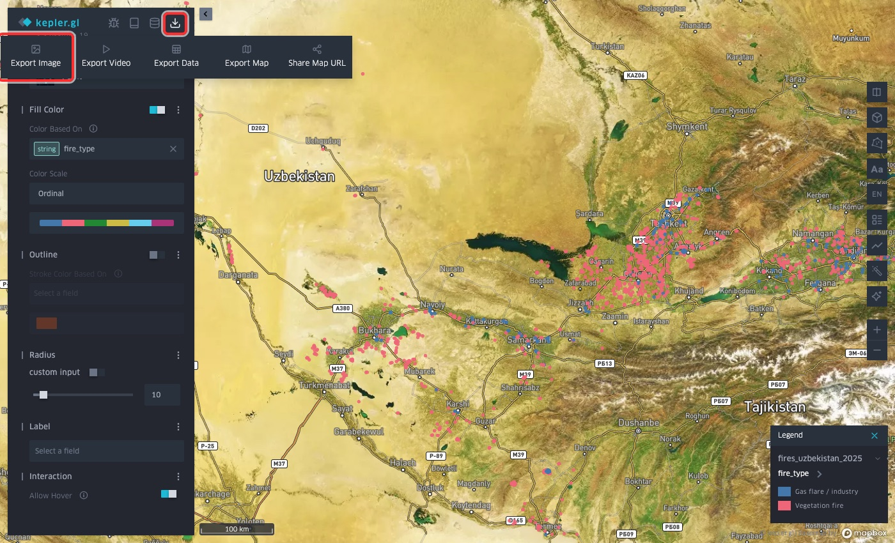

**Step 16.** Tick **Add legend on map**. Under **Resolution**, choose **2x** if you'd like a sharper image. Wait for the preview to appear, then click **Download**. A `.png` file is saved to your **Downloads** folder.

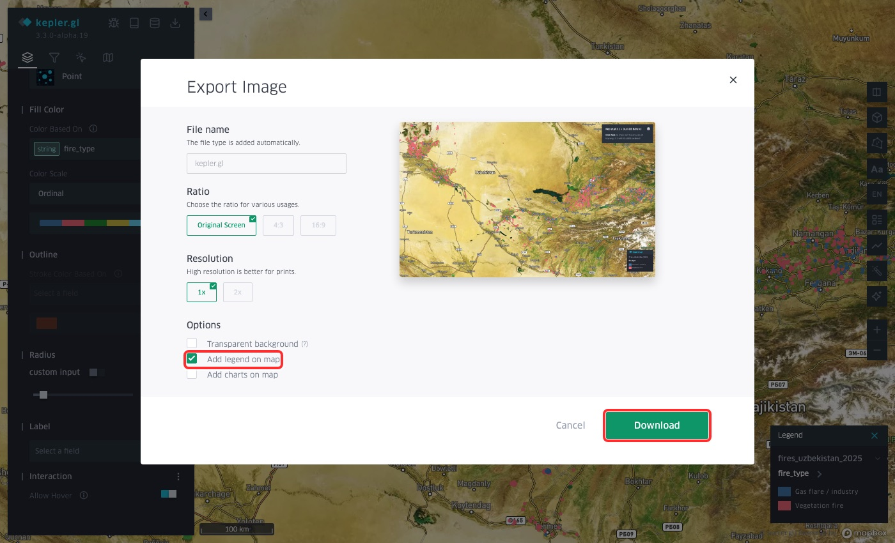

🎉 **You've made a map from satellite data!**

---

## 🎨 Part 5 – Make it yours

Everyone in the group uses the same data. Here's how to make **your** map different. Pick **one idea from each row** (or invent your own!):

| | Choose one |
|---|---|
| **1. What to color by** (Step 10) | `day_night` · `season` · `region` · `satellite` · `confidence_level` · `fire_type` · `month` |
| **2. Where to look** | All of Uzbekistan · your home region · the Fergana Valley · Karakalpakstan & the Aral Sea · a single city |
| **3. Background** (Step 6) | Satellite · Dark · Light · Voyager · No basemap |

Here's what some of the combinations look like:

| A · Day or night? (`day_night`) | B · Which season? (`season`) |
|---|---|
| 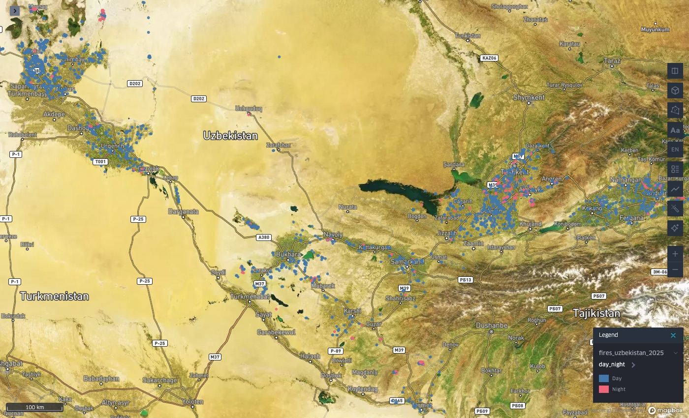 | 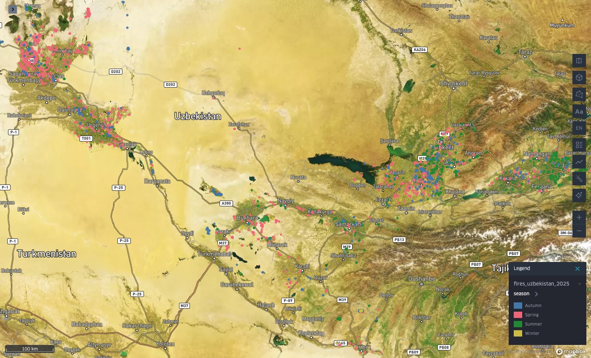 |
| About 1 in 3 detections happened at night. | **Spring** fires dominate the farmland along the Amu Darya in Khorezm and Karakalpakstan. |

| C · Which region? (`region`) | D · Which satellite? (`satellite`) |
|---|---|
| 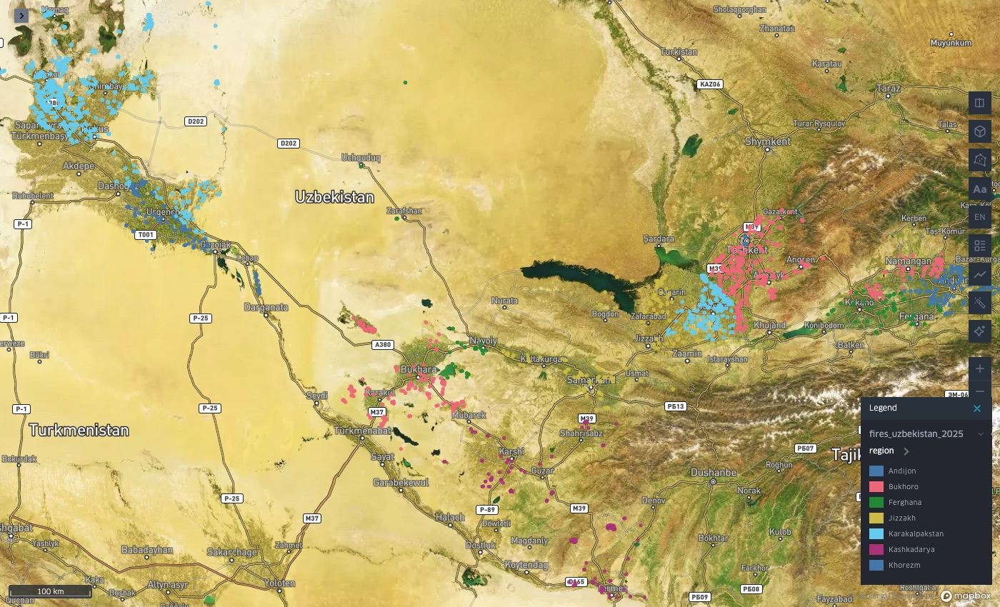 |  |
| Set **Steps → 12** so each region gets its own color. | Aqua (afternoon pass) caught 2,679 points, Terra (morning pass) 1,970. |

| E · How sure is NASA? (`confidence_level`) |
|---|
| 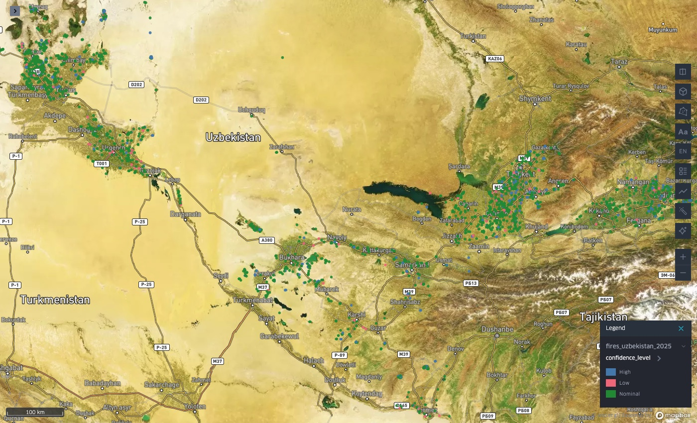 |

### More ideas to stand out ⭐

- **Size by strength:** in the layer settings, open **Radius** and set **Radius Based On** to `fire_power_mw`. Strong fires become big circles.
- **Only one month or season:** open the **filter tab** (the funnel icon, 2nd tab) → **Add Filter** → choose `month` or `season`, then pick the values you want.
- **Fires as a heatmap:** under **Basic**, change *Point* to **Heatmap** for a glowing "density" look.
- **🕵️ Solve the mystery:** about **1,700 hotspots** are stacked on almost the same spot near **38.05° N, 67.30° E** in Surkhandarya. They all look like one dot! Zoom in there on the satellite background. What do you think is burning all year round?
- **Different year or country:** get more data for free at [firms.modaps.eosdis.nasa.gov/country](https://firms.modaps.eosdis.nasa.gov/country/). Choose *MODIS*, a year, and a country.

---

## 📤 Part 6 – Share your map

1. Give your downloaded image a clear name, e.g. `day01_fires_by_season_Aziza.png`.
2. Upload it to **`2026/Day 01 Points/YourName/`** in this repository. The [Quick Start in the main README](../../../README.md#-quick-start-add-your-map-no-coding-needed) shows how, with no coding needed.
3. Post it with **#30DayMapChallenge** and say which choices you made (e.g. *"colored by season, Fergana Valley, dark background"*).

---

## 🆘 Something went wrong?

| Problem | Fix |
|---|---|
| The **Add Data** window disappeared | Click **+ Add Data** at the top of the left panel. |
| Nothing happens after pasting the link | Check that you copied the **whole** link. Or download the file and drag it in instead (see Step 2). |
| All points are the same color | Make sure you chose a column in **Color Based On** (Step 10). |
| Colors look too similar | Use a **Qualitative** palette (Steps 11–13). |
| The map is blank or gray | Wait a few seconds for the background to load, or zoom in and out once. |
| I closed the tab and lost everything | Nothing is saved online. Just start again from Step 1; it only takes a minute to get back. |

---

## 📚 Data credits

- **Fire detections:** NASA FIRMS, MODIS Collection 6.1 active fire / hotspot detections (MCD14ML), Terra & Aqua, Uzbekistan 2025. [firms.modaps.eosdis.nasa.gov](https://firms.modaps.eosdis.nasa.gov/). doi: [10.5067/FIRMS/MODIS/MCD14ML](https://doi.org/10.5067/FIRMS/MODIS/MCD14ML)
- **Region names:** added using the region boundaries in [`2025/Boundaries`](../../../2025/Boundaries) (source: simplemaps.com). Points just outside the border were matched to the nearest region.
- **Readable columns** (`fire_type`, `day_night`, `season`, `month`, `confidence_level`) were made from the original FIRMS codes: `type`, `daynight`, `acq_date` and `confidence` (Low < 30, Nominal 30–80, High > 80).
