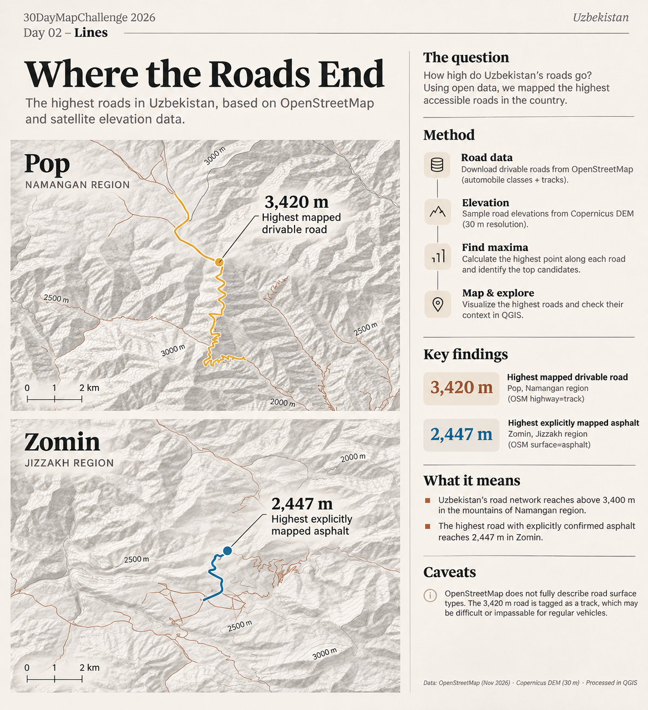
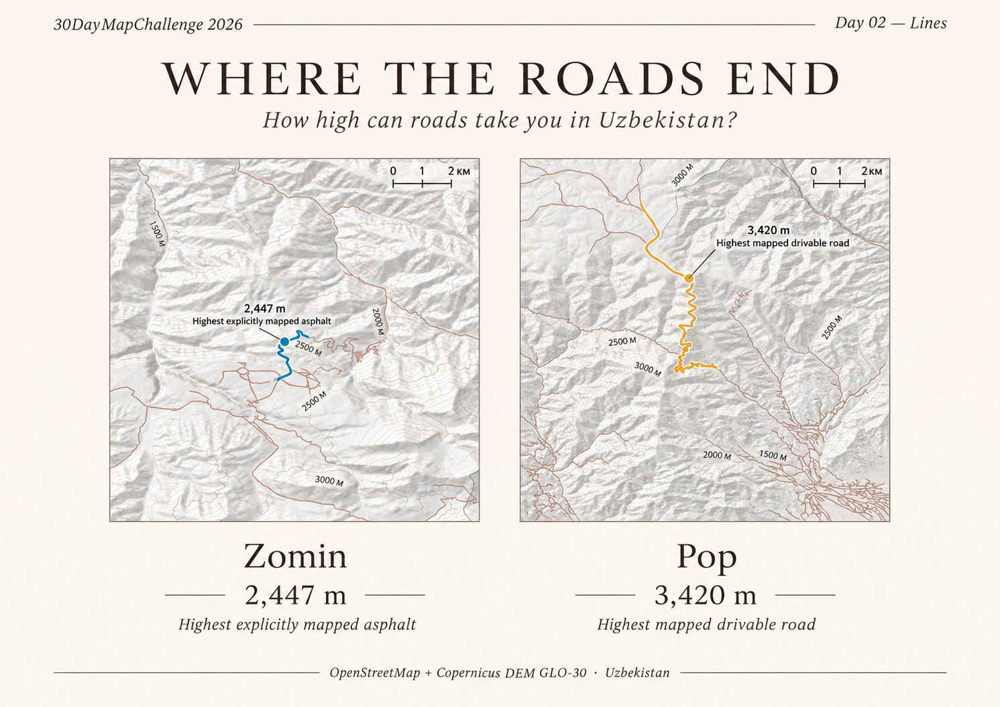

# Day 02 — Lines | Where the Roads End

How high do Uzbekistan's **mapped roads** reach? Road geometries from OpenStreetMap were sampled against Copernicus elevation data.

**Key findings:** **3,420 m** near Pop (Namangan Region) for a mapped `highway=track`; **2,447 m** near Zomin (Jizzakh Region) for a road explicitly tagged `surface=asphalt`. These are *mapped elevation estimates*, not verified driving conditions.

**Data:** OpenStreetMap + Copernicus DEM GLO-30.  
**Tools:** Python/Jupyter for analysis, QGIS for maps.

## Files

- `report_01.png`, `report_02.png` — two published visuals.
- `day02_lines.qgz` — QGIS project with the Pop and Zomin layouts.

## Open or recreate in QGIS

1. Open `day02_lines.qgz` in **QGIS 3.44+** (recommended).
2. If layers are missing, relink `where_roads_end.gpkg` and the **Pop/Zomin** DEM, hillshade and contour files. The QGIS project expects these under `data/processed/` in the [original project structure](https://github.com/mmirshod/30daymapchallenge-2026/tree/main/projects/day02_lines).
3. Use the existing **Print Layouts** (`Day02 Pop` and `Day02_Zomin`) to edit or export the maps.
4. To rebuild the analysis, run the notebooks in the [source project](https://github.com/mmirshod/30daymapchallenge-2026/tree/main/projects/day02_lines/notebooks) using the original OSM extract and DEM tiles (large input files are not included here).
