# 〰️ Day 02 · Lines: rivers, roads and railways inside your region

**A beginner tutorial with Python in Google Colab. No installation, no experience needed.**

You will draw the regions of Uzbekistan, turn their edges into **boundary lines**, and fill your favourite region with thousands of **rivers and canals** (or roads, or railways) from OpenStreetMap. In the end you choose the region, the lines and the colours, so everyone's map comes out different.

⏱️ About 20 minutes · 💻 Any computer with a browser · 🔑 A Google account (Gmail)

📄 **Printable PDF:** [English](pdf/Day02_Tutorial_EN.pdf) · [Русский](pdf/Day02_Tutorial_RU.pdf) · [Oʻzbekcha](pdf/Day02_Tutorial_UZ.pdf)

| Ferghana, `night` | Uzbekistan, `pastel` | Khorezm, `mint` |
|:---:|:---:|:---:|
| 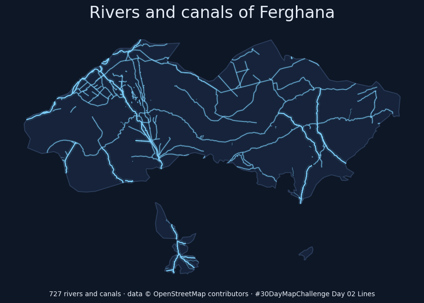 | 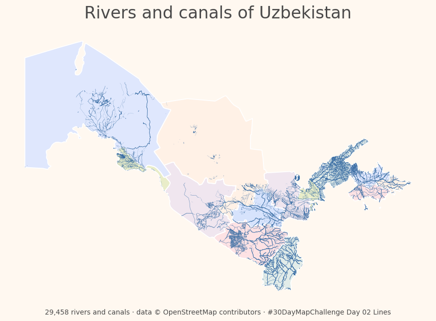 | 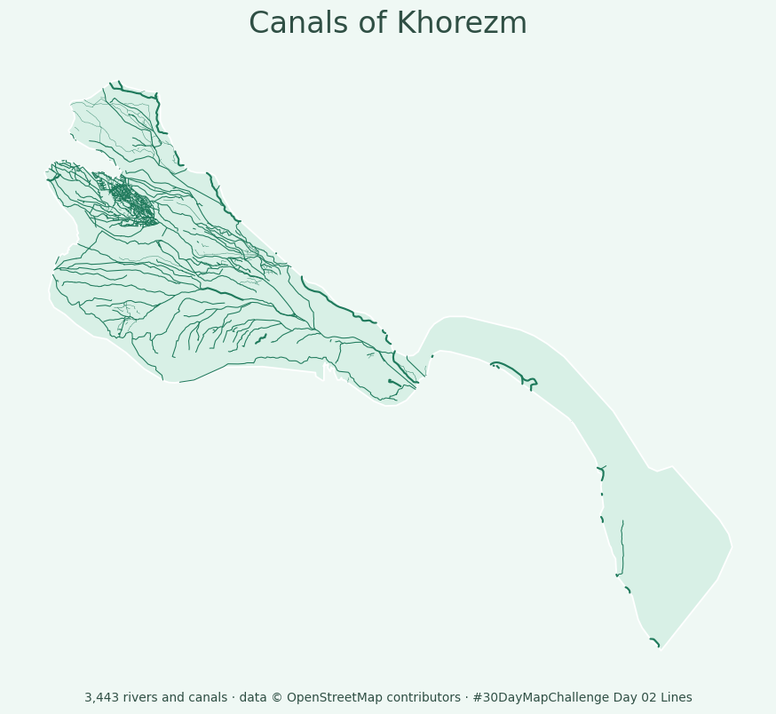 |

---

## 📚 Part 0 · Two ideas you need

**Boundaries.** A boundary file stores the outline of each region. In this tutorial we use the **14 regions** of Uzbekistan (12 regions, Karakalpakstan and Tashkent City).

**Lines.** On a map, a *line* is a list of points joined together: a river, a canal, a road or a railway. Even a region's border is a line!

**Clipping** joins the two ideas. The region is the cookie cutter and the lines are the dough. We keep only the lines **inside** the region.

**Our data** comes from [OpenStreetMap](https://www.openstreetmap.org), the free world map made by volunteers. It's already prepared for you in the [`data`](data) folder:

| File | What's inside |
|---|---|
| `uzbekistan_regions.geojson` | the 14 regions |
| `waterways.geojson` | ~34,000 rivers, canals, drains and mountain streams |
| `railways.geojson` | ~13,000 railway lines |
| `roads.geojson` | ~23,000 main roads |

---

## 🚀 Part 1 · Launch the tutorial

**Google Colab** lets you run Python code in your browser for free. A *notebook* is a page that mixes text and code. You don't need to install anything.

### Option A · One click (recommended)

1. Click this button: 
   (or copy this address into your browser: `colab.research.google.com/github/NodiraTillayeva/30DayMapChallengeUzbekistan/blob/main/2026/Day%2002%20Lines/tutorial/day02_lines.ipynb`)
2. The notebook opens. Click **Sign in** (top right) and log in with your Google account. You need to sign in to run code.

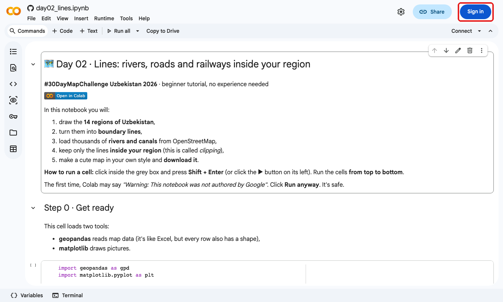

3. **Keep your own copy (recommended).** Click **Copy to Drive** in the toolbar. Colab opens your personal copy, saved in your Google Drive in the folder *Colab Notebooks*. Work in that copy: your changes are saved and you can come back to it later. Without a copy, your changes disappear when you close the tab.

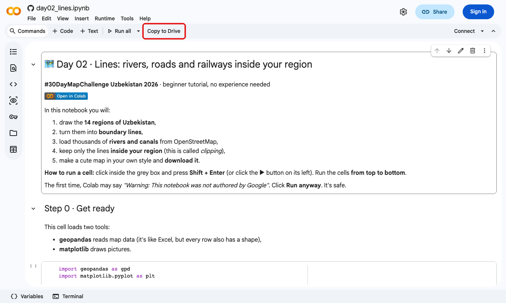

### Option B · Open it from Colab yourself

1. Go to [colab.research.google.com](https://colab.research.google.com) and sign in.
2. In the window that opens, choose the **GitHub** tab (or **File → Open notebook → GitHub**).
3. Paste `NodiraTillayeva/30DayMapChallengeUzbekistan`, press Enter, and click **`2026/Day 02 Lines/tutorial/day02_lines.ipynb`**.

### Option C · On your own computer (for people who already use Python)

1. Download the notebook: open [`day02_lines.ipynb`](day02_lines.ipynb) on GitHub and click the **Download raw file** button (⬇, top right of the file).
2. Open it in Jupyter, JupyterLab or VS Code. You need the packages `geopandas` and `matplotlib` (`pip install geopandas matplotlib`).
3. It reads the data from the internet, like in Colab. To work offline, download the data (Part 2) and change `BASE` in the first cell to your data folder, e.g. `BASE = "data/"`.

---

## 📥 Part 2 · Get the datasets

**In Colab you don't need to download anything.** The notebook reads all the data from this project on GitHub by itself (that's what the `BASE = "https://..."` line in Step 0 does).

Download the data only if you want to use it in another program, such as **QGIS**, **kepler.gl** or **ArcGIS**, or to work offline.

### All files at once

⬇️ **[Download day02_lines_data.zip](https://github.com/NodiraTillayeva/30DayMapChallengeUzbekistan/raw/main/2026/Day%2002%20Lines/tutorial/data/day02_lines_data.zip)** (2.2 MB). It contains the four files below and a `README.md`. Unzip it (right-click → *Extract all* on Windows, double-click on Mac).

### One file at a time

| File | What's inside | Size |
|---|---|---|
| [`uzbekistan_regions.geojson`](data/uzbekistan_regions.geojson) | the 14 regions (column `region`) | 0.1 MB |
| [`waterways.geojson`](data/waterways.geojson) | 33,793 rivers, canals, drains and streams (column `kind`) | 8.0 MB |
| [`railways.geojson`](data/railways.geojson) | 13,091 railway lines | 1.9 MB |
| [`roads.geojson`](data/roads.geojson) | 23,232 main roads: `motorway`, `trunk`, `primary`, `secondary` | 3.6 MB |

Click a file name, then click the **Download raw file** button (⬇) at the top right of the page:

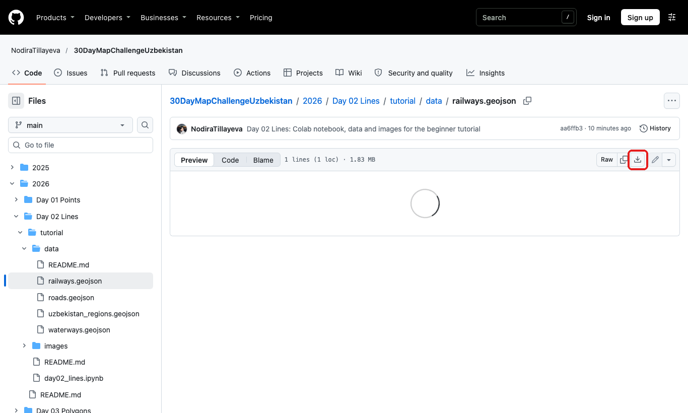

### How to open the files

- **QGIS:** drag the `.geojson` file into the QGIS window, or use *Layer → Add Layer → Add Vector Layer*.
- **kepler.gl:** open [kepler.gl/demo](https://kepler.gl/demo) and drag the file in (like in the Day 01 tutorial).
- **Python:** `gpd.read_file("waterways.geojson")`.
- **geojson.io:** for a quick look at the small regions file, drag it into [geojson.io](https://geojson.io).

### The original, full-size data

Our files are simplified copies. The originals are free:
- **OpenStreetMap for Uzbekistan:** [download.geofabrik.de/asia/uzbekistan.html](https://download.geofabrik.de/asia/uzbekistan.html) → *uzbekistan-latest-free.shp.zip* (about 270 MB). Use the layers `gis_osm_waterways_free_1`, `gis_osm_railways_free_1` and `gis_osm_roads_free_1`.
- **Region boundaries:** `Boundaries/uz.shp` in this repository (from simplemaps.com).

---

## ▶️ Part 3 · How to run a cell

The notebook is made of **cells**. Text cells explain things. Grey boxes are **code cells**.

To run a code cell, click the **▶ button** on its left (it appears when you move the mouse over the cell), or click inside the cell and press **Shift + Enter**.

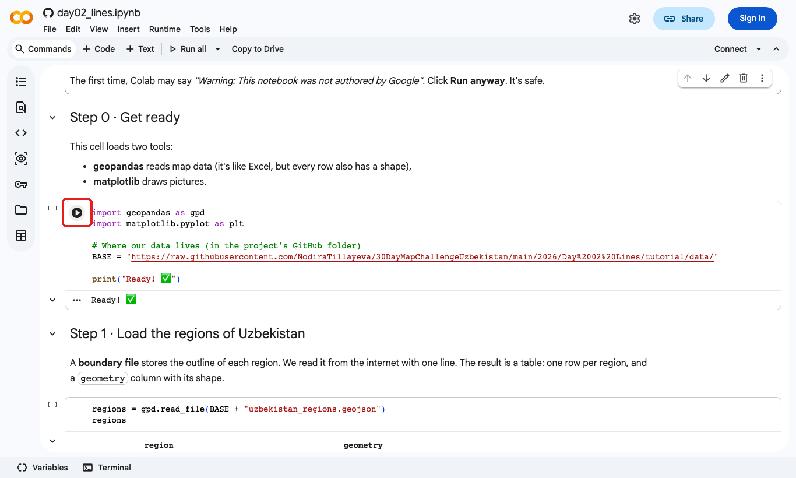

The first time, Colab shows **"Warning: This notebook was not authored by Google"**. Click **Run anyway**. That's normal for notebooks from GitHub.

Run the first cell (Step 0). When you see **`Ready! ✅`** under it, you're set.

> 💡 Always run the cells **in order, from top to bottom**. Each cell uses what the cells above it created.

---

## 🗺️ Part 4 · Draw the regions (Step 1)

Run the two cells of **Step 1**. The first one reads the boundary file and shows it as a table with 14 rows. The second one draws it:

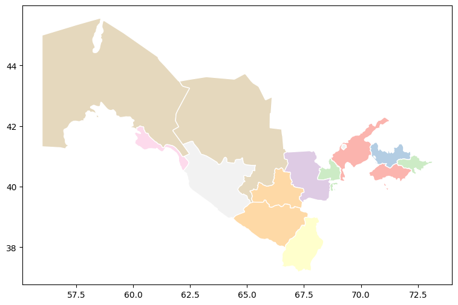

## 〰️ Part 5 · Turn the regions into lines (Step 2)

Run **Step 2**. `.boundary` keeps only the edges of each region, so the filled shapes become **lines**:

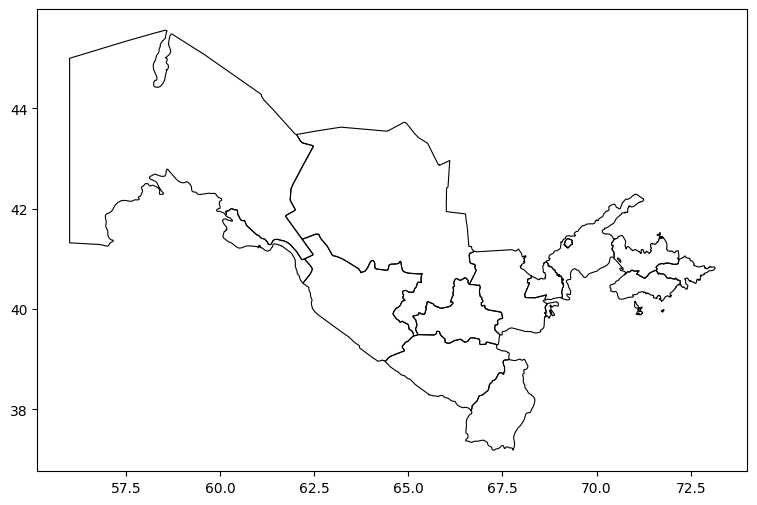

## 💧 Part 6 · Load the rivers and canals (Step 3)

Run the two cells of **Step 3**. The first one tells you how many lines there are of each kind. The second draws them all:

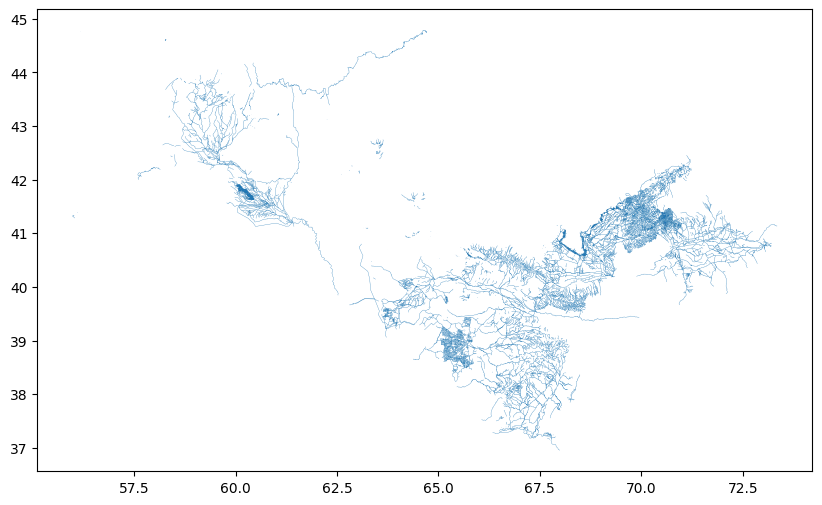

Look how many canals there are, especially in the Ferghana Valley, Khorezm and Bukhara! Most of Uzbekistan's water flows through irrigation canals.

## ✂️ Part 7 · Keep only the lines inside your region (Step 4)

This is the main skill of today: **clipping**.

In the Step 4 cell, change `MY_REGION = "Ferghana"` to your region and run it. Region names must be written **exactly** like this:

`Andijon` · `Bukhoro` · `Ferghana` · `Jizzakh` · `Karakalpakstan` · `Kashkadarya` · `Khorezm` · `Namangan` · `Navoi` · `Samarkand` · `Sirdaryo` · `Surkhandarya` · `Tashkent City` · `Tashkent Region`

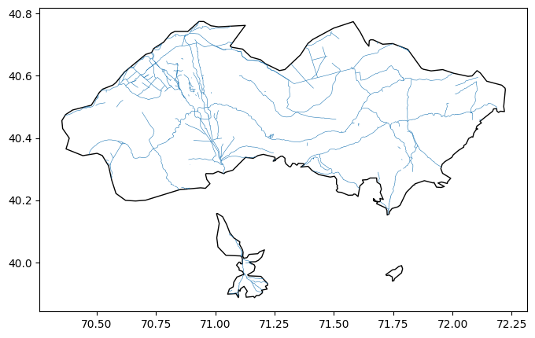

## 🎨 Part 8 · Make it cute (Step 5)

Now find the **settings cell** in Step 5 and change the four settings:

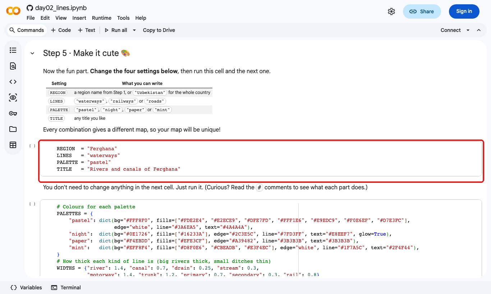

| Setting | What you can write |
|---|---|
| `REGION` | a region name from the list above, or `"Uzbekistan"` for the whole country |
| `LINES` | `"waterways"`, `"railways"` or `"roads"` |
| `PALETTE` | `"pastel"`, `"night"`, `"paper"` or `"mint"` |
| `TITLE` | any title you like, inside quotes |

Then run the settings cell **and** the big cell under it. Your map appears:

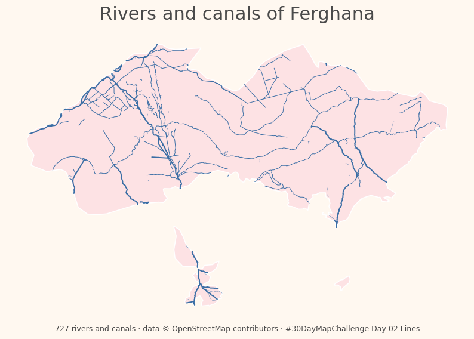

Rivers are drawn thick, canals medium, and small ditches thin, so the big rivers stand out. For large areas the lines automatically get thinner so they don't blur together.

---

## 🌈 Make it yours: ideas

Change the settings and run the two cells again. Some combinations to try:

| `"Uzbekistan"`, `"roads"`, `"night"` | `"Samarkand"`, `"roads"`, `"pastel"` | `"Tashkent Region"`, `"railways"`, `"paper"` |
|:---:|:---:|:---:|
| 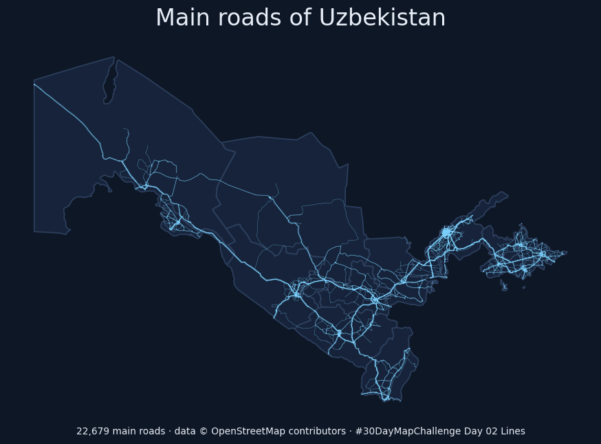 | 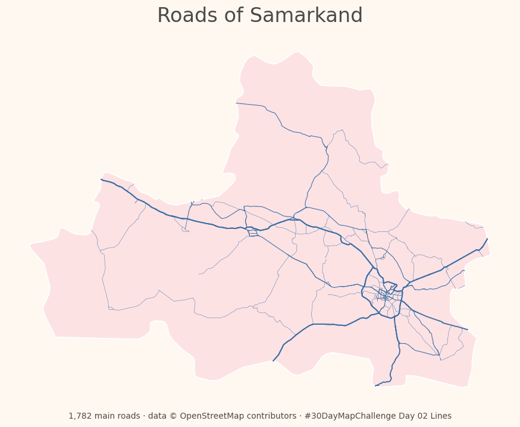 | 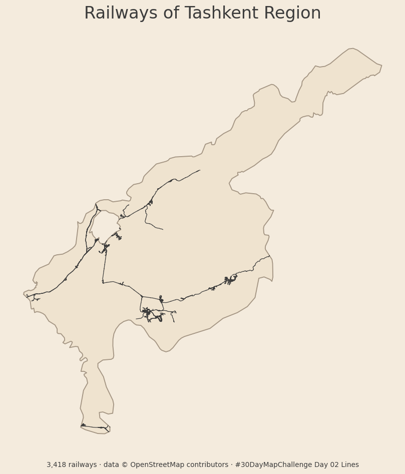 |

**Challenges for the curious:**
- Show only the big rivers: in Step 5, after the line `inside = gpd.clip(data, area)`, add `inside = inside[inside["kind"] == "river"]`.
- Change a colour: in `PALETTES`, replace a colour code like `"#3A6EA5"` with any colour from [htmlcolorcodes.com](https://htmlcolorcodes.com).
- Compare two regions: make one map for a river region (Khorezm) and one for a mountain region (Surkhandarya).

---

## 💾 Part 9 · Save and share your map

1. Run the cell in **Step 6**. Your map downloads as **`my_day02_map.png`** (check your *Downloads* folder).
2. Make a folder named after **your map's topic**, e.g. `Canals of Khorezm`. Put your map inside, plus a short `README.md` with **your name**, the data (OpenStreetMap) and the tool (Python in Colab).
3. Upload the folder to **`2026/Day 02 Lines/`** in this repository. The [Quick Start in the main README](../../../README.md#-quick-start-add-your-map-no-coding-needed) shows how, with no coding needed.
4. Post it with **#30DayMapChallenge** and credit **© OpenStreetMap contributors**.

---

## 🆘 Something went wrong?

| What you see | What to do |
|---|---|
| `NameError: name 'gpd' is not defined` (or `'regions'`, `'lines'`) | You skipped a cell. Run all the cells from the top again, in order. Or click **Runtime → Run all**. |
| `AssertionError: Check the spelling of REGION!` (or `MY_REGION`) | The region name has a typo. Copy it exactly from the list in Part 7, including capital letters and quotes. |
| `AssertionError: LINES must be ...` or `PALETTE must be ...` | Use one of the values from the table in Part 8, e.g. `"night"`, not `"blue"`. |
| `SyntaxError` | A quote `"` is missing. Every text value needs quotes on both sides: `"Samarkand"`. |
| The download doesn't start | Allow pop-ups for Colab, or click the 📁 **Files** icon on the left, find `my_day02_map.png`, click **⋮ → Download**. |
| It asks me to sign in | Click **Sign in** (top right). Colab needs a Google account to run code. |
| Everything is broken | Click **Runtime → Restart session**, then **Runtime → Run all**. |

---

## 📎 Credits

- Lines: © [OpenStreetMap contributors](https://www.openstreetmap.org/copyright) (ODbL), downloaded from [Geofabrik](https://download.geofabrik.de/asia/uzbekistan.html) on 2 November 2026 and simplified. See [`data/README.md`](data/README.md).
- Region boundaries: [simplemaps.com](https://simplemaps.com), from `Boundaries` in this repository.
- Tools: [Google Colab](https://colab.research.google.com), [GeoPandas](https://geopandas.org), [Matplotlib](https://matplotlib.org).
