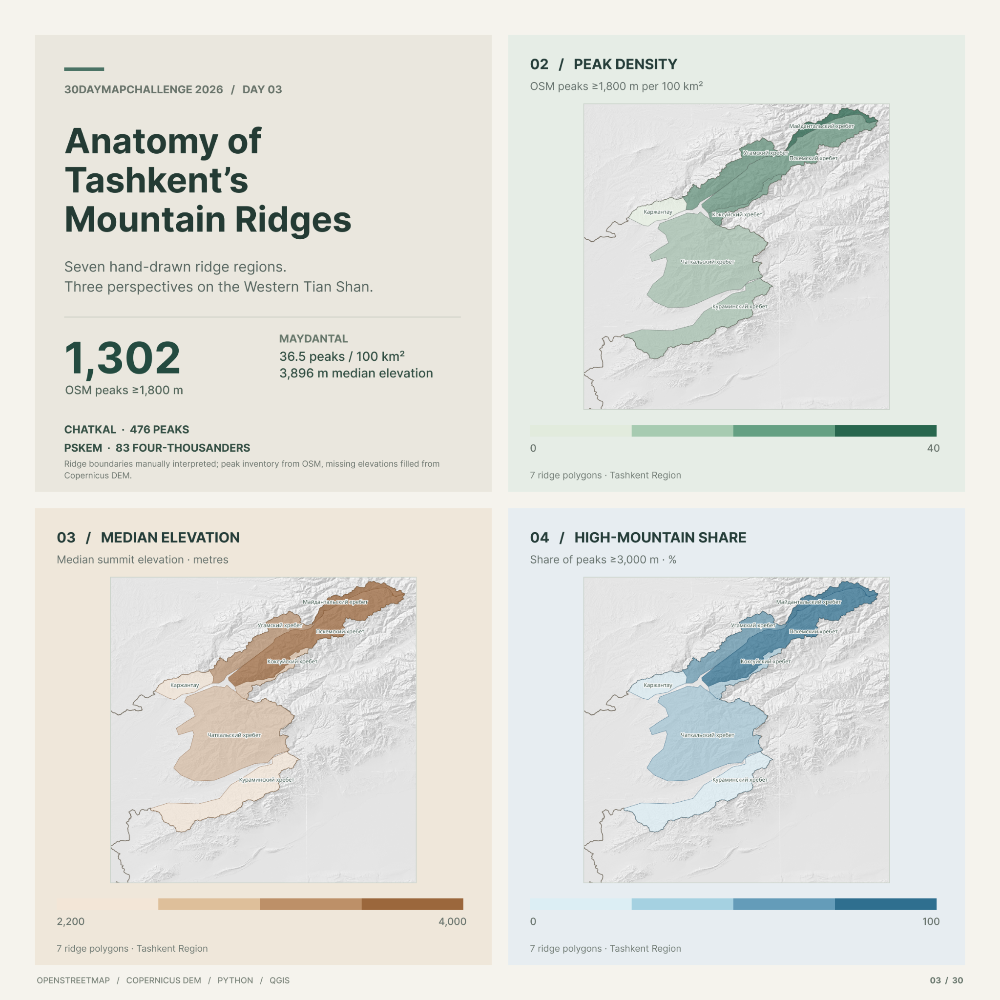

# Day 03 — Polygons | Anatomy of Tashkent's Mountain Ridges

Seven **manually delineated mountain-ridge polygons** were compared using **1,302 OpenStreetMap peaks ≥1,800 m** inside the Tashkent Region + city study boundary. The maps show peak density, median summit elevation and the share of peaks ≥3,000 m.

**Highlights:** Chatkal has **476 peaks**; Maydantal has the highest density (**36.5 peaks / 100 km²**) and median summit elevation (**3,896 m**); Pskem contains **83 peaks ≥4,000 m**.

**Data:** OpenStreetMap + Copernicus DEM GLO-30.  
**Tools:** Python/Jupyter, QGIS, Figma.

## Files

- `report.png` — finished 2×2 report.
- `day03_polygons.qgz` — QGIS project with the thematic polygon styles and layout.

## Open or recreate in QGIS

1. Open `day03_polygons.qgz` in **QGIS 3.44+** (recommended).
2. If prompted, relink `ridges_with_stats.gpkg`, `peaks_with_ridges.gpkg`, `tashkent_boundary.gpkg`, `tashkent_dem_30m.tif` and `tashkent_hillshade.tif` from the [source project](https://github.com/mmirshod/30daymapchallenge-2026/tree/main/projects/day03_polygons). The large DEM/hillshade files may need to be regenerated.
3. Open the QGIS **Print Layout** and export the map; to reproduce the analysis, see the [Python notebooks](https://github.com/mmirshod/30daymapchallenge-2026/tree/main/projects/day03_polygons/notebooks).

**Note:** Ridge boundaries are approximate, manually interpreted polygons—not official geological boundaries. Peak coverage depends on OpenStreetMap completeness.
