# 🟪 Day 03 · Polygons: how many people live in each region?

**A beginner tutorial with Mapshaper, right in your browser. No account, no installation, no experience needed.**

You will load the 14 regions of Uzbekistan as **polygons**, measure their **area**, attach the official **population** of each region, calculate the **population density** (people per km²) and colour the map by it. Then you will turn the same numbers into a **dot map** where every dot stands for thousands of people. On the way you will learn your first commands in a tiny map language.

⏱️ About 25 minutes · 💻 Any computer with a browser (Chrome, Edge, Firefox or Safari) · 🔑 No account needed

📄 **Printable PDF:** [English](pdf/Day03_Tutorial_EN.pdf) · [Русский](pdf/Day03_Tutorial_RU.pdf) · [Oʻzbekcha](pdf/Day03_Tutorial_UZ.pdf)

| People per km² | One dot = 10,000 people | Night palette |
|:---:|:---:|:---:|
| 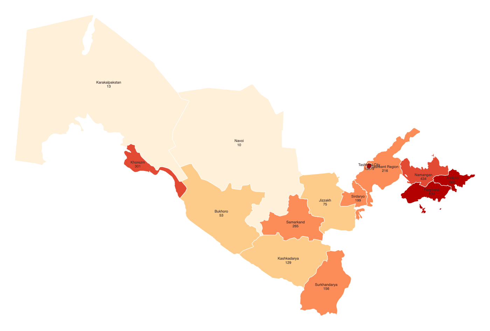 | 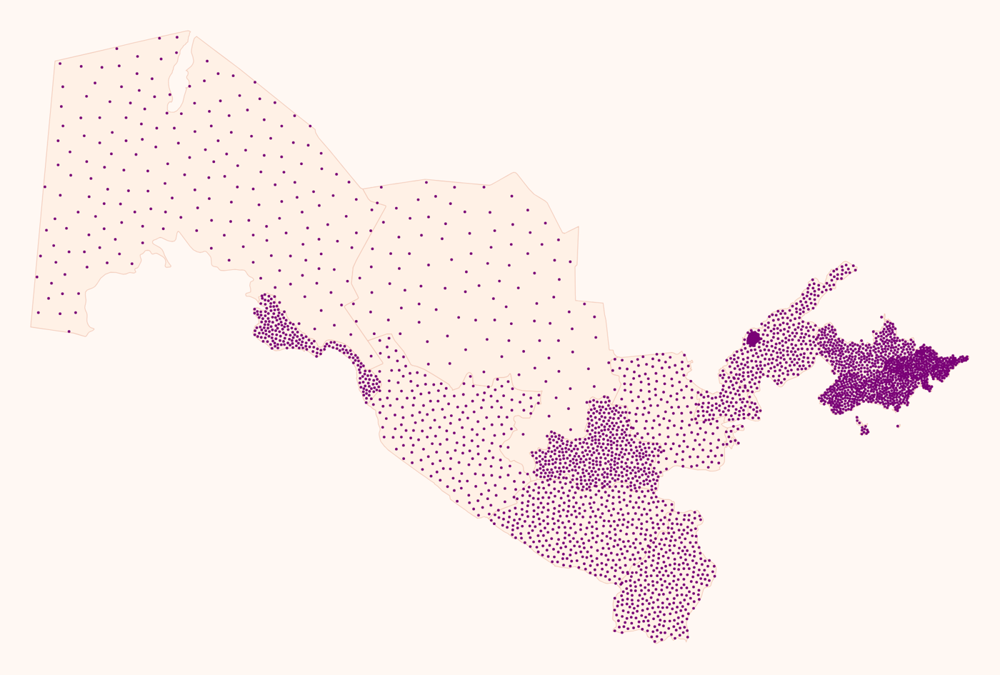 | 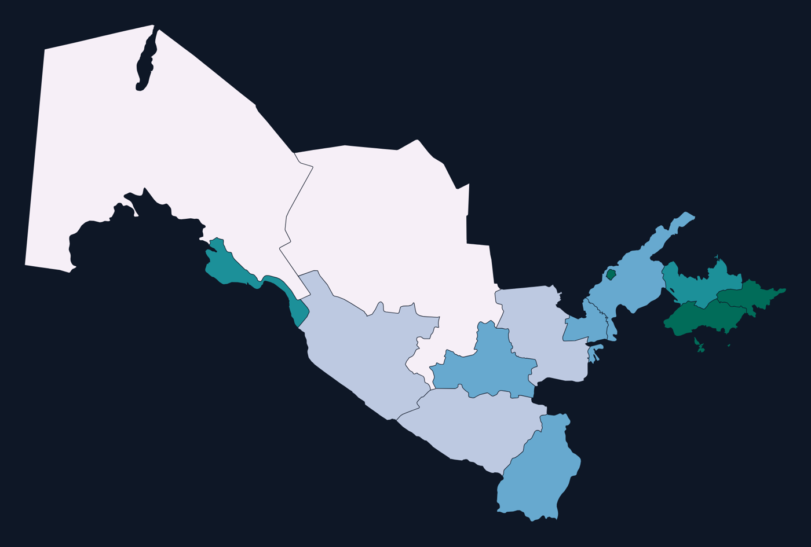 |

---

## 📚 Part 0 · The ideas you need

**Polygon.** A closed shape that covers an area: a region, a lake, a park. Our file has one polygon for each of the 14 regions (12 regions, Karakalpakstan and Tashkent City).

**Attribute table.** Every polygon has a row of information next to its shape, like a spreadsheet. At the start there is only one column, `region`, with the name.

**Join.** Our population numbers are in a separate table (a CSV file). A *join* glues the two tables together by matching the region names.

**Density.** Big regions can have many people and still feel empty. Dividing people by area gives **people per km²**, which is fairer to compare.

**Choropleth.** A map where each polygon is coloured by its number. Darker = more people per km².

**Mapshaper** ([mapshaper.org](https://mapshaper.org)) is a free, open-source map tool that runs in your browser. Your files stay on your computer: nothing is uploaded to a server.

---

## 📥 Part 1 · Get the data

You need two small files. Download both into the same folder (for example *Downloads*):

| File | What's inside |
|---|---|
| [`uzbekistan_regions.geojson`](data/uzbekistan_regions.geojson) | the 14 regions as polygons (column `region`) |
| [`population_2026.csv`](data/population_2026.csv) | the permanent population of each region on 1 January 2026 (columns `region`, `population`) |

⬇️ Or download both at once: **[day03_polygons_data.zip](https://github.com/NodiraTillayeva/30DayMapChallengeUzbekistan/raw/main/2026/Day%2003%20Polygons/tutorial/data/day03_polygons_data.zip)** and unzip it.

To download one file from GitHub: click its name, then click the **Download raw file** button (⬇) at the top right of the page.

The population numbers are official figures from the **Statistics Agency of Uzbekistan** ([stat.uz](https://stat.uz/en/press-center/news-of-committee/66574-zbekiston-a-olisi-38-2-mlndan-oshdi-4)). Together they add up to the country total: **38,236,704 people**.

---

## 🗺️ Part 2 · Open Mapshaper and load the regions

1. Go to **[mapshaper.org](https://mapshaper.org)**. You see the **Import files** window.
2. Drag `uzbekistan_regions.geojson` into the dashed box (or click **select** and choose the file).

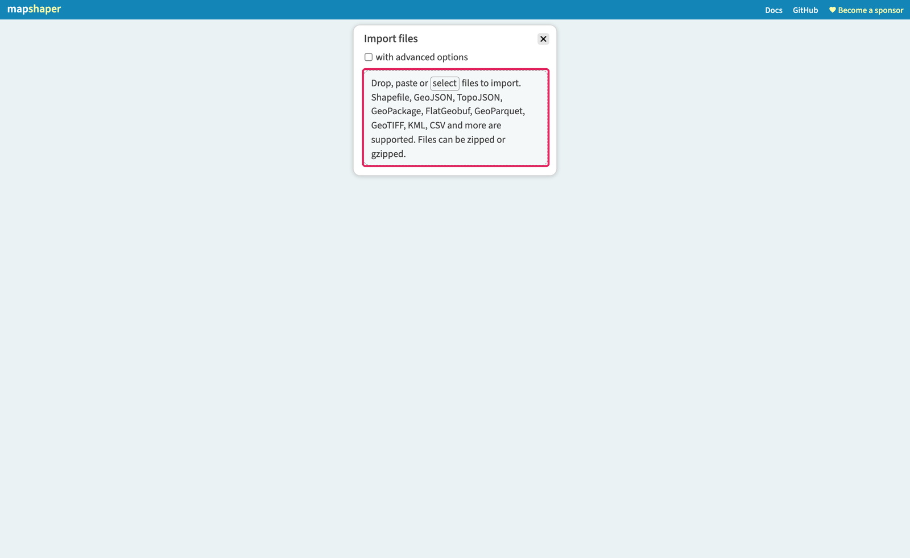

3. The regions appear on the right. On the left, the **Layers** list shows one layer, `uzbekistan_regions`, with **14 polygons**.

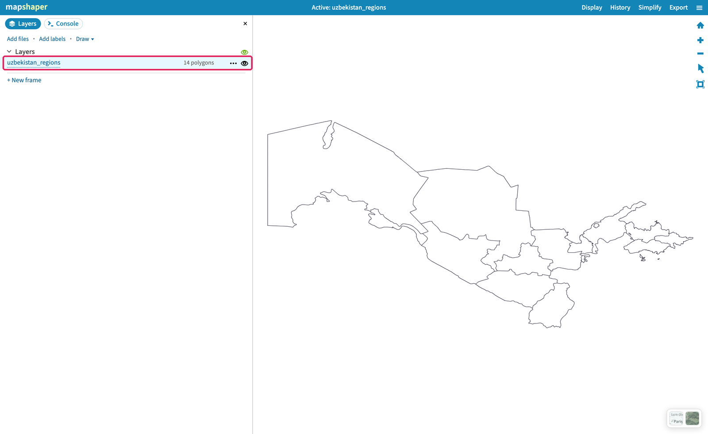

---

## ⌨️ Part 3 · Your first command

Click **Console** (top left). A black box opens at the bottom. Here you type **commands**: short instructions that start with a dash `-`.

Type this and press **Enter**:

```
-info
```

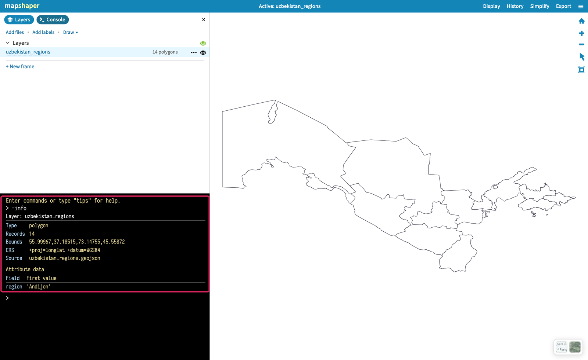

Mapshaper describes the layer: it is a **polygon** layer with **14 records** (rows), and its only field (column) is `region`.

> 💡 You can type `tips` in the console for help, and use the ↑ arrow key to bring back the previous command. If you make a mistake, the **↶ undo** button at the bottom of the map takes back the last change.

---

## ✂️ Part 4 · How detailed is a border? (Simplify)

Every border is made of thousands of little points. Let's see what happens with fewer of them.

1. Click **Simplify** (top right). Keep the default settings and click **Apply**.

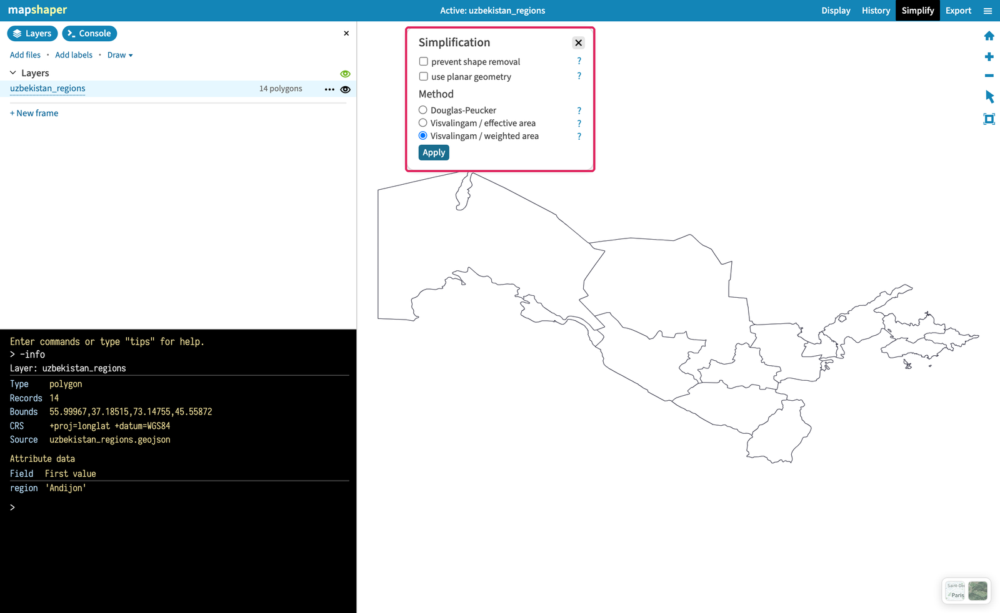

2. A slider appears at the top. Drag it to the right, to about **3%**: only 3% of the points are kept and the borders become blocky.

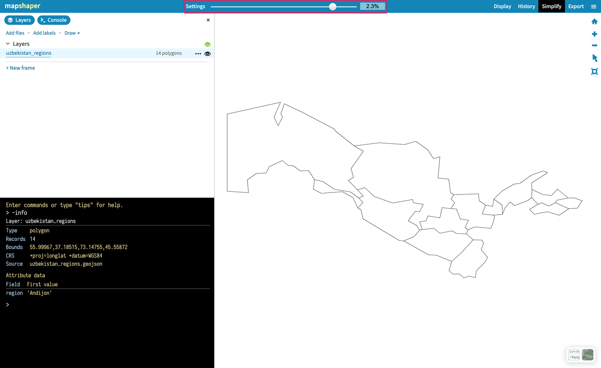

3. **Drag the slider all the way back to the left (100%)** before you continue, so your areas are measured on the full, detailed borders. Then click **Simplify** again to close it.

Simplifying makes files smaller and maps faster. For a whole-country map, 10–20% usually still looks great.

---

## 📐 Part 5 · Measure each polygon's area

Back in the console, type these two commands (press **Enter** after each one):

```
-each 'area_km2 = Math.round(this.area / 1000000)'
-calc 'sum(area_km2)'
```

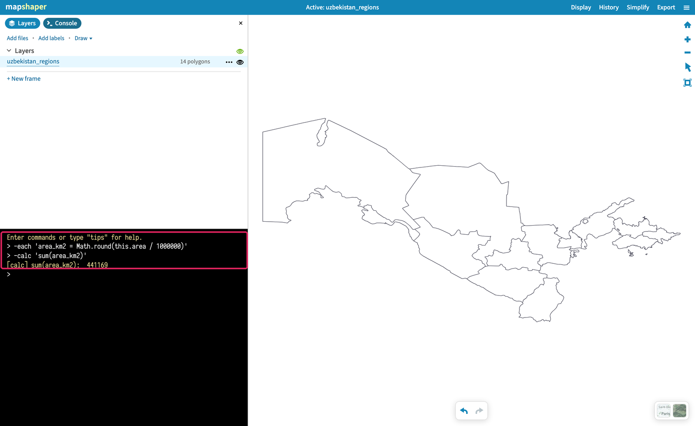

What happened:
- `-each` runs a small formula **for each polygon**. `this.area` is the polygon's area in m². Dividing by 1,000,000 gives km², and `Math.round` removes the decimals. The result goes into a new column, `area_km2`.
- `-calc 'sum(area_km2)'` adds up the column: about **441,000 km²** for the whole country.

> ✏️ The quotes `' '` around the formula are important. Copy the commands exactly.

---

## 👥 Part 6 · Add the population table

1. Click **Layers**, then **Add files** (above the layer list) and choose `population_2026.csv`.

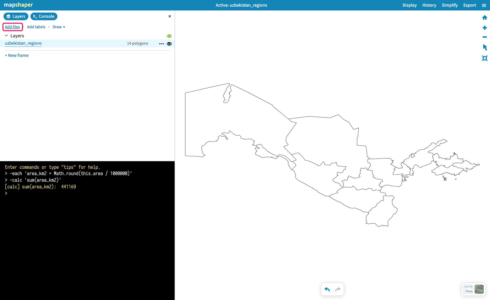

2. Click **Submit**.

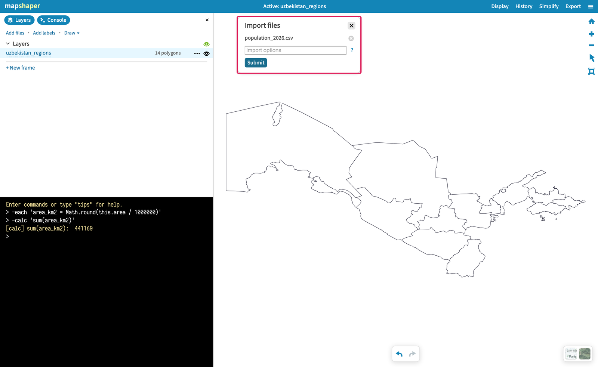

3. Now there are two layers: `population_2026` (**14 data records**: a table without shapes) and `uzbekistan_regions` (**14 polygons**).

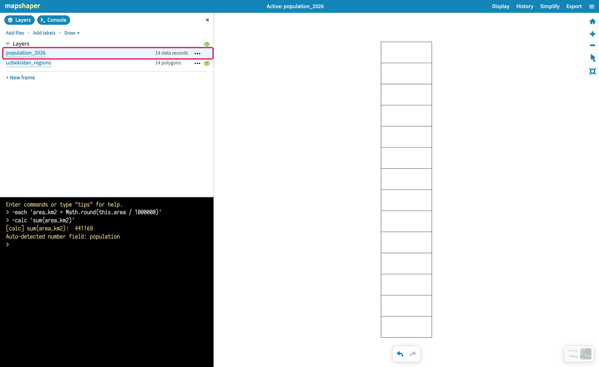

> 💡 The map turns into a column of empty boxes: Mapshaper is showing the new table layer, which has rows but no shapes. That's normal. The first command in Part 7 switches back to the polygons (or click `uzbekistan_regions` in the list).

---

## 🔗 Part 7 · Join and calculate the density

In the console, type these four commands, one by one:

```
-target uzbekistan_regions
-join population_2026 keys=region,region
-each 'density = Math.round(population / area_km2)'
-calc 'max(density)'
```

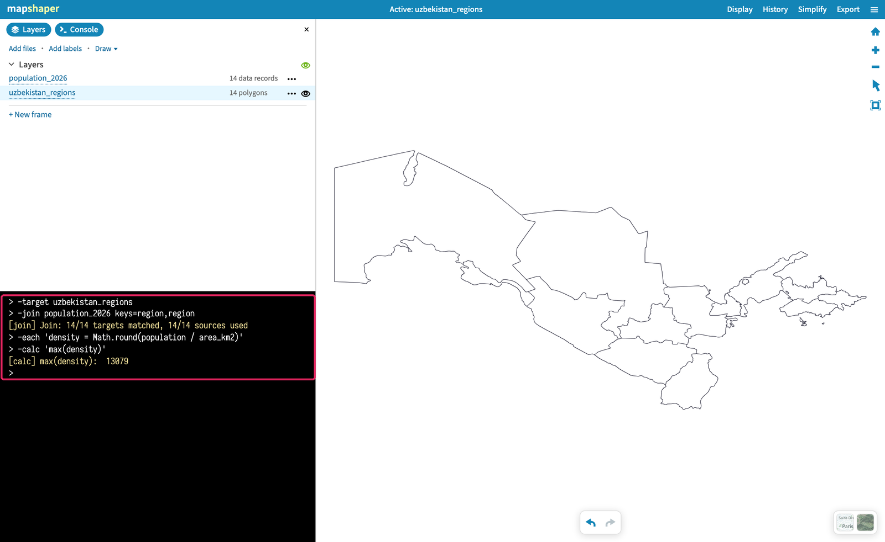

- `-target` chooses the layer the next commands work on: our polygons.
- `-join` copies the `population` of each row in the table to the polygon with the same `region` name. Look for **14/14 targets matched**: every region found its number. 🎉
- `-each` creates the column `density` = people ÷ km².
- `-calc 'max(density)'` shows the highest density: **13,079 people per km²**, in Tashkent City.

Here is the whole table you just made:

| Region | Population | Area (km²) | People per km² |
|---|---:|---:|---:|
| Tashkent City | 3,178,100 | 243 | 13,079 |
| Andijon | 3,521,800 | 4,079 | 863 |
| Ferghana | 4,223,000 | 6,701 | 630 |
| Namangan | 3,190,800 | 7,346 | 434 |
| Khorezm | 2,069,200 | 6,882 | 301 |
| Samarkand | 4,379,800 | 16,532 | 265 |
| Tashkent Region | 3,160,700 | 14,631 | 216 |
| Sirdaryo | 946,300 | 4,762 | 199 |
| Surkhandarya | 3,011,000 | 19,269 | 156 |
| Kashkadarya | 3,717,000 | 28,718 | 129 |
| Jizzakh | 1,566,900 | 20,789 | 75 |
| Bukhoro | 2,107,000 | 39,975 | 53 |
| Karakalpakstan | 2,053,200 | 161,627 | 13 |
| Navoi | 1,111,900 | 109,615 | 10 |

Samarkand has the **most people**, but Andijon is the most **crowded** region: 863 people on every km². Navoi and Karakalpakstan are mostly desert.

*The areas are measured from our boundary file, so they differ a little from official figures. Tashkent City's border in this file is older and smaller than today's city, so its density comes out higher than official statistics.*

---

## 🎨 Part 8 · Colour the polygons (choropleth)

```
-classify field=density breaks=50,150,300,600 colors=OrRd
```

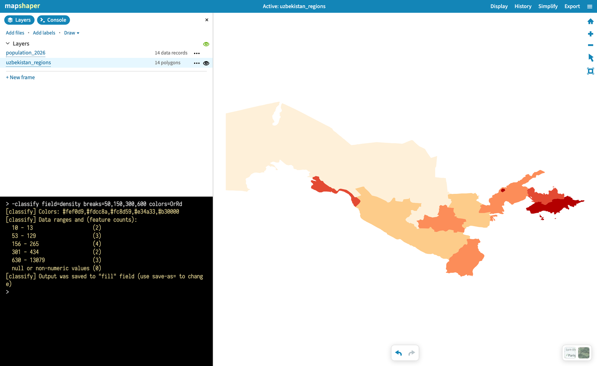

`-classify` puts every region into a colour group:
- `field=density` is the number to colour by.
- `breaks=50,150,300,600` are the borders between groups: under 50, 50–150, 150–300, 300–600, and over 600 people per km².
- `colors=OrRd` is the palette (orange to red).

Try other palettes! Replace `OrRd` with `PuRd`, `BuPu`, `YlGnBu`, `PuBuGn`, `Greens` or `Purples` and run the command again. You can also write your own colours: `colors=#FDE2E4,#FAB5C1,#F48AA3,#D65A85,#8E2C5C`.

---

## 🌐 Part 9 · A better shape for Uzbekistan (projection)

The map so far uses longitude and latitude directly, which stretches the country sideways. A **projection** draws the round Earth on a flat page. This one keeps the true sizes of areas:

```
-proj +proj=aea +lat_1=38 +lat_2=44 +lon_0=64
```

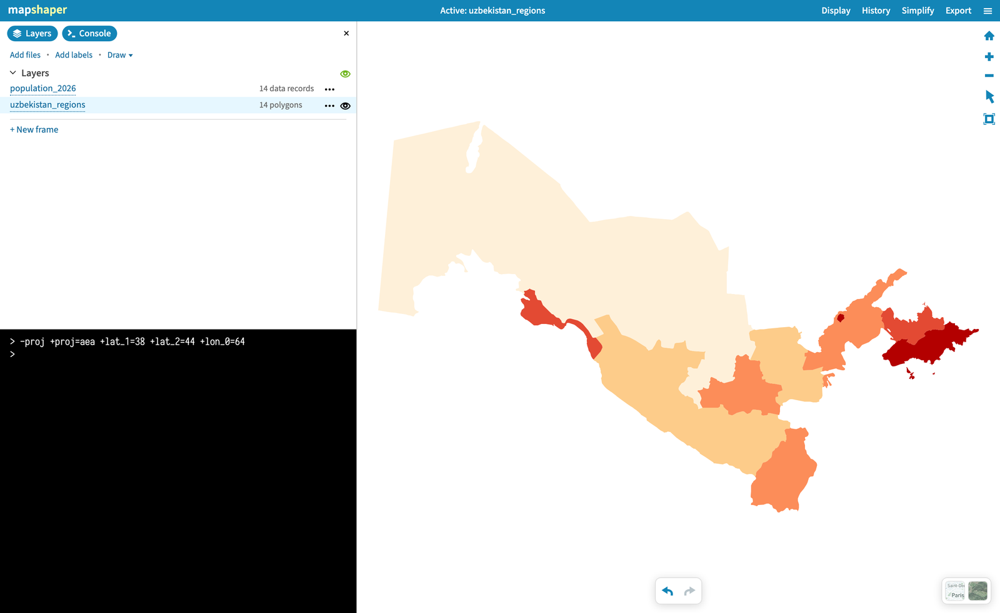

Uzbekistan now looks the way it does on a globe.

---

## 🏷️ Part 10 · Borders and labels

```
-innerlines + name=borders
-style stroke=white stroke-width=1.5
-target uzbekistan_regions
-points inner + name=labels
-each 'label = region + "\n" + density'
-style label-text=label font-size=11 fill=#3b2b2b
```

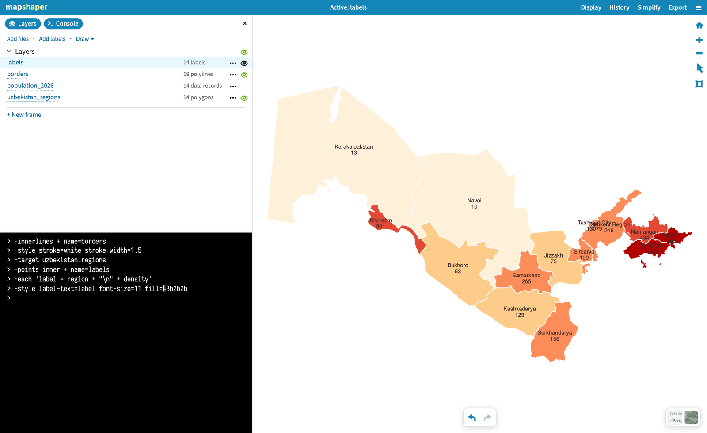

- `-innerlines` creates a new layer with only the **shared borders** between regions (the `+` means "keep the original layer too"). We colour them white.
- `-points inner` puts one point **inside** each polygon, a good place for its label.
- The label is the region name, a new line (`\n`) and the density.

---

## ⚫ Part 11 · A dot map: every dot is people

A choropleth shows *density*. A **dot map** shows *how many*: each dot is 20,000 people, scattered randomly inside its region.

```
-target uzbekistan_regions
-dots fields=population per-dot=20000 colors=#7a0177 r=1.3 + name=people
```

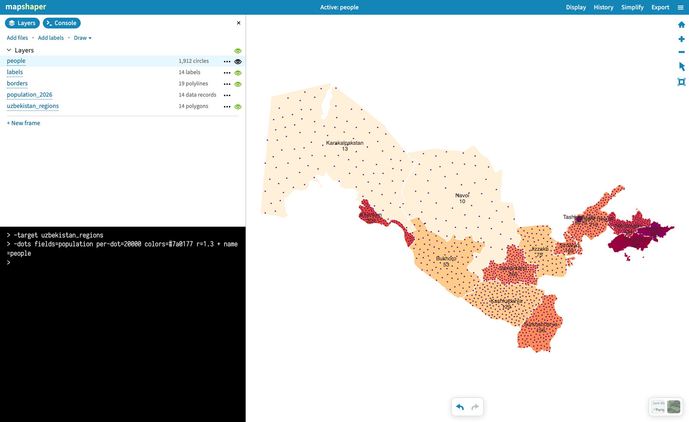

The Ferghana Valley fills up with dots, and the desert stays almost empty. To hide a layer, click its 👁 eye in the **Layers** list.

---

## 💾 Part 12 · Export your map

1. Click **Export** (top right).
2. Under **Content**, tick the layers you want in the picture (for the choropleth: `uzbekistan_regions`, `borders`, `labels`).
3. Choose **SVG** (sharp at any size, best for Canva or Figma) or **PNG** (a normal picture), then click **Export**.

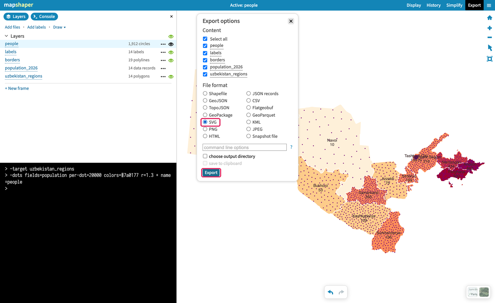

The file downloads as `output.svg` (or `.png`). Open it in **Canva**, **Figma** or **Inkscape** to add a **title**, a **legend** for the colours, and the data source.

---

## 🌈 Make it yours: ideas

- **Your palette:** change `colors=` in Part 8, or use the night look: a dark background in Canva with `colors=PuBuGn`.
- **More dots:** the dot map at the top uses `per-dot=10000 r=2`. Try fewer, bigger dots with `per-dot=50000 r=2.5`.
- **Two maps side by side:** population (dots) and density (colours) tell different stories. Post both!
- **Only your region:** before Part 8, type `-filter 'region == "Samarkand"'` to keep just one polygon (`-filter` deletes the others, so use ↶ undo to bring them back).
- **Challenge:** Tashkent City's 12 districts are in [`Boundaries/Tashkent_boundaries.geojson`](../../../Boundaries). Can you find their populations on [stat.uz](https://stat.uz) and make a district map?

---

## 💾 Share your map

1. Make a folder named after **your map's topic**, e.g. `Crowded Ferghana Valley`. Put your map inside, plus a short `README.md` with **your name**, the data (stat.uz, simplemaps.com) and the tool (Mapshaper).
2. Upload the folder to **`2026/Day 03 Polygons/`** in this repository. The [Quick Start in the main README](../../../README.md#-quick-start-add-your-map-no-coding-needed) shows how, with no coding needed.
3. Post it with **#30DayMapChallenge** and credit the **Statistics Agency of Uzbekistan** for the population data.

---

## 🆘 Something went wrong?

| What you see | What to do |
|---|---|
| `[join] Missing data layer [population_2026]` | The CSV isn't loaded yet. Do Part 6 first, and check the layer name in the **Layers** list. |
| `ReferenceError ... population is not defined` | The join didn't happen. Run `-target uzbekistan_regions` and the `-join` command again. |
| `ReferenceError ... area_km2 is not defined` | You skipped Part 5. Run the `-each 'area_km2 = ...'` command. |
| `[join] Join: 13/14 targets matched` | A region name in the CSV is spelled differently. Don't edit the files, or copy them again from Part 1. |
| `The i command cannot be run` (or similar) | You typed a word without the dash. Commands start with `-`, e.g. `-info`. |
| The map shows empty boxes | The table layer is active. Click `uzbekistan_regions` in the **Layers** list. |
| A label or point is missing | The slider in Part 4 isn't back at 100%. Click **Simplify** and drag the slider all the way left. |
| Everything is broken | Reload the page and start again from Part 2. It only takes a few minutes. |

---

## 📎 Credits

- Population on 1 January 2026: [Statistics Agency of Uzbekistan (stat.uz)](https://stat.uz/en/press-center/news-of-committee/66574-zbekiston-a-olisi-38-2-mlndan-oshdi-4).
- Region boundaries: [simplemaps.com](https://simplemaps.com), from [`Boundaries`](../../../Boundaries) in this repository.
- Tool: [Mapshaper](https://mapshaper.org) by Matthew Bloch, open source ([GitHub](https://github.com/mbloch/mapshaper)).
