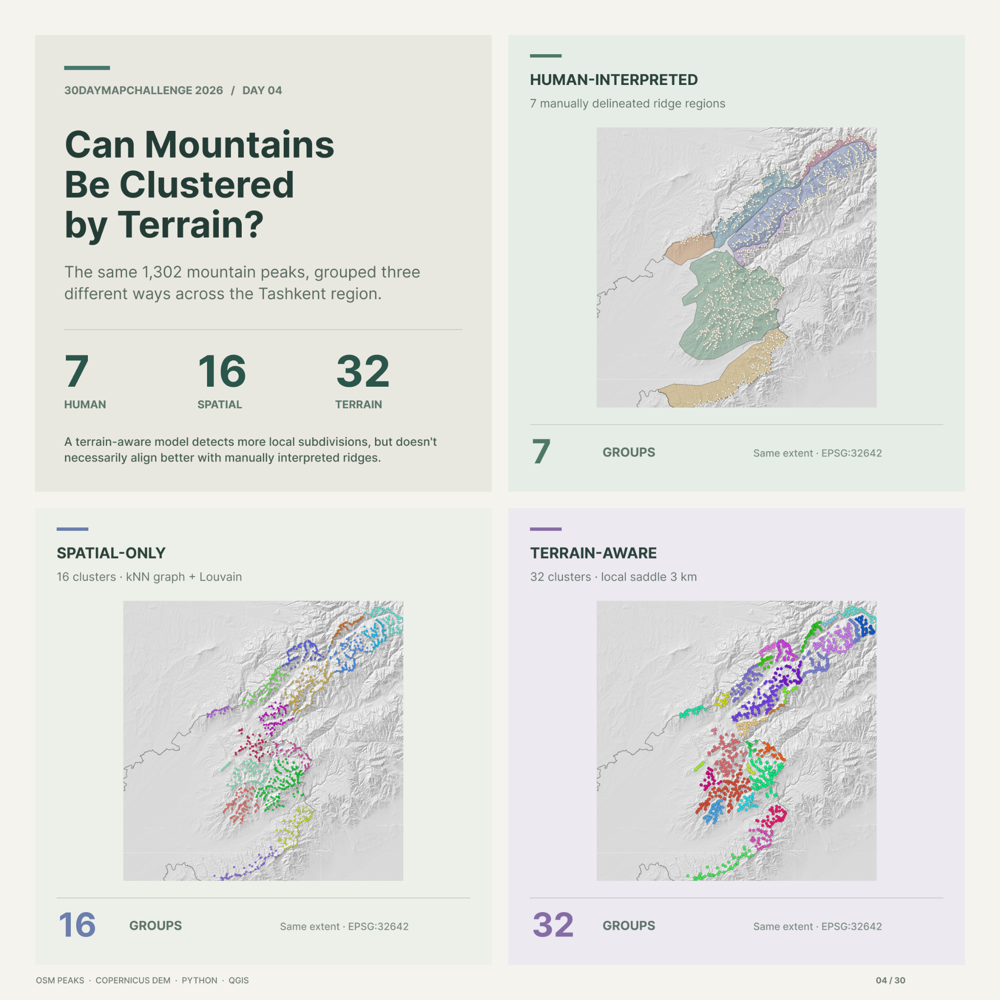

# Day 04 — Clusters | Can Mountains Be Clustered by Terrain?

The same **1,302 mountain peaks ≥1,800 m** were grouped in three ways: **7** human-interpreted ridge regions, **16** spatial-only clusters (nearby peaks), and **32** terrain-aware clusters (proximity plus local terrain barriers).

**Key result:** The terrain-aware method produced finer groups, but spatial-only clustering agreed more closely with the manually drawn ridges (**ARI 0.342 vs. 0.265**). The manual delineations are a comparison reference, **not ground truth**.

**Data:** OpenStreetMap + Copernicus DEM GLO-30.  
**Tools:** Python (graph clustering), QGIS, Figma.

## Files

- `report.png` — finished three-map comparison.
- `day04_clusters.qgz` — QGIS project with three themed maps and a layout.

## Open or recreate in QGIS

1. Open `day04_clusters.qgz` in **QGIS 3.44+** (recommended).
2. Relink `peaks_clustered.gpkg` from the [Day 04 source data](https://github.com/mmirshod/30daymapchallenge-2026/tree/main/projects/day04_clusters/data/processed), plus `ridges_with_stats.gpkg`, `tashkent_boundary.gpkg` and `tashkent_hillshade.tif` from [Day 03](https://github.com/mmirshod/30daymapchallenge-2026/tree/main/projects/day03_polygons/data/processed). Regenerate hillshade if absent.
3. Switch between QGIS **Map Themes** (human / spatial / terrain) or open the saved **Print Layout**.
4. To rerun clustering, consult the [Day 04 notebook](https://github.com/mmirshod/30daymapchallenge-2026/tree/main/projects/day04_clusters/notebooks) and its terrain inputs.
