# 🫧 Day 04 · Clusters: where do Tashkent's cafés gather?

**A beginner tutorial with QGIS, the free desktop map program used by professionals. No coding, no experience needed.**

You will put **2,408 cafés, restaurants and fast-food places** from OpenStreetMap on a map of Tashkent, see where they crowd together with a **heatmap**, let QGIS find the **clusters** for you with the **DBSCAN** tool, draw a shape around each cluster, count the places in every **district**, and finish with a printable map.

⏱️ About 45 minutes (plus 10 minutes to install QGIS) · 💻 Windows, macOS or Linux · 🔑 No account needed

📄 **Printable PDF:** [English](pdf/Day04_Tutorial_EN.pdf) · [Русский](pdf/Day04_Tutorial_RU.pdf) · [Oʻzbekcha](pdf/Day04_Tutorial_UZ.pdf)

| Heatmap | DBSCAN clusters | Places per district |
|:---:|:---:|:---:|
| 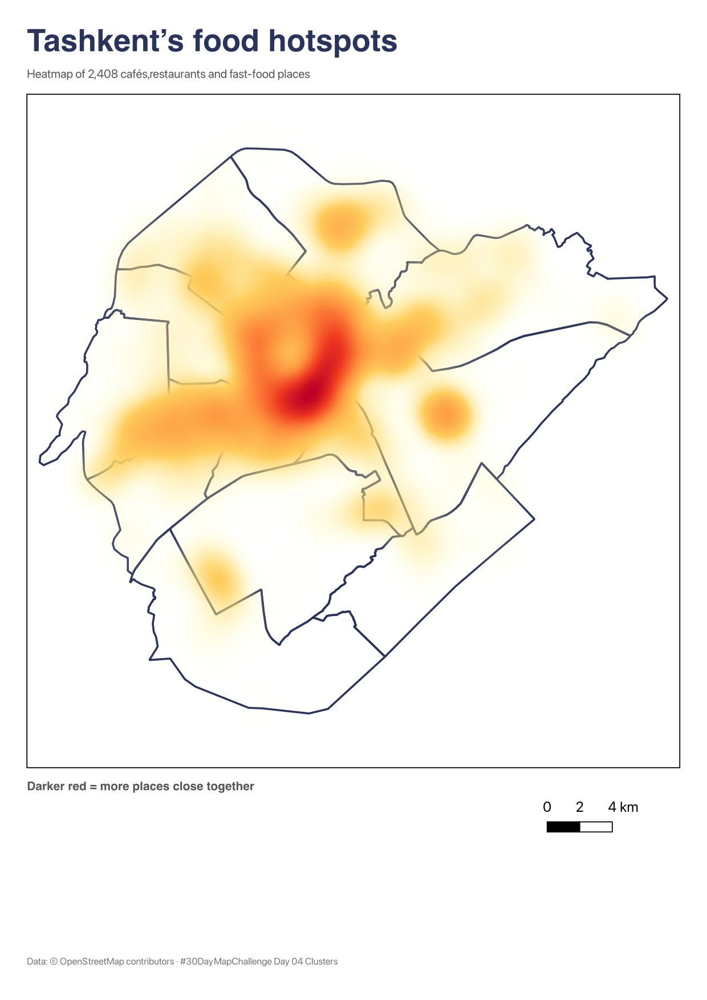 | 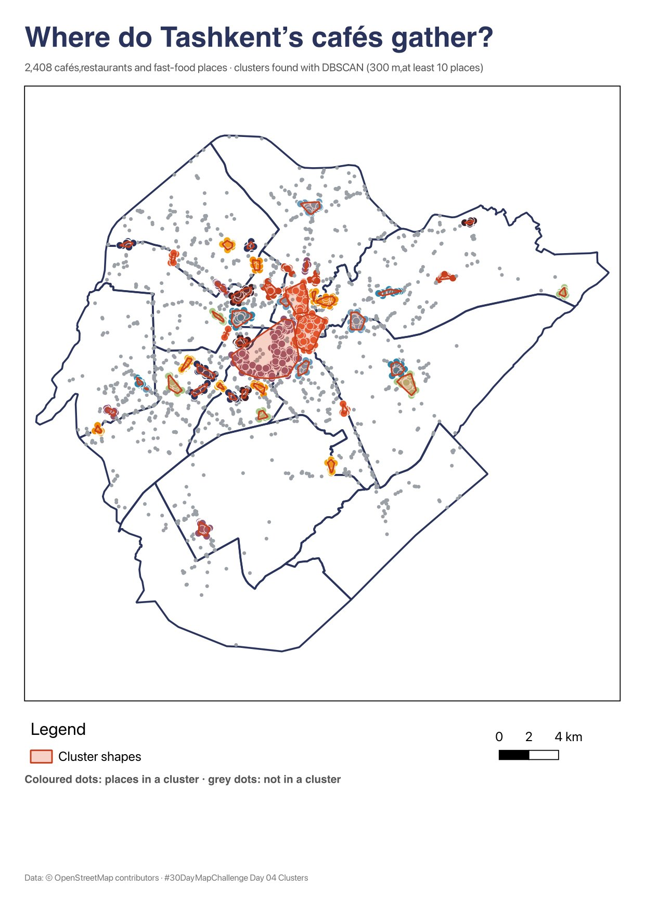 | 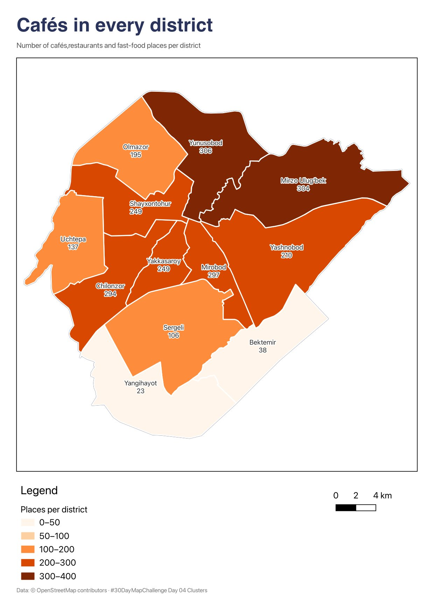 |

## 📚 Part 0 · The ideas you need

**Points.** Each café is one point with a location and a few columns (`name`, `kind`).

**Cluster.** A group of points that are much closer to each other than to the rest. Clusters show where life happens: shopping streets, the city centre, a market.

**Heatmap.** Every point spreads a little "heat" around it. Where many points are close, the heat adds up and turns red. It's a quick way to *see* clusters.

**DBSCAN.** A tool that *finds* clusters with two simple rules:
1. **Distance:** two places are neighbours if they are less than, for example, **300 m** apart.
2. **Minimum size:** a group needs at least, for example, **10 places** to count as a cluster.

Places that are too far from any group are **noise**: they don't belong to a cluster.

**Projection.** Our data uses degrees (longitude and latitude). DBSCAN needs **metres**, so we reproject the points into a metre-based system first.

## 💾 Part 1 · Install QGIS

1. Go to **[qgis.org/download](https://qgis.org/download/)**. The page first asks for a donation. QGIS is free: click **Skip it and go to download**.

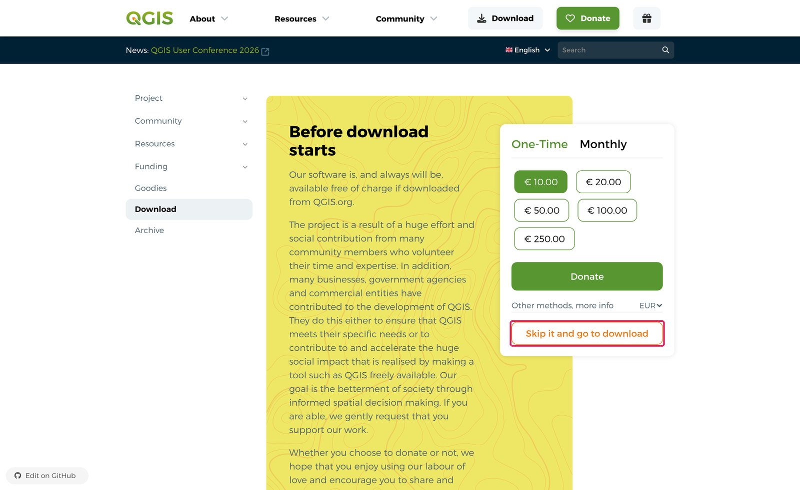

2. The page picks your system (Windows or macOS) automatically. Click **Download LTR** (Long Term Release, the most stable version).

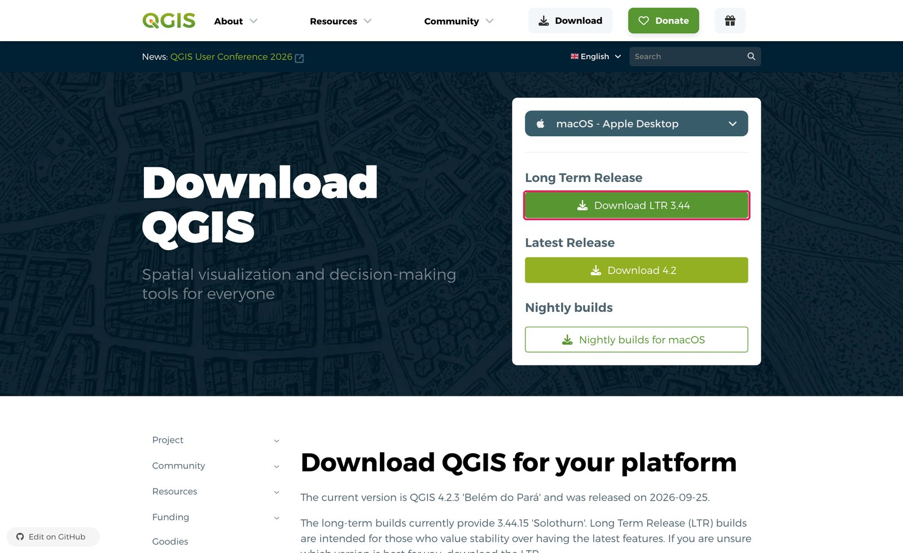

3. Install it like any other program: on **Windows** run the `.msi` file and click *Next* until it finishes. On **macOS** open the `.dmg` file and drag QGIS into *Applications*.

> 💡 The screenshots in this tutorial come from QGIS 3.34 on a Mac. Newer versions (3.44 and later) look almost the same. On Windows the menus (**Project**, **View**, **Layer**, **Vector**…) are at the top of the QGIS window, and on a Mac they are at the top of the screen.

## 📥 Part 2 · Get the data

Download both files into one folder:

| File | What's inside |
|---|---|
| [`tashkent_food_places.geojson`](data/tashkent_food_places.geojson) | 2,408 cafés, restaurants and fast-food places (columns `name`, `kind`) |
| [`tashkent_districts.geojson`](data/tashkent_districts.geojson) | the 12 districts of Tashkent City (column `district`) |

⬇️ Or both at once: **[day04_clusters_data.zip](https://github.com/NodiraTillayeva/30DayMapChallengeUzbekistan/raw/main/2026/Day%2004%20Clusters/tutorial/data/day04_clusters_data.zip)**, then unzip it.

To download one file from GitHub: click its name, then the **Download raw file** button (⬇) at the top right.

## 📡 Where does the data come from? Get your own from OpenStreetMap

Our cafés come from **[OpenStreetMap](https://www.openstreetmap.org)** (OSM), the free world map made by volunteers. You can download any kind of place from it yourself: schools, pharmacies, mosques, bus stops, parks… Here are two ways.

| | **A · Overpass Turbo** | **B · Geofabrik** |
|---|---|---|
| Best for | one city, one or a few kinds of places | the whole country, many layers at once |
| How | type a search in the browser | download one big zip file |
| Size | small (about 1 MB for Tashkent's cafés) | big (about 260 MB for Uzbekistan) |

### A · Overpass Turbo (in the browser)

1. Open **[overpass-turbo.eu](https://overpass-turbo.eu)** and click **Wizard** at the top. (Don't worry if the map shows another city: the search will move it.)

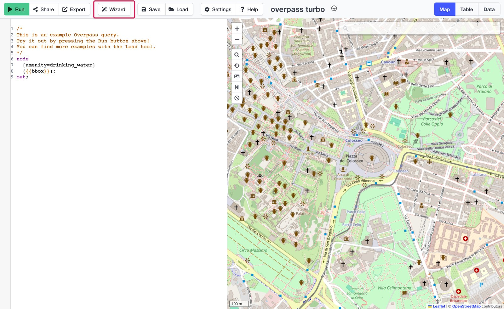

2. Type what you want and where, then click **build and run query**:

```
(amenity=cafe or amenity=restaurant or amenity=fast_food) in Tashkent
```

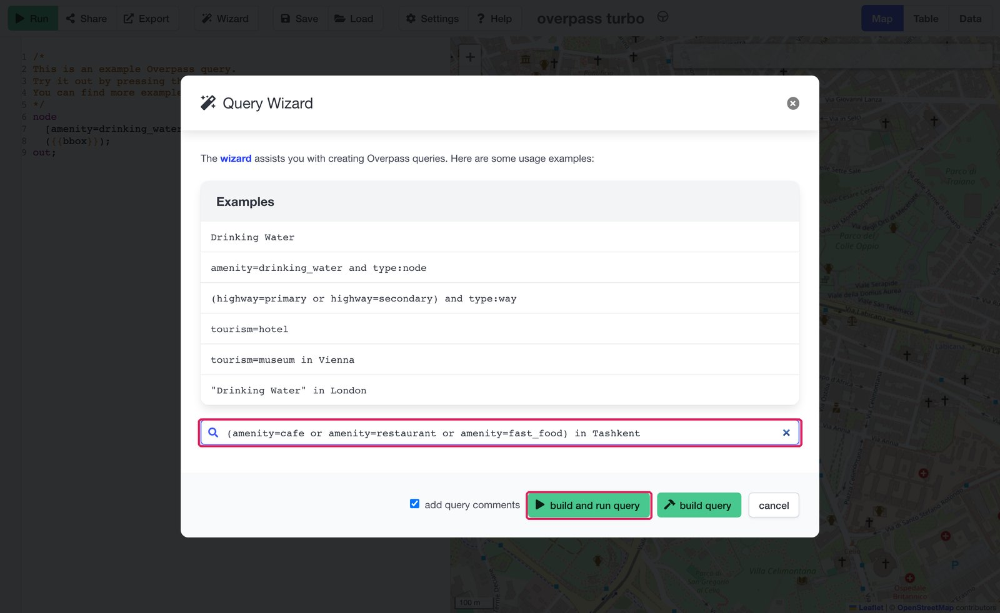

3. Wait a few seconds. The places appear on the map (click 🔍 **zoom to data** on the left of the map if you don't see them). The text on the left is the real query the Wizard wrote for you, in the **Overpass** language.

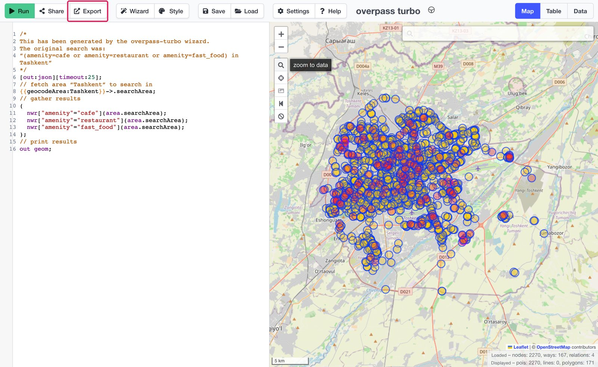

4. Click **Export** → next to **GeoJSON** click **download**. You get a file called `export.geojson`.

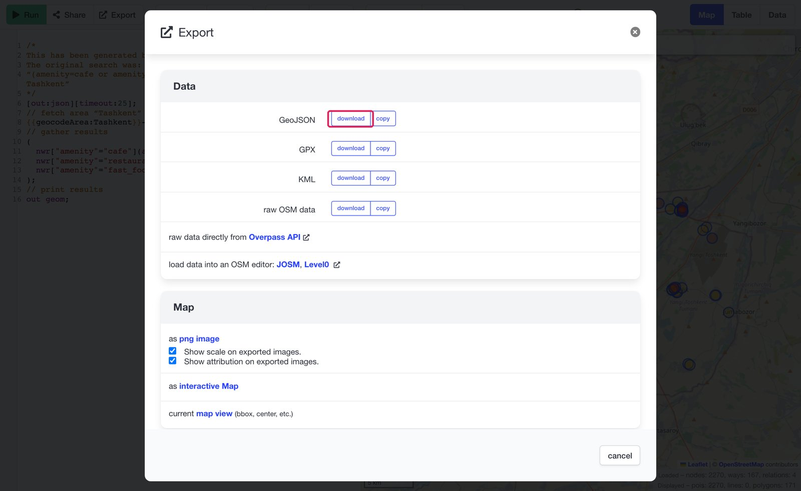

5. Drag `export.geojson` into QGIS. QGIS asks which part to add, because OSM stores some places as **points** and others as **building outlines** (polygons). Choose the **Point** layer (or both, and turn the polygons into points with **Vector → Geometry Tools → Centroids**).

**What should I type?** In OSM every thing has a **tag**, `key=value`. Some useful ones:

| You want | Type in the Wizard |
|---|---|
| cafés | `amenity=cafe` |
| schools | `amenity=school` |
| pharmacies | `amenity=pharmacy` |
| mosques | `amenity=place_of_worship and religion=muslim` |
| bus stops | `highway=bus_stop` |
| parks | `leisure=park` |
| hotels | `tourism=hotel` |
| supermarkets | `shop=supermarket` |

Then add ` in ` and a city: `in Samarkand`, `in Bukhara`, `in Namangan`. To find the tag for anything else, search the [OSM wiki Map features](https://wiki.openstreetmap.org/wiki/Map_features) page or click a place on [openstreetmap.org](https://www.openstreetmap.org) with the **?** (Query features) tool.

> 💡 If Overpass Turbo says the server is busy or the query timed out, wait a minute and click **Run** again, or search a smaller city.

### B · Geofabrik (the whole country)

1. Open **[download.geofabrik.de/asia/uzbekistan.html](https://download.geofabrik.de/asia/uzbekistan.html)** and click **uzbekistan-latest-free.shp.zip**.

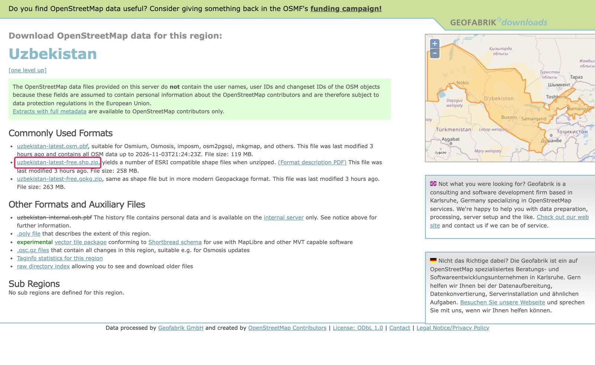

2. Unzip it. You get many layers as shapefiles: `gis_osm_roads_free_1` (roads), `gis_osm_waterways_free_1` (rivers), `gis_osm_buildings_a_free_1` (buildings), `gis_osm_pois_free_1` (points of interest: cafés, shops, schools…) and more.
3. Drag `gis_osm_pois_free_1.shp` into QGIS. The column `fclass` says what each point is.
4. To keep only cafés, restaurants and fast food: right-click the layer → **Filter…** and type:

```
"fclass" IN ('cafe', 'restaurant', 'fast_food')
```

5. To keep only Tashkent: **Vector → Geoprocessing Tools → Clip**, with the points as **Input layer** and `tashkent_districts` as **Overlay layer**.

This is exactly how the tutorial file was made (some places are drawn as buildings in OSM, so they were also turned into points from the `gis_osm_pois_a_free_1` layer).

> ⚖️ **Always credit the data:** *© OpenStreetMap contributors*. OSM is free to use under the [ODbL licence](https://www.openstreetmap.org/copyright) as long as you say where it comes from.

## 🖥️ Part 3 · Meet QGIS

Open QGIS. You see the start screen:

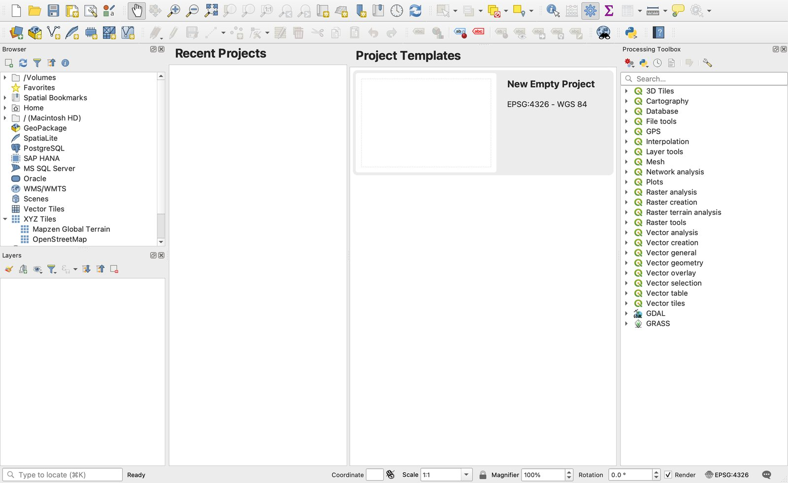

The four parts you will use:
- **Browser** (top left): your files and online maps.
- **Layers** (bottom left): everything on your map. Layers at the top are drawn on top.
- **Map** (centre): the map itself. Scroll to zoom, hold the mouse button and drag to move.
- **Processing Toolbox** (right): hundreds of tools with a search box. If you don't see it, open **Processing → Toolbox**.

## 🗺️ Part 4 · Add a background map

In the **Browser**, click the small arrow next to **XYZ Tiles**, then **double-click OpenStreetMap**.

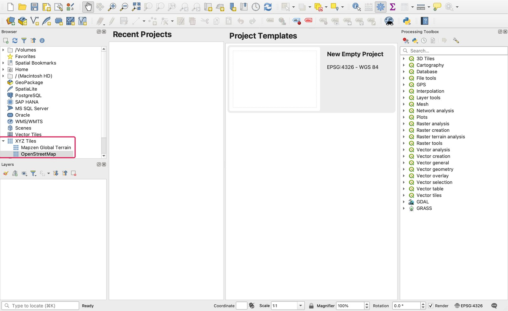

The world map appears. Zoom in to Tashkent with the mouse wheel, or wait for Part 5: once the districts are loaded, right-click `tashkent_districts` → **Zoom to Layer** jumps straight there.

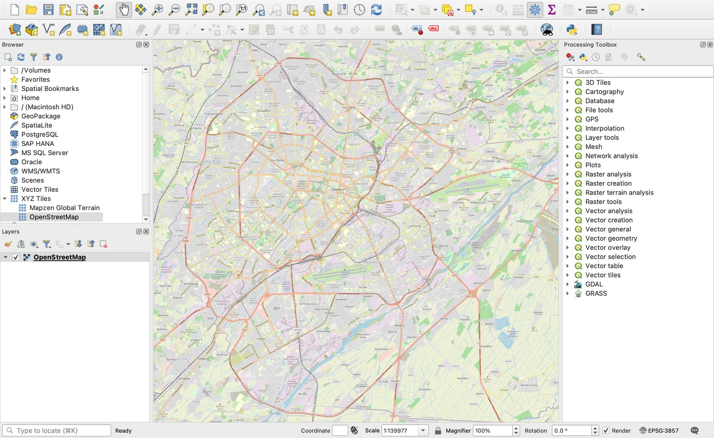

## 📍 Part 5 · Add the cafés and districts

1. Drag `tashkent_districts.geojson` and then `tashkent_food_places.geojson` from your folder into the QGIS map. They appear in the **Layers** panel.

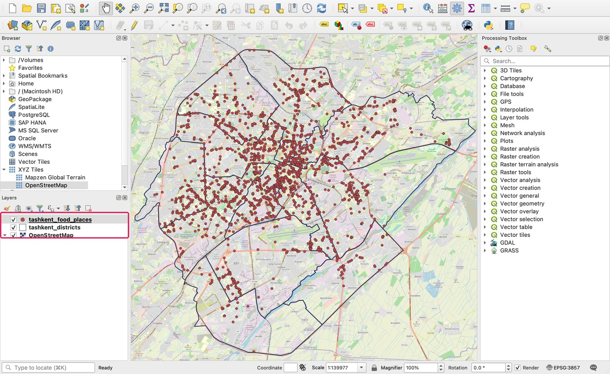

2. Look inside: right-click `tashkent_food_places` → **Open Attribute Table**. Every row is one place, with its `name` and `kind` (`cafe`, `restaurant` or `fast_food`). Some names are empty (`NULL`) because nobody added them to OpenStreetMap yet.

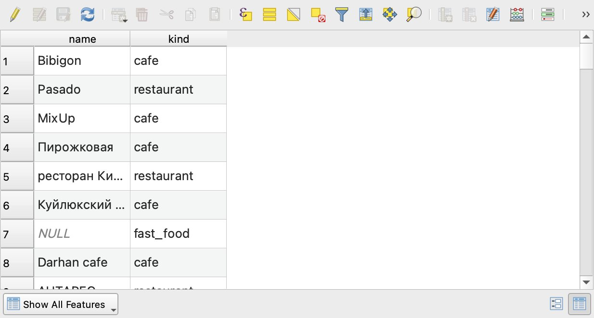

3. Close the table.

> 💡 If the districts cover the map in one colour: double-click `tashkent_districts` → **Symbology** → click **Simple Fill** → set **Fill style** to *No Brush*. Now only the borders are drawn.

## 🎨 Part 6 · Colour the places by kind

1. **Double-click** `tashkent_food_places` in the Layers panel. The **Layer Properties** window opens.
2. Click **Symbology** on the left.
3. At the top, change **Single Symbol** to **Categorized**.
4. Set **Value** to `kind`.
5. Click **Classify**, then **OK**.

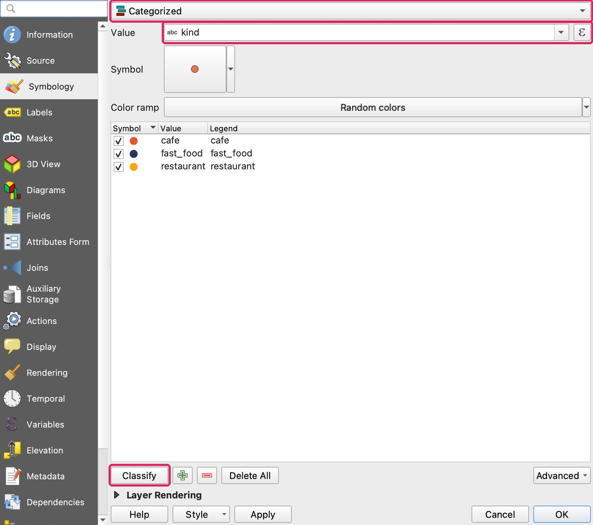

Cafés, restaurants and fast food now have their own colours:

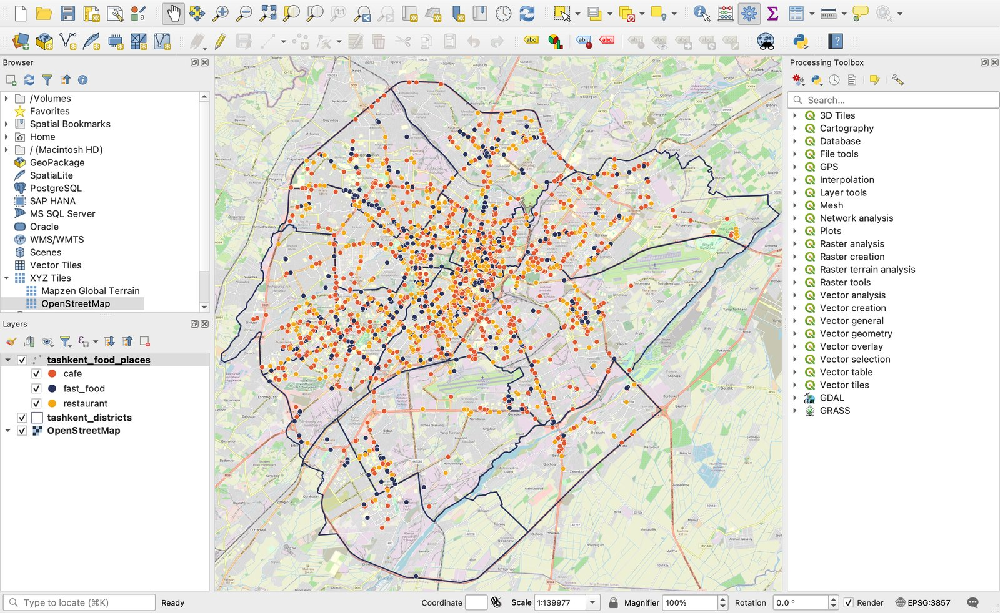

## 🔥 Part 7 · A heatmap: see the hotspots

1. Double-click `tashkent_food_places` again → **Symbology**.
2. Change **Categorized** to **Heatmap**.
3. Pick a **Color ramp** you like (click the small arrow next to it, e.g. *Reds* or *Magma*) and set **Radius** to about `12` millimetres. Click **OK**.

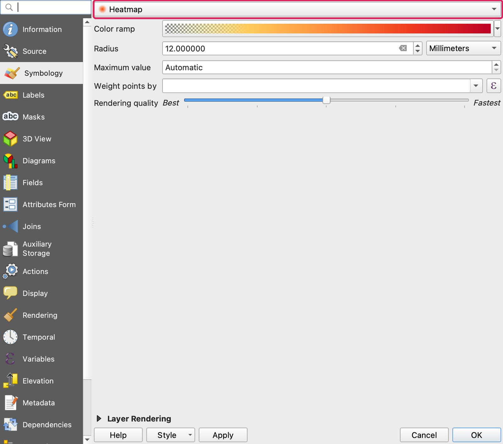

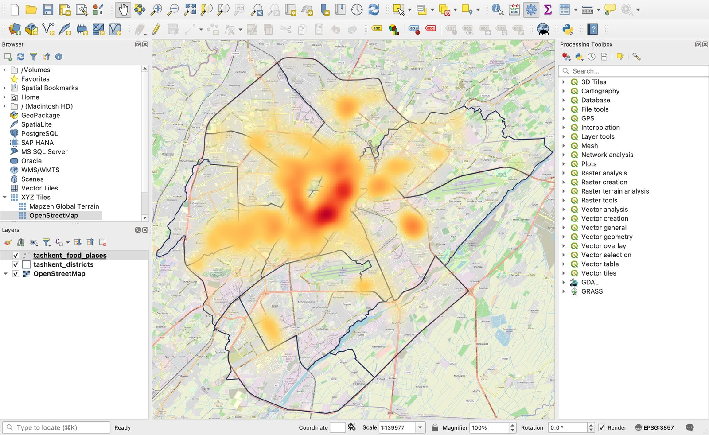

The hottest spot is the **city centre**. Smaller hotspots appear along big streets and in the neighbourhoods.

> 💡 To make the background quieter: double-click `OpenStreetMap` → **Transparency** → set **Global Opacity** to about 50%.

## 📏 Part 8 · From degrees to metres (reproject)

DBSCAN measures distance in the units of the layer. Our points are in **degrees**, so "300" would mean 300 degrees, almost the whole Earth! Let's convert them to **metres**.

1. In the **Processing Toolbox**, type `reproject` in the search box and double-click **Reproject layer**.

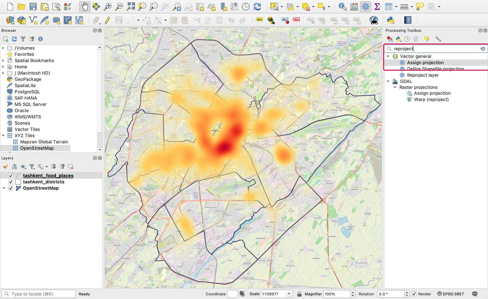

2. **Input layer:** `tashkent_food_places`.
3. **Target CRS:** click the small globe button and search for `32642`. Choose **WGS 84 / UTM zone 42N** (EPSG:32642), the metre-based system for Tashkent.
4. Click **Run**, then **Close**. A new layer called **Reprojected** appears.

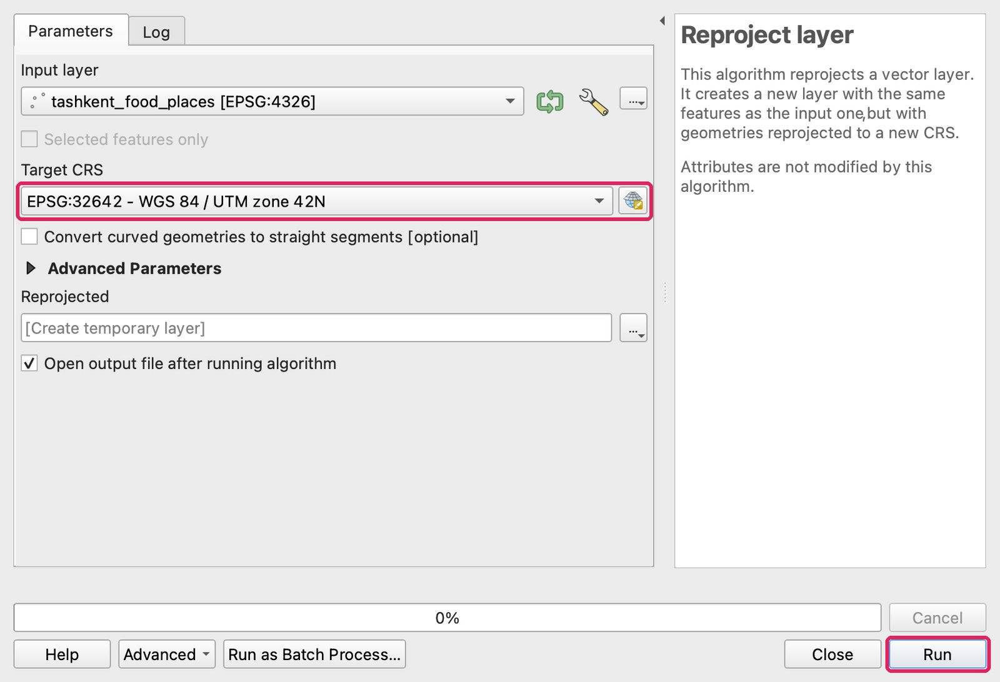

## 🫧 Part 9 · Find the clusters (DBSCAN)

1. In the Processing Toolbox, search `dbscan` and double-click **DBSCAN clustering**.

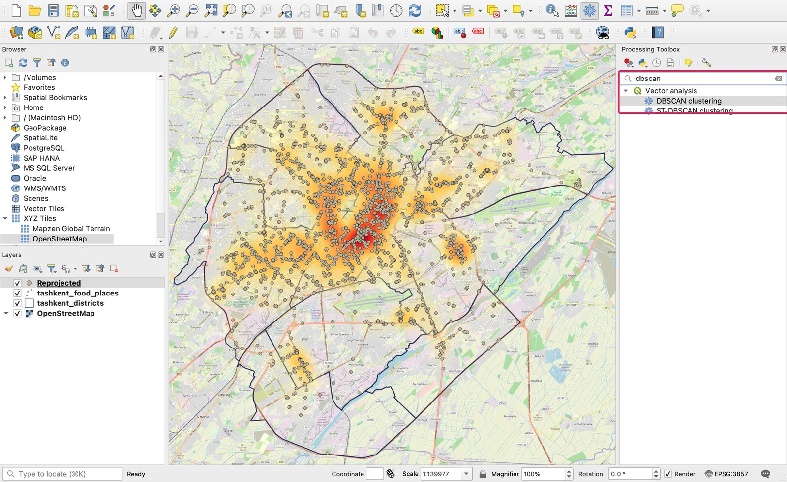

2. Fill in:
   - **Input layer:** `Reprojected`
   - **Minimum cluster size:** `10`
   - **Maximum distance between clustered points:** `300` (meters)
3. Click **Run**, then **Close**.

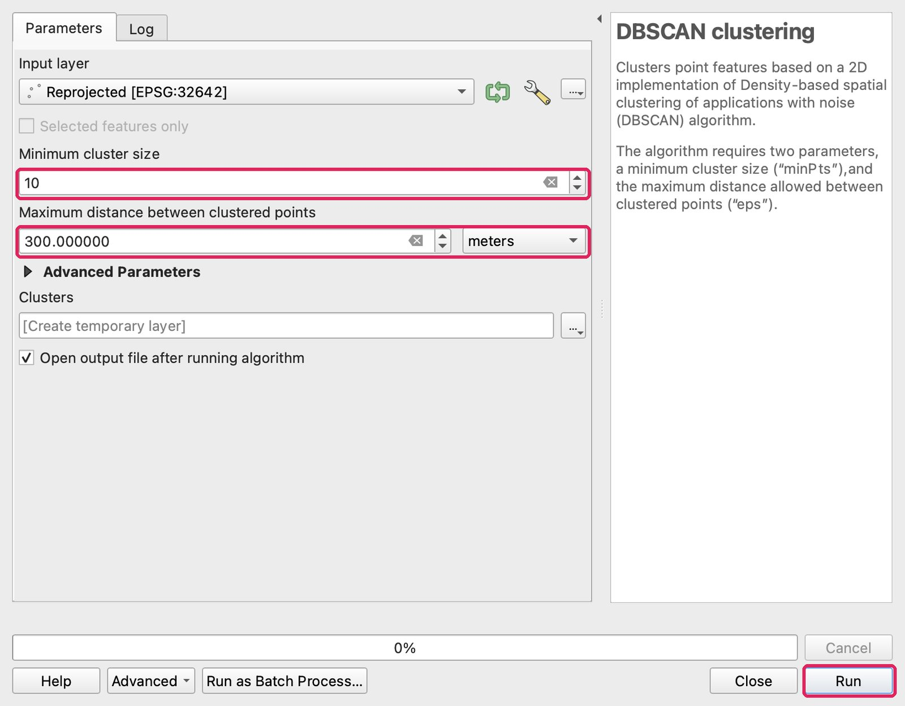

A new layer **Clusters** appears. Open its attribute table: there are two new columns, `CLUSTER_ID` (which cluster the place belongs to) and `CLUSTER_SIZE` (how many places are in that cluster). Places with `NULL` are noise: not in any cluster.

4. Colour it: double-click **Clusters** → **Symbology** → **Categorized** → **Value:** `CLUSTER_ID` → **Color ramp:** *Random colors* → **Classify** → **OK**. Untick the other point layers to hide them.

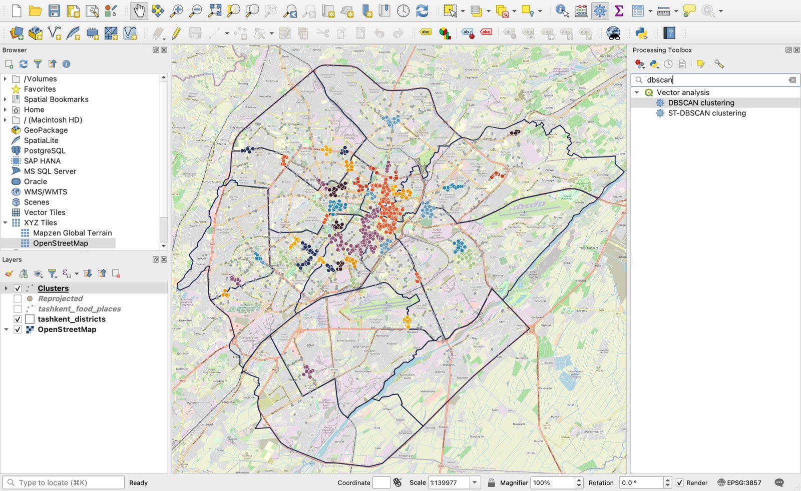

QGIS found **46 clusters**. Together they contain **1,159 of the 2,408 places** (almost half!). The biggest cluster has **243 places**, in the city centre where **Mirobod and Yakkasaroy** districts meet.

> 🧪 **Experiment:** run DBSCAN again with `200` or `500` metres. With 200 m you get smaller, tighter clusters; with 500 m the centre turns into one giant cluster of more than a thousand places. There is no single "right" answer: choose what tells your story best.

## 🔷 Part 10 · Draw a shape around each cluster

1. In the Processing Toolbox, search `minimum bounding` and double-click **Minimum bounding geometry**.
2. **Input layer:** `Clusters` · **Field:** `CLUSTER_ID` · **Geometry type:** **Convex Hull**. Click **Run**, then **Close**.

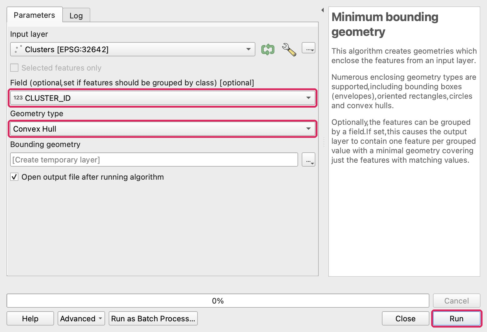

A convex hull is like a rubber band stretched around the points of each cluster. A new layer, **Bounding geometry**, appears (we renamed it *Cluster shapes*: right-click → **Rename Layer**).

3. The noise points (with no cluster) also got one big shape. Remove it: right-click the new layer → **Filter…**, type the expression below and click **OK**:

```
"CLUSTER_ID" IS NOT NULL
```

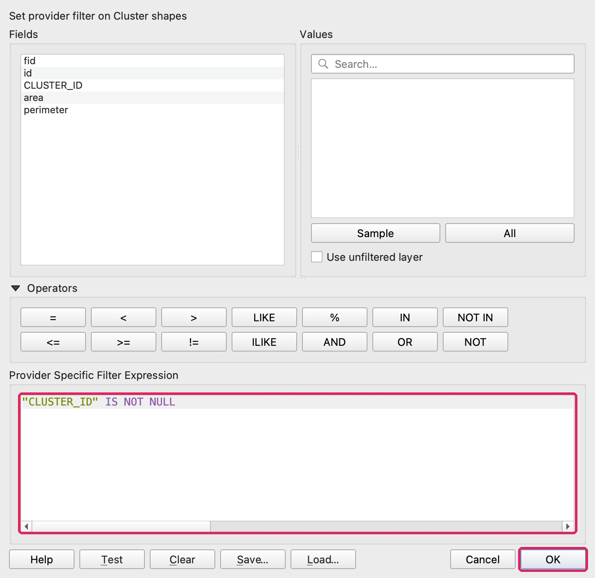

4. Make the shapes see-through: double-click the layer → **Symbology** → set the fill colour's **opacity** to about 30%.

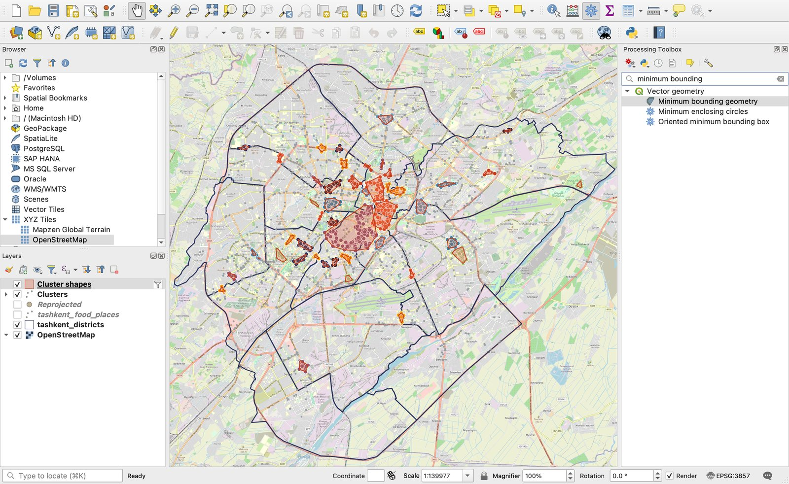

## 🏙️ Part 11 · How many places in each district?

1. In the menu, open **Vector → Analysis Tools → Count Points in Polygon** (or search `count points` in the toolbox).
2. **Polygons:** `tashkent_districts` · **Points:** `tashkent_food_places`. Click **Run**, then **Close**.

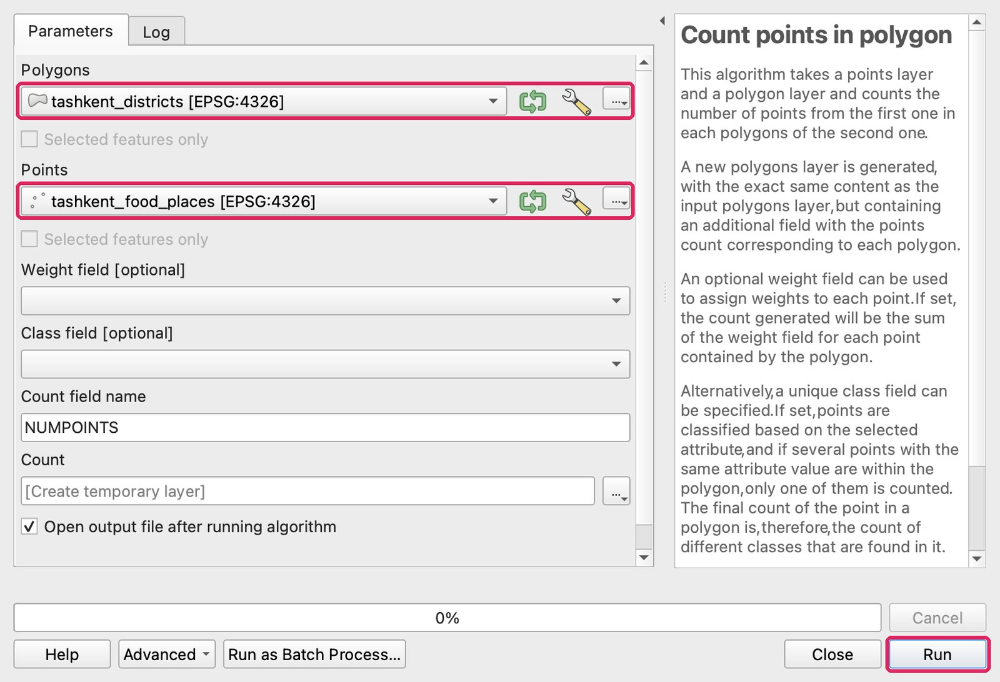

The new layer **Count** has a column `NUMPOINTS`. Colour it: **Symbology** → **Graduated** → **Value:** `NUMPOINTS` → pick a colour ramp → **Classify** → **OK**. Add labels: **Labels** → **Single Labels** → **Value:** `district`.

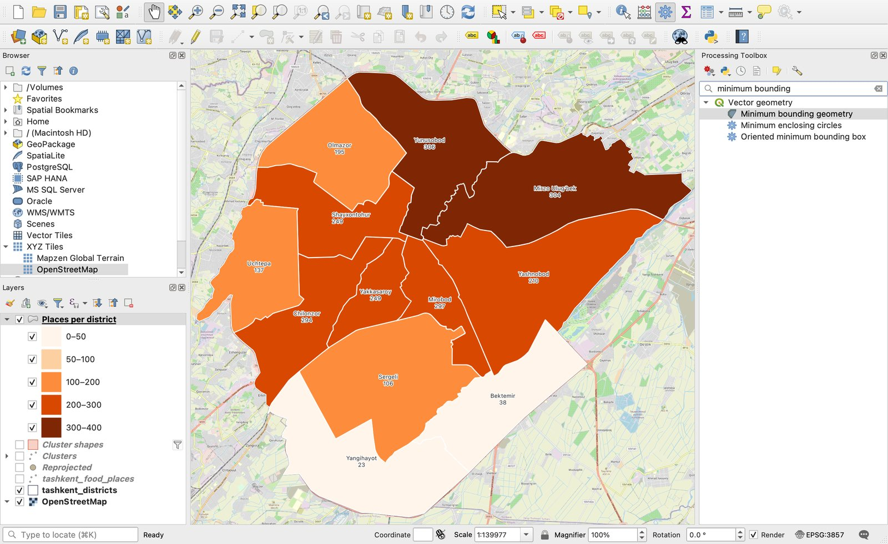

| District | Places | Area (km²) | Places per km² |
|---|---:|---:|---:|
| Mirobod | 297 | 16.6 | 17.9 |
| Yakkasaroy | 249 | 14.0 | 17.8 |
| Chilonzor | 294 | 30.7 | 9.6 |
| Shayxontohur | 249 | 27.6 | 9.0 |
| Yunusobod | 306 | 40.5 | 7.5 |
| Olmazor | 195 | 33.0 | 5.9 |
| Mirzo Ulugʻbek | 304 | 55.6 | 5.5 |
| Uchtepa | 137 | 28.3 | 4.8 |
| Yashnobod | 210 | 59.1 | 3.6 |
| Sergeli | 106 | 51.9 | 2.0 |
| Bektemir | 38 | 31.9 | 1.2 |
| Yangihayot | 23 | 44.5 | 0.5 |

**Yunusobod** has the most places, but the small central districts **Mirobod** and **Yakkasaroy** are the most crowded: almost 18 places on every km².

## 🖨️ Part 12 · Make a printable map (Print Layout)

1. **Project → New Print Layout**, give it a name (e.g. `Clusters map`) and click **OK**. A new window opens with an empty page.
2. **Add Item → Add Map**, then drag a rectangle on the page. Your map appears inside it.
3. **Add Item → Add Label** for the title (type it in **Item Properties** on the right and make the font big).
4. **Add Item → Add Legend** and **Add Item → Add Scale Bar**, and place them under the map.
5. **Layout → Export as Image…**, choose a name, and save it as PNG.

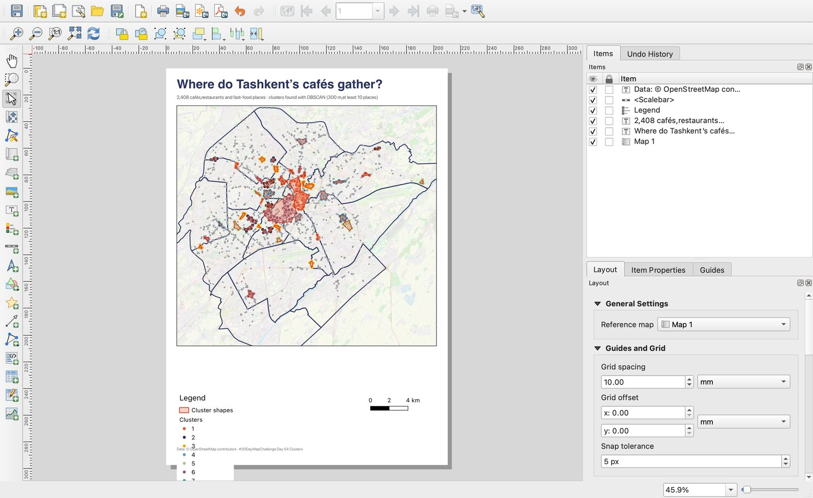

> 💡 In the legend's **Item Properties**, untick **Auto update** to remove layers you don't want (like the 46 cluster numbers). Always add the source: *Data © OpenStreetMap contributors*.

## 🌈 Make it yours: ideas

- **Other places:** the same steps work for any points. Download schools, pharmacies or supermarkets yourself (see [Get your own from OpenStreetMap](#-where-does-the-data-come-from-get-your-own-from-openstreetmap)) or use the fire points from the [Day 01 tutorial](../../Day%2001%20Points/tutorial/README.md).
- **Only cafés:** right-click the layer → **Filter…** → `"kind" = 'cafe'`, then run DBSCAN again.
- **Night mode:** remove the OpenStreetMap layer, set the background to dark (**Project → Properties → General → Background color**) and use a glowing colour ramp like *Magma* for the heatmap.
- **Your city:** Samarkand, Bukhara or Namangan? Use the Overpass Turbo Wizard with `in Samarkand` and repeat the steps. In Part 8, pick the UTM zone for your city: **EPSG:32642** for Tashkent, Samarkand, Namangan and Fergana; **EPSG:32641** for Bukhara, Navoi and Urgench; **EPSG:32640** for Nukus; **EPSG:32643** for Andijan.

## 💾 Share your map

1. Make a folder named after **your map's topic**, e.g. `Coffee clusters of Tashkent`. Put your map inside, plus a short `README.md` with **your name**, the data (OpenStreetMap) and the tool (QGIS).
2. Upload the folder to **`2026/Day 04 Clusters/`** in this repository. The [Quick Start in the main README](../../../README.md#-quick-start-add-your-map-no-coding-needed) shows how, with no coding needed.
3. Post it with **#30DayMapChallenge** and credit **© OpenStreetMap contributors**.

## 🆘 Something went wrong?

| What you see | What to do |
|---|---|
| I can't see the **Processing Toolbox** | **Processing → Toolbox** (or **View → Panels → Processing Toolbox**). |
| DBSCAN finds **0 clusters** or one huge cluster | You used the layer in degrees. Run DBSCAN on the **Reprojected** layer (Part 8) and check that the distance unit says *meters*. |
| The districts hide the points | In the Layers panel, drag `tashkent_districts` **below** the point layers, or set its fill to *No Brush* (Part 5). |
| The OpenStreetMap background stays grey | It needs internet. Check your connection, then zoom a little to reload it. |
| A tool says the layer is not valid | Make sure you chose the right **Input layer** in the drop-down at the top of the tool. |
| macOS says QGIS can't be opened | Right-click QGIS in *Applications* → **Open** → **Open**. You only need to do this once. |
| My layer disappeared | Check the ✓ next to it in the Layers panel, then right-click it → **Zoom to Layer**. |

## 📎 Credits

- Cafés, restaurants and fast food: © [OpenStreetMap contributors](https://www.openstreetmap.org/copyright) (ODbL), from the [Geofabrik](https://download.geofabrik.de/asia/uzbekistan.html) extract of 2 November 2026. See [`data/README.md`](data/README.md).
- Tashkent districts: from [`Boundaries`](../../../Boundaries) in this repository.
- Tool: [QGIS](https://qgis.org), free and open source. DBSCAN: Ester, Kriegel, Sander and Xu (1996).
