# 👁️ Day 05 · Sight: what can you see from the Tashkent TV Tower?

**A beginner tutorial with GDAL, the free command-line toolbox that sits inside almost every map program. Your first steps in the terminal, no coding experience needed.**

You will download free **satellite elevation data** (Copernicus DEM), glue the tiles together, turn them into a shaded relief, and ask the computer one question: **"What can I see from here?"** The answer is called a **viewshed**. You will compare the view from the foot of the Tashkent TV Tower with the view from its observation deck, look out from the top of **Big Chimgan**, and check whether the two can see each other. At the end you put everything on top of **Sentinel-2 satellite imagery** in QGIS.

⏱️ About 45 minutes (plus 10 minutes to install GDAL) · 💻 Windows, macOS or Linux · 🔑 No account needed

📄 **Printable PDF:** [English](pdf/Day05_Tutorial_EN.pdf) · [Русский](pdf/Day05_Tutorial_RU.pdf) · [Oʻzbekcha](pdf/Day05_Tutorial_UZ.pdf)

| From the ground (1.7 m) | From the deck (97 m) | From Big Chimgan |
|:---:|:---:|:---:|
| 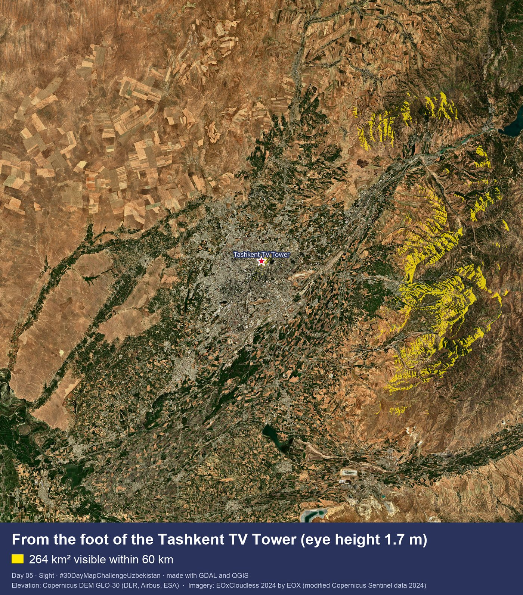 | 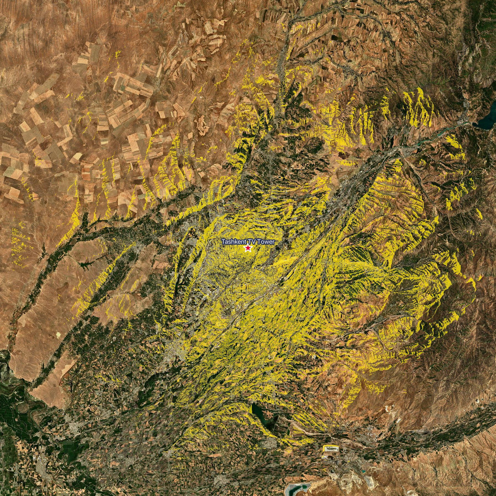 | 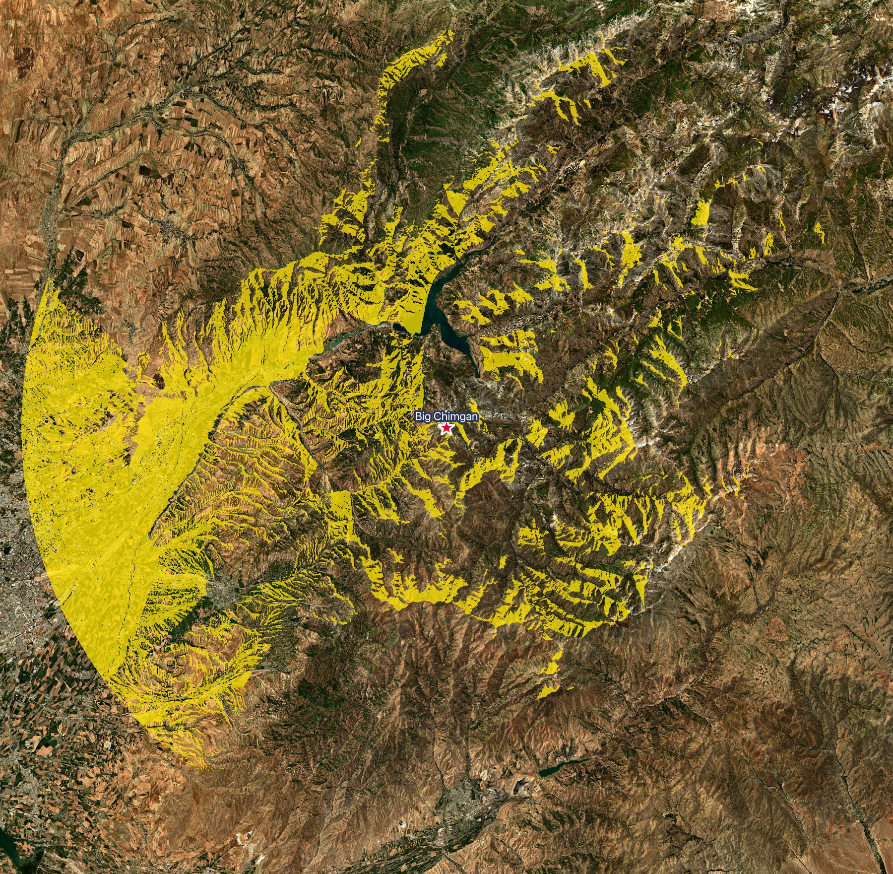 |
| **264 km²** visible | **1,662 km²** visible | **2,100 km²** visible |

## 📚 Part 0 · The ideas you need

**Elevation model (DEM).** A raster (a grid of pixels) where every pixel stores a height in metres. Ours is the **Copernicus DEM GLO-30**: one pixel every 30 m, measured from space by two German radar satellites, **TerraSAR-X** and **TanDEM-X**, flying side by side between 2011 and 2015. It is a *surface* model: it includes buildings and trees, which is exactly what blocks your view.

**Viewshed.** Stand somewhere, look around in every direction: everything you can see is your viewshed. The computer draws an invisible straight line from your eyes to every pixel. If a hill, building or forest is in the way, that pixel is hidden. Visible pixels get the value **255**, hidden ones **0**.

**Observer height.** Your eyes are about **1.7 m** above the ground. On the TV Tower's observation deck they are **97 m** up. A few metres can change everything.

**The terminal.** A window where you type commands instead of clicking buttons. Each GDAL command is one line: the **tool name**, some **options** that start with `-`, then the **input** and **output** files. Example: `gdaldem hillshade dem_utm.tif hillshade.tif`.

**Projection.** The tiles come in degrees (longitude, latitude). Viewsheds need **metres**, so we reproject to **UTM zone 42N** (EPSG:32642), the metre-based system for Tashkent, just like on Day 04.

## 💾 Part 1 · Install GDAL and open the terminal

### 🪟 Windows: you already have it

If you installed QGIS for Day 04, GDAL came with it. Open the **Start** menu, type **OSGeo4W Shell** and open it. A black window appears: that is your terminal.

### 🍎 macOS and 🐧 Linux: install Miniforge, then GDAL

Miniforge is a free installer for scientific tools. It puts GDAL in its own box, so it can't break anything on your computer.

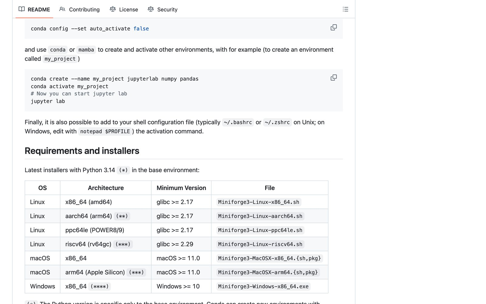

1. Open **Terminal** (macOS: press **⌘ Space**, type *Terminal*, press Enter).
2. Copy these two lines, paste them, press Enter after each, and answer **yes** to every question:

   ```
   curl -L -O "https://github.com/conda-forge/miniforge/releases/latest/download/Miniforge3-$(uname)-$(uname -m).sh"
   bash Miniforge3-$(uname)-$(uname -m).sh
   ```

3. **Close Terminal and open it again.** Now create a box called `gdal` with GDAL inside and step into it:

   ```
   conda create -n gdal -c conda-forge gdal
   conda activate gdal
   ```

   Your prompt now starts with **`(gdal)`**. Every time you open a new Terminal for this tutorial, type `conda activate gdal` first.

> 💡 On a Mac, QGIS also ships some GDAL tools, but on our test Mac its copy of `gdal_viewshed` didn't work. Miniforge gives you the newest GDAL and works the same on every computer. On Windows you can use Miniforge too (open **Miniforge Prompt** instead of the OSGeo4W Shell).

### ✅ Test it

Type this and press Enter:

```
gdalinfo --version
```

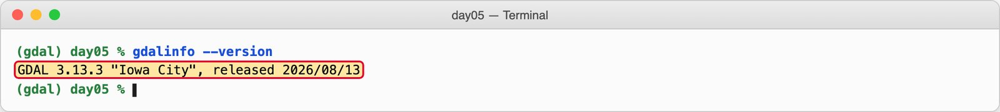

If you see `GDAL 3.…`, you're ready. If you see *command not found*, look at [Something went wrong?](#-something-went-wrong).

## 📥 Part 2 · Get the satellite elevation data

The Copernicus DEM is free and lives on Amazon's open-data service, **no account needed**. The world is cut into tiles of 1° × 1°, and each tile is named after its **lower-left corner**: `N41_00_E069` covers 41–42° north and 69–70° east. Tashkent sits at about 41.3° N, 69.3° E.

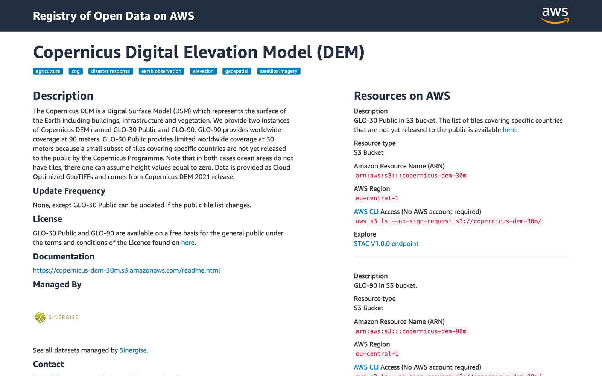

1. Make a folder called **`day05`** (for example in *Downloads*).
2. Click each link to download the 6 tiles (about 40 MB each) and move them into `day05`:

| Tile | Covers |
|---|---|
| [N41 E068](https://copernicus-dem-30m.s3.amazonaws.com/Copernicus_DSM_COG_10_N41_00_E068_00_DEM/Copernicus_DSM_COG_10_N41_00_E068_00_DEM.tif) | west of Tashkent, Chinoz |
| [N41 E069](https://copernicus-dem-30m.s3.amazonaws.com/Copernicus_DSM_COG_10_N41_00_E069_00_DEM/Copernicus_DSM_COG_10_N41_00_E069_00_DEM.tif) | **Tashkent**, Chirchiq |
| [N41 E070](https://copernicus-dem-30m.s3.amazonaws.com/Copernicus_DSM_COG_10_N41_00_E070_00_DEM/Copernicus_DSM_COG_10_N41_00_E070_00_DEM.tif) | **Chimgan**, Charvak lake |
| [N40 E068](https://copernicus-dem-30m.s3.amazonaws.com/Copernicus_DSM_COG_10_N40_00_E068_00_DEM/Copernicus_DSM_COG_10_N40_00_E068_00_DEM.tif) | Syrdarya region |
| [N40 E069](https://copernicus-dem-30m.s3.amazonaws.com/Copernicus_DSM_COG_10_N40_00_E069_00_DEM/Copernicus_DSM_COG_10_N40_00_E069_00_DEM.tif) | Angren, Olmaliq, Bekobod |
| [N40 E070](https://copernicus-dem-30m.s3.amazonaws.com/Copernicus_DSM_COG_10_N40_00_E070_00_DEM/Copernicus_DSM_COG_10_N40_00_E070_00_DEM.tif) | Kamchik pass, north Fergana valley |

3. In the terminal, go into the folder with `cd` ("change directory"), then list what's inside (`ls` on macOS/Linux, `dir` on Windows):

   ```
   cd Downloads/day05
   ls
   ```

   On Windows: `cd %USERPROFILE%\Downloads\day05` and then `dir`.

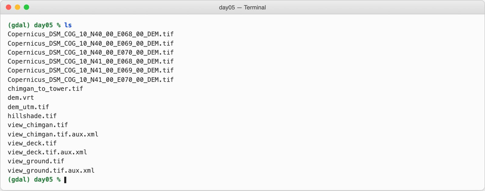

> 💡 **Another city?** Pick the tiles by the lower-left corner of the 1° square your place is in. Samarkand (39.65° N, 66.96° E) is `N39_00_E066`, Bukhara is `N39_00_E064`, Khiva is `N41_00_E060`. Change both numbers in the link.

## 🔍 Part 3 · Look inside a tile (`gdalinfo`)

`gdalinfo` tells you everything about a raster file without opening it:

```
gdalinfo Copernicus_DSM_COG_10_N41_00_E069_00_DEM.tif
```

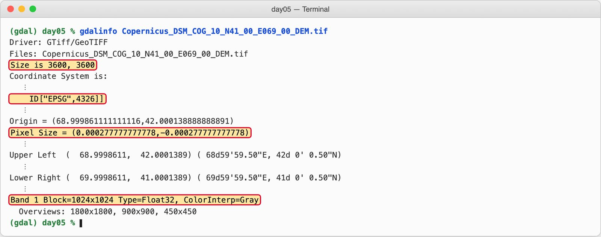

Read the highlighted lines:
- **Size is 3600, 3600**: the tile is 3,600 × 3,600 pixels.
- **EPSG 4326**: coordinates are in degrees (longitude, latitude).
- **Pixel Size = 0.000277…**: one pixel is 1/3600 of a degree, about 30 m.
- **Type=Float32**: every pixel is a decimal number, the height in metres.

## 🧩 Part 4 · Glue the tiles and switch to metres (`gdalbuildvrt`, `gdalwarp`)

First, glue the six tiles into one **virtual** mosaic. The `*` means "every file whose name starts with `Copernicus_`". It takes a second, because a `.vrt` is only a small text file pointing at the tiles:

```
gdalbuildvrt dem.vrt Copernicus_*.tif
```

Then cut out our area and reproject it to metres with **`gdalwarp`**, the most useful GDAL tool:

```
gdalwarp -te 68.5 40.8 71.0 42.0 -te_srs EPSG:4326 -t_srs EPSG:32642 -tr 30 30 -r bilinear dem.vrt dem_utm.tif
```

| Option | Means |
|---|---|
| `-te 68.5 40.8 71.0 42.0` | cut to this box: west, south, east, north |
| `-te_srs EPSG:4326` | …and the box is written in degrees |
| `-t_srs EPSG:32642` | reproject to UTM zone 42N (metres) |
| `-tr 30 30` | make every pixel exactly 30 × 30 m |
| `-r bilinear` | smooth the heights while resampling |
| `dem.vrt dem_utm.tif` | input, then output |

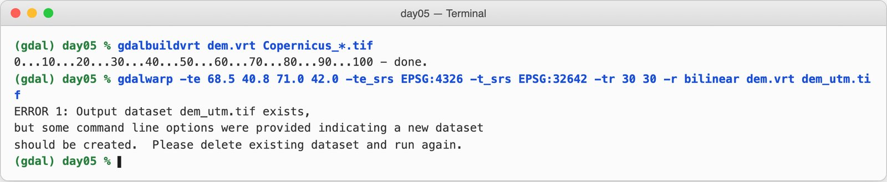

After about 15 seconds you have **`dem_utm.tif`**: 7,030 × 4,505 pixels, from the Syrdarya to the mountains behind Charvak.

## 📍 Part 5 · Ask a pixel a question (`gdallocationinfo`)

How high is the ground under the TV Tower (41.3456° N, 69.2850° E)? And the top of Big Chimgan (41.4952° N, 70.0583° E)? The `-wgs84` option lets you type longitude and latitude:

```
gdallocationinfo -wgs84 dem_utm.tif 69.2850 41.3456
gdallocationinfo -wgs84 dem_utm.tif 70.0583 41.4952
```

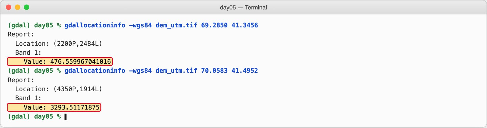

The tower stands on **477 m**, the summit of Big Chimgan is **3,294 m** (the official height is 3,309 m: a 30 m pixel is an average, so sharp peaks come out a little lower).

> ⚠️ Longitude comes **first** (x, then y). If you swap them you'll ask about a place in the Indian Ocean.

## 🔢 Part 6 · From degrees to metres for one point (`gdaltransform`)

`gdal_viewshed` needs the observer's position in the same metres as the raster. `gdaltransform` converts it. `echo` sends the two numbers into the tool:

```
echo 69.2850 41.3456 | gdaltransform -s_srs EPSG:4326 -t_srs EPSG:32642
echo 70.0583 41.4952 | gdaltransform -s_srs EPSG:4326 -t_srs EPSG:32642
```

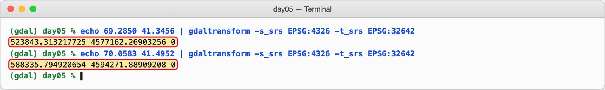

Write them down (rounded):

| Place | x (metres east) | y (metres north) |
|---|---|---|
| Tashkent TV Tower | **523843** | **4577162** |
| Big Chimgan | **588336** | **4594272** |

## ⛰️ Part 7 · A shaded relief (`gdaldem hillshade`)

Heights are hard to see as plain grey. A **hillshade** lights the terrain as if the sun shone from several directions, so ridges and valleys pop out:

```
gdaldem hillshade -multidirectional -z 2 dem_utm.tif hillshade.tif
```

`-multidirectional` uses light from several directions, and `-z 2` makes the hills look twice as tall (helpful in the flat city).

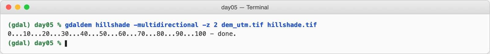

## 👁️ Part 8 · The viewshed (`gdal_viewshed`)

Now the main question. First, from the **foot** of the tower, at eye height:

```
gdal_viewshed -ox 523843 -oy 4577162 -oz 1.7 -md 60000 dem_utm.tif view_ground.tif
```

Then from the **observation deck**, 97 m up:

```
gdal_viewshed -ox 523843 -oy 4577162 -oz 97 -md 60000 dem_utm.tif view_deck.tif
```

| Option | Means |
|---|---|
| `-ox 523843 -oy 4577162` | where the observer stands (metres, from Part 6) |
| `-oz 1.7` / `-oz 97` | eye height above the ground, in metres |
| `-md 60000` | look up to 60 km away |

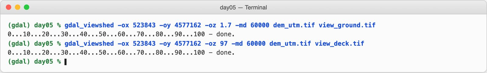

Each one takes less than a second. GDAL also bends the line of sight a little to take the **curvature of the Earth** and the bending of light in the air into account, so far-away places are handled correctly.

## 📐 Part 9 · How much can you see? (`gdalinfo -stats`)

Each viewshed is a square of 4,001 × 4,001 pixels (60 km in every direction), with **255** for visible and **0** for hidden. Ask GDAL for the average (the **mean**):

```
gdalinfo -stats view_ground.tif
gdalinfo -stats view_deck.tif
```

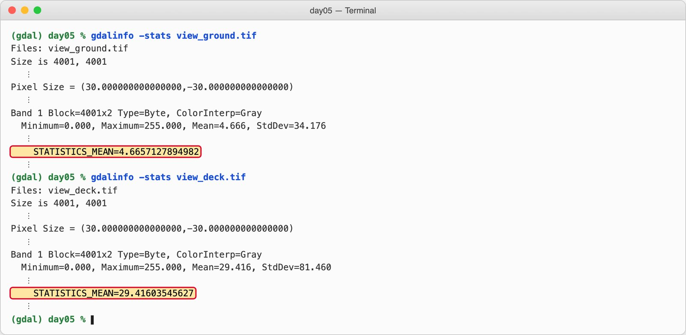

Turn the mean into square kilometres:

> **visible area (km²) = mean ÷ 255 × width × height × 900 ÷ 1,000,000**
>
> (900 m² is one 30 × 30 m pixel.)

| Observer | Mean | Share of the square | Visible area |
|---|---|---|---|
| Ground, 1.7 m | 4.666 | 1.8 % | **264 km²** |
| Deck, 97 m | 29.416 | 11.5 % | **1,662 km²** |

From the ground, buildings and trees hide almost everything around you; you only see the far mountain slopes that face Tashkent. From the deck you see **six times more**.

## 🏔️ Part 10 · The view from Big Chimgan, and can they see each other?

Climb Big Chimgan (on the computer):

```
gdal_viewshed -ox 588336 -oy 4594272 -oz 1.7 -md 60000 dem_utm.tif view_chimgan.tif
gdalinfo -stats view_chimgan.tif
```

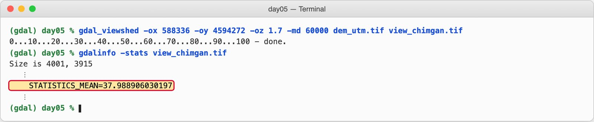

The mean is 37.989, and this square is 4,001 × 3,915 pixels (it's cut at the top by our data), so you see **2,100 km²**: the slopes all around Charvak lake and a wide arc of the plain towards Tashkent (the round edge is our 60 km limit).

**Can you see the TV Tower from the summit?** The option **`-tz`** (target height) checks whether something *tall* is visible, not just the ground. Ask whether the tower's deck (97 m) can be seen from Chimgan, 66.7 km away, then read the pixel at the tower:

```
gdal_viewshed -ox 588336 -oy 4594272 -oz 1.7 -tz 97 -md 80000 dem_utm.tif chimgan_to_tower.tif
gdallocationinfo -valonly -wgs84 chimgan_to_tower.tif 69.2850 41.3456
```

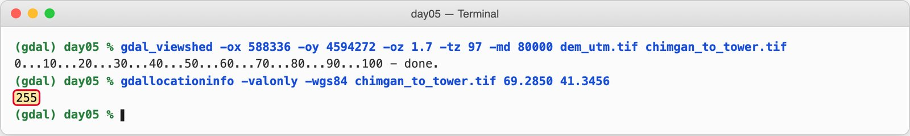

**255 = yes!** On a clear day, people on the observation deck and on the summit of Big Chimgan can see each other.

## 🛰️ Part 11 · Put it on Sentinel-2 satellite imagery (QGIS)

Time to make it look good. Open **QGIS** (from Day 04).

**1. Add a cloud-free Sentinel-2 image of the whole region.** Go to **Layer → Add Layer → Add XYZ Layer…**. Paste this address into **URL** and click **Add**, then **Close**:

```
https://tiles.maps.eox.at/wmts/1.0.0/s2cloudless-2024_3857/default/g/{z}/{y}/{x}.jpg
```

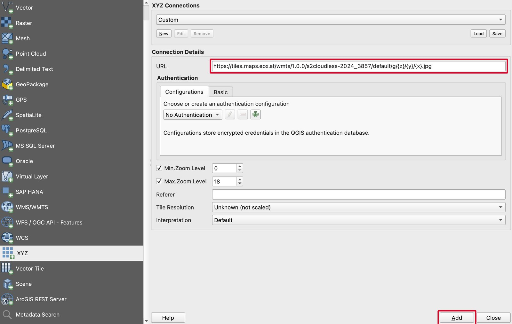

This is **EOxCloudless 2024**: thousands of Sentinel-2 photos from the year, with every cloud removed.

**2. Drag in your files.** Download **[`viewpoints.geojson`](data/viewpoints.geojson)** (the TV Tower and Big Chimgan as two points) into `day05`. Then drag **`hillshade.tif`**, **`view_deck.tif`** and **`viewpoints.geojson`** onto the map. The viewshed shows up black and white: white is visible.

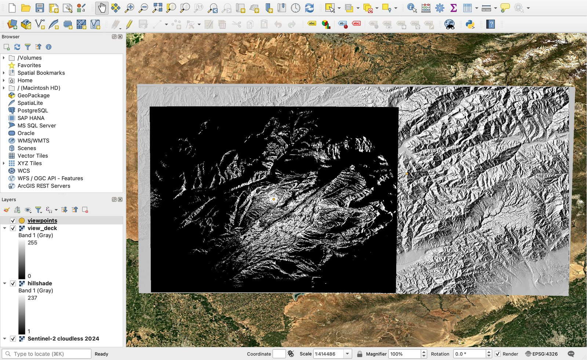

**3. Mix the relief into the photo.** Double-click **hillshade** in the Layers panel → **Symbology**. At the bottom, under *Layer Rendering*, set **Blending mode** to **Multiply**. Then open the **Transparency** tab on the left and set **Global Opacity** to about 40 %. Click **OK**. The mountains now have shadows on the satellite image.

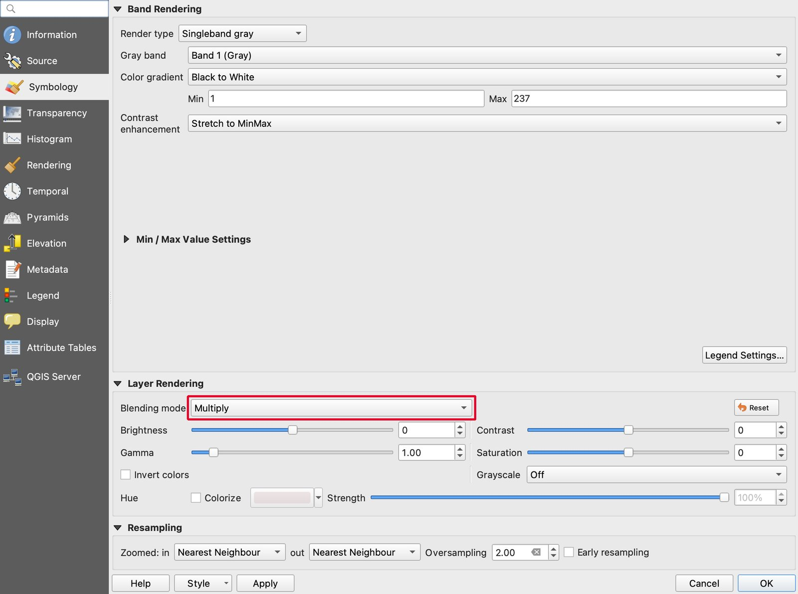

**4. Show only what's visible.** Double-click **view_deck** → **Symbology**. Set **Render type** to **Paletted/Unique values** and click **Classify**. Two rows appear, **0** and **255**. Select the row **0** and click the **minus** button, so hidden pixels are not drawn at all. Double-click the colour of **255** and pick a bright yellow. In the **Transparency** tab set **Global Opacity** to 75 % and click **OK**.

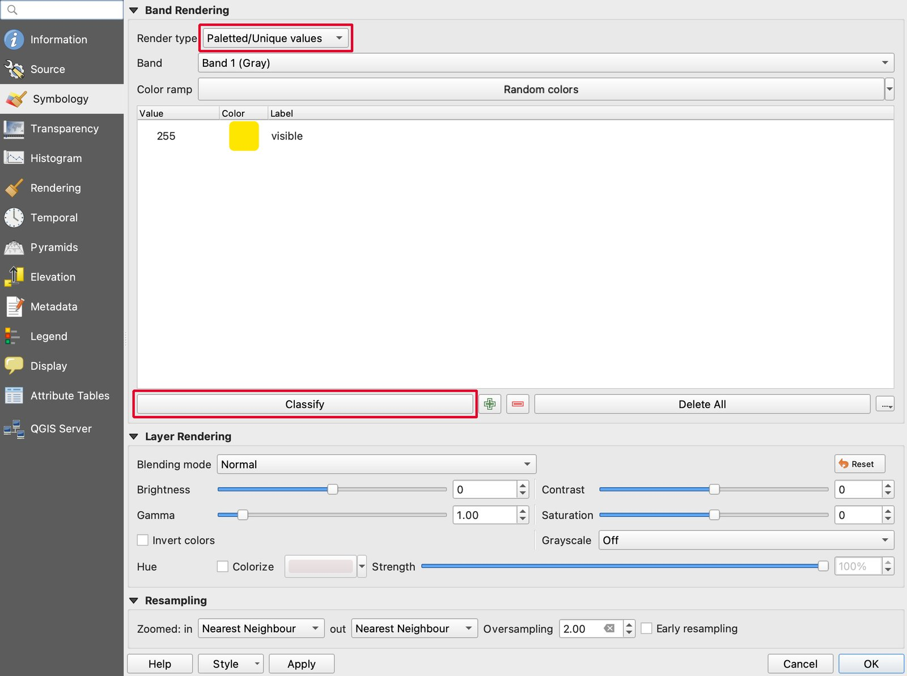

**5. Mark the viewpoints.** Double-click **viewpoints** → **Symbology** → choose a red **star**, size 6. In **Labels**, choose **Single Labels** with the value **name**, and add a buffer (a white or dark outline around the text) under **Buffer**.

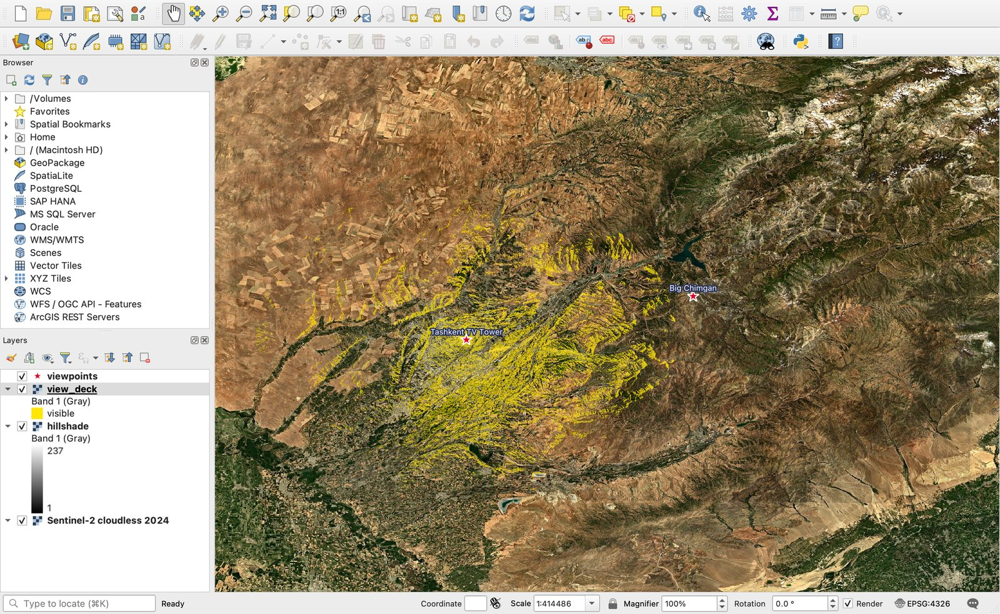

**6. Save the picture.** **Project → Import/Export → Export Map to Image…**. Set **Resolution** to **300 dpi** and click **Save**.

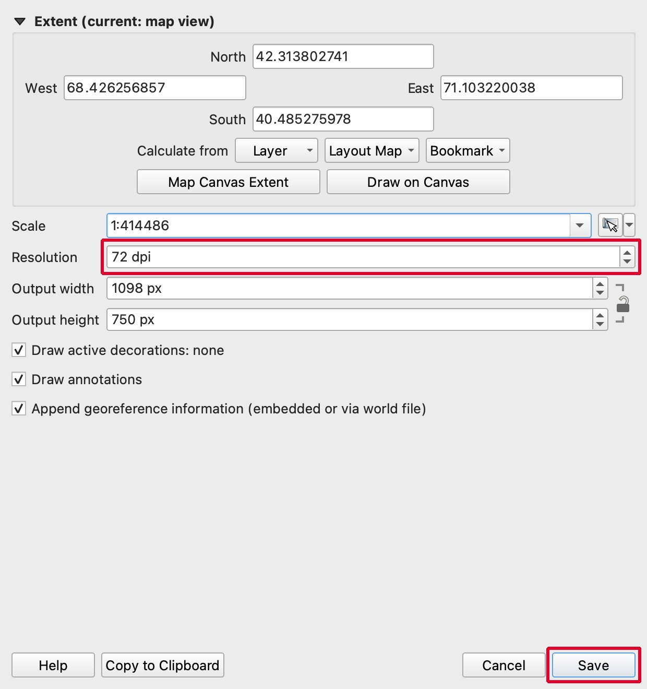

Repeat step 4 with `view_ground.tif` and `view_chimgan.tif` to make the other two maps.

> 💡 Want a title, a legend and a scale bar? Use **Print Layout** exactly as in Day 04, Part 12.

## 🌈 Make it yours: ideas

- **Minarets were watchtowers.** Compute the view from the top of the **Kalon Minaret** in Bukhara (45.6 m, about 39.7759° N, 64.4146° E, UTM zone 41N **EPSG:32641**, tile `N39_00_E064`) or the **Islam Khoja Minaret** in Khiva (57 m, about 41.3774° N, 60.3600° E, EPSG:32641, tile `N41_00_E060`).
- **Your own home.** Find your building in QGIS, read its coordinates, and run a viewshed with `-oz` = your floor × 3 m. Can you see Chimgan from your window? Use `-tz`.
- **Grow the tower.** Run the TV Tower viewshed with `-oz 1.7`, `25`, `50`, `97`, `200` and make a chart: area against height.
- **Where can you see the tower from?** Flip the question: put the observer on the ground everywhere and the target at the top. Running `gdal_viewshed -ox 523843 -oy 4577162 -oz 375 -tz 1.7 …` shows every place where a person (1.7 m) can see the tip of the 375 m tower: that's how far the tower works as a landmark.
- **Other cities, other UTM zones:** Nukus EPSG:32640 · Bukhara, Navoi, Urgench, Khiva EPSG:32641 · Tashkent, Samarkand, Namangan, Fergana EPSG:32642 · Andijan EPSG:32643.

## 💾 Share your map

Export your map (Part 11), add a title, and post it with **#30DayMapChallenge #30DayMapChallengeUzbekistan**. Please credit the data:

> Elevation: Copernicus DEM GLO-30 © DLR e.V. 2010–2014 and © Airbus Defence and Space GmbH 2014–2018, provided under COPERNICUS by the European Union and ESA. Imagery: EOxCloudless https://cloudless.eox.at by EOX IT Services GmbH (Contains modified Copernicus Sentinel data 2024).

## 🆘 Something went wrong?

| Problem | Fix |
|---|---|
| `command not found` / `is not recognized` | macOS/Linux: type `conda activate gdal` first. Windows: use the **OSGeo4W Shell**, not the normal Command Prompt. |
| `No such file or directory` / `does not exist` | You're in the wrong folder. Type `ls` (or `dir`) and check the tiles are there; use `cd` to go to `day05`. |
| Windows: `gdalbuildvrt` doesn't understand `*` | List the six files by name instead: `gdalbuildvrt dem.vrt Copernicus_DSM_COG_10_N40_00_E068_00_DEM.tif Copernicus_DSM_COG_10_N40_00_E069_00_DEM.tif …` |
| `gdal_viewshed`: the observer is outside the raster | You used degrees instead of metres. Use the numbers from `gdaltransform` (Part 6). |
| `Output dataset dem_utm.tif exists` | Delete the old file or add `-overwrite` to the `gdalwarp` command. |
| The viewshed is all black | Check the order: `-ox` is the x (523843), `-oy` the y (4577162). |
| The XYZ layer is blank in QGIS | Check your internet connection and that the URL has `{z}/{y}/{x}` exactly. |
| Copy-pasted commands fail | Paste each command as **one line**. Make sure no "smart quotes" (“ ”) sneaked in. |

## 📎 Credits

- **Elevation:** [Copernicus DEM GLO-30](https://registry.opendata.aws/copernicus-dem/) © DLR e.V. 2010–2014 and © Airbus Defence and Space GmbH 2014–2018, provided under COPERNICUS by the European Union and ESA; all rights reserved. Free to use under the Copernicus DEM licence.
- **Satellite imagery:** [EOxCloudless 2024](https://cloudless.eox.at) by EOX IT Services GmbH (Contains modified Copernicus Sentinel data 2024), [CC BY-NC-SA 4.0](https://creativecommons.org/licenses/by-nc-sa/4.0/), free for non-commercial use.
- **Tools:** [GDAL](https://gdal.org) (MIT licence), [Miniforge](https://github.com/conda-forge/miniforge), [QGIS](https://qgis.org).
- Screenshots: GDAL 3.13 in a macOS terminal, QGIS 3.34 on a Mac. Heights and areas computed with the commands in this tutorial.
