# Day 06 tutorial: Put a 1913 map of Tashkent on today's city

**Theme: Vintage.** In this tutorial you take a real map from 1913 and pin it onto today's Tashkent, so you can slide between the two cities. You work in **Allmaps**, a free tool that runs in your web browser. You don't install anything and you don't need an account. It takes about 45 minutes.

📄 **Printable PDF:** [English](pdf/Day06_Tutorial_EN.pdf) · [Русский](pdf/Day06_Tutorial_RU.pdf) · [Oʻzbekcha](pdf/Day06_Tutorial_UZ.pdf)

| Tashkent in 1913 and today | The square, then and now | The old bazaar, then and now |
|---|---|---|
| 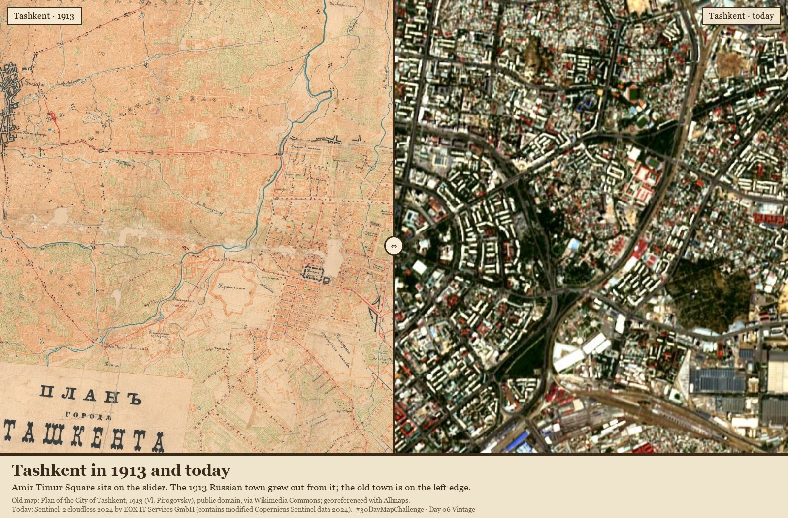 | 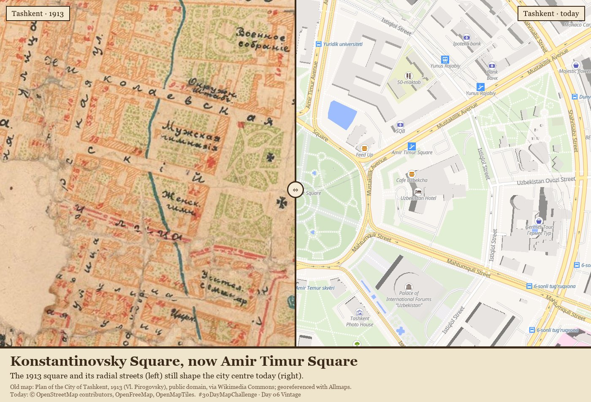 | 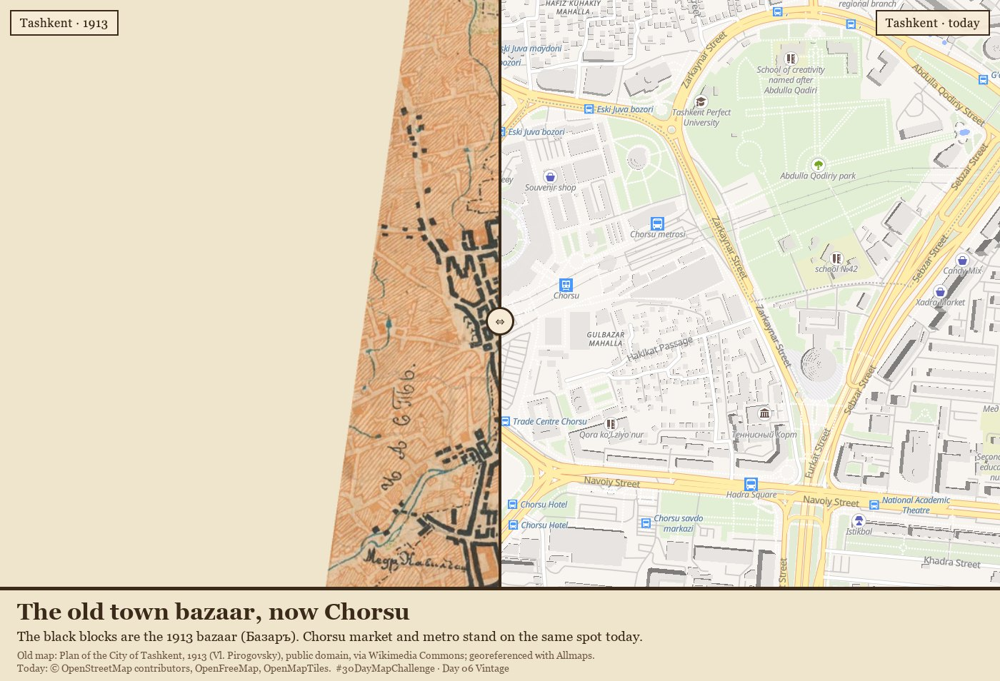 |

**What you'll learn**
- What **georeferencing** is, and how to do it by clicking matching points on an old map and a modern one.
- How to read an old map against today's satellite images and streets.
- How to share the result as a link, as map tiles for QGIS or MapLibre, and as a swipe map.

---

## Part 0. Five ideas before you start

1. **A scan is just a picture.** A scanned paper map is a photo: it knows nothing about where on Earth it is. Its "coordinates" are only pixels, like "3249 pixels from the left, 2021 from the top".
2. **Georeferencing** is telling the computer where the picture belongs. You do it with **ground control points** (GCPs). A GCP is one place you can find on both maps, such as a square or a street corner. You click it on the old map, then on the modern map.
3. **Three points are the minimum.** With 3 or more points, the computer works out how to stretch, rotate and move the old map so that all points line up as well as possible. More points, spread out over the whole map, give a better fit.
4. **A mask** is an outline around the part of the scan you want to keep. It cuts away the white paper border.
5. **IIIF** (say "triple-eye-eff") is a standard way for libraries to put large images online in small tiles, so you can zoom in without downloading a huge file. Allmaps only opens maps that are online in IIIF. You don't need to know more than that today: we prepared the link for you.

---

## Part 1. Meet the map

Our map is the **Plan of the City of Tashkent, as of 1 April 1913** (*План города Ташкента, составлен по 1 апреля 1913 года*), published by Vladimir Pirogovsky. It was printed to show Tashkent's new electric tram, which opened in 1913. Its scale is "100 sazhens to the inch", about 1:8,400. It is **public domain**, and the scan comes from [Wikimedia Commons](https://commons.wikimedia.org/wiki/File:Tashkent-1913-map.jpg).

What to look for:
- **The old town** on the left (west): narrow, winding streets, with the big bazaar drawn in black.
- **The Russian new town** in the middle and on the right (east): straight streets running out from a round square like the spokes of a wheel. That round square is today's **Amir Timur Square**. In 1913 it was **Konstantinovsky Square**.
- **The Ankhor canal** in blue between the two towns, and the **Salar canal** further east.
- **The railway station** in the south-east, and the red **tram lines**.

The labels use the spelling from before the 1918 Russian spelling reform, so you'll see letters like **ъ** at the ends of words and **і**: *Базаръ* is "Bazaar".

> **Why the map lives in our repository.** Wikimedia Commons doesn't offer IIIF, so Allmaps can't open the Commons copy. We cut the scan into IIIF tiles with a small Python script ([data/make_iiif.py](data/make_iiif.py)) and put them in this repository, in the [iiif/tashkent-1913](../../../iiif/tashkent-1913) folder. You can do the same for any scan you are allowed to share.

---

## Part 2. Open the map in Allmaps Editor

1. Open **[editor.allmaps.org](https://editor.allmaps.org)**.
2. Copy this link and paste it into the box in the middle of the page (**1**), then press **Enter**:

   ```
   https://raw.githubusercontent.com/NodiraTillayeva/30DayMapChallengeUzbekistan/main/iiif/tashkent-1913/manifest.json
   ```

   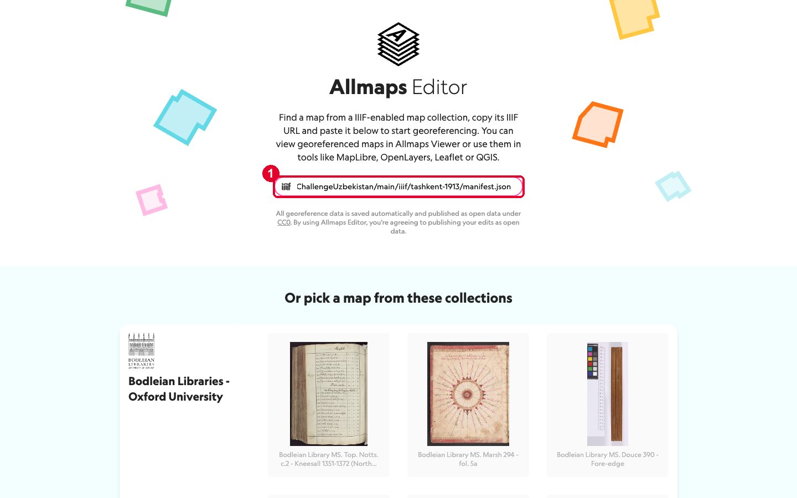

3. Allmaps shows the map's title and a picture of it. Click the picture to choose it.

   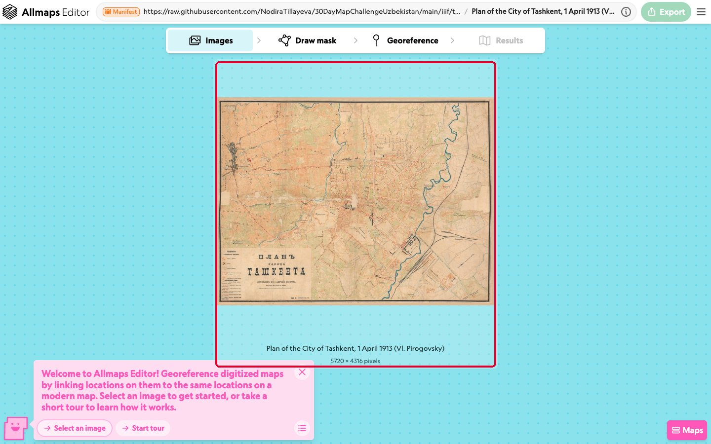

> ⚠️ **Read this before you click anything else.** Allmaps saves every change at once, publicly, and for everyone. There is no "my copy": all of us edit **the same** 1913 map. So:
> - **Don't delete points you didn't add.** If you see points already there, that's other people's work (or ours).
> - If you see points move while you work, someone else is editing too. That's fine.
> - If the map gets broken, Part 4 shows how to put back our 6 good points in one paste.
> - The page you build in Part 8 uses a saved copy, so it keeps working whatever happens to the shared map.

---

## Part 3. Draw the mask

The mask cuts away the paper border, so only the map itself is pinned to the city.

1. Click **Draw mask** at the top.
2. Click on the four corners of the map's black frame, one after another: top-left (**1**), top-right (**2**), bottom-right (**3**), then bottom-left. Zoom in with the mouse wheel to click exactly on the frame.
3. Click the first corner again, or click **Finish**, to close the outline.

   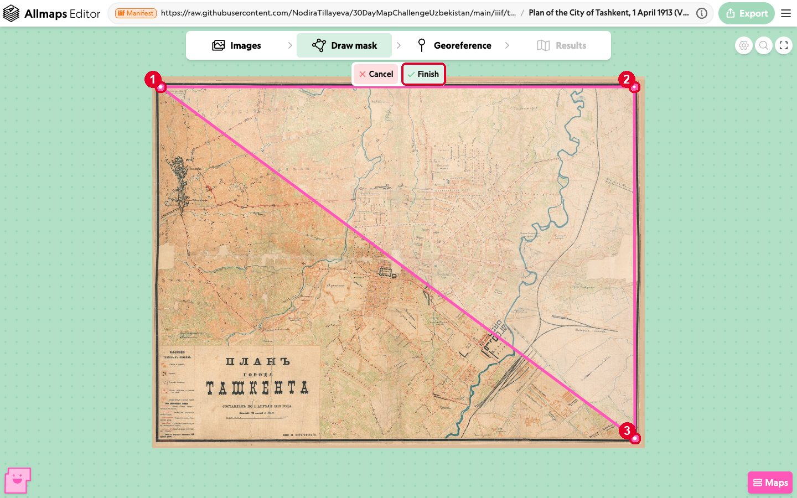

4. If the map already has a mask (a pink outline), you don't need a new one. To change it, drag its corners.

---

## Part 4. Place the control points

This is the heart of georeferencing. The old map is on the left and today's map is on the right.

1. Click **Georeference** at the top.
2. On the right, click the magnifying glass (**1**), type **Tashkent** (**2**) and click **Tashkent, TK, Uzbekistan** (**3**). The modern map flies to Tashkent.

   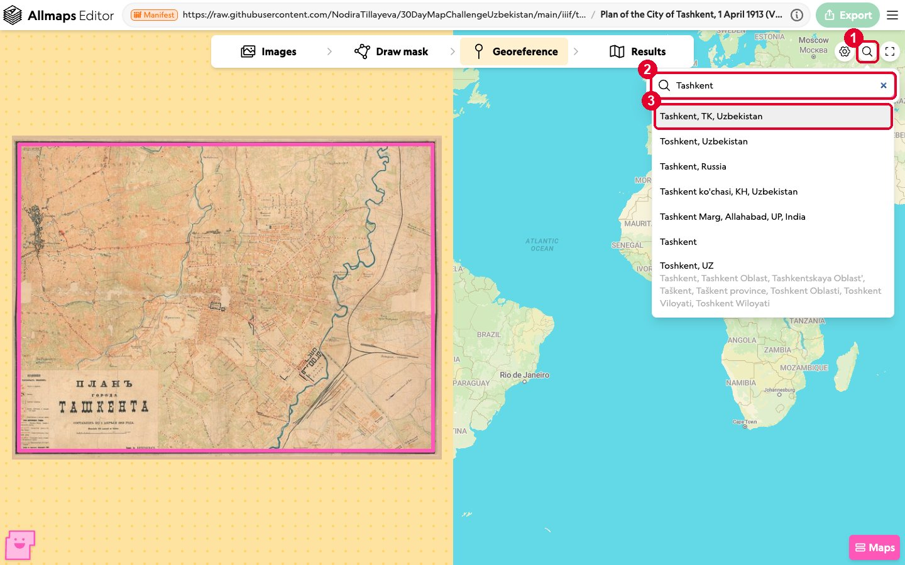

3. Zoom in on both sides until you can see the **round square** in the middle of the new town on the left, and **Amir Timur Square** on the right. Use the mouse wheel to zoom and drag to move. Each side moves on its own.

   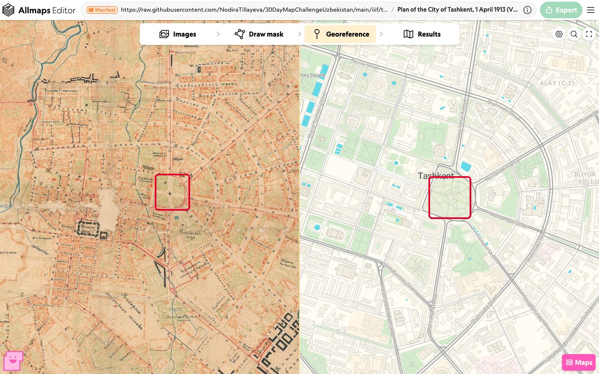

4. **Click the centre of the square on the old map.** A pink dot with the number **1** appears.

   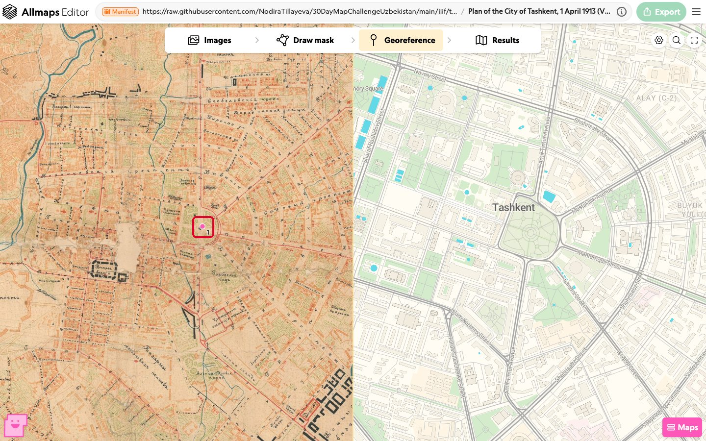

5. **Click the centre of Amir Timur Square on the modern map.** A dot with the same number **1** appears. That is your first control point: one place, clicked on both maps.

   

6. Add **at least 3 more points** the same way. Always click the old map first, then the modern map. Spread them out: one in each part of the map is better than five close together. Good choices are places that haven't moved since 1913:
   - **Kukeldash madrasa**, in the old town, next to Chorsu bazaar (west);
   - a crossing of the big **radial streets** north of the square;
   - a crossing near the **railway station** (south-east);
   - a crossing in the **south-west** of the new town.

   To fix a point, drag it. To remove one of *your* points, open **Maps** at the bottom right and click the bin next to it.

7. Click **Maps** at the bottom right to see the list of points. Each line shows the pixel on the old map and the longitude and latitude it belongs to.

   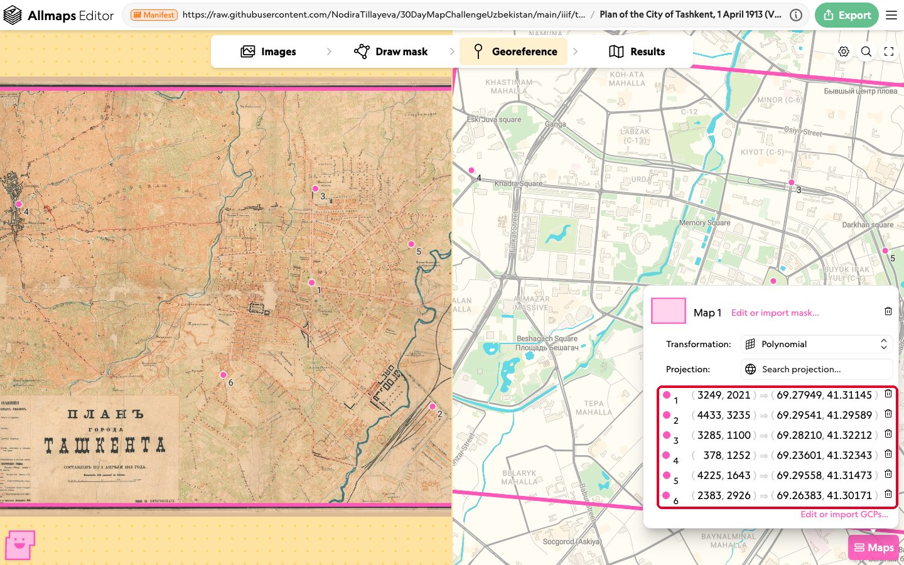

> **Shortcut, or repair.** You can also paste points as text. Click **Maps** → **Edit or import GCPs…**, delete what's in the box, paste the six lines below and click **Save**. These are the points we used for the final maps. The same text is in [data/tashkent-1913-gcps.points](data/tashkent-1913-gcps.points), in the format QGIS uses (longitude, latitude, then pixel x and minus pixel y).
>
> ```
> mapX,mapY,sourceX,sourceY,enable,dX,dY,residual
> 69.27949,41.31145,3249,-2021,1,0,0,0
> 69.29541,41.29589,4433,-3235,1,0,0,0
> 69.2821,41.32212,3285,-1100,1,0,0,0
> 69.23601,41.32343,378,-1252,1,0,0,0
> 69.295584,41.314732,4225,-1643,1,0,0,0
> 69.263831,41.301709,2383,-2926,1,0,0,0
> ```

---

## Part 5. Check the result

1. Click **Results** at the top. The old map now lies on top of today's city.

   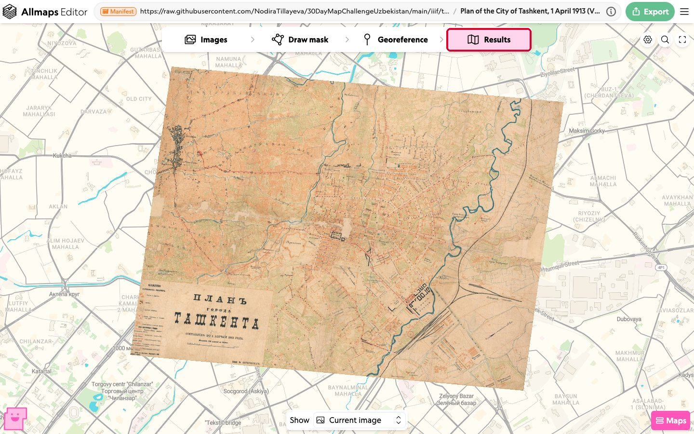

2. Zoom in and check a few streets. **Hold down the Space bar** to hide the old map for a moment and see the modern map under it.
3. Notice that the old map is turned by about 5°. That's not a mistake: the surveyors of 1913 didn't draw "up" exactly as north.
4. If some part doesn't fit, go back to **Georeference** and add or move a point there.

**Which transformation?** Open **Maps** and click the menu next to **Transformation**. It decides *how* the old map is bent to fit the points.

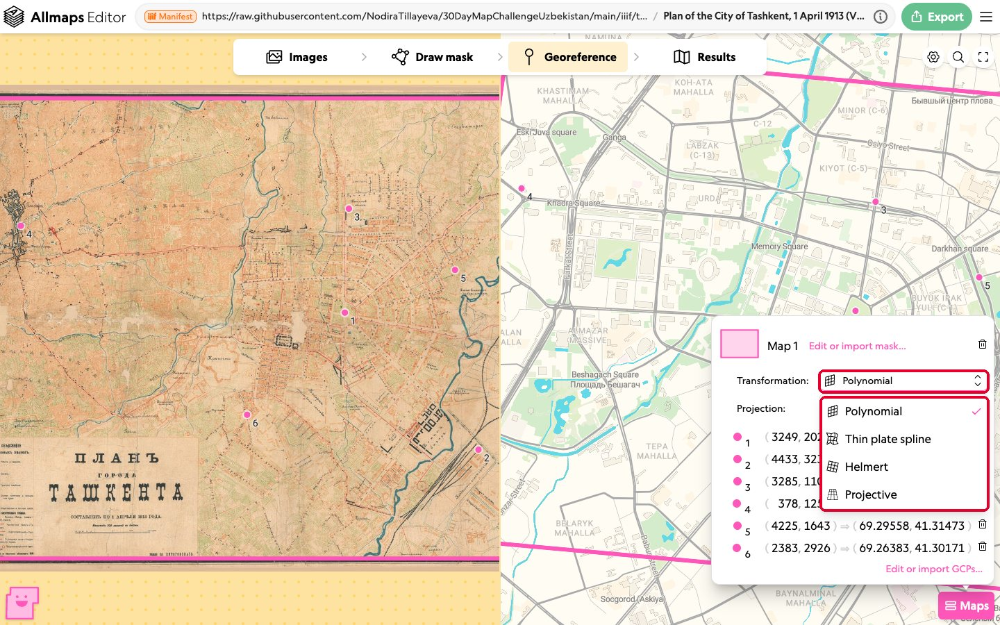

| Choice | What it does | When to use it |
|---|---|---|
| **Polynomial** (default) | Moves, turns, stretches and slightly tilts the whole map, like a sheet of glass. | Almost always. Good for a careful city plan like ours. |
| **Helmert** | Only moves, turns and scales evenly. The shape stays exactly the same. | When you trust the old map's proportions completely. |
| **Thin plate spline** | Bends the map like rubber so that every point fits exactly. | Old, hand-drawn maps with errors. It needs many points, otherwise it twists strangely. |
| **Projective** | Treats the map like a photo taken at an angle. | Photos of maps, aerial photos. |

With our 6 points the polynomial fit is off by only about **3 pixels** on the old map, which is under 10 metres on the ground. You can see it in [the final square map](images/final-b-square.jpg): the 1913 ring and today's ring road lie on top of each other.

---

## Part 6. Share your georeferenced map

Click **Export** at the top right (**1**). Each line has a copy button on its right.

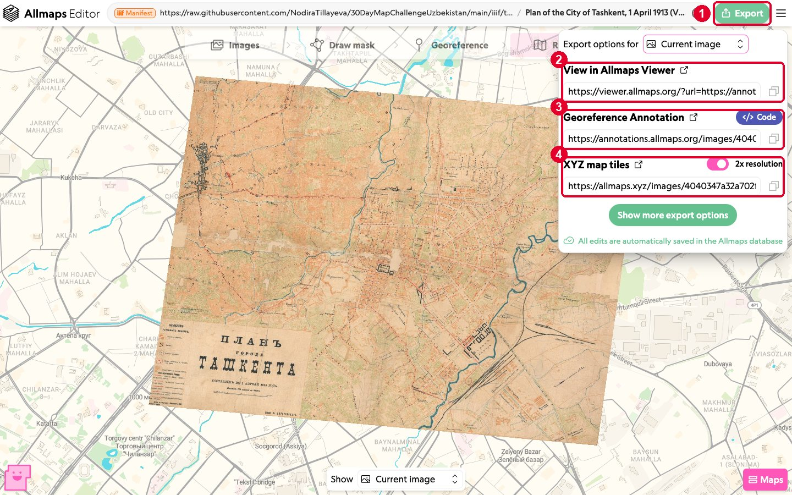

- **View in Allmaps Viewer** (**2**): a link anyone can open to see the old map on today's city. Good for sending to friends.
- **Georeference Annotation** (**3**): your work as a small text file (JSON) with the points and the mask. Click **Code** to see it. Save a copy: it's your backup, and it's what we saved as [data/tashkent-1913.georef.json](data/tashkent-1913.georef.json).
- **XYZ map tiles** (**4**): a link for other map programs, such as QGIS (Part 9) or our swipe map (Part 8). Keep **2x resolution** on for sharp tiles.

Our georeferenced map in the Allmaps Viewer: **[open it](https://viewer.allmaps.org/?url=https://annotations.allmaps.org/images/4040347a32a702f2)**.

---

## Part 7. Explore in Allmaps Viewer

Open your **View in Allmaps Viewer** link. Click the **drop** icon at the bottom and drag the slider down to make the old map see-through. You'll see both cities at once.

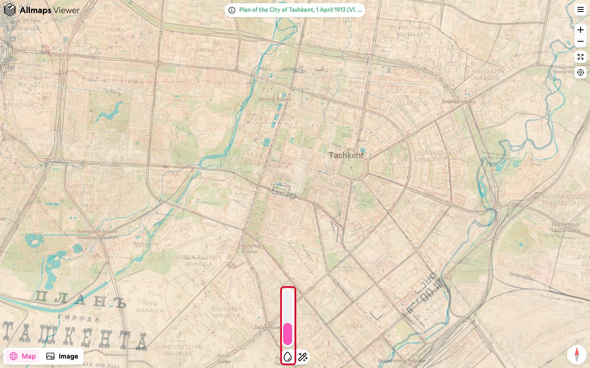

Things to look for:
- Most of the 1913 radial streets around the square are still main streets today.
- The black **bazaar** on the left lies exactly where **Chorsu** market and metro are today.
- The **Ankhor canal** still flows in the same bed.
- Large parts of the 1913 town were rebuilt after the earthquake of 1966. Where do the old streets disappear?

---

## Part 8. Make a vintage swipe map

We made a small web page, [compare.html](compare.html), with a slider between 1913 and today. It's the page we used for the final images.

1. Download [compare.html](compare.html): open it on GitHub, click the **Download raw file** button (an arrow pointing down), and save it.
2. Double-click the file. It opens in your web browser.
3. Drag the round **⇔** button left and right. Use the buttons at the bottom to jump to **Whole city**, **Amir Timur Square** or **Old town**, and to switch between **Satellite** (Sentinel-2 cloudless 2024, the same images as in Day 05) and **Streets** (OpenStreetMap). Satellite is best from far away, and Streets is best close up.
4. **To show your own georeferenced map**, open compare.html in a text editor (Notepad on Windows, TextEdit on Mac), find the line that starts with `const OLD_MAP_TILES`, and replace it with your **XYZ map tiles** link from Part 6:

   ```js
   const OLD_MAP_TILES = 'https://allmaps.xyz/images/YOUR-ID/{z}/{x}/{y}@2x.png';
   ```

   Save the file and open it again.

To make a picture for your #30DayMapChallenge post, set up the view you like and take a screenshot.

---

## Part 9 (bonus). Use the old map in QGIS

In Day 05 you added satellite images to QGIS as an **XYZ Tiles** layer. The old map works the same way.

1. In QGIS, in the **Browser** panel, right-click **XYZ Tiles** → **New Connection…**.
2. Name it **Tashkent 1913** and paste your **XYZ map tiles** link from Part 6 into **URL**. Click **OK**.
3. Double-click **Tashkent 1913** to add it to the map. Add **OpenStreetMap** too, and put the old map on top.
4. Right-click the old map layer → **Properties** → **Transparency**, and set **Opacity** to about 60%.

Now you can draw on top of it: for example, trace the 1913 tram lines as a new line layer and compare them with today's metro.

---

## Ideas for your own map

- **Other cities.** Many old maps of Central Asia are already online in IIIF, for example in the [David Rumsey Map Collection](https://www.davidrumsey.com) and the [Library of Congress](https://www.loc.gov/maps/). Paste their IIIF link into Allmaps Editor. Look for plans of Samarkand, Bukhara, Kokand or Andijan.
- **Your own scan.** Have an old map at home, or a Soviet map you're allowed to share? Use [data/make_iiif.py](data/make_iiif.py) to put it online as IIIF, then georeference it.
- **Then and now, street by street.** Pick five 1913 street names from the map (for example *Николаевская*) and find what they are called today.
- **Vintage style.** Put the old map's colours on a modern map: use its paper colour as the background and its red and blue as line colours.

## When you share

Please credit:
> Plan of the City of Tashkent, 1913 (Vl. Pirogovsky), public domain, via Wikimedia Commons. Georeferenced with Allmaps.

And add the credit for whatever modern map you show:
> Sentinel-2 cloudless 2024 by EOX IT Services GmbH (contains modified Copernicus Sentinel data 2024)

or
> © OpenStreetMap contributors

---

## Troubleshooting

| Problem | What to do |
|---|---|
| The editor says it can't open the link. | Check that you copied the whole link, ending in `manifest.json`. Make sure there's no space at the start or end. |
| The old map is upside down or twisted in **Results**. | One point is clicked in the wrong place, or one point has its two sides swapped. Open **Maps** and check the list; drag the wrong point. |
| Someone deleted the points. | Use the shortcut in Part 4: paste our 6 points into **Edit or import GCPs…**. |
| The old map is shifted a little in one corner. | Add a point in that corner. Points close together in the middle can't hold the corners in place. |
| **Thin plate spline** makes the map wobbly. | Go back to **Polynomial**, or add many more points. |
| compare.html shows only the modern map. | You need an internet connection. If you changed `OLD_MAP_TILES`, check the quotes and that the link has `{z}/{x}/{y}` in it. |
| The satellite image is blurry when I zoom in. | Sentinel-2 has 10 m pixels. Switch to **Streets** for close-ups. |

## Credits

- **Old map:** Plan of the City of Tashkent, as of 1 April 1913, published by Vl. Pirogovsky. Public domain, scan from [Wikimedia Commons](https://commons.wikimedia.org/wiki/File:Tashkent-1913-map.jpg). We re-host it as IIIF tiles in this repository.
- **Georeferencing:** [Allmaps](https://allmaps.org). Georeference data made in Allmaps Editor is published under CC0.
- **Satellite images:** [Sentinel-2 cloudless 2024](https://s2maps.eu) by EOX IT Services GmbH (contains modified Copernicus Sentinel data 2024), licensed CC BY-NC-SA 4.0.
- **Streets:** © [OpenStreetMap](https://www.openstreetmap.org/copyright) contributors, served by [OpenFreeMap](https://openfreemap.org) with OpenMapTiles.
- **Swipe map:** [MapLibre GL JS](https://maplibre.org).
