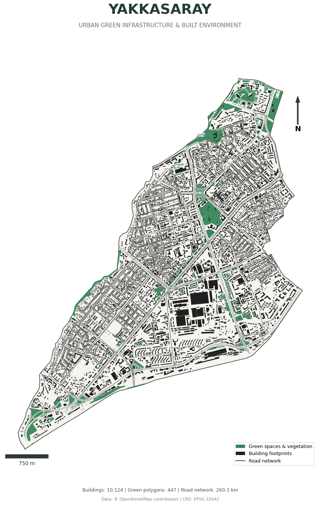

Day 07 | 10-Minute Map #30DayMapChallenge 

For Day 7, I created an urban green space map of Yakkasaray District, Tashkent, Uzbekistan.
The map combines three spatial datasets from OpenStreetMap:

Green spaces and vegetation
Building footprints
Road network

Data: Open Street Map 

Tool: Python

Author: Tumaris Ramanova
