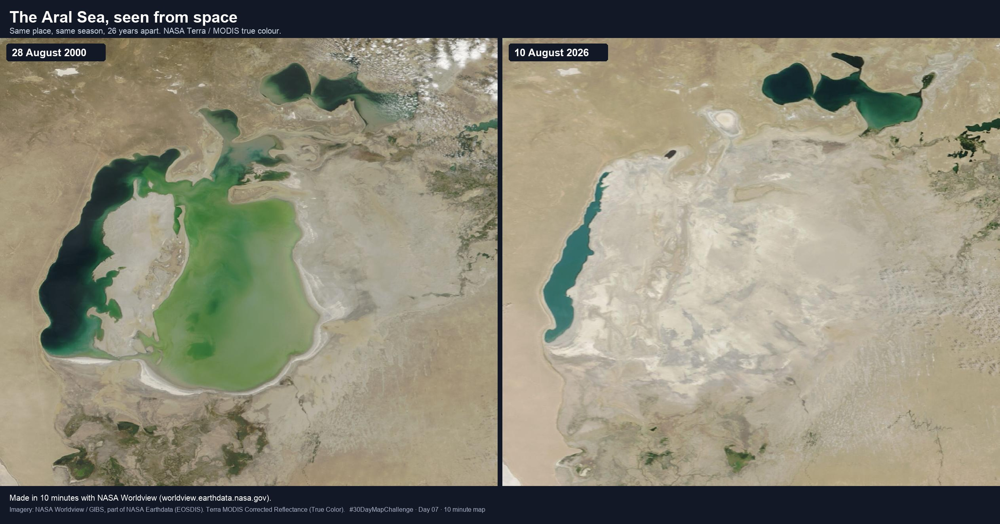
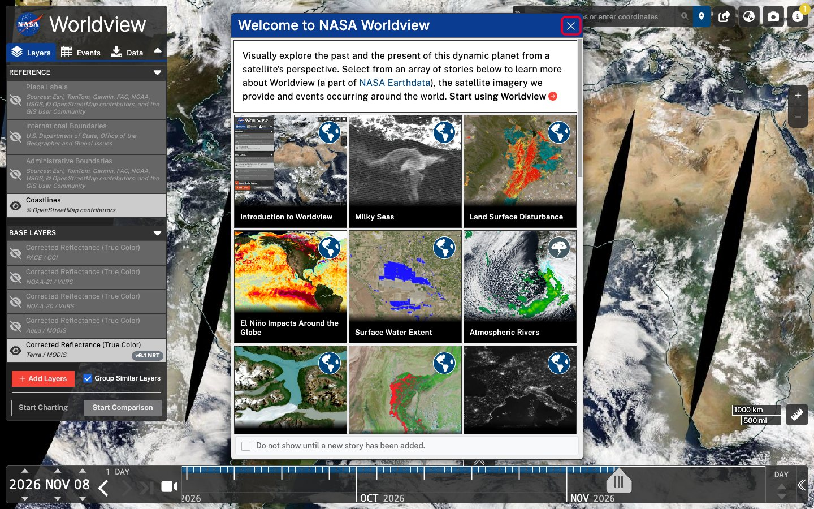
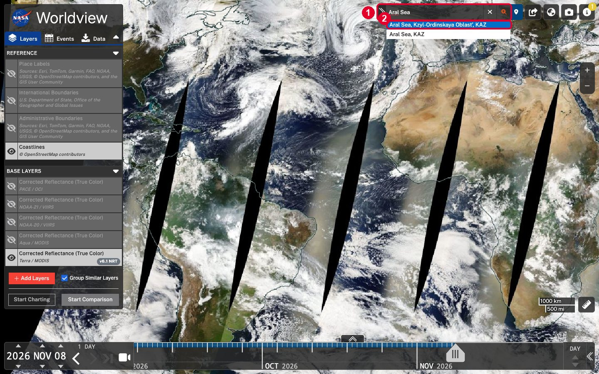
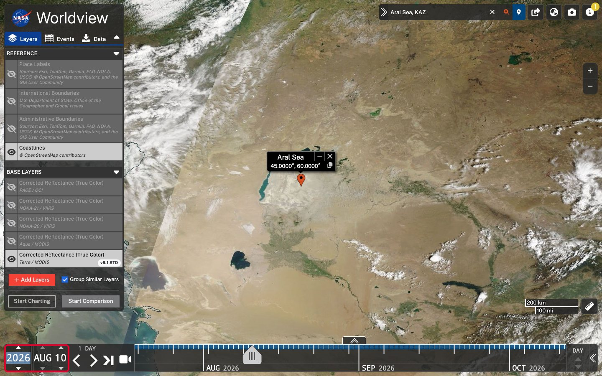
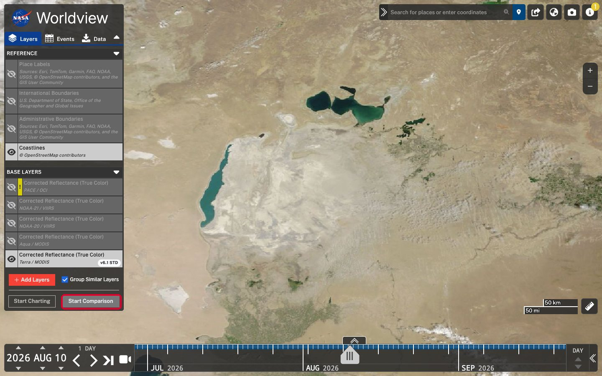
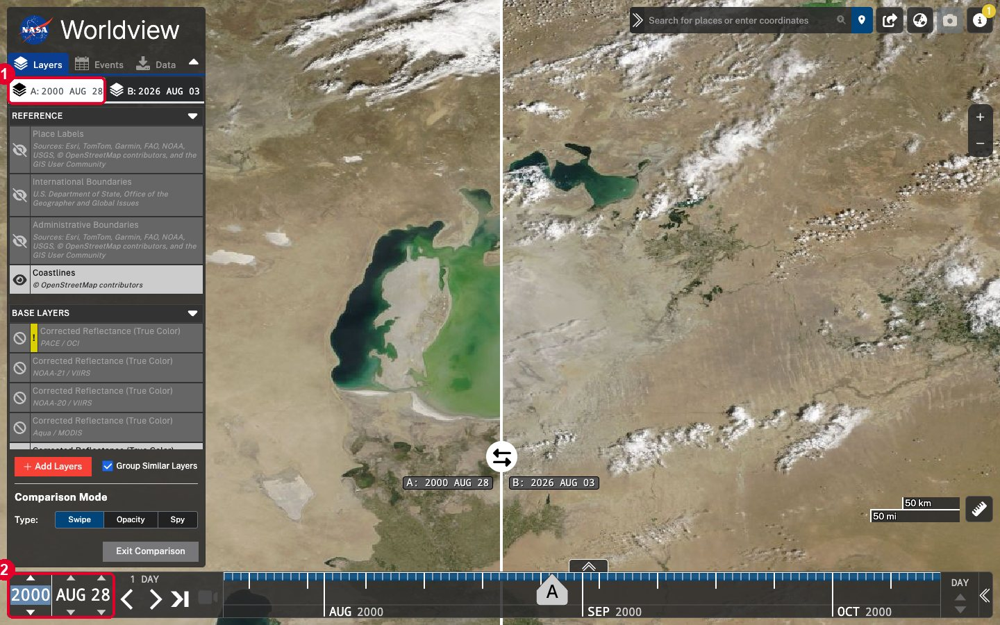
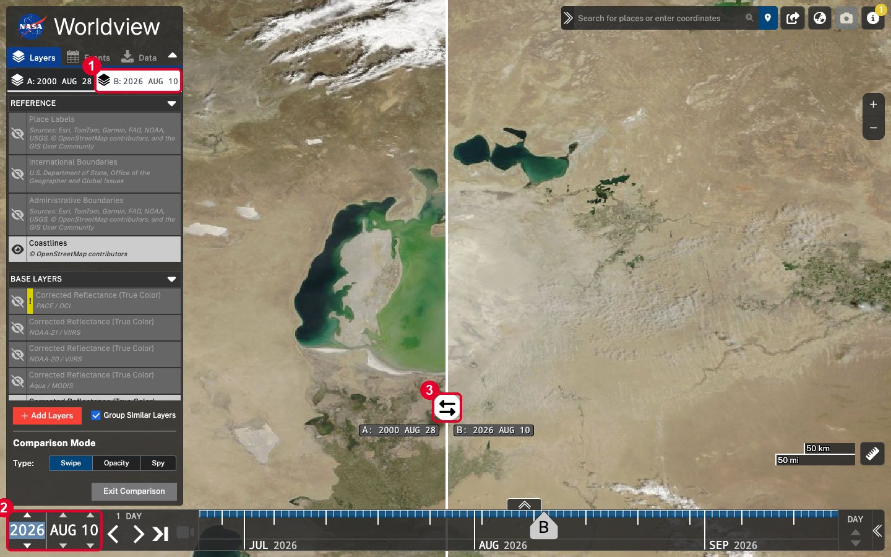
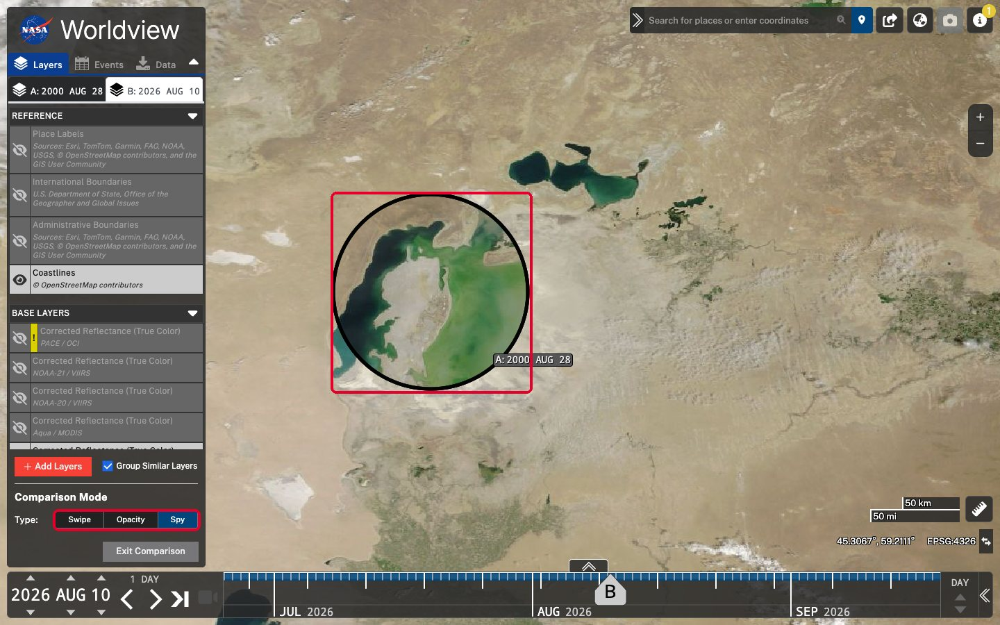
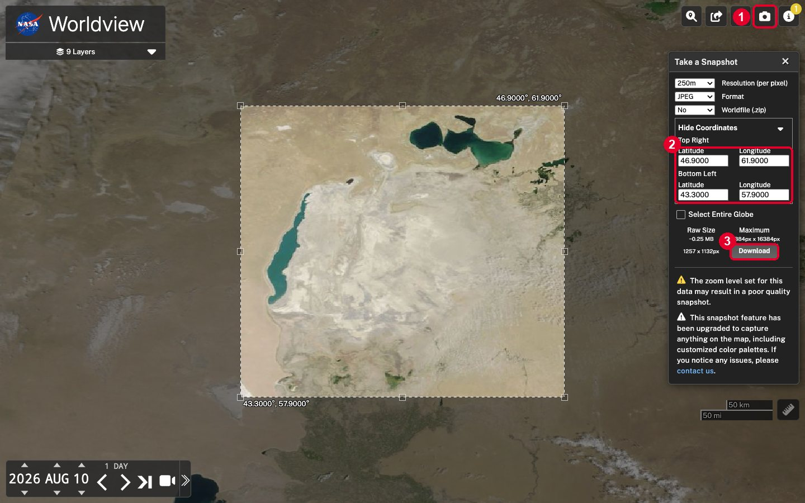
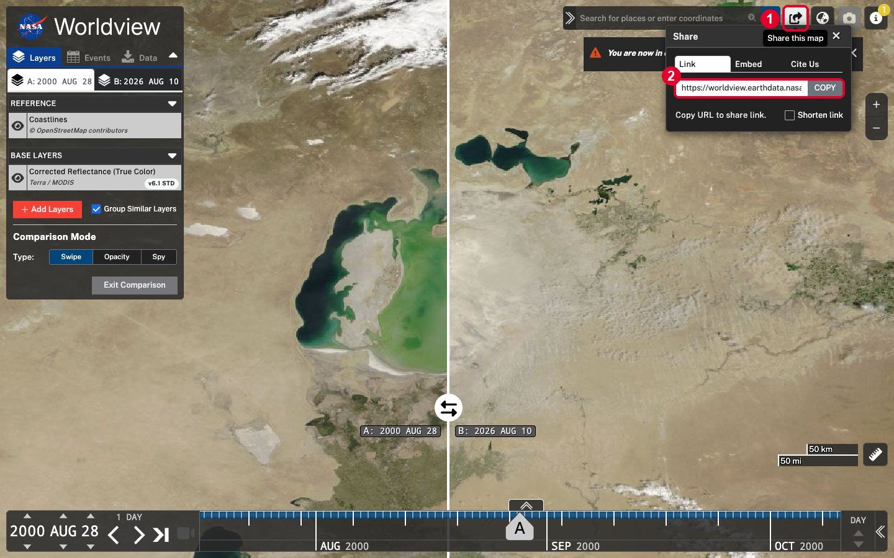

# Day 07 tutorial: The Aral Sea from space, in 10 minutes

**Theme: 10 minute map.** You have 10 minutes to make a map. In this tutorial you use **NASA Worldview**, a free website that shows satellite images of the whole Earth for every day since 2000. You'll find the Aral Sea, compare the year 2000 with 2026, and download two real satellite images. Nothing to install, no account.

📄 **Printable PDF:** [English](pdf/Day07_Tutorial_EN.pdf) · [Русский](pdf/Day07_Tutorial_RU.pdf) · [Oʻzbekcha](pdf/Day07_Tutorial_UZ.pdf)

**Before you start:** read the steps once, then set a timer for 10 minutes. ⏱️

## Three ideas in one minute (not counted)

1. **One satellite, every day.** NASA's **Terra** satellite has photographed the whole Earth every day since February 2000. Its camera is called **MODIS**. Each pixel is 250 metres across, so you can see lakes and cities, but not houses.
2. **True colour** means the picture uses the same colours your eyes would see from space: water is dark blue or green, desert is beige, salt is white, clouds are white too.
3. **The Aral Sea** was once one of the four largest lakes in the world. Its southern part lies in Uzbekistan, in Karakalpakstan; its northern part in Kazakhstan. From the 1960s, the water of the Amu Darya and Syr Darya was taken for cotton fields, and the sea began to dry out. The dry seabed is now a new desert, the **Aralkum**.

## Minutes 0–2. Open Worldview and find the Aral Sea

1. Open **[worldview.earthdata.nasa.gov](https://worldview.earthdata.nasa.gov)**.
2. A welcome window appears. Close it with the **×** in its top right corner.

   

3. Click the search box at the top right (**1**), type **Aral Sea** and click **Aral Sea, KAZ** (**2**). The map flies there and puts a red pin in the middle. Close the pin's label with its **×**.

   

4. If the map is too close or too far, use the **+** and **–** buttons on the right, or the mouse wheel, until you see the whole sea.

## Minutes 2–3. Go to a clear summer day

Worldview opens on today's date. Today might be cloudy, so pick a clear day.

1. At the bottom left you see the date: year, month, day. Click the **month**, type **AUG** and press **Tab**. Type **10** for the day and press **Tab**.
2. The map changes to **10 August 2026**. That's what the Aral Sea looks like now.

   

> **Clouds?** Use the **<** and **>** arrows next to the date to step one day back or forward until you find a clear day.

## Minutes 3–6. Compare 2000 with 2026

1. In the panel on the left, click **Start Comparison**.

   

2. Two tabs appear: **A** and **B**. Each tab has its own date. Tab **A** is selected (**1**). Change its date (**2**): click the **year**, type **2000**, press **Tab**; type **AUG**, press **Tab**; type **28**, press **Tab**. The left side of the map now shows 28 August 2000.

   

3. Click tab **B** (**1**) and set its date to **2026 AUG 10** the same way (**2**). Now drag the round **⇆** button (**3**) left and right. Left is 2000, right is 2026.

   

4. Try the other two ways to compare under **Comparison Mode**: **Opacity** fades one year into the other, and **Spy** shows 2000 inside a circle that follows your mouse.

   

## Minutes 6–9. Download two satellite images

The camera button doesn't work in comparison mode, so first click **Exit Comparison** in the left panel. Then take one picture for each year.

1. Make sure the date shows **2026 AUG 10**. Click the **camera** button at the top right (**1**). A dashed box appears on the map, and the **Take a Snapshot** panel opens.
2. Click **Edit Coordinates** and type the corners of the box (**2**), so both years have exactly the same frame:

   | | Latitude | Longitude |
   |---|---|---|
   | **Top Right** | 46.9 | 61.9 |
   | **Bottom Left** | 43.3 | 57.9 |

3. Leave **Resolution** at **250m** and **Format** at **JPEG**. Click **Download** (**3**). A file called `snapshot-2026-08-10.jpeg` is saved.

   

4. Close the panel, change the date to **2000 AUG 28**, and repeat steps 1–3. You get `snapshot-2000-08-28.jpeg`.

These are the two pictures we downloaded this way: [2000](images/snapshot-2000-08-28.jpg) and [2026](images/snapshot-2026-08-10.jpg). Each is 1257 × 1132 pixels.

## Minutes 9–10. Share it

1. Click the **Share** button at the top right (**1**) and click **COPY** (**2**). The link saves everything: the place, the dates and the comparison. Anyone who opens it sees your map.

   

2. Post your two pictures side by side, with the link, and the tag **#30DayMapChallenge**. Done! ⏱️

**Our comparison, ready to open:** [the Aral Sea, 2000 and 2026 in Worldview](https://worldview.earthdata.nasa.gov/?v=54.94,42,64.86,48.2&l=Coastlines_15m,MODIS_Terra_CorrectedReflectance_TrueColor&lg=true&l1=Coastlines_15m,MODIS_Terra_CorrectedReflectance_TrueColor&lg1=false&ca=true&cv=50&t=2000-08-28-T08%3A00%3A00Z&t1=2026-08-10-T08%3A00%3A00Z).

## What you can see

- **The big southern sea is almost gone.** In 2000 the eastern basin was a wide green lake. In 2026 it is white salt and sand: the Aralkum desert.
- **A thin strip of water is left in the west**, along the cliffs of the Ustyurt plateau.
- **The small northern sea is bigger in 2026 than in 2000.** In 2005 Kazakhstan finished the Kokaral dam, which keeps the Syr Darya water in the north.
- **In the south, the green patches** are the fields and wetlands of the Amu Darya delta in Karakalpakstan.

## Ideas for another 10-minute map

All of these work the same way: search a place, pick a date, take a snapshot.

- **Night lights.** Click **Add Layers**, search **Black Marble**, and add the night-lights layer. Compare Tashkent, Samarkand and the Fergana Valley at night.
- **Snow on the mountains.** Look at the Chimgan mountains east of Tashkent in January and in July.
- **Dust storms.** Search for a windy spring day over the Aralkum: you can sometimes see salt and dust blowing off the dry seabed.
- **Make an animation.** Click the **video camera** button next to the date to make a GIF of many days or years.

## Troubleshooting

| Problem | What to do |
|---|---|
| The map is all white. | Clouds. Use the **<** and **>** arrows next to the date to find a clear day. |
| The map has black stripes. | Those are gaps between the satellite's passes. Pick another day, or switch on **Aqua / MODIS** in **Base Layers**. |
| The camera button is grey. | You're still in comparison mode. Click **Exit Comparison**. |
| Typing the date doesn't work. | Click the field first, so it's highlighted, then type and press **Tab**. Months are typed as three letters: JAN, FEB, … DEC. |
| The two downloads don't line up. | Use **Edit Coordinates** with the same four numbers for both years. |

## Credits

- **Satellite images:** NASA Worldview, part of NASA Earthdata (EOSDIS), using imagery from the NASA Global Imagery Browse Services (GIBS). Terra MODIS Corrected Reflectance (True Color). NASA imagery is free to use; please credit "NASA Worldview".
- **Coastlines layer:** © OpenStreetMap contributors.
