# Day 08 tutorial: If the Aral Sea came back

**Theme: Utopia, a map of something which could be.** On Day 07 you saw the Aral Sea dry up from space. Today you bring it back. You take satellite elevation data, tell the computer "every place lower than the old water level is sea again", and lay the result over a NASA satellite image of the dry seabed today. You work in **QGIS**, with a tool you haven't used yet: the **Raster Calculator**. It takes about 40 minutes.

📄 **Printable PDF:** [English](pdf/Day08_Tutorial_EN.pdf) · [Русский](pdf/Day08_Tutorial_RU.pdf) · [Oʻzbekcha](pdf/Day08_Tutorial_UZ.pdf)

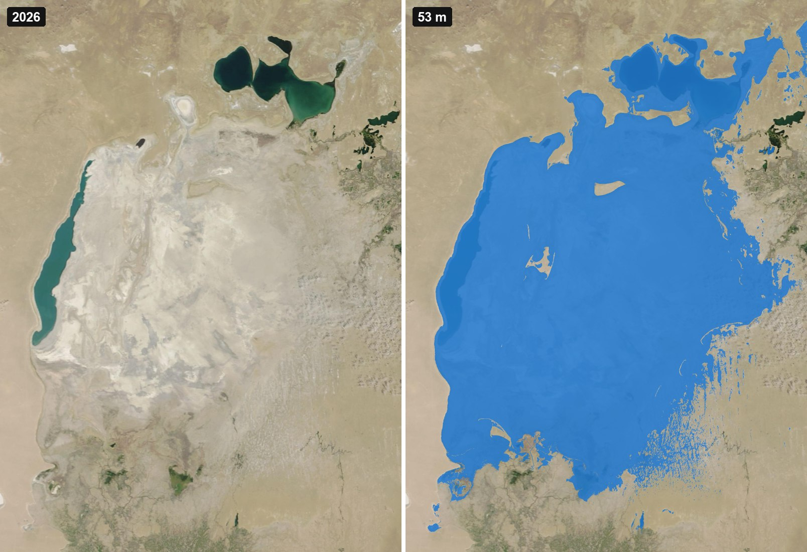

**What you'll learn**
- How to load NASA satellite images into QGIS straight from the internet.
- How to ask a question of every pixel at once with the **Raster Calculator**.
- How to measure an area from a raster, and check your answer against history.

## Part 0. Four ideas before you start

1. **An elevation model (DEM)** is a grid where every pixel stores a height in metres. You met one on Day 05. Ours comes from the **Copernicus** satellites. Each pixel is 90 m × 90 m.
2. **Water fills from the bottom.** If the sea came back to a certain level, every place lower than that level would be under water. So "where would the sea be?" is the same question as "where is the ground lower than the water level?".
3. **The 1960 level.** Before the rivers were taken for irrigation, the surface of the Aral Sea stood at about **53 metres above sea level**. That's our "utopia" level.
4. **The Raster Calculator** looks at every pixel and does a calculation. If you write `height <= 53`, it answers **1** (yes, under water) or **0** (no, dry land) for each pixel. You get a new raster of ones and zeros: a map of the sea.

## Part 1. Get the data

1. Download our elevation file: **[aral_dem_90m.tif](data/aral_dem_90m.tif)** (20 MB). On GitHub, click **Download raw file**. It covers the whole Aral basin, from 58°E to 62°E and from 43°N to 47°N.
2. Make a folder called **day08** on your Desktop and put the file in it.
3. You need **QGIS**, which you installed on Day 04.

> **How we made the file.** We downloaded 16 Copernicus GLO-90 tiles from the free [Copernicus DEM on AWS](https://registry.opendata.aws/copernicus-dem/) (the same source as Day 05, but the 90 m version), glued them together, and reprojected them to **UTM zone 41N** (EPSG:32641), so that each pixel is measured in metres. You can do the same with the GDAL commands from Day 05.

## Part 2. Add NASA's satellite image of today

You'll use the same picture you saw on Day 07: Terra MODIS, 10 August 2026.

1. In QGIS, click **Layer → Data Source Manager**, then **XYZ** on the left. Click **New**.
2. **Name:** `NASA MODIS 10 Aug 2026`. **URL:** copy and paste this whole line:

   ```
   https://gibs.earthdata.nasa.gov/wmts/epsg3857/best/MODIS_Terra_CorrectedReflectance_TrueColor/default/2026-08-10/GoogleMapsCompatible_Level9/{z}/{y}/{x}.jpg
   ```

3. Set **Max. Zoom Level** to **9**: NASA's tiles stop there. Click **OK**, then **Add**, then **Close**.

   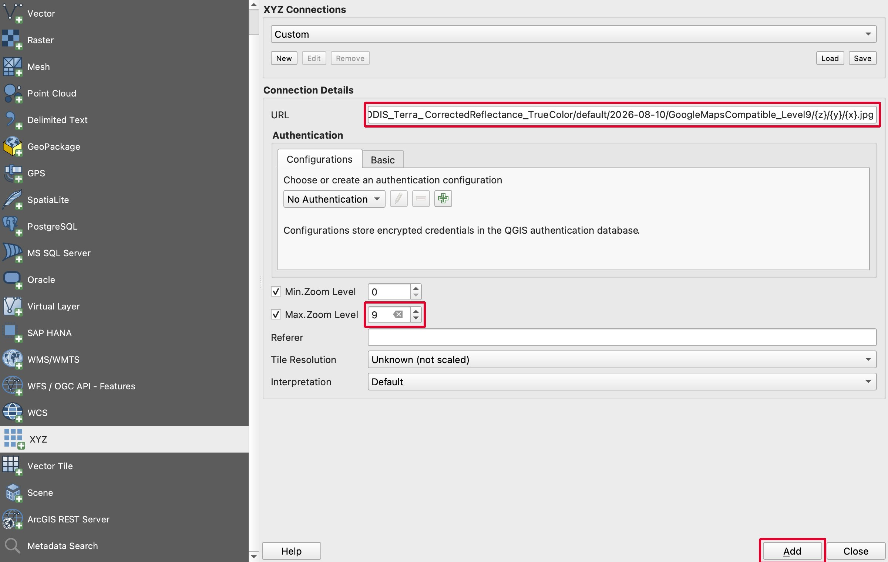

> **Want another day?** Change `2026-08-10` in the link to any date since 2000, for example `2000-08-28` from Day 07.

## Part 3. Add the elevation file

1. Drag **aral_dem_90m.tif** from your day08 folder into the QGIS map.
2. In the bottom right corner, the project's coordinate system changes to the DEM's, **EPSG:32641**. If it doesn't, click it and choose **WGS 84 / UTM zone 41N**.
3. You see a grey picture: dark is low, light is high. The darkest part is the bottom of the old sea.

   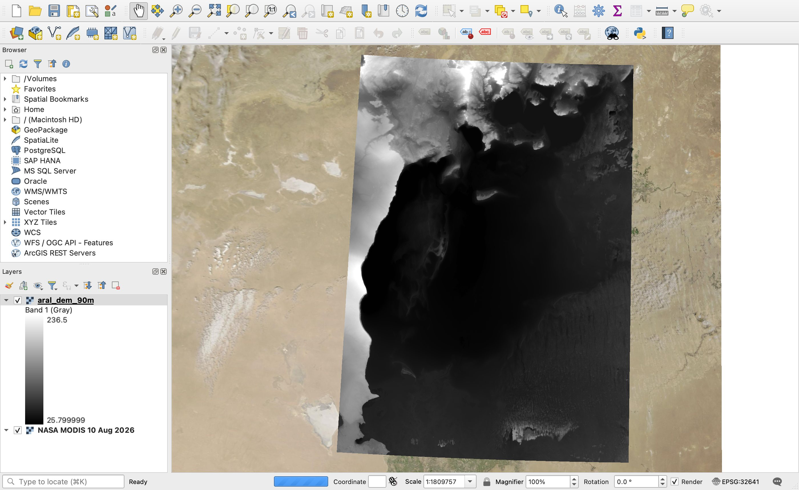

## Part 4. Fill the sea with the Raster Calculator

1. Click **Raster → Raster Calculator…**.
2. In **Raster Bands**, double-click **aral_dem_90m@1**. It appears in the expression box at the bottom.
3. Click the **<=** button, then type **53**. The box now says:

   ```
   "aral_dem_90m@1" <= 53
   ```

   Under the box it should say **Expression valid**.
4. Next to **Output layer**, click **…**, go to your day08 folder and type the name **sea_53**. Leave **Output format** as **GeoTIFF**.
5. Click **OK**.

   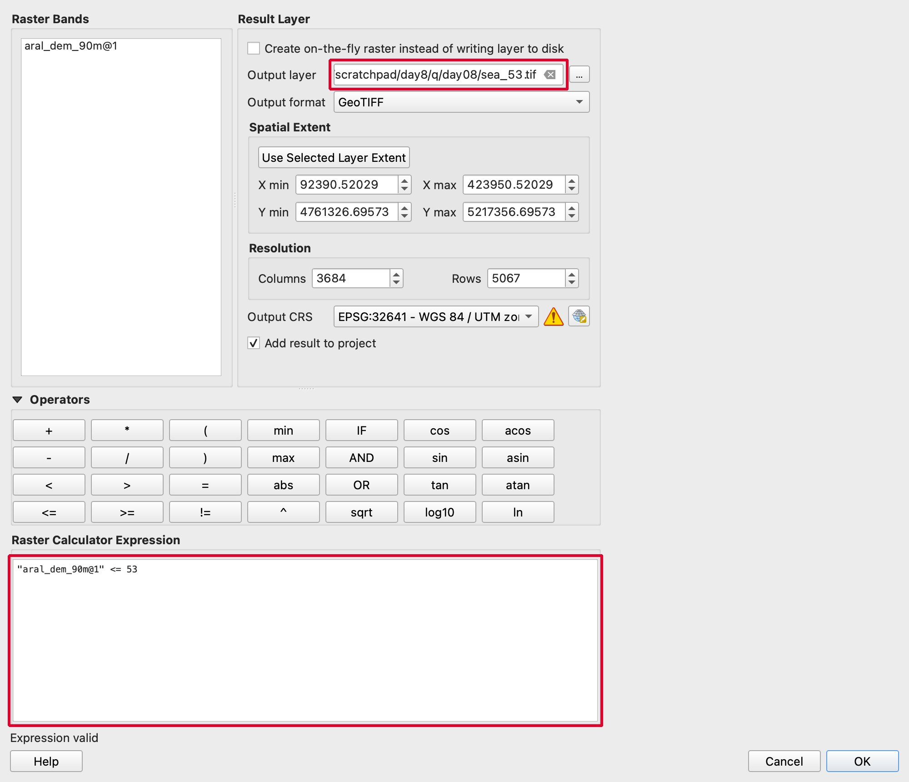

A new layer **sea_53** appears. It's black and white: **white = 1 = sea**, **black = 0 = dry land**.

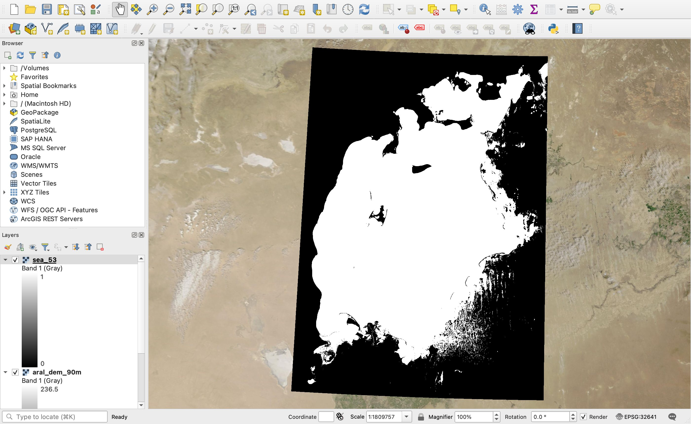

## Part 5. Colour the sea blue

1. Right-click **sea_53** → **Properties** → **Symbology**.
2. **Render type:** choose **Paletted/Unique values**. Click **Classify**. Two lines appear: **0** and **1**.
3. Click line **0** and remove it with the red **minus** button. Now dry land is see-through.
4. Double-click the colour of line **1** and pick a blue. Change its label to **sea**.
5. Under **Layer Rendering**, set **Opacity** to about 80%, so you can still see the seabed under the water. Click **OK**.

   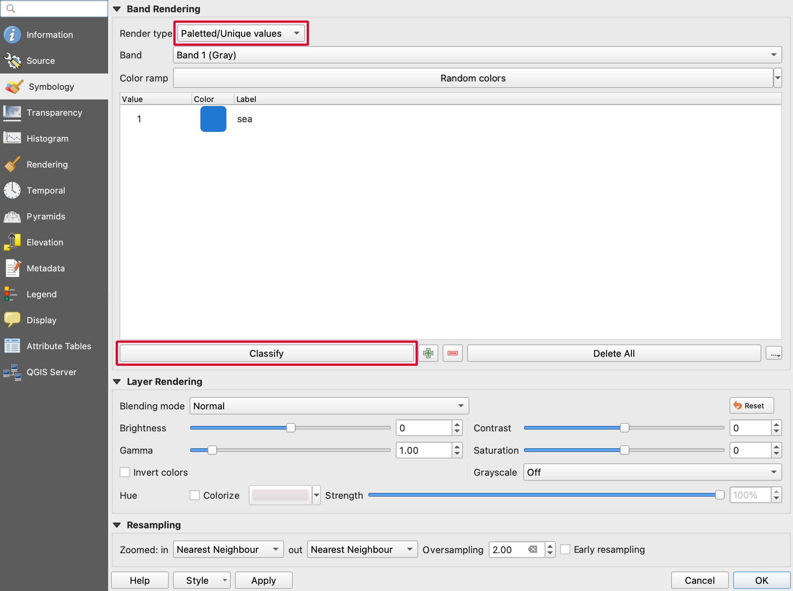

6. In the **Layers** panel, untick **aral_dem_90m** to hide the grey elevation layer.

   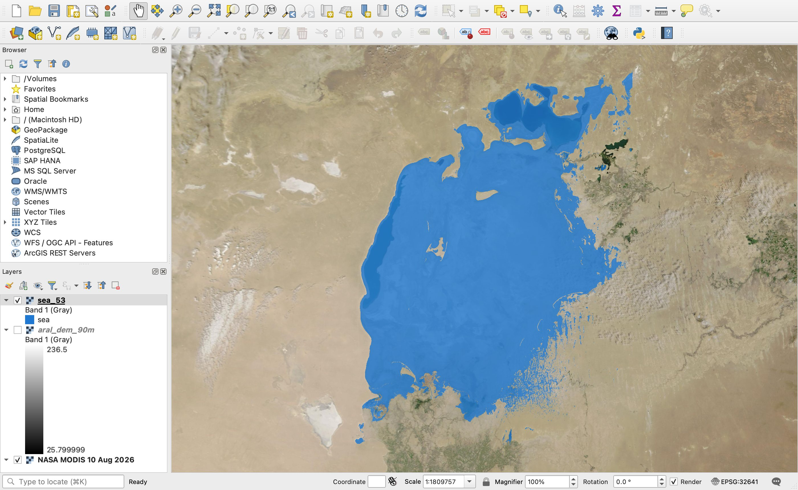

Look at the shape: two islands appear in the middle. The long one in the north is **Barsakelmes**; the one in the middle, once called **Vozrozhdeniya**, is today joined to the land. Muynak, in Karakalpakstan, is a harbour town again.

## Part 6. How big is the sea? Check against history

1. Click **Processing → Toolbox** and search for **Raster layer unique values report**. Double-click it.
2. **Input layer:** **sea_53**. Next to **Unique values table**, click **…** → **Create Temporary Layer**. Click **Run**.

   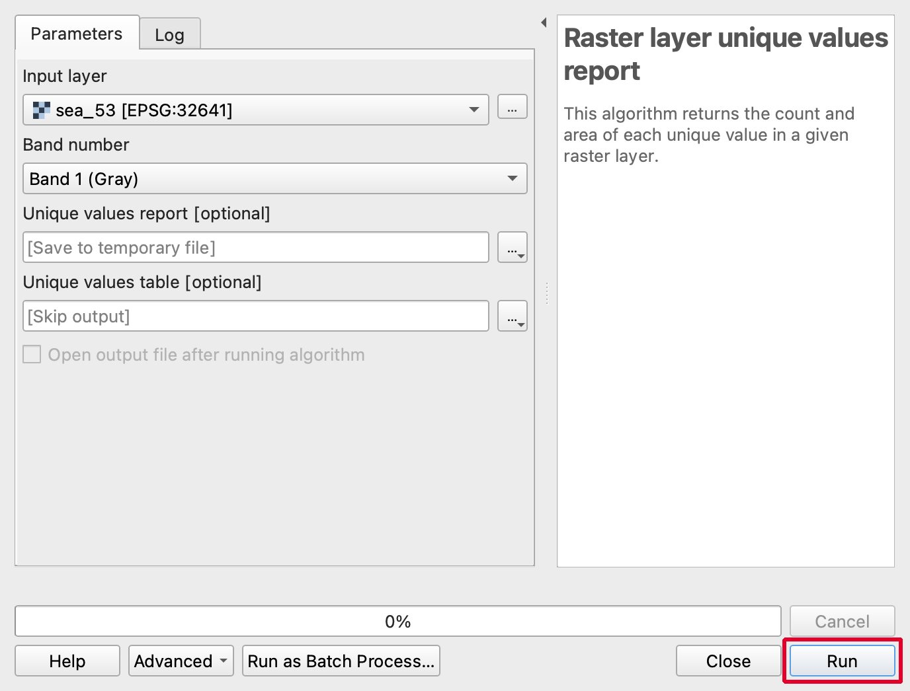

3. When it finishes, open the result table (**Unique values table** in the Layers panel → right-click → **Open Attribute Table**). The **m2** column gives the area of each value in square metres.

   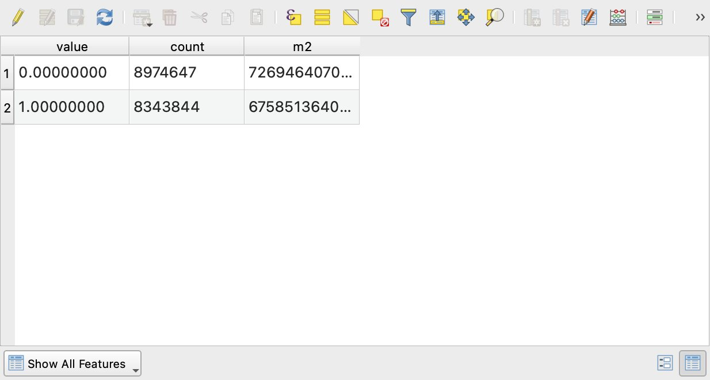

4. The line with **value 1** says **67,585,136,400 m²**. Divide by 1,000,000 to get square kilometres: about **67,600 km²**.

History books give the Aral Sea in 1960 an area of about **66,000–68,000 km²**. Your map, made from today's satellite data, gives almost the same number. 🎉

> **Why it's not exact.** The heights come from satellites flying in 2011–2015, after the sea had dried, and are rounded to 90 m pixels. Low sandy plains in the south-east are also below 53 m: they show up as speckled blue dots that weren't really sea. And the 1960 measurements used a slightly different "zero" for sea level. Still, being within a few per cent is very good for a 40-minute map.

## Part 7. Try other water levels

Run the Raster Calculator again with another number instead of 53, for example **42** (about the level of the small northern sea today) or **30**. Name each result after its level, colour it, and measure it. These are our results:

| Water level | Sea area | What it looks like |
|---|---|---|
| **30 m** | 11,700 km² | Only the deepest parts of the western and eastern basins. |
| **42 m** | 44,700 km² | The big southern sea is back, but its southern shore stays dry. |
| **53 m** | 67,600 km² | The Aral Sea of 1960, from Kazakhstan to Karakalpakstan. |

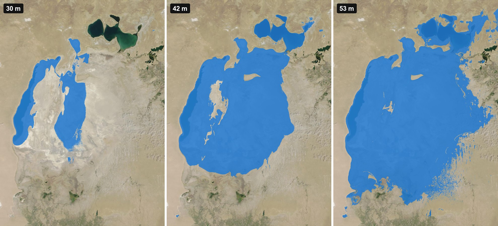

## Part 8. Export your map

1. Arrange the view you like.
2. Click **Project → Import/Export → Export Map to Image…**. Set **Resolution** to **300 dpi** and click **Save**.

   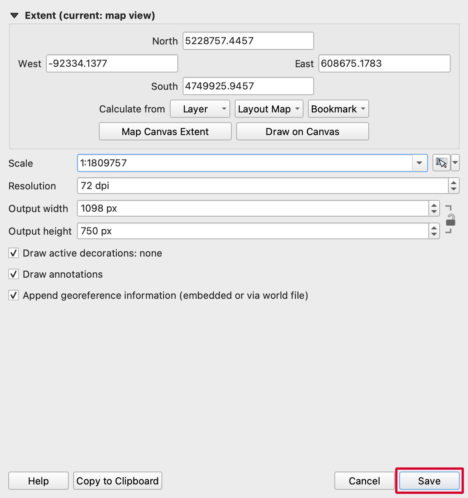

For your #30DayMapChallenge post, put "today" and "utopia" side by side, as in our final map at the top.

## Ideas for your own utopia

- **The Aydar–Arnasay lakes:** these lakes in Uzbekistan appeared after 1969, when flood water from the Syr Darya was let into a desert hollow. Try the same method to see how big they could become.
- **A green Aralkum:** instead of water, colour the dry seabed lower than 53 m green: forests of saxaul are being planted there to stop salt and dust storms.
- **Sea level rise, anywhere:** the same two steps work for any coast or lake in the world. Download the tiles for another place and try it.
- **Animated filling:** make sea_30, sea_35, sea_40… and turn them into a GIF, so the sea rises in front of you.

## When you share

Please credit:
> Elevation: Copernicus DEM GLO-90 © DLR e.V. 2010–2014 and © Airbus Defence and Space GmbH 2014–2018, provided under COPERNICUS by the European Union and ESA. Satellite image: NASA Worldview / GIBS, Terra MODIS.

## Troubleshooting

| Problem | What to do |
|---|---|
| The NASA layer is empty. | Check the URL: the date must be `YYYY-MM-DD` and the end must be `{z}/{y}/{x}.jpg`. Set **Max. Zoom Level** to 9. |
| The satellite image is blurry when I zoom in. | MODIS pixels are 250 m. Zoom out, or use Sentinel-2 cloudless from Day 05 for close-ups. |
| The Raster Calculator says **Expression invalid**. | Double-click the band name instead of typing it, and use the **<=** button. The quotes must be straight: `"`. |
| sea_53 is all black or all white. | You probably typed a different number, or picked a different layer. Check the expression. |
| The area is in strange units. | The project must be in **UTM zone 41N** (EPSG:32641), so pixels are measured in metres. |
| My area is 0 or very small. | You looked at the line with **value 0**. The sea is **value 1**. |

## Credits

- **Elevation:** Copernicus DEM GLO-90 © DLR e.V. 2010–2014 and © Airbus Defence and Space GmbH 2014–2018, provided under COPERNICUS by the European Union and ESA. Downloaded from the [Copernicus DEM on AWS](https://registry.opendata.aws/copernicus-dem/).
- **Satellite image:** NASA Worldview / Global Imagery Browse Services (GIBS), part of NASA Earthdata (EOSDIS). Terra MODIS Corrected Reflectance (True Color), 10 August 2026.
- **Software:** [QGIS](https://qgis.org).
