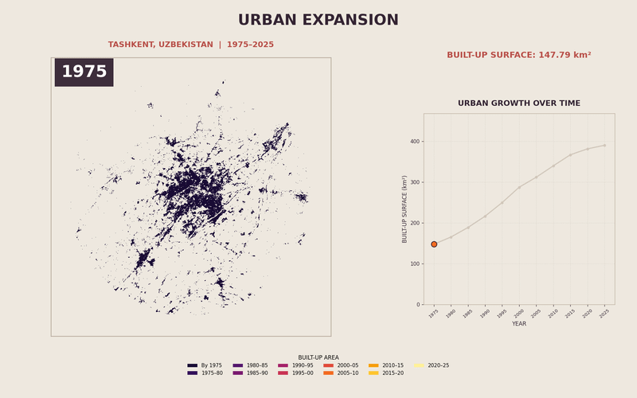

# Day 09: Urban Expansion – Tashkent, Uzbekistan 🏙️

Part of the [#30DayMapChallenge](https://30daymapchallenge.com/)

## 🌆 The Expanding City: Tashkent, Uzbekistan

**How much has Tashkent expanded over the past 50 years?**

For Day 09, I explored the historical urban expansion of Tashkent and its surrounding areas between **1975 and 2025**.

Using the **Global Human Settlement Layer (GHSL)**, I mapped changes in built-up surface area at five-year intervals to visualize the city's urban development over five decades.

The results reveal substantial expansion of the built-up footprint, with urban development extending beyond the central part of Tashkent into surrounding areas.

## 🎬 Urban Expansion Animation (1975–2025)

The animation combines historical urban development maps with a synchronized statistical graph, illustrating both the spatial expansion of the city and changes in its total built-up surface area over time.

## 🛠️ Behind the Map

The visualization was created using two main tools:

- **Google Earth Engine (GEE):** Geospatial data processing and analysis using GHSL.
- **Python:** Creating an animation that combines the historical urban expansion maps with a synchronized statistical graph.

## 📊 Data & Tools

| Category | Details |
|---|---|
| Study Area | Tashkent, Uzbekistan |
| Time Period | 1975–2025 |
| Temporal Interval | 5 years |
| Dataset | Global Human Settlement Layer (GHSL) |
| Data Provider | European Commission – Joint Research Centre (JRC) |
| Geospatial Analysis | Google Earth Engine |
| Visualization & Animation | Python |

## 🎯 Project Objective

To explore the spatial and temporal dynamics of urban expansion in Tashkent over the past five decades using satellite-derived built-up surface data.

Author: Tumaris Ramanova
