# Day 09 tutorial: City or countryside? Ask the satellite

**Theme: Urban–rural.** Google's **AlphaEarth** model has looked at years of satellite images of every place on Earth and summed up each 10 × 10 m square in 64 numbers: its **embedding**. Places that look and behave alike get similar numbers. In this tutorial you pick one place in Tashkent and one place in the fields, and ask: *which other places are like this one?* You work in the **Google Earth Engine Code Editor**, in your browser. It takes about 30 minutes.

📄 **Printable PDF:** [English](pdf/Day09_Tutorial_EN.pdf) · [Русский](pdf/Day09_Tutorial_RU.pdf) · [Oʻzbekcha](pdf/Day09_Tutorial_UZ.pdf)

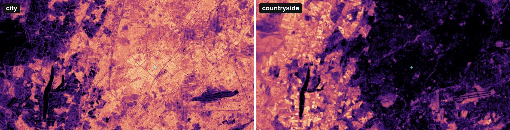

**What you'll learn**
- What a satellite **embedding** is, and why it's useful.
- How to run a script in Google Earth Engine, the free cloud tool used by scientists everywhere.
- How to do a **similarity search**: find every place that looks like an example you choose.

## Part 0. Three ideas before you start

1. **A fingerprint for every place.** For each 10 m pixel and each year since 2017, AlphaEarth combined everything the satellites saw (Sentinel-2 colours, Sentinel-1 radar, Landsat and more) into 64 numbers. You can't read them one by one, but together they describe the place: roofs or crops, trees or water, how it changes over the seasons.
2. **Similar places have similar numbers.** To compare two places, multiply their 64 numbers pair by pair and add them up (a **dot product**). The answer is close to **1** for very similar places and lower for different ones.
3. **Earth Engine does the work in the cloud.** Tashkent alone has millions of pixels. Earth Engine computes them on Google's computers and only sends you the picture.

## Part 1. Get access to Earth Engine (once, about 10 minutes)

Earth Engine is free for students, teachers and researchers, but you need a Google account and a **Cloud project** registered for **noncommercial** use. You do this only once.

### 1a. Open the Earth Engine page in Google Cloud

1. Sign in to your Google account, then open **[console.cloud.google.com/earth-engine](https://console.cloud.google.com/earth-engine/welcome)**.
2. You see **Welcome to Earth Engine**. If you don't have a project yet, click **Select a project** at the top (**1**) → **New project**. If you already have one, choose it there and go straight to **Register** (**2**).

   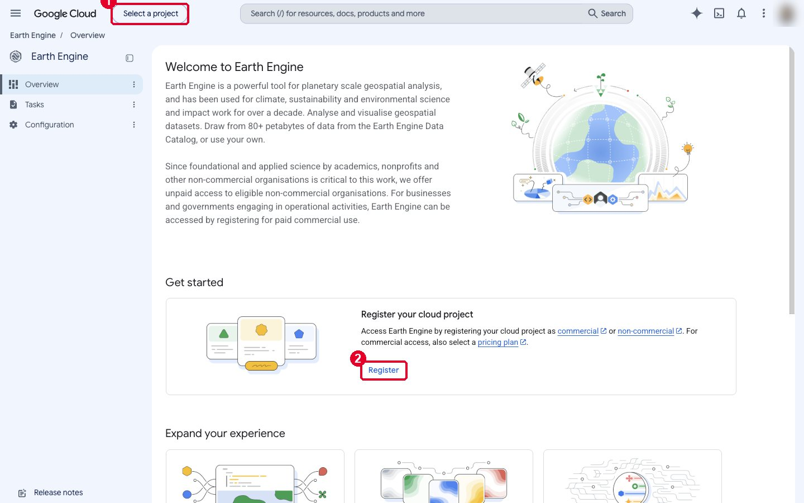

### 1b. Create a project

1. **Project name:** type a short name, for example `gee-30daymap-uz` (**1**). Google makes a **Project ID** from it, which you can't change later.
2. Leave **Parent resource** as **No organisation**, then click **Create** (**2**). Wait a few seconds until the project is ready, and make sure it's selected at the top of the page.

   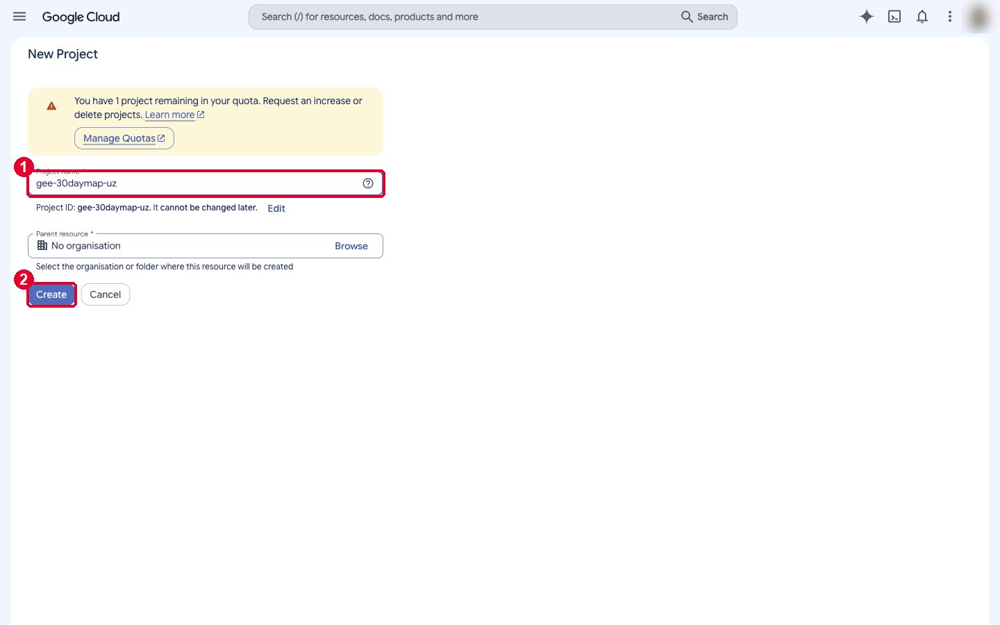

### 1c. Register the project for noncommercial use

On the Earth Engine page, click **Register**. A form with five steps opens.

**Step 1: Select your organisation type.** Open the list (**1**), choose **Public or private academic institution (including department, staff, students)**, and click **Next** (**2**). Teachers and trainers can also choose **Earth Engine trainer or trainee**.

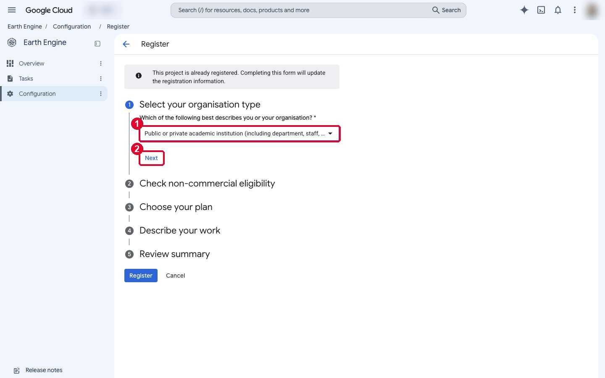

**Step 2: Check non-commercial eligibility.**
- Type the name of your university or school (**1**).
- *Will you receive any payment … from commercial entities?* Choose **No** (**2**).

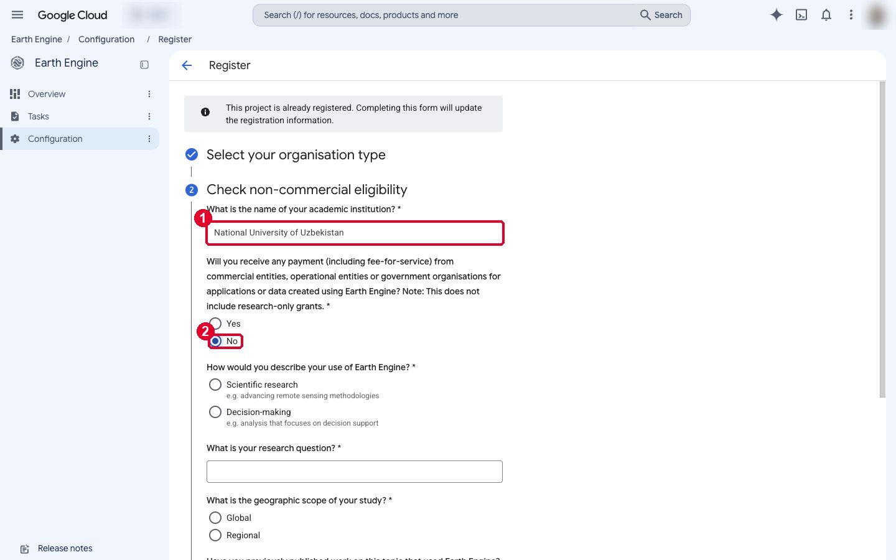

- *How would you describe your use of Earth Engine?* **Scientific research**.
- *What is your research question?* Write one sentence about your project (**1**), for example: *How do cities and the countryside differ across Uzbekistan?*
- *Geographic scope:* **Regional**, and type **Uzbekistan, Central Asia**.
- *Have you previously published work …?* **No**.
- Click **Check eligibility**. When the message says **you are eligible for non-commercial Earth Engine use** (**2**), click **Next** (**3**).

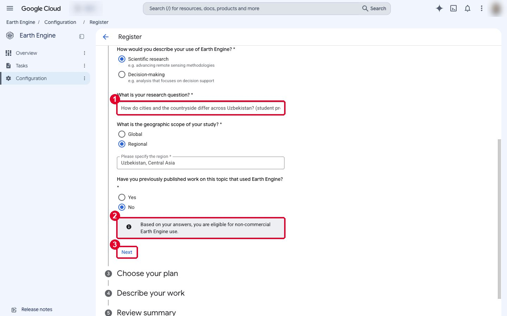

**Step 3: Choose your plan.** Choose the free **Community tier** (it may already be chosen for you), then click **Next**.

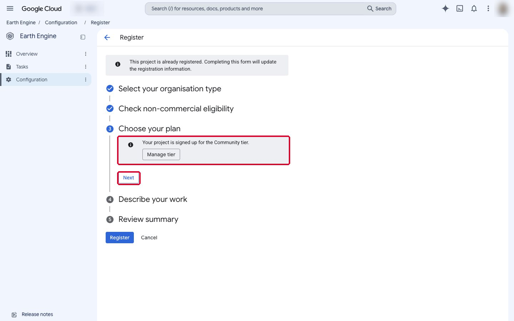

**Step 4: Describe your work.** You can leave the three checkboxes empty. In *Will you use Earth Engine for any of the following?* open the list, tick **Classroom or education**, click **OK** (**1**), then **Next** (**2**).

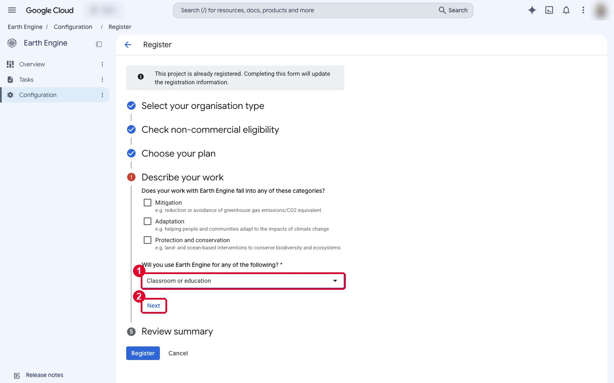

**Step 5: Review summary.** Check your answers and click the blue **Register** button at the bottom.

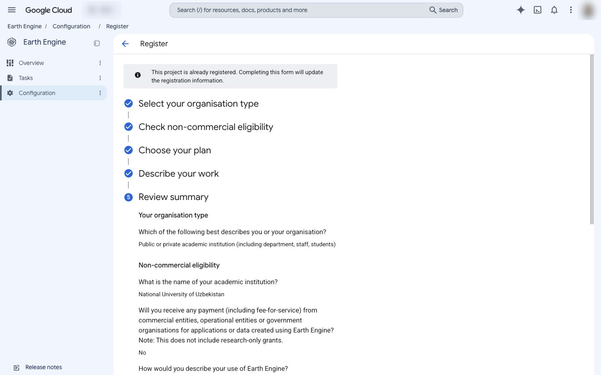

> Our screenshots were taken with a project that was already registered, so they show a grey note at the top, *This project is already registered*. You won't see it on a new project.

### 1d. Open the Code Editor

Go to **[code.earthengine.google.com](https://code.earthengine.google.com)**. If it asks for a project, choose the one you just registered. The **Code Editor** opens: scripts on the left, the code in the middle, the console on the right and the map at the bottom.

> **Free, but not unlimited.** The Community Tier gives every noncommercial project a monthly amount of computing time. This tutorial uses only a small part of it. If you see a yellow message about quota, the map still works, just more slowly.

## Part 2. Paste the script and run it

1. Open our script: **[day09_similarity.js](data/day09_similarity.js)**. Click **Copy raw file** (the two-squares button) on GitHub.
2. Click into the empty middle panel of the Code Editor and paste (**Ctrl+V**, or **⌘V** on a Mac).
3. Click **Run**.

   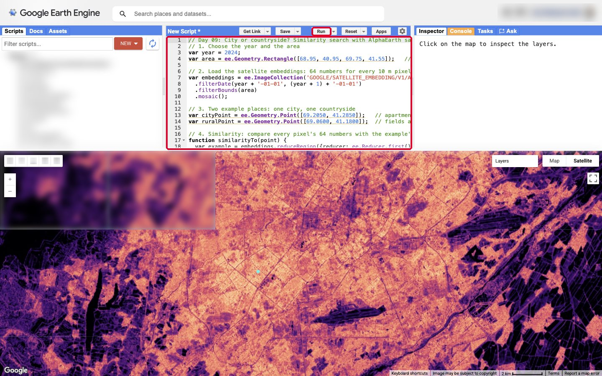

After a few seconds the map flies to Tashkent. The **Console** on the right says **Embedding bands: 64**: the 64 numbers of each pixel.

The colourful layer is **Similar to the city** (**2**). The small blue dot is our city example, apartment blocks in Chilonzor. Bright yellow and orange mean "very similar to this place"; dark purple means "very different".

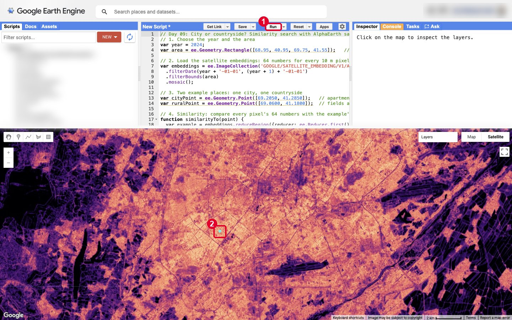

Look how clearly the city stands out. The dark shapes inside it are the things that aren't "city": parks, the Ankhor canal, the lakes and the airport's runways.

## Part 3. What the script does, line by line

| Part of the script | What it does |
|---|---|
| `var area = …Rectangle(…)` | The area we look at: Tashkent and the farmland around it. |
| `ee.ImageCollection('GOOGLE/SATELLITE_EMBEDDING/V1/ANNUAL')` | The AlphaEarth Satellite Embedding dataset: one image with 64 bands for each year. |
| `.filterDate(year…)` and `.mosaic()` | Keeps only the year we want (2024) and joins the tiles into one image. |
| `cityPoint`, `ruralPoint` | The two example places, as longitude and latitude. |
| `similarityTo(point)` | Reads the 64 numbers of the example, multiplies them with the 64 numbers of every pixel and adds them up: the dot product. |
| `Map.addLayer(…)` | Draws the result on the map with a colour palette. |
| `cityLike.gt(ruralLike)` | For every pixel: is it more like the city (red) or more like the countryside (green)? |
| `Map.onClick(…)` | Lets you click anywhere and search for places like that one. |

## Part 4. Switch to the countryside

1. Click **Layers** at the top right of the map (**1**).
2. Untick **Similar to the city** and tick **Similar to the countryside** (**2**).

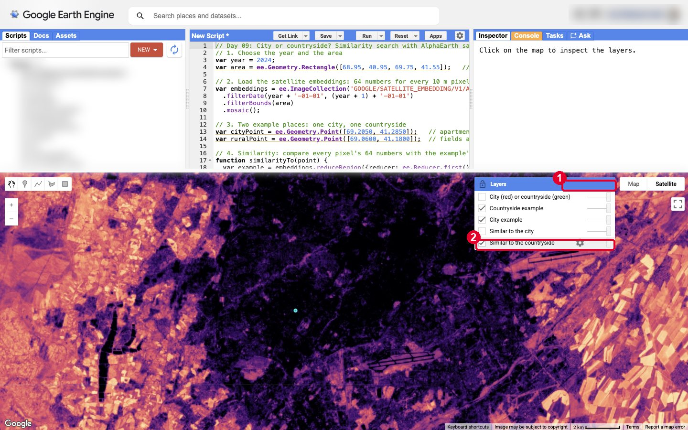

Now it's the other way round: the city goes dark and the fields around it light up. The countryside example is a cotton and wheat field south-west of the city, outside this view.

## Part 5. City or countryside, for every pixel

In **Layers**, untick the similarity layer and tick **City (red) or countryside (green)**. Each pixel is red if it's more similar to the city example, and green if it's more similar to the field.

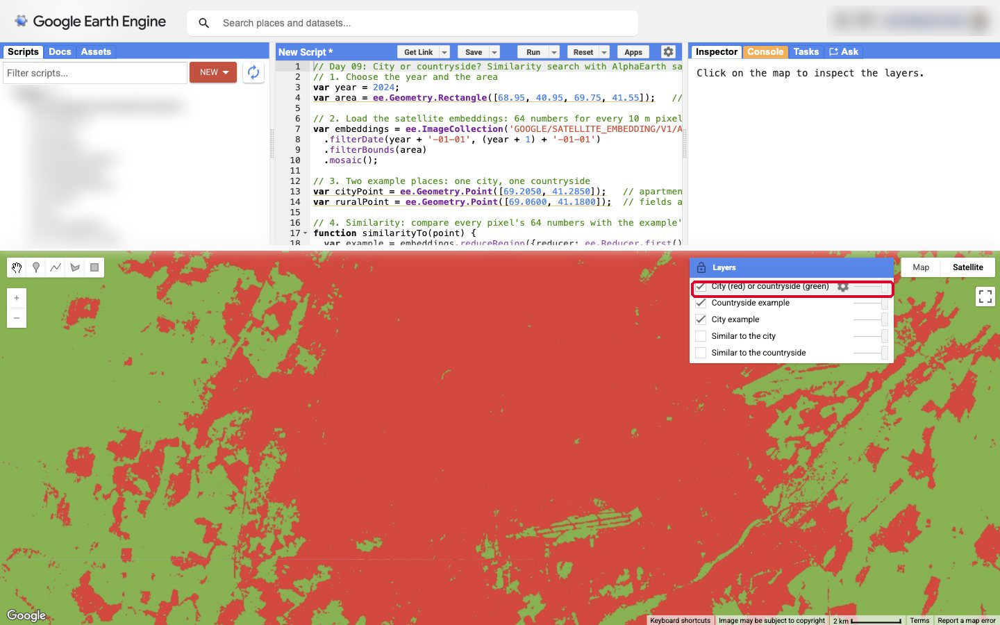

With only two examples this is a rough map: the countryside around Tashkent is full of villages and gardens, and some of them look more like the city than like a field. That's the interesting part of "urban–rural": the line between them isn't sharp.

## Part 6. Your turn: click any place

1. Close the **Layers** panel. The cursor on the map is now a cross.
2. Click any place you're curious about: your school, a mahalla with houses and gardens, a bazaar, a park.
3. Wait a few seconds. A new layer appears: **Similar to the place you clicked**. A yellow dot marks your place, and the **Console** tab prints its coordinates.

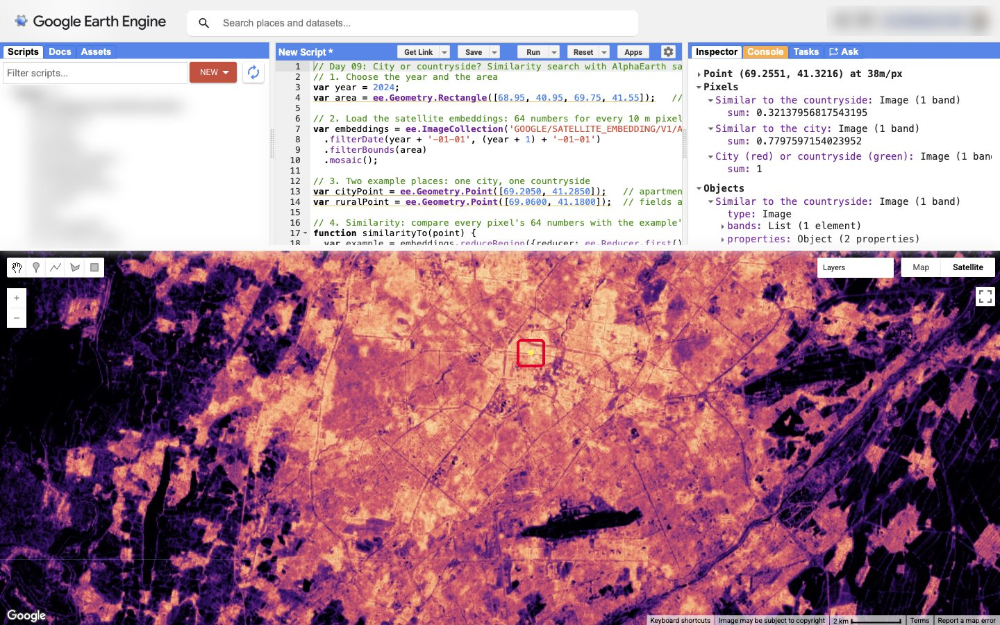

Here we clicked a spot near Abay Street in the city centre (Urda). Places like it light up across the whole centre, while the fields, the canals and the big parks stay dark. Try a mahalla with houses and gardens next: you'll see a different pattern.

## Part 7. Read the numbers with the Inspector

1. Click the **Inspector** tab at the top right (**1**).
2. Click a place on the map. The Inspector lists the value of every layer at that point (**2**). For example, at our city example **Similar to the city** is 0.87, but **Similar to the countryside** is only 0.41.

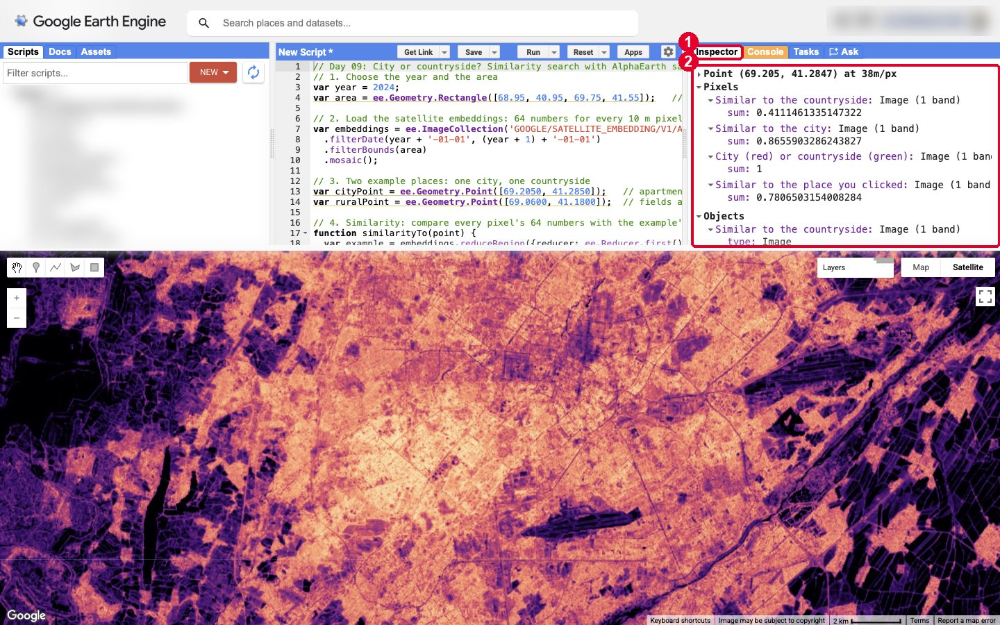

## Part 8. Save and share

- **Save:** click **Save** above the code and give the script a name. It's stored in your own scripts list on the left.
- **Share:** click **Get Link**. Earth Engine makes a link to a copy of your script; anyone who opens it can run it. Be careful: the link is public.
- **Picture for your post:** make the map full screen with the square button on the right of the map, hide the panels and take a screenshot.

## Ideas for your own map

- **Another city.** Change the area and the two example points to Samarkand, Namangan or Nukus.
- **Another year.** Change `var year = 2024;` to 2017 and compare. Which fields around Tashkent became city?
- **More than two examples.** Add a third example, for example a mahalla, and colour each pixel by the example it's most similar to.
- **Find a type of place.** Click one greenhouse, one solar farm or one orchard, and find all the others in the Fergana Valley.

## When you share

Please credit:
> The AlphaEarth Foundations Satellite Embedding dataset is produced by Google and Google DeepMind (CC BY 4.0). Map made with Google Earth Engine.

## Troubleshooting

| Problem | What to do |
|---|---|
| Earth Engine asks for a project. | Register one (Part 1), then choose it from the project menu at the top right. |
| **Run** does nothing, or there's a red error in the Console. | Make sure you pasted the whole script, from the first line to the last `});`. |
| The map stays grey or blurry for a long time. | Wait: the first view can take up to a minute. Zoom in a little to compute fewer pixels. |
| A yellow message says the quota is exceeded. | Your project has used its monthly computing time. The map still works, but slowly. Use a smaller area, or wait until next month. |
| Everything is bright, or everything is dark. | Change `min: 0.4, max: 1` in `Map.addLayer` to show a narrower range, for example `min: 0.7`. |

## Credits

- **Satellite embeddings:** The AlphaEarth Foundations Satellite Embedding dataset is produced by Google and Google DeepMind. Licensed [CC BY 4.0](https://creativecommons.org/licenses/by/4.0/). Earth Engine ID: `GOOGLE/SATELLITE_EMBEDDING/V1/ANNUAL`, 2017–2024, 10 m.
- **Method:** based on Google's [similarity search tutorial](https://developers.google.com/earth-engine/tutorials/community/satellite-embedding-05-similarity-search) for the Satellite Embedding dataset.
- **Software:** [Google Earth Engine](https://earthengine.google.com) Code Editor.
