# Day 11 tutorial: A map you can listen to

**Theme: Sound.** Most maps are only for your eyes. Today's map is for your ears: you click a place in Uzbekistan and hear it. The bird market in Tashkent, a karnay, children in the Juma Mosque in Khiva, a dutor in a desert yurt camp. Then you add a sound you find online and **your own recording** from your phone. You work in **Google Colab** with a little Python, as on Day 02. It takes about 30 minutes.

📄 **Printable PDF:** [English](pdf/Day11_Tutorial_EN.pdf) · [Русский](pdf/Day11_Tutorial_RU.pdf) · [Oʻzbekcha](pdf/Day11_Tutorial_UZ.pdf)

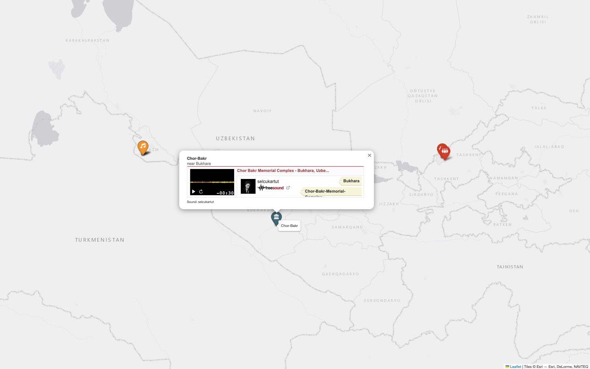

**What you'll learn**
- How to make an interactive web map with **folium**.
- How to put a sound player inside a map **popup**.
- Where to find free sounds, and how to add your own recording to a map.

## Part 0. Three ideas before you start

1. **A marker and a popup.** A web map is made of layers. A **marker** is a pin on one place. When you click it, a **popup** opens: a small box that can hold text, pictures, and also a sound player.
2. **A sound has a place.** Every recording was made somewhere. If you know the latitude and longitude of that place, you can put the sound on the map.
3. **Free sounds.** [Freesound](https://freesound.org) is a free library of hundreds of thousands of sounds, uploaded by people from all over the world. Each sound has a **licence**. **CC0** means anyone can use it for anything. All six sounds in our map are CC0.

## Part 1. Open the notebook in Colab

1. Click this button: 
2. Sign in with your Google account (top right).
3. **Keep your own copy:** click **Copy to Drive** (**1**). Colab opens your copy, saved in your Google Drive. Work in that copy, so your changes are saved.

   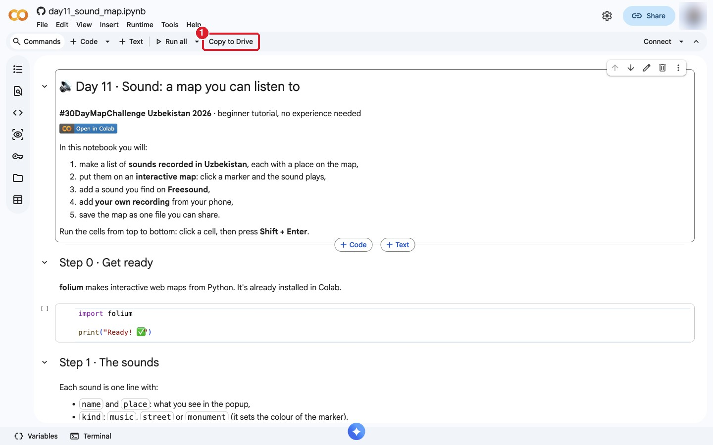

## Part 2. Run the first cells

1. Click the **▶** button to the left of the first code cell (Step 0).
2. Colab warns you that the notebook comes from GitHub. It's our notebook, so click **Run anyway** (**1**).

   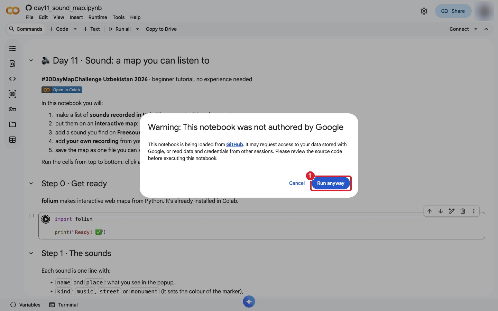

3. Wait a few seconds: Colab starts a computer for you. When the cell is done, it shows a green tick and **Ready! ✅** (**2**).

   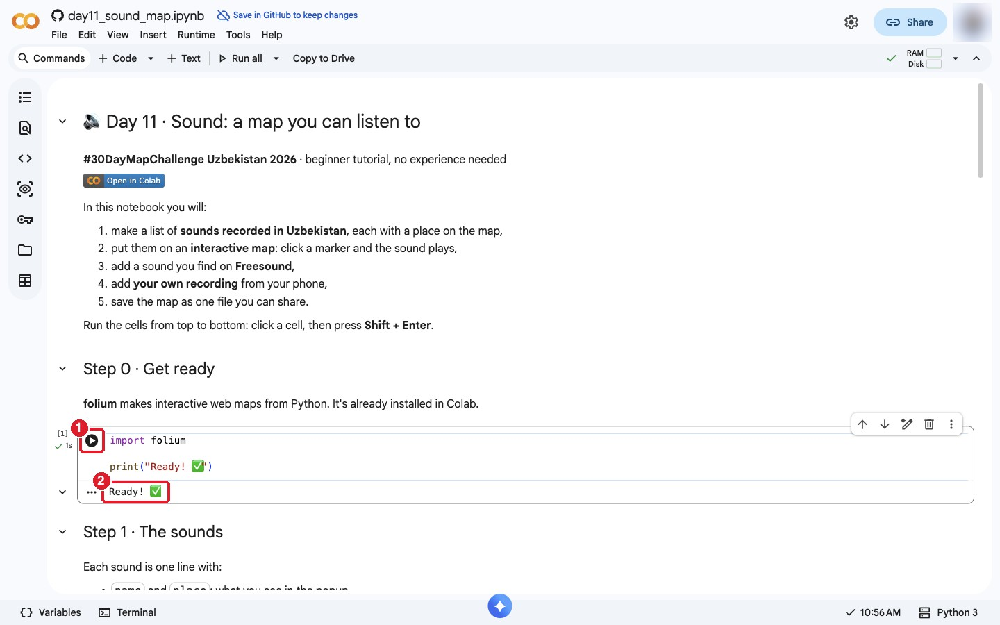

4. Run the next cell (Step 1). It makes the list of sounds and prints **6 sounds** (**1**).

   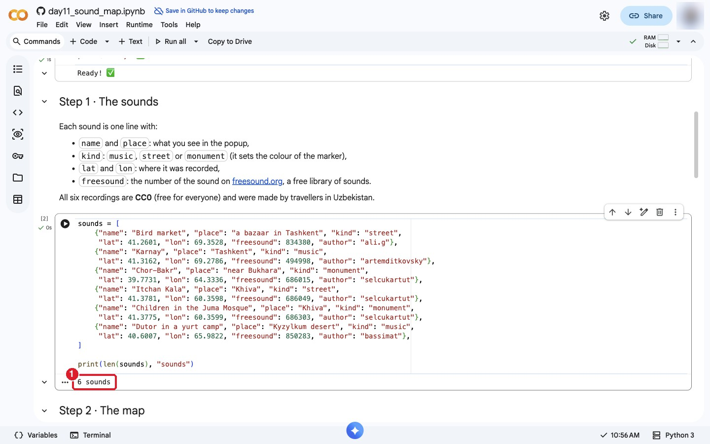

Each sound in the list has a name, a place, a kind (`music`, `street` or `monument`), its coordinates, and its number on Freesound.

## Part 3. The map

Run the cell in Step 2. The map of Uzbekistan appears under the cell, with one marker for each sound: orange for music, red for street sounds, blue-grey for monuments.

1. Click a marker, for example the red one in Tashkent (**1**). Its popup opens with Freesound's player.
2. Click **▶** in the player (**2**) and listen. 🔊

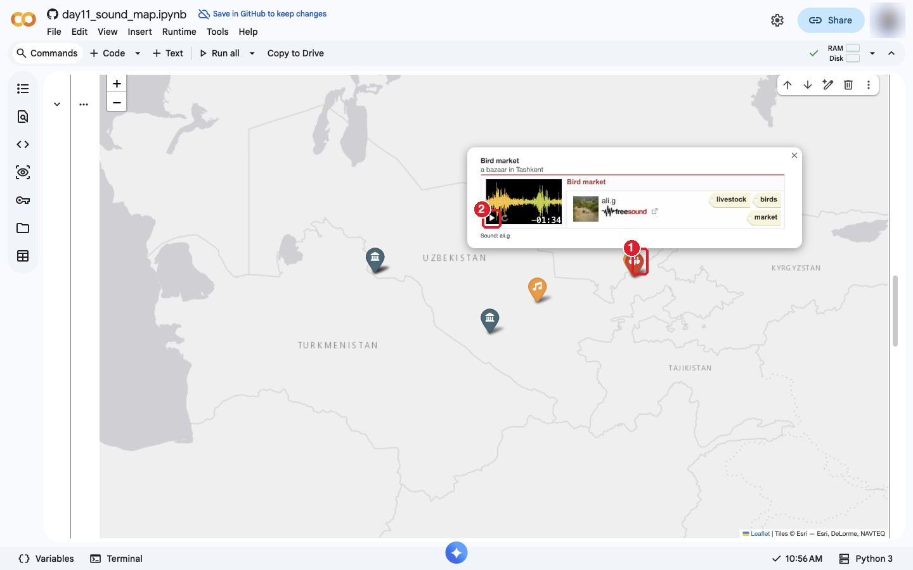

You can drag the map and zoom in with the mouse wheel. In Khiva two markers stand on top of each other: zoom in to see both.

## Part 4. What the code does

| Part of the code | What it does |
|---|---|
| `sounds = [ … ]` | The list of sounds. Each `{ … }` is one sound. |
| `"lat": 41.2601, "lon": 69.3528` | Where the sound was recorded: latitude (north–south) and longitude (east–west). |
| `COLORS`, `ICONS` | The colour and the small picture on the marker for each kind of sound. |
| `def player(s)` | Makes the sound player: Freesound's own player for Freesound sounds, the browser's `<audio>` player for your own files. |
| `folium.Map(…)` | The map, centred on Uzbekistan, with a light grey background from Esri. |
| `folium.Marker(…)` | One pin for each sound, with its popup and a tooltip (the name you see when the mouse is over it). |

## Part 5. Add a sound from Freesound

1. Go to **[freesound.org](https://freesound.org)** and search, for example, **Khiva**, **Bukhara** or **Tashkent**. You can listen without an account.
2. Open a sound you like. Check its **name** (**1**) and its **licence** on the right (**2**). CC0 and CC BY are the easiest to use. With **CC BY**, write the author's name on your map.
3. Look at the address of the page, for example `freesound.org/people/selcukartut/sounds/686051/`. The **number at the end** is the sound's number.

   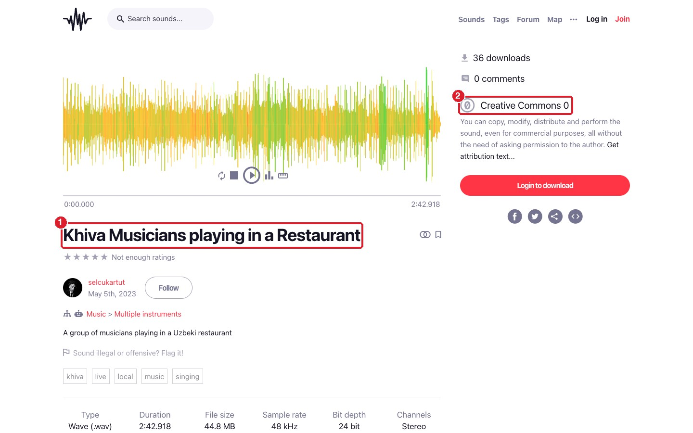

4. In the notebook, go to Step 3. Change the line: the name, the place, the coordinates and the number (**1**). Then run the cell. A new map appears with your sound on it.

   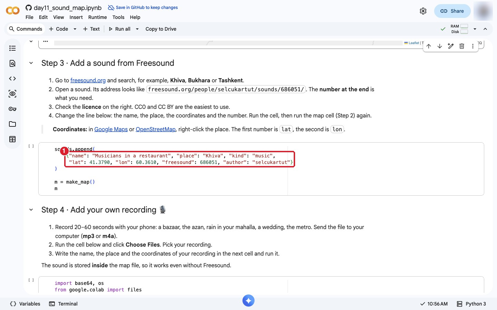

> **How do I find the coordinates?** Open [Google Maps](https://maps.google.com) and right-click the place. The first number is `lat`, the second is `lon`. Click the numbers to copy them. Some Freesound sounds also show a small map with the exact place.

## Part 6. Add your own recording 🎙️

This is the best part: a sound that nobody else has.

1. **Record.** Use your phone's voice recorder for 20–60 seconds: your bazaar, the azan from your mahalla mosque, rain, a wedding, the metro, a doira lesson. Hold the phone still and don't talk.
2. **Send the file to your computer** (by Telegram, email or a cable). Phones save **m4a** or **mp3** files; both work.
3. In Step 4, run the cell with `files.upload()`. A **Choose Files** button appears (**1**). Click it and pick your recording.

   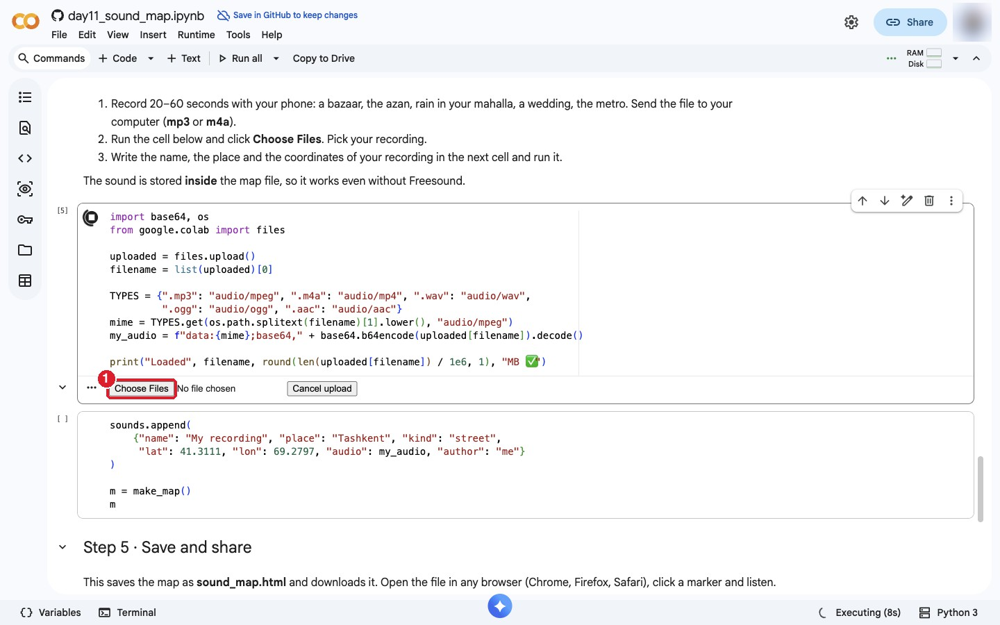

4. When it says **Loaded … ✅** (**1**), your sound is in the notebook.

   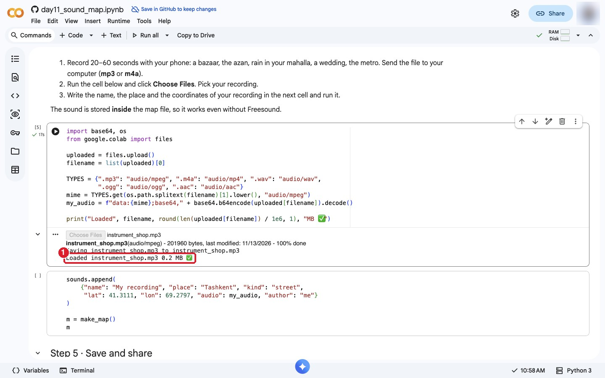

5. In the next cell, write the name of your sound, the place and the coordinates where you recorded it, and run the cell. Your marker appears on the map with a simple player (**1**).

   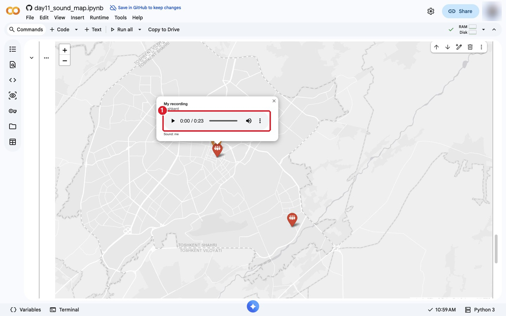

For our screenshots we didn't record anything ourselves. We uploaded a CC0 recording from Freesound instead: an old man in a musical instruments shop in Tashkent, by T_WAZ. We don't know where the shop is, so we put it in the city centre.

> **Your sound lives inside the map.** The notebook turns your recording into text and stores it inside the map file. So it plays even without the internet. Keep recordings short: one minute is about 1 MB, and the file grows with every recording.

## Part 7. Save and share

1. Run the cell in Step 5 (**1**). Colab saves the map as **sound_map.html** and downloads it to your computer.

   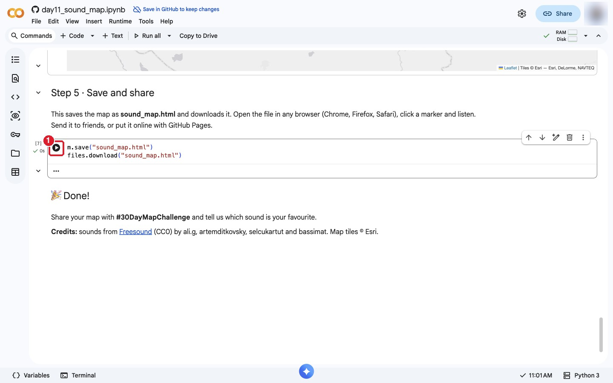

2. Double-click **sound_map.html**. It opens in your browser: click the markers and listen. The Freesound players need the internet; your own recordings don't.
3. **Share it:** send the file to friends in Telegram, or put it online for free with [GitHub Pages](https://pages.github.com). For your #30DayMapChallenge post, take a screenshot with one popup open, and add the link or the file.

## Ideas for your own sound map

- **The sounds of your city:** go out for one hour and record five places: a bazaar, a park, a bus stop, a school yard, a quiet street. Map them all.
- **Loud and quiet:** use a free sound-level (decibel) app on your phone and write down how loud each place is. Make the markers bigger for louder places with `folium.CircleMarker`.
- **Music of the regions:** find recordings of Shashmaqom (Bukhara), Khorezm lazgi, Karakalpak zhyrau or Surkhandarya bakhshi, and map each one where it comes from.
- **A sound walk:** record along one street every 100 m and connect the markers with `folium.PolyLine`, so people can "walk" with their ears.

## When you share

Please credit:
> Sounds from Freesound (CC0): ali.g, artemditkovsky, selcukartut, bassimat. Map tiles © Esri. Made with folium.

If you use a sound with a **CC BY** licence, write its title and author too.

## Troubleshooting

| Problem | What to do |
|---|---|
| `NameError: name 'sounds' is not defined` | Run the cells in order, from the top. After Colab restarts, run them all again (**Runtime → Run all**). |
| The Freesound player is empty or grey. | It needs the internet. Wait a few seconds, or close the popup and open it again. |
| My own recording doesn't play. | Check the file type: mp3 and m4a work in all browsers. Some Android phones save **amr** or **3gp**: convert them to mp3 first with a free online converter. |
| `NameError: name 'my_audio' is not defined` | You didn't upload a file yet. Run the cell with **Choose Files** first. |
| The marker is in the wrong place. | You swapped `lat` and `lon`. In Uzbekistan, `lat` is about 37–46, `lon` is about 56–73. |
| `SyntaxError` after I changed a line. | Look for a missing comma, quote `"` or bracket `}`. Copy the line from another sound and change only the values. |
| The download doesn't start. | Your browser may block it. Allow downloads for colab.research.google.com, or open the **Files** panel on the left, right-click **sound_map.html** → **Download**. |

## Credits

- **Sounds:** from [Freesound](https://freesound.org), all CC0: [Bird market](https://freesound.org/s/834380/) by ali.g; [Karnay](https://freesound.org/s/494998/) by artemditkovsky; [Chor Bakr Memorial Complex](https://freesound.org/s/686015/), [Khiva Soundscape](https://freesound.org/s/686049/), [Children visiting a monumental building in Khiva](https://freesound.org/s/686303/) and [Khiva Musicians playing in a Restaurant](https://freesound.org/s/686051/) by selcukartut; [Uzbekistan Traditional Popular Music with Dutor #001](https://freesound.org/s/850283/) by bassimat; [UZBEKISTAN_01](https://freesound.org/s/843984/) by T_WAZ (our stand-in for "your own recording").
- **Locations:** where the author gave coordinates (bird market, karnay, dutor), we used them. For the Khiva and Bukhara sounds we used the places named in the descriptions, located with OpenStreetMap.
- **Map tiles:** Esri World Light Gray Canvas. © Esri, DeLorme, NAVTEQ.
- **Software:** [folium](https://python-visualization.github.io/folium/), [Google Colab](https://colab.research.google.com).
