# Day 12 tutorial: Where is the sun and the wind strongest?

**Theme: Power.** Since 2021, Uzbekistan has built big solar and wind farms in the desert, next to its old gas power plants. But were they built in the best places? In this tutorial you open two maps made by the World Bank, one of **solar power** and one of **wind**, put Uzbekistan's power plants from OpenStreetMap on top, and measure how sunny and windy each farm's place really is. You work in **Google Colab** with Python and two new tools, **rasterio** and **rasterstats**. It takes about 30 minutes.

📄 **Printable PDF:** [English](pdf/Day12_Tutorial_EN.pdf) · [Русский](pdf/Day12_Tutorial_RU.pdf) · [Oʻzbekcha](pdf/Day12_Tutorial_UZ.pdf)

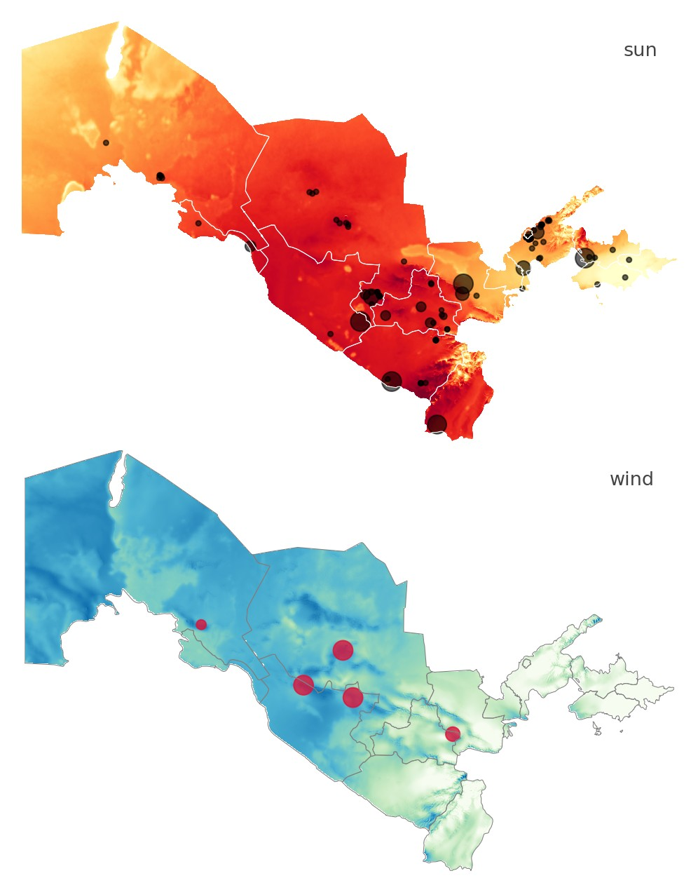

**What you'll learn**
- What a **raster** is, and how to open and draw one in Python.
- How to read the value of a raster **under a point**, for example under a solar farm.
- How to get the **average** of a raster for each region (zonal statistics).

## Part 0. Three ideas before you start

1. **Raster and vector.** On Days 02 and 03 you worked with **vector** data: points, lines and polygons. A **raster** is different: it's a grid of pixels, like a photo, but every pixel stores a number. In our solar raster, each pixel is about 1 km × 1 km.
2. **PVOUT: how much power the sun gives.** The **Global Solar Atlas** calculates, for every pixel, how many **kWh** of electricity **1 kWp** of solar panels (about 2–3 big panels) would make in one year.
3. **Wind at 100 m.** The **Global Wind Atlas** gives the average wind speed 100 m above the ground, where the blades of a big wind turbine turn. A wind farm needs about **6–7 m/s** or more. Twice the wind speed gives eight times more power!

## Part 1. The data

You don't need to download anything: the notebook reads the files from this project on GitHub. They're in the [data](data) folder, if you want to open them in QGIS:

| File | What's inside | Size |
|---|---|---|
| [solar_pvout.tif](data/solar_pvout.tif) | Solar power potential (PVOUT), kWh per kWp per year, about 1 km pixels | 0.5 MB |
| [wind_speed_100m.tif](data/wind_speed_100m.tif) | Average wind speed at 100 m, m/s, on the same 1 km grid | 1.4 MB |
| [power_plants.geojson](data/power_plants.geojson) | 189 power plants from OpenStreetMap: `name`, `source`, `mw` | 32 KB |
| [uzbekistan_regions.geojson](data/uzbekistan_regions.geojson) | The 14 regions (the same as Day 02) | 71 KB |

> **How we made the files.** We downloaded the Uzbekistan GeoTIFFs from [globalsolaratlas.info](https://globalsolaratlas.info/download/uzbekistan) and [globalwindatlas.info](https://globalwindatlas.info), cut them to the border of Uzbekistan, and put the wind data (250 m pixels) on the same 1 km grid as the solar data, so the files are small. The power plants are every `power=plant` in OpenStreetMap with a source of gas, hydro, solar, wind, coal or nuclear, downloaded on 16 November 2026.

## Part 2. Open the notebook and run it

1. Click this button: 
2. Sign in with your Google account and click **Copy to Drive** (**1**), so your changes are saved.

   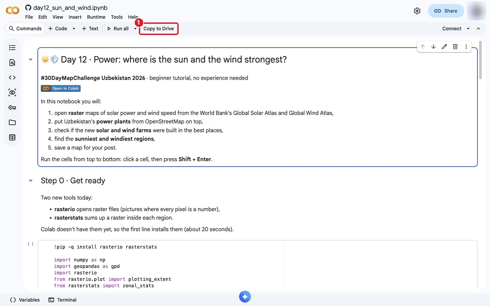

3. This time, let's run everything at once: click **Run all** (**1**). Colab warns you that the notebook comes from GitHub. Click **Run anyway** (**2**).

   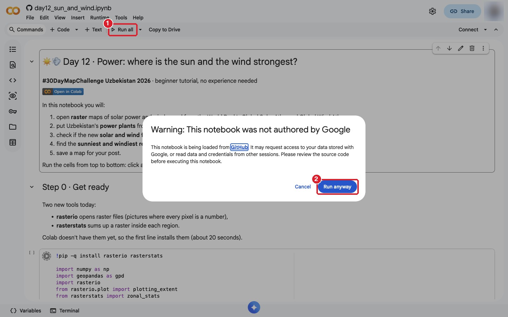

4. Wait about a minute. The first cell installs rasterio and rasterstats, then says **Ready! ✅** (**1**). The other cells follow one by one. At the end, Colab downloads a picture, **power_map.png**.

   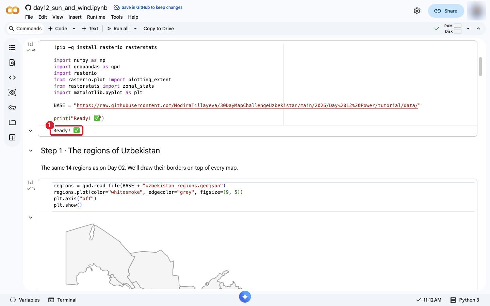

Now scroll down slowly and read the results, step by step.

## Part 3. The solar map

`rasterio.open()` opens the raster and `read(1)` reads its numbers into a grid called `sun`. The cell prints its size and the lowest, highest and average values (**1**): from 939 to 1,772 kWh per kWp per year, 1,551 on average.

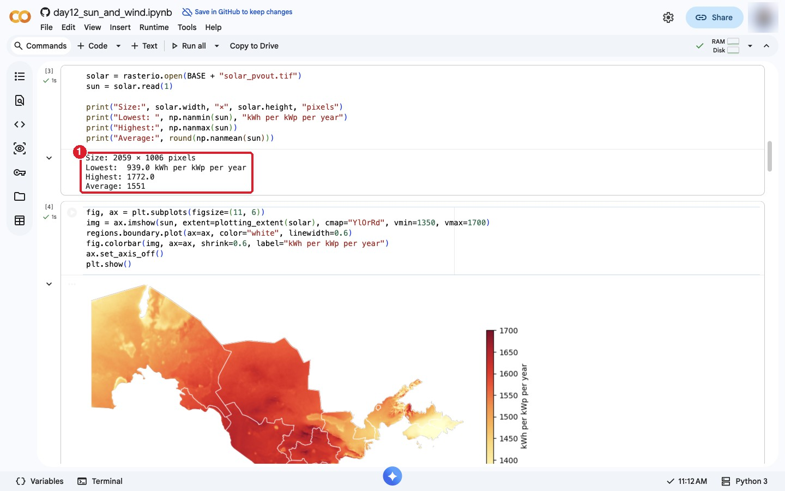

The next cell draws the grid with `imshow`, using the colour map `YlOrRd` (yellow → orange → red). We set `vmin=1350, vmax=1700`, so the colours show the differences between places instead of a few very dark mountain pixels.

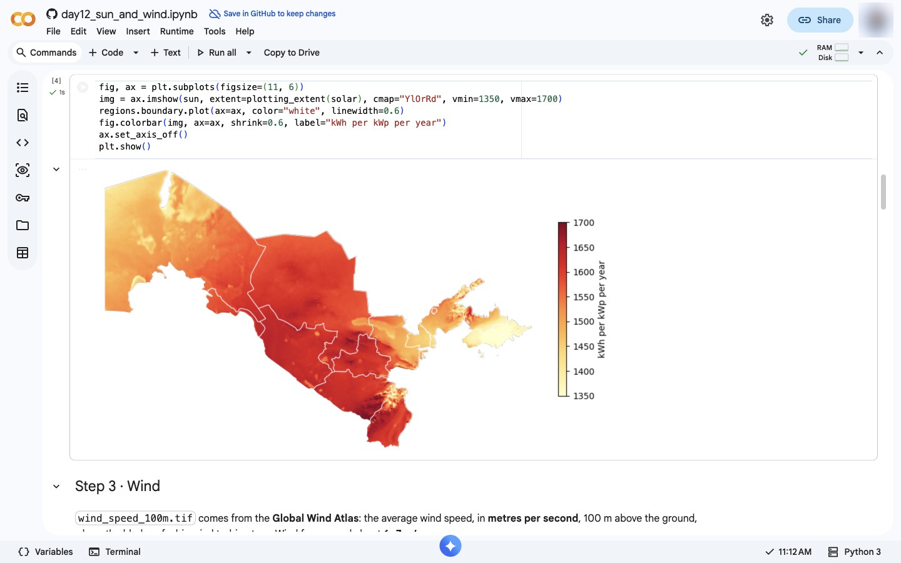

The south-west is sunniest: Bukhara, Kashkadarya, Samarkand and Surkhandarya. The mountains in the east and the Ferghana Valley get less, because of clouds and shadows, and the north-west less because it's further north.

## Part 4. The wind map

The same steps with the wind raster. On average, the wind at 100 m blows at **6.5 m/s**, and up to **11.9 m/s** in the windiest spot (**1**).

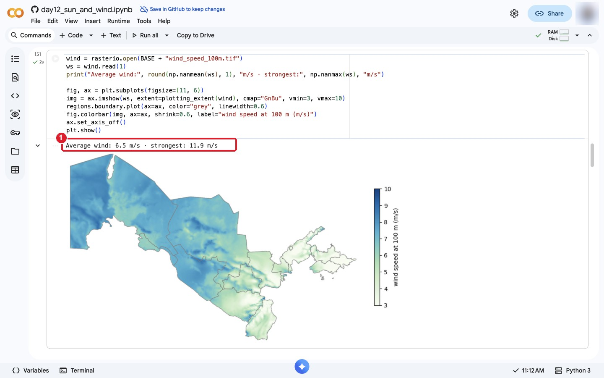

Here the picture is the other way round: the strongest wind is in the **west**, over the Ustyurt plateau and the Kyzylkum desert in Karakalpakstan, Navoi and Bukhara. The Ferghana Valley and Tashkent are calm.

## Part 5. The power plants

`gpd.read_file()` opens the power plants. The first table counts them by source (**1**): 99 solar, 61 hydro, 19 gas, 5 wind, 4 coal and 1 nuclear (still being built, near Jizzakh). The second table shows the biggest ones (**2**). The largest is the Syrdarya gas power plant, 3,000 MW.

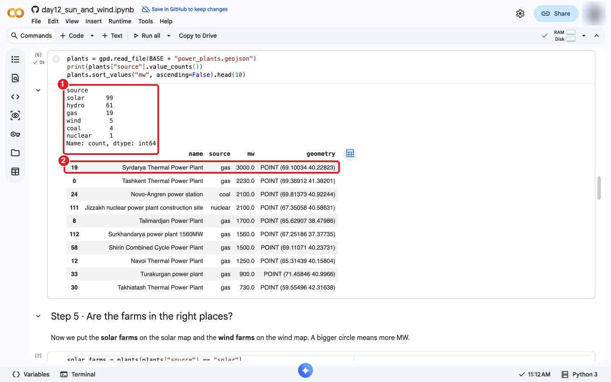

> **Why so many solar plants?** Most of them are small. The really big power still comes from gas: in our data, gas plants add up to about 14,000 MW, solar to about 4,000 MW and wind to about 1,850 MW.

## Part 6. Are the farms in the right places?

The cell in Step 5 draws the solar farms (black circles) on the solar map, and the wind farms (red circles) on the wind map. A bigger circle means more MW.

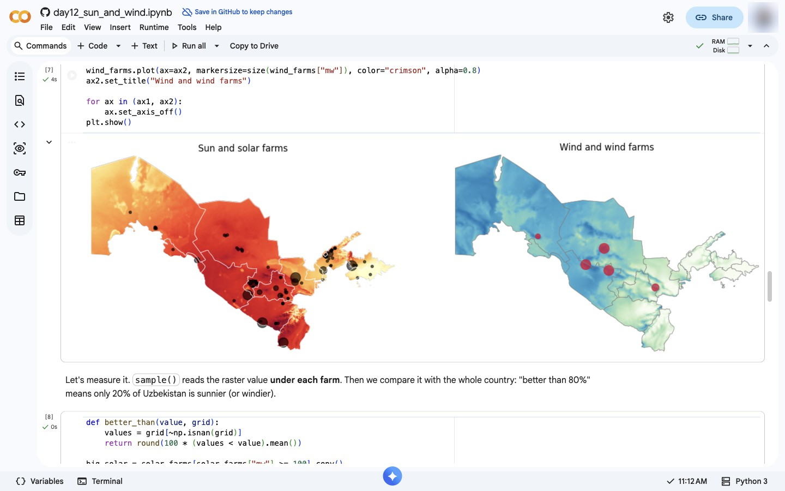

Now we measure it. `solar.sample()` reads the raster value **under each farm**. The function `better_than()` then compares it with every pixel in Uzbekistan: "better than 95%" means only 5% of the country is sunnier.

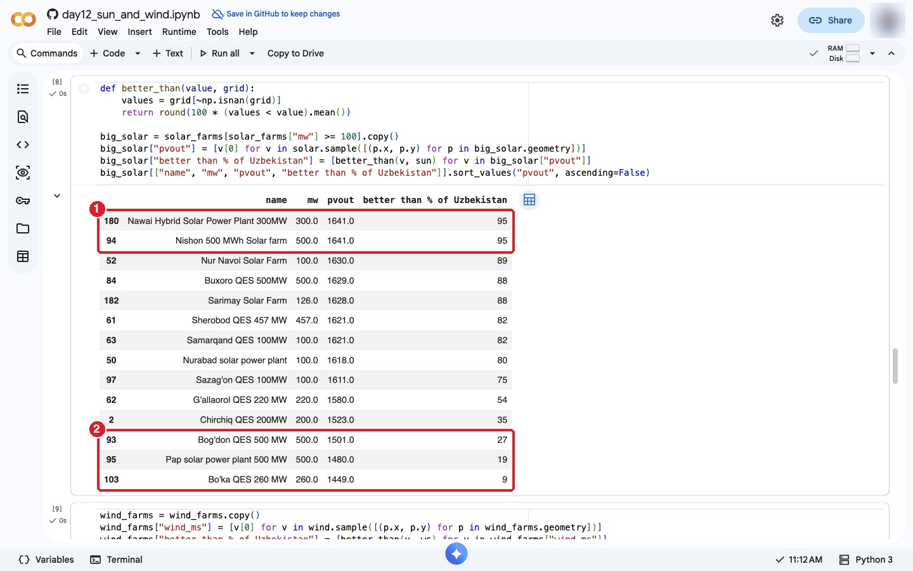

- The farms in Navoi, Bukhara, Samarkand and Surkhandarya are among the sunniest places in the country (**1**).
- But three big farms are in less sunny places (**2**): Bog'don (Jizzakh), Pap (Namangan) and Bo'ka (Tashkent region). Why build there? Sun isn't the only reason: these places are closer to big cities and power lines, and bringing electricity from the desert needs long, expensive lines.

And the wind farms:

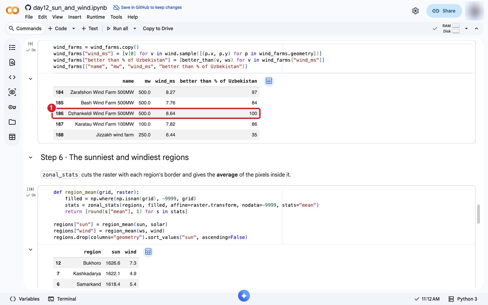

Dzhankeldi in Bukhara region stands in the windiest place of all (**1**): the table says 100, because after rounding almost no pixel in Uzbekistan is windier. Four of the five wind farms are in the windiest 20%.

## Part 7. The sunniest and windiest regions

`zonal_stats()` cuts the raster with the border of each region and gives the **average** of the pixels inside it. This is called **zonal statistics**.

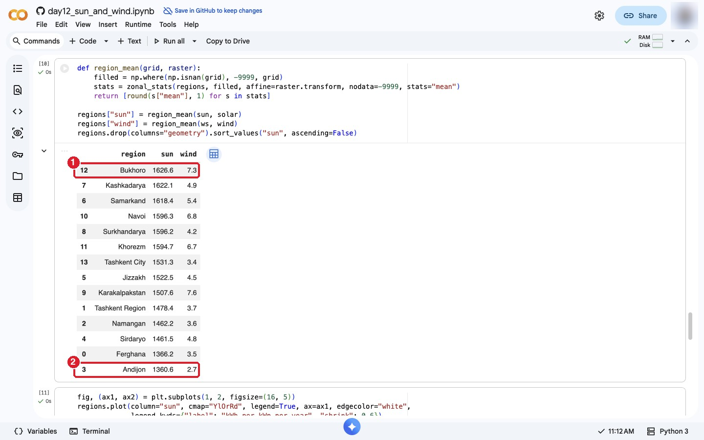

**Bukhara** comes first for sun (**1**), and it's also one of the windiest. **Andijan** comes last for both (**2**). The next cell turns the table into two maps:

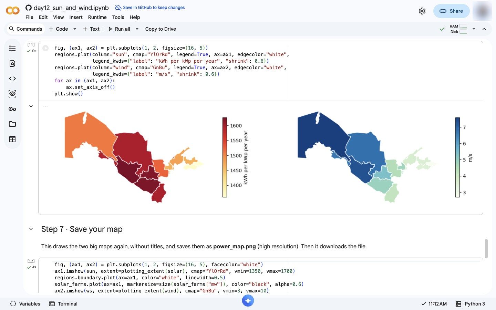

## Part 8. Save your map

The last cell draws the two big maps again without titles, saves them as **power_map.png** with `dpi=200` (sharp enough to print), and downloads the file (**1**).

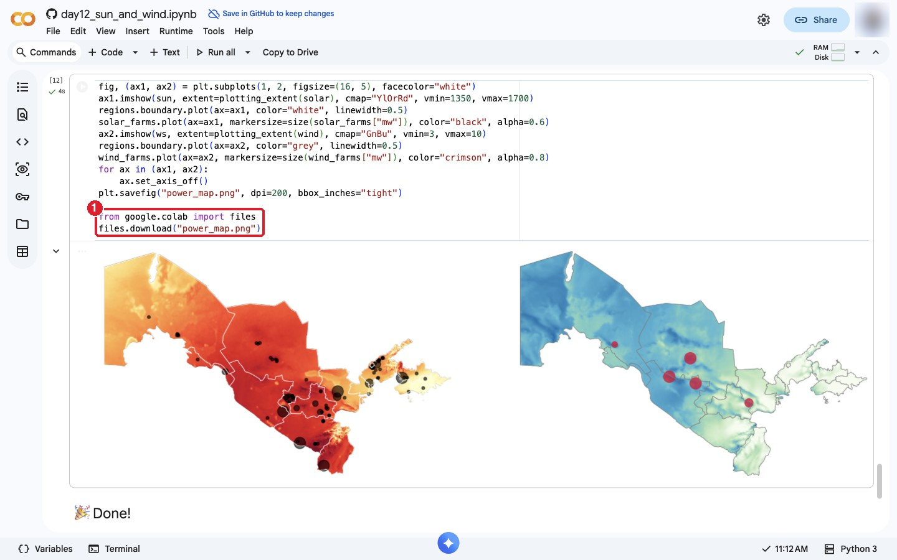

For your #30DayMapChallenge post, you can add a title and a short legend in Canva or PowerPoint.

## Ideas for your own map

- **Change the colours:** try `cmap="inferno"` or `cmap="plasma"` for the sun, `cmap="Blues"` for the wind.
- **A different source:** map the **hydro** plants on the elevation from Day 05 or 08. They're all in the mountains, of course. Or the **gas** plants: are they near the gas fields of Kashkadarya and Bukhara?
- **Sun or wind for each district:** download district borders from [geoBoundaries](https://www.geoboundaries.org) (ADM2) and run `zonal_stats` again.
- **Summer and winter:** the Solar Atlas also has monthly data. How much less power do the panels make in January?
- **Where would you build the next farm?** Find places that are sunny **and** close to a city, and draw them.

## When you share

Please credit:
> Solar data: Global Solar Atlas 2.0, © 2019 The World Bank, source: Solargis. Wind data: Global Wind Atlas 3.0, DTU and the World Bank. Both CC BY 4.0. Power plants © OpenStreetMap contributors (ODbL).

## Troubleshooting

| Problem | What to do |
|---|---|
| `ModuleNotFoundError: No module named 'rasterio'` | Run the first cell (Step 0) again. It installs rasterio and rasterstats. |
| `NameError: name 'sun' is not defined` | Run the cells in order, from the top, or use **Runtime → Run all**. |
| `RasterioIOError` or `HTTP error` | Colab couldn't reach GitHub. Check the `BASE` line, wait a minute and try again. |
| The solar map is almost all one colour. | Check `vmin=1350, vmax=1700` in `imshow`. Without them, a few dark mountain pixels stretch the colours. |
| Some circles are very small. | Their MW isn't known in OpenStreetMap, so they get a small size. You can add the power to OSM yourself! |
| The download doesn't start. | Open the **Files** panel on the left, right-click **power_map.png** → **Download**. |

## Credits

- **Solar data:** [Global Solar Atlas 2.0](https://globalsolaratlas.info), a free, web-based application developed and operated by Solargis s.r.o. on behalf of the World Bank Group, using Solargis data, with funding from ESMAP. © 2019 The World Bank. CC BY 4.0. Layer: PVOUT, long-term yearly average.
- **Wind data:** [Global Wind Atlas 3.0](https://globalwindatlas.info), a free, web-based application developed, owned and operated by the Technical University of Denmark (DTU), in partnership with the World Bank Group, with funding from ESMAP. CC BY 4.0. Layer: mean wind speed at 100 m.
- **Power plants:** © [OpenStreetMap](https://www.openstreetmap.org/copyright) contributors, ODbL. Names and capacities as mapped in OSM on 16 November 2026; some may be planned or under construction.
- **Regions:** the same file as [Day 02](../../Day%2002%20Lines/tutorial/README.md), from simplemaps.com, simplified.
- **Software:** [rasterio](https://rasterio.readthedocs.io), [rasterstats](https://pythonhosted.org/rasterstats/), [geopandas](https://geopandas.org), [matplotlib](https://matplotlib.org), [Google Colab](https://colab.research.google.com).
