# Day 13 tutorial: Trees and heat in Tashkent

**Theme: Interactions.** On a hot July morning, walk from a bus stop into a park and you feel it: under the trees it's cooler. Today you measure this interaction between **trees** and **heat** from space. You find a **Landsat** satellite image of Tashkent, turn its thermal band into **surface temperature**, measure greenness with **NDVI**, and compare the two for 800,000 pixels. You work in **Google Colab** with a new way to get satellite data: **STAC** and the **Microsoft Planetary Computer**. No account needed for the data. It takes about 30 minutes.

📄 **Printable PDF:** [English](pdf/Day13_Tutorial_EN.pdf) · [Русский](pdf/Day13_Tutorial_RU.pdf) · [Oʻzbekcha](pdf/Day13_Tutorial_UZ.pdf)

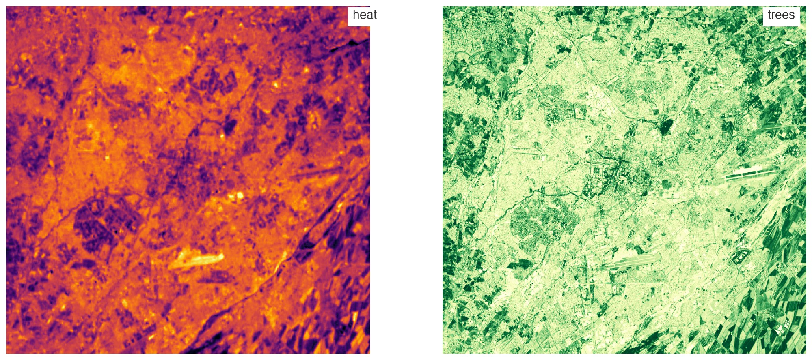

**What you'll learn**
- How to **search a satellite archive** with STAC and load only the part of the image you need.
- How a satellite measures **temperature**, and how to turn its numbers into °C.
- How to calculate **NDVI**, and how to show the relationship between two maps with a chart.

## Part 0. Four ideas before you start

1. **Landsat.** NASA and the USGS have photographed the Earth with Landsat satellites since 1972. **Landsat 8** and **Landsat 9** pass over Tashkent every 16 days each, so together every 8 days, at about 11 in the morning. Each pixel is 30 m × 30 m.
2. **A satellite thermometer.** Besides colours, Landsat measures **thermal infrared** light: the heat that every surface sends out. From it the USGS calculates the **surface temperature**: the temperature of roofs, asphalt, soil and tree tops. On a sunny day it's much hotter than the air temperature in the weather forecast.
3. **NDVI: how green.** Healthy leaves reflect a lot of **near-infrared** light (which our eyes can't see) and absorb **red** light. NDVI compares the two: about **0** for roofs and roads, **0.2–0.4** for grass and gardens, **0.6 or more** for dense trees.
4. **STAC: a search engine for satellite images.** **STAC** (SpatioTemporal Asset Catalog) is a common language that satellite archives use. You ask "Landsat, over this point, in summer 2026, with few clouds", and you get a list of images. The **Microsoft Planetary Computer** keeps petabytes of free satellite data in STAC. You read only the small box you need, straight from the cloud.

## Part 1. Open the notebook and run it

1. Click this button: 
2. Sign in with your Google account and click **Copy to Drive** (**1**), so your changes are saved.

   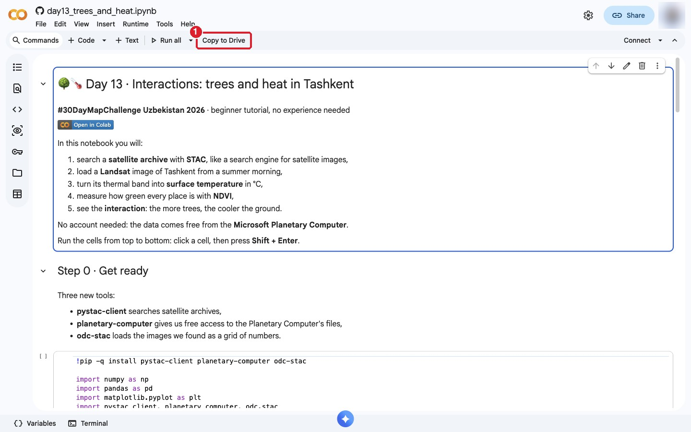

3. Click **Run all** (**1**), then **Run anyway** (**2**) when Colab warns you that the notebook comes from GitHub.

   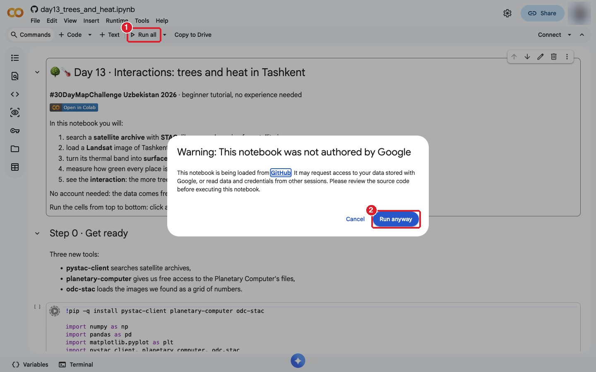

4. Wait about a minute. The first cell installs the three new tools and connects to the Planetary Computer: **Ready! ✅** (**1**). At the end, Colab downloads a picture, **trees_and_heat.png**.

   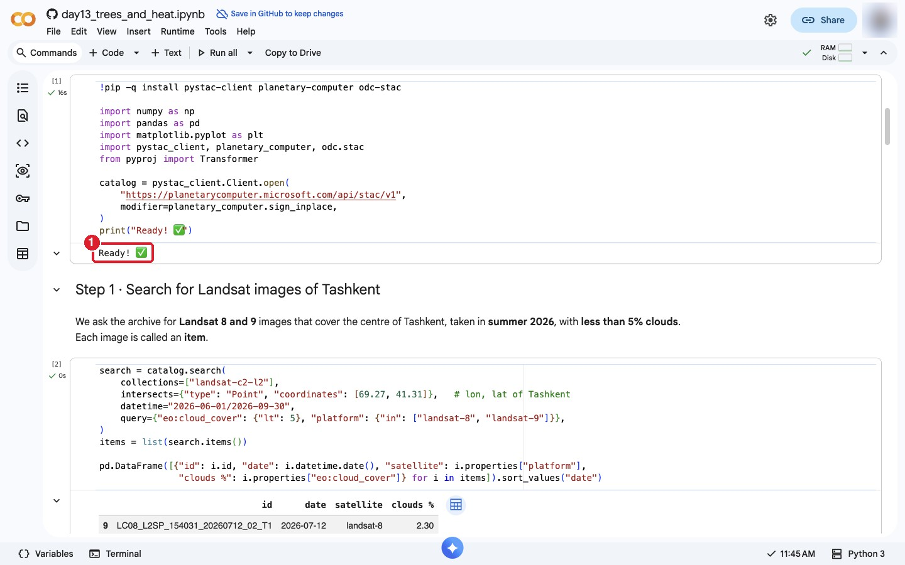

Now scroll down and read the results step by step.

## Part 2. Search the archive

`catalog.search()` asks the Planetary Computer for Landsat images (`landsat-c2-l2`) that cover the centre of Tashkent, from June to September 2026, with less than 5% clouds. It finds ten. We take **28 July 2026**, from Landsat 8, with only 0.05% clouds (**1**).

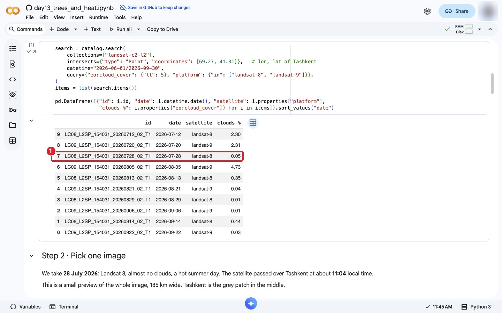

> **Want another day?** Copy any `id` from this table into Step 2. The `09` images are from Landsat 9.

## Part 3. Look at the image and load Tashkent

Step 2 shows a small preview of the whole Landsat image. It's about 185 km wide, and Tashkent is near the middle.

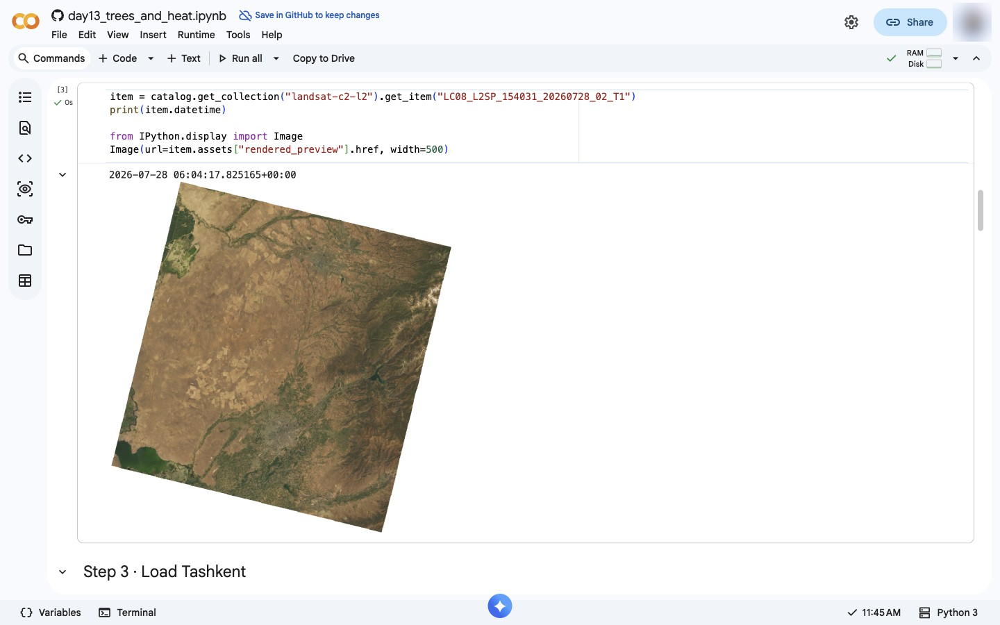

Step 3 loads only a box around Tashkent (`bbox`), with three **bands** (**1**): `red`, `nir08` (near-infrared) and `lwir11` (thermal infrared). That's 980 × 818 pixels, about 29 km × 25 km. The numbers in the bands are not yet degrees or colours; we change that in the next steps.

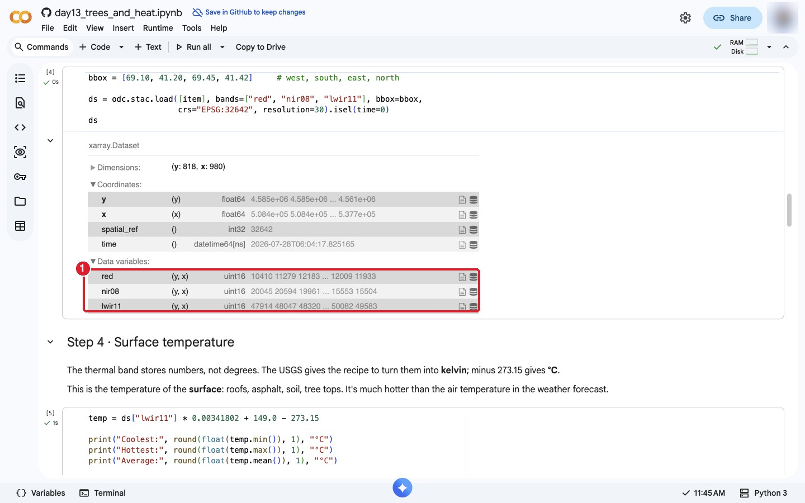

## Part 4. Surface temperature

The USGS publishes a recipe that turns the thermal numbers into kelvin: `number × 0.00341802 + 149.0`. Minus 273.15 gives °C. At 11:04 on 28 July, the surface of Tashkent was between **24 °C** and **59 °C**, and **43 °C** on average (**1**).

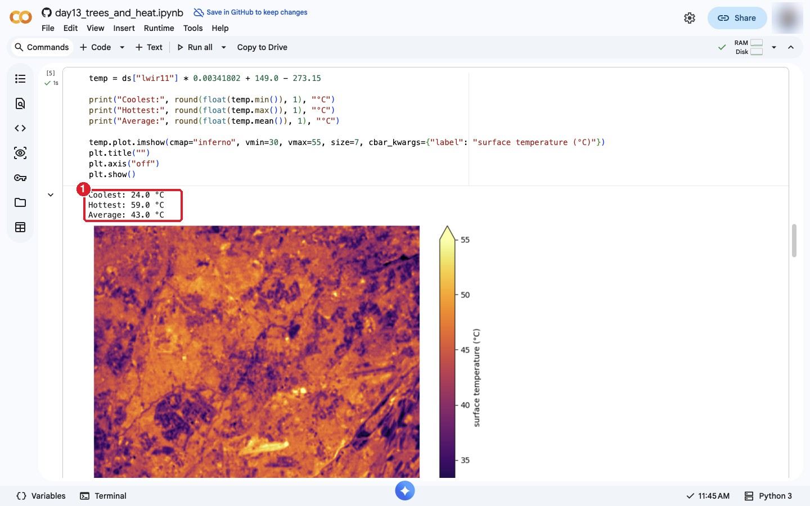

We use the colour map `inferno`: dark purple is cool, yellow is hot. Look for the dark patches: big parks and the old mahallas with gardens. The brightest yellow shape, south of the centre, is the airport.

## Part 5. NDVI

`ndvi = (nir − red) / (nir + red)`. First we turn the numbers into **reflectance** (the share of light that bounces back, from 0 to 1), with the recipe `number × 0.0000275 − 0.2`.

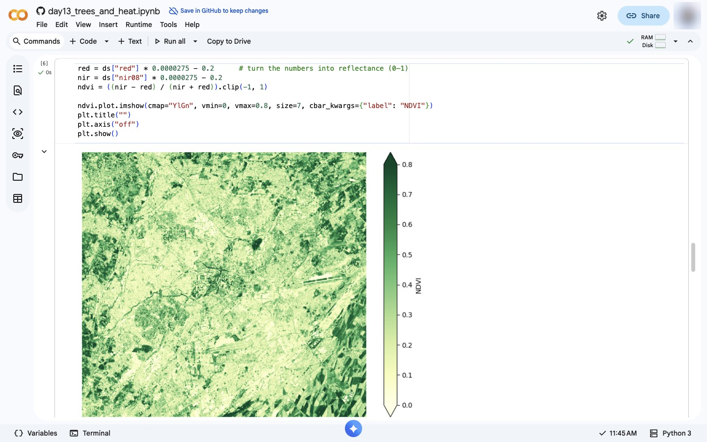

Dark green: fields around the city and big parks. Pale yellow: roofs, roads and bare land. Do you see that the NDVI map looks like the temperature map in reverse?

## Part 6. The interaction

Every pixel now has two numbers: its NDVI and its temperature. `plt.hexbin` puts all of them on one chart: NDVI from left to right, temperature from bottom to top. The darker a hexagon, the more pixels.

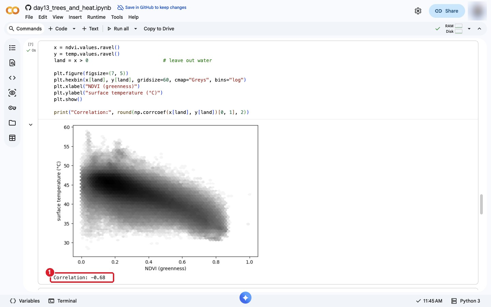

The cloud of pixels goes **down to the right**: the greener, the cooler. The **correlation** is **−0.68** (**1**). A correlation of −1 would be a perfect line going down, 0 would be no relationship at all, so −0.68 is a strong one.

The next cell puts the pixels into four groups and gives the average temperature of each (**1**):

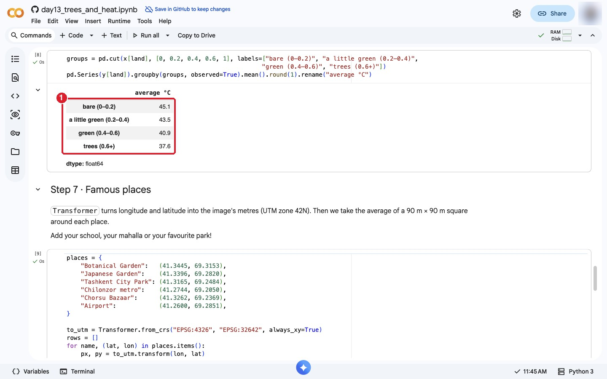

Places with **trees are 7.5 °C cooler** than bare places (37.6 °C instead of 45.1 °C).

## Part 7. Famous places

Step 7 takes six places by their latitude and longitude, changes them into the image's metres with `Transformer`, and averages a 90 m × 90 m square around each.

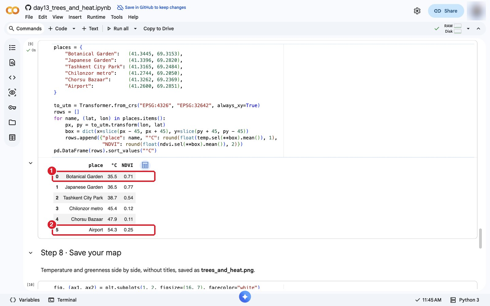

The **Botanical Garden** is the coolest, 35.5 °C (**1**). The **airport** is the hottest, 54.3 °C (**2**): its concrete and dry grass get no shade. That's **19 °C** difference in one city at the same moment!

> **Not just trees.** Water also keeps surfaces cool, and the material matters: dark asphalt and metal roofs get hotter than light-coloured surfaces.

## Part 8. Save your map

The last cell draws the two maps side by side without titles and downloads them as **trees_and_heat.png** (**1**).

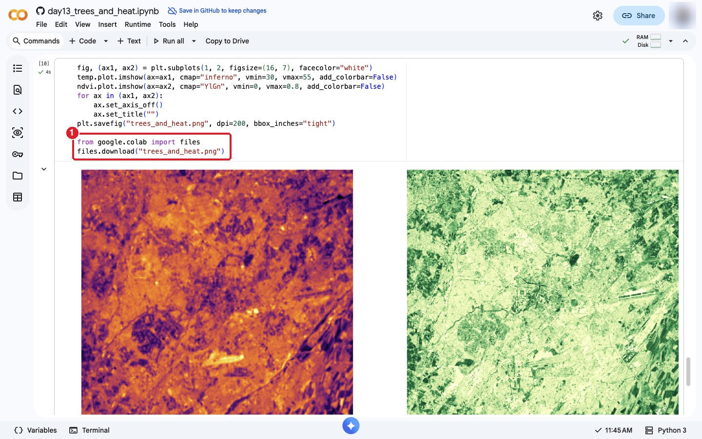

For your #30DayMapChallenge post, add a short title and the two legends (°C and NDVI) in Canva or PowerPoint.

## Ideas for your own map

- **Your mahalla:** add your school, your street or your favourite park to `places` in Step 7. Find the coordinates in Google Maps (right-click).
- **Another city:** change `bbox` and the point in Step 1 to Samarkand, Bukhara, Nukus or Termez. Is the desert around them hotter than the city?
- **Winter and summer:** pick a January image. Are the parks still cooler?
- **Then and now:** Landsat 8 started in 2013. Compare July 2014 with July 2026: did the new districts make Tashkent hotter?
- **A cooler city plan:** find the hottest places where many people walk (bazaars, bus stations) and suggest where to plant trees.

## When you share

Please credit:
> Landsat 8 Collection 2 Level-2 courtesy of the U.S. Geological Survey. Data accessed through the Microsoft Planetary Computer.

## Troubleshooting

| Problem | What to do |
|---|---|
| `ModuleNotFoundError: No module named 'pystac_client'` | Run the first cell (Step 0) again. It installs the tools. |
| `NameError: name 'item' is not defined` | Run the cells in order, from the top, or use **Runtime → Run all**. |
| `APIError` or a timeout when searching or loading | The Planetary Computer is busy. Wait a minute and run the cell again. |
| The map is all one colour. | Check `vmin=30, vmax=55` in the temperature cell. In winter, use lower numbers, for example `vmin=-5, vmax=20`. |
| There are strange cold spots. | Clouds! They're cold on top. Choose an image with fewer clouds in Step 1. |
| The download doesn't start. | Open the **Files** panel on the left, right-click **trees_and_heat.png** → **Download**. |

## Credits

- **Satellite data:** Landsat 8 Collection 2 Level-2 (surface reflectance and surface temperature), scene `LC08_L2SP_154031_20260728_02_T1`, courtesy of the U.S. Geological Survey. Landsat data is free and has no restrictions on use.
- **Data access:** [Microsoft Planetary Computer](https://planetarycomputer.microsoft.com), collection `landsat-c2-l2`.
- **Software:** [pystac-client](https://pystac-client.readthedocs.io), [planetary-computer](https://github.com/microsoft/planetary-computer-sdk-for-python), [odc-stac](https://odc-stac.readthedocs.io), [xarray](https://xarray.dev), [matplotlib](https://matplotlib.org), [pyproj](https://pyproj4.github.io/pyproj/), [Google Colab](https://colab.research.google.com).
