# Day 14 tutorial: Every building in Uzbekistan

**Theme: Borgesian map.** In a one-paragraph story from 1946, *On Exactitude in Science*, Jorge Luis Borges tells of an empire whose mapmakers made a map at **1:1 scale**: as big as the empire itself. It was perfect, and useless. Today you get close to that dream: a map of **every building in Uzbekistan**, 7,135,676 of them, most traced by AI from satellite images. You ask questions with **DuckDB** and **SQL**, draw one dot per building until the country appears, zoom in to single houses, and find the places where the map is *not* the territory. You work in **Google Colab**. It takes about 30 minutes.

📄 **Printable PDF:** [English](pdf/Day14_Tutorial_EN.pdf) · [Русский](pdf/Day14_Tutorial_RU.pdf) · [Oʻzbekcha](pdf/Day14_Tutorial_UZ.pdf)

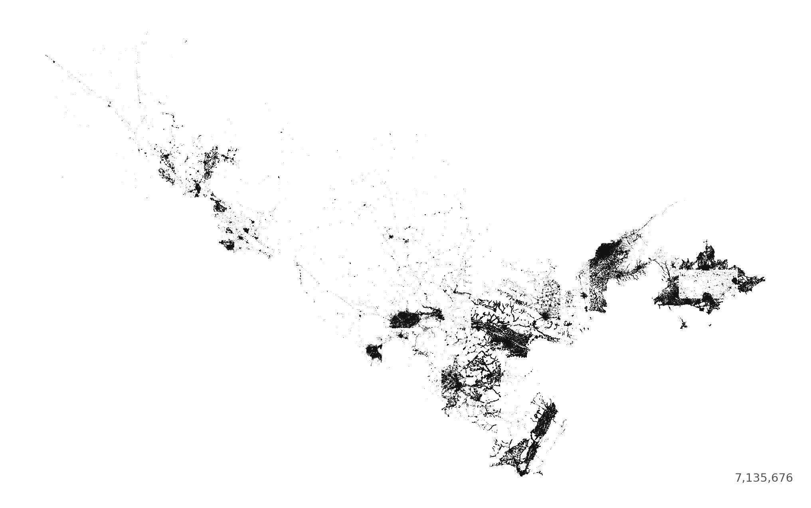

**What you'll learn**
- How to ask questions to a table of millions of rows with **SQL** in **DuckDB**.
- How to draw a map with no base map at all, only data.
- Where open building data comes from, and why it has gaps.

## Part 0. Three ideas before you start

1. **Buildings traced by AI.** Nobody walked around Uzbekistan drawing 7 million houses. **Microsoft** trained an AI to find building outlines in very sharp satellite images, and ran it over the whole world. Volunteers drew more buildings by hand in **OpenStreetMap**. **Overture Maps**, a group of companies including Microsoft, Meta, Amazon and TomTom, joins both into one open dataset.
2. **SQL, the language of data.** **SQL** questions look almost like English: `SELECT region, count(*) FROM buildings GROUP BY region` means "for each region, count the buildings". **DuckDB** is a small, fast database that runs inside Python and answers such questions on millions of rows in a second.
3. **The map is not the territory.** Even 7 million buildings is not *everything*. Where the AI didn't look and no volunteer has mapped, the data is empty, but people live there. Finding those gaps is part of reading any map.

## Part 1. The data

You don't need to download anything: the notebook reads the files from this project on GitHub.

| File | What's inside | Size |
|---|---|---|
| [uz_buildings.parquet](data/uz_buildings.parquet) | 7,135,676 buildings: `region`, `lon`, `lat` (centre), `area_m2`, `src` (source) | 40 MB |
| [bukhara_old_town.parquet](data/bukhara_old_town.parquet) | Full outlines of the 4,101 buildings in Bukhara's old town | 0.3 MB |
| [uzbekistan_regions.geojson](data/uzbekistan_regions.geojson) | The 14 regions (the same as Day 02) | 71 KB |

**Parquet** is a file format for big tables: small, fast, and readable by DuckDB, pandas, QGIS and many other tools.

> **How we made the files.** We asked Overture Maps (release 2026-10-21.0) for every building in a box around Uzbekistan with DuckDB, straight from Overture's cloud storage. It took 18 minutes and gave 13.8 million buildings. Then we kept only those whose centre falls inside Uzbekistan, gave each one its region, and saved the centre point instead of the full outline, so the file is small. The Extra step at the end of the notebook shows how to do it yourself for one town.

## Part 2. Open the notebook and run it

1. Click this button: 
2. Sign in with your Google account and click **Copy to Drive** (**1**), so your changes are saved.

   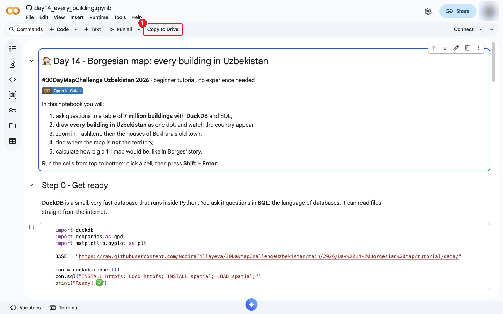

3. Click **Run all** (**1**), then **Run anyway** (**2**).

   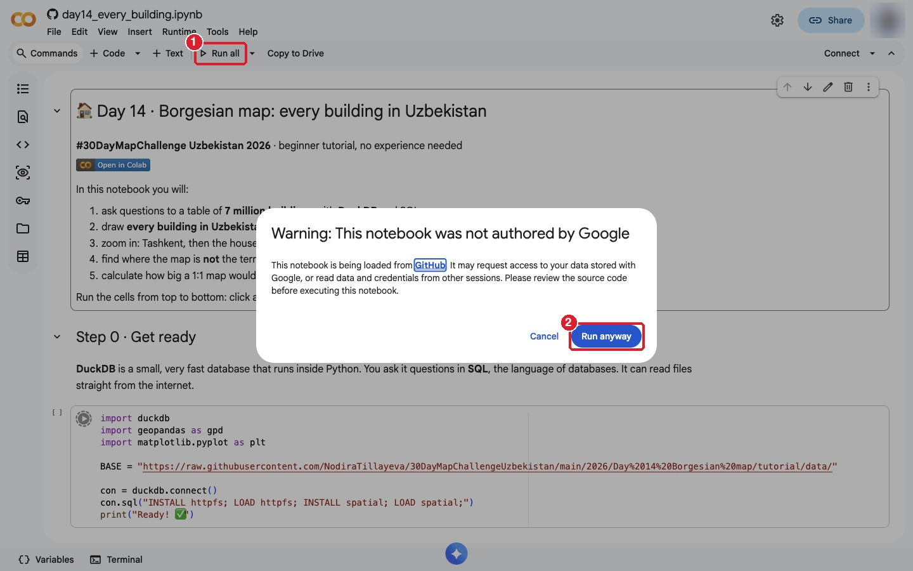

4. Wait about a minute. The first cell connects DuckDB to the internet (`httpfs`) and adds its map tools (`spatial`): **Ready! ✅** (**1**).

   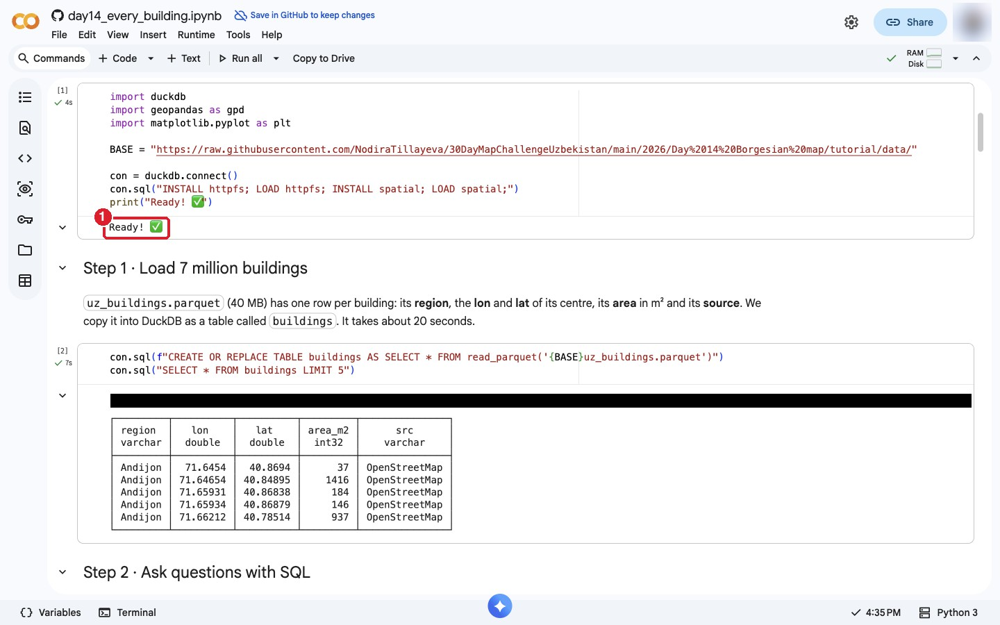

## Part 3. Load 7 million buildings

`CREATE TABLE buildings AS SELECT * FROM read_parquet(...)` copies the whole file into DuckDB, as a table called `buildings`. Then `SELECT * FROM buildings LIMIT 5` shows the first five rows (**1**): each building's region, the longitude and latitude of its centre, its area, and who drew it.

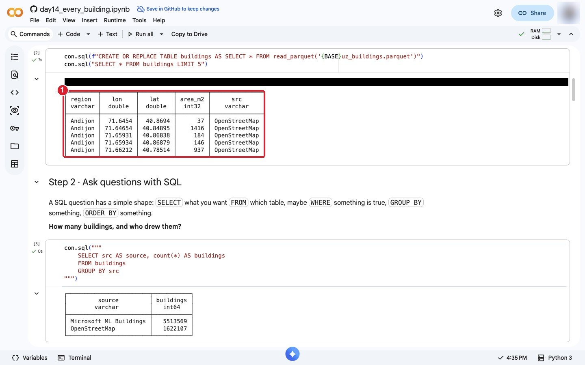

## Part 4. Ask questions with SQL

**Who drew the buildings?** `GROUP BY src` counts them by source (**1**): **5,513,569** were traced by Microsoft's AI and **1,622,107** were drawn by OpenStreetMap volunteers.

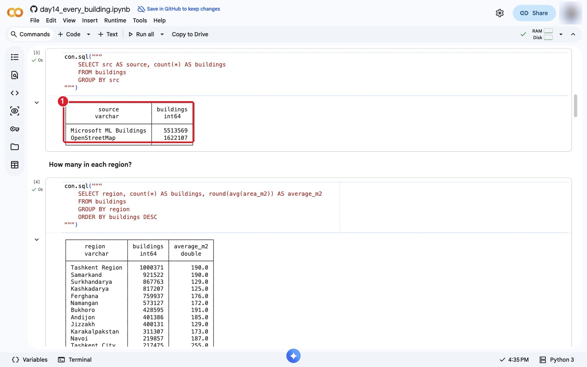

**How many in each region?** (**1**) Tashkent Region comes first with about 1 million buildings, then Samarkand and Surkhandarya. Tashkent City has only 217,475, but they're big on average, 255 m², because of apartment blocks and offices. (Khorezm's average is even bigger, 281 m², but for a different reason: see Part 7.)

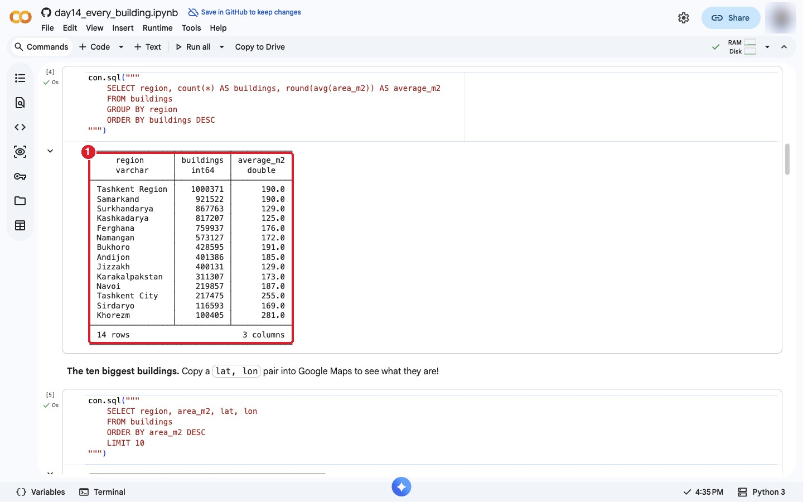

**The ten biggest buildings** (**1**). The biggest has a roof of 186,844 m², as big as 26 football fields. Copy its `lat, lon` into Google Maps and find out what it is!

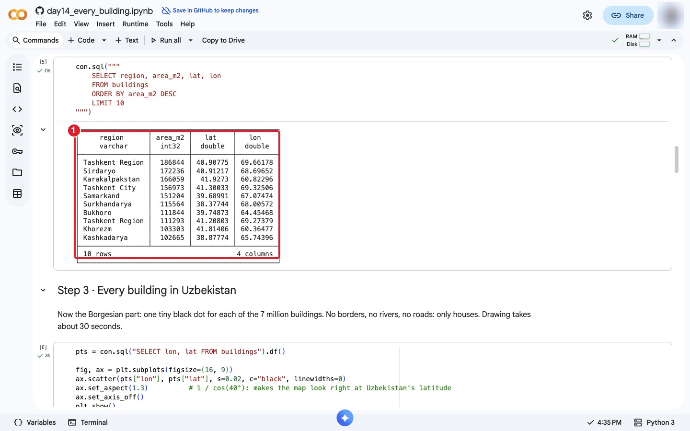

## Part 5. Every building in Uzbekistan

`plt.scatter` draws one tiny black dot for each building. There's no border, no river, no road on this map, but you can see all of them: the Ferghana Valley, Tashkent, the Zarafshan valley with Samarkand and Bukhara, the Kashkadarya and Surkhandarya oases along the rivers, and Karakalpakstan along the Amu Darya. Where there are no houses, there's desert or mountains.

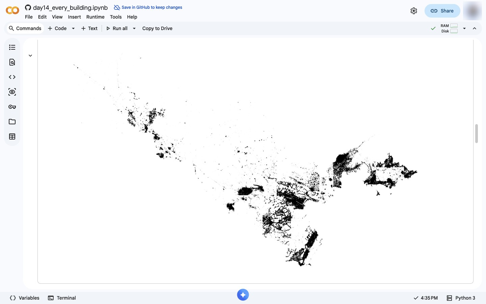

> `ax.set_aspect(1.3)` stretches the map a little from top to bottom. At Uzbekistan's latitude, one degree of longitude is shorter than one degree of latitude (about 85 km instead of 111 km), so without it the country would look too wide.

## Part 6. Zoom in

**Tashkent.** The same dots, only for `region = 'Tashkent City'`. Dark areas are mahallas, full of small houses close together. The paler areas in the middle are apartment blocks, parks and big roads: fewer buildings, more space between them.

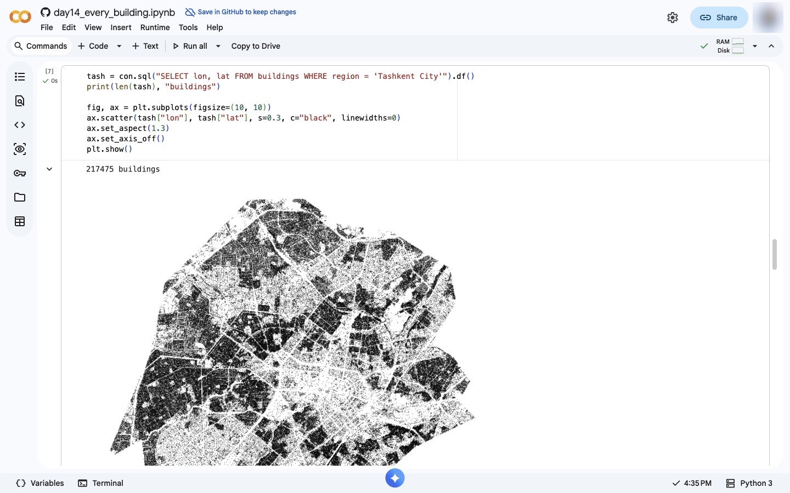

**Bukhara's old town.** Now each building is not a dot but its real outline, coloured by size: light for small houses, dark for big ones. Can you find the walls of the **Ark** fortress?

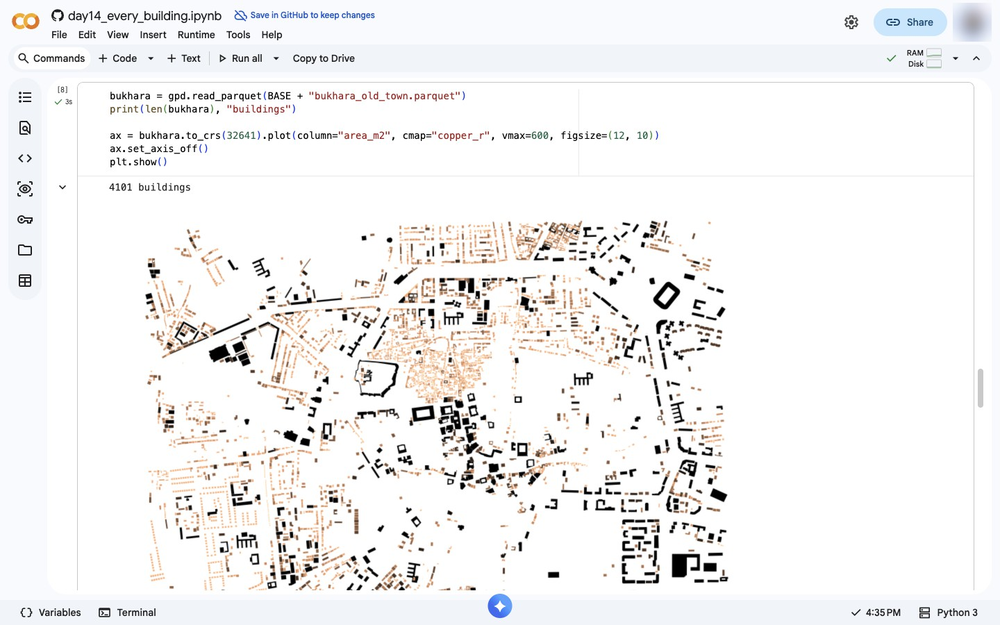

## Part 7. Where the map is not the territory

Look again at the big map. In the **Ferghana Valley** there's an empty belt with straight edges, and **Khorezm**, one of the most crowded regions, looks almost empty. That's not desert. It's a **gap in the data**: the AI didn't cover these places, and volunteers haven't drawn them yet. Where only some buildings are drawn, they're usually the big ones, which is why Khorezm's average building looks so large.

The cell in Step 6 counts buildings in squares of 0.2° × 0.2° (about 17 km × 22 km). In the middle of the valley, around 40.6–40.8° N and 71.2–72.0° E, there are only a few hundred, or even 46 (**1**), right next to squares with 100,000.

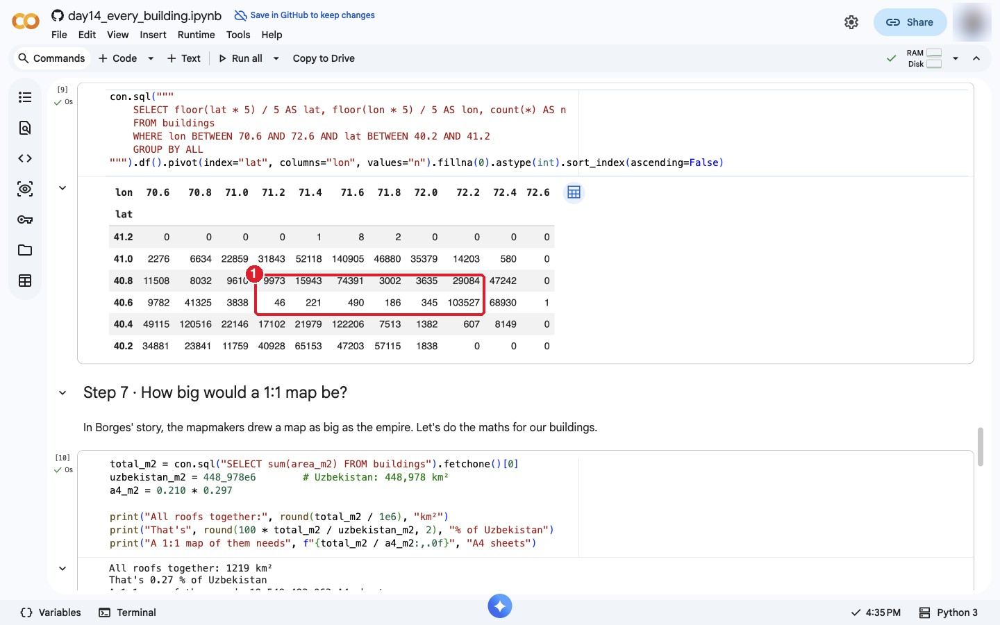

> **You can fill the gap!** Anyone can draw buildings in OpenStreetMap, for example with the [HOT Tasking Manager](https://tasks.hotosm.org) or the [iD editor](https://www.openstreetmap.org/edit). Your mahalla could be in the next Overture release.

## Part 8. How big would a 1:1 map be?

Step 7 adds up the area of all roofs (**1**): **1,219 km²**, which is 0.27% of Uzbekistan. To print them at 1:1, like Borges' mapmakers, you'd need **19.5 billion A4 sheets**. Laid side by side, the map would be as big as the buildings themselves, and just as useless as in the story.

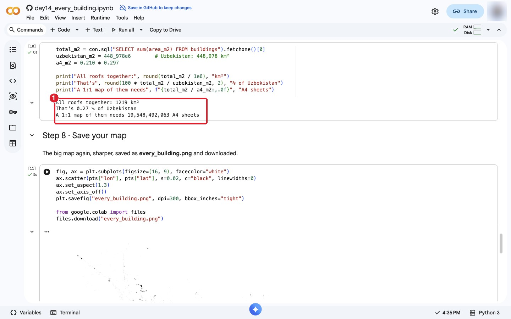

## Part 9. Save your map

Step 8 draws the big map again, sharper (`dpi=300`), and downloads it as **every_building.png** (**1**).

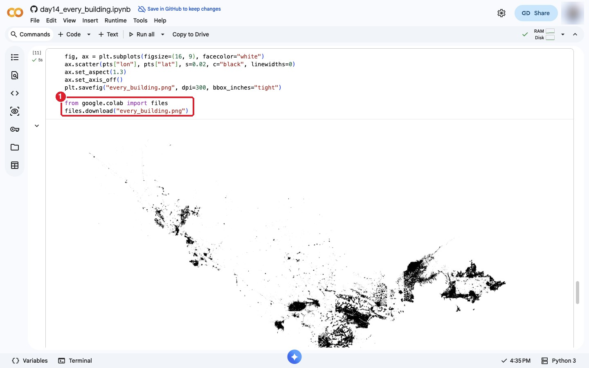

## Extra. Ask the cloud directly

The last cell can ask **Overture Maps** directly for the buildings in any box, for example your town, with their full outlines. It reads from thousands of files in the cloud, so it takes **5–10 minutes**. That's why it's switched off: change `RUN_LIVE = False` to `True` (**1**) and the four numbers to your town's box, then run it.

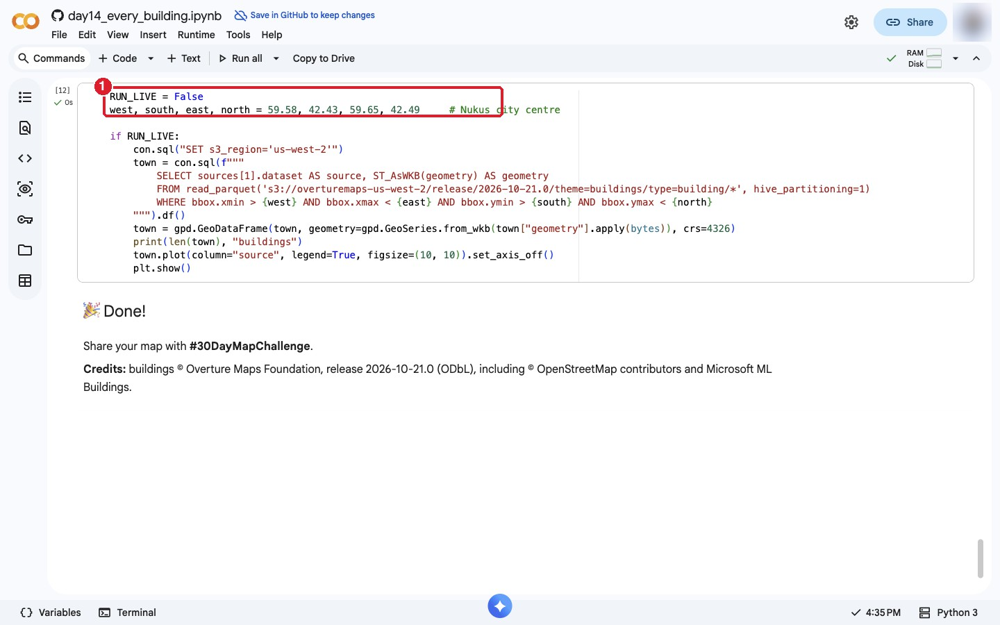

> **How to find your box:** on [bboxfinder.com](http://bboxfinder.com), draw a rectangle around your town and copy the four numbers at the bottom (west, south, east, north). Keep it small, a few kilometres.

## Ideas for your own map

- **Your town, house by house:** use the Extra step for your town and colour the buildings by `source`: which ones did the AI find, which ones did people draw?
- **Big and small:** colour the dots by `area_m2`. Where are the big buildings: factories, bazaars, new districts?
- **Buildings per person:** divide the number of buildings by the population of each region (Day 03).
- **Glow map:** draw the dots in yellow on a black background, with `alpha=0.3`. It looks like a night-lights photo.
- **Mind the gap:** map only the gaps: places with many people but few buildings in the data.

## When you share

Please credit:
> Buildings © Overture Maps Foundation (release 2026-10-21.0), ODbL, including © OpenStreetMap contributors and Microsoft ML Building Footprints.

## Troubleshooting

| Problem | What to do |
|---|---|
| `HTTP Error` or `IO Error` when loading | Colab couldn't reach GitHub. Wait a minute and run the cell again. |
| `Catalog Error: Table with name buildings does not exist` | Run Step 1 first, or use **Runtime → Run all**. |
| Colab crashes or says it's out of memory | Restart (**Runtime → Restart session**) and run again. 7 million points need about 1 GB. |
| The country map is almost empty. | The dots are tiny. Change `s=0.02` to `s=0.1`. |
| The Extra step takes forever. | It's slow, that's normal. Make your box smaller, or try it later. |
| `Binder Error` in my own SQL | Check the column names: `region`, `lon`, `lat`, `area_m2`, `src`. Text needs single quotes: `'Navoi'`. |

## Credits

- **Buildings:** [Overture Maps Foundation](https://overturemaps.org), release 2026-10-21.0, buildings theme, licensed [ODbL](https://opendatacommons.org/licenses/odbl/). Sources: © [OpenStreetMap](https://www.openstreetmap.org/copyright) contributors and [Microsoft ML Building Footprints](https://github.com/microsoft/GlobalMLBuildingFootprints).
- **Regions:** the same file as [Day 02](../../Day%2002%20Lines/tutorial/README.md), from simplemaps.com, simplified.
- **Story:** Jorge Luis Borges, *Del rigor en la ciencia* (*On Exactitude in Science*), 1946.
- **Software:** [DuckDB](https://duckdb.org) with the spatial and httpfs extensions, [geopandas](https://geopandas.org), [matplotlib](https://matplotlib.org), [Google Colab](https://colab.research.google.com).
