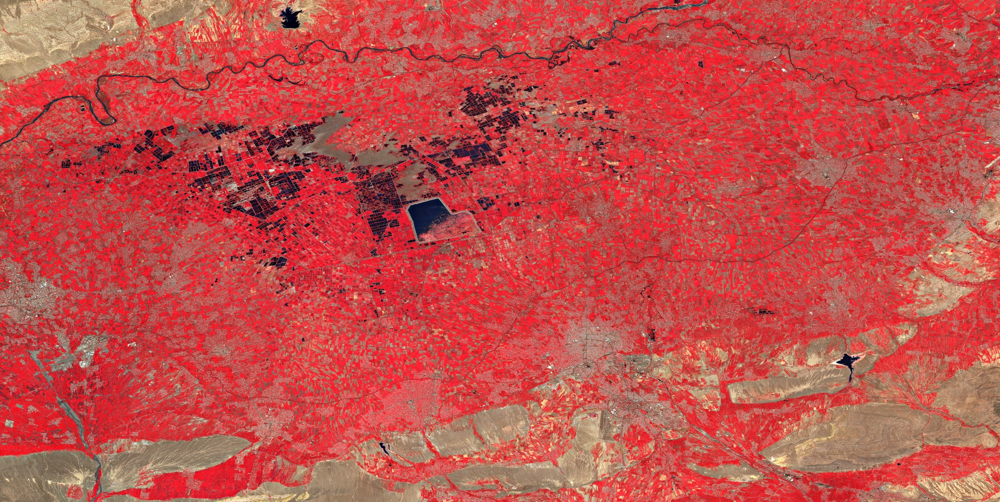
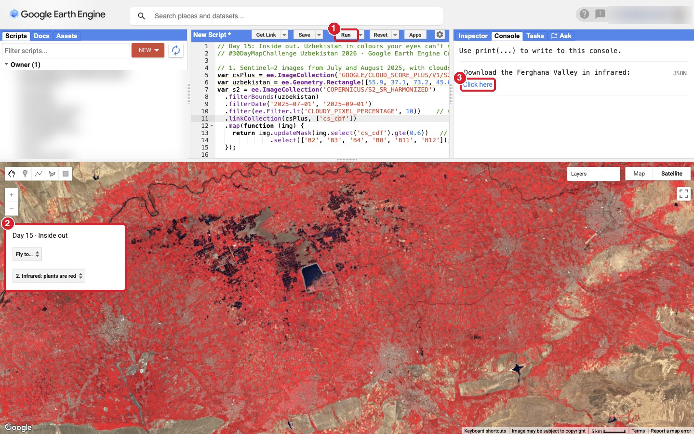
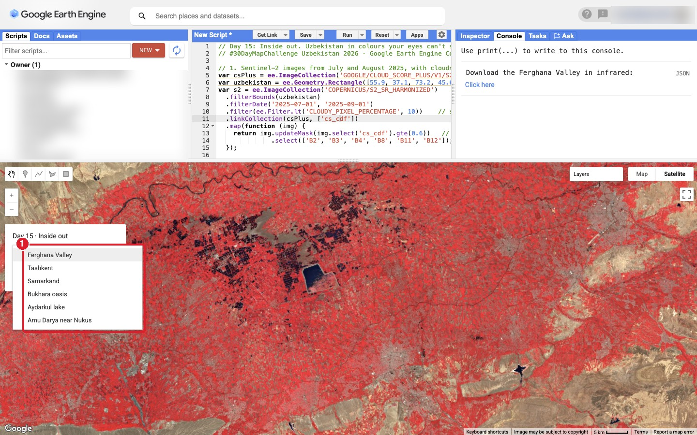
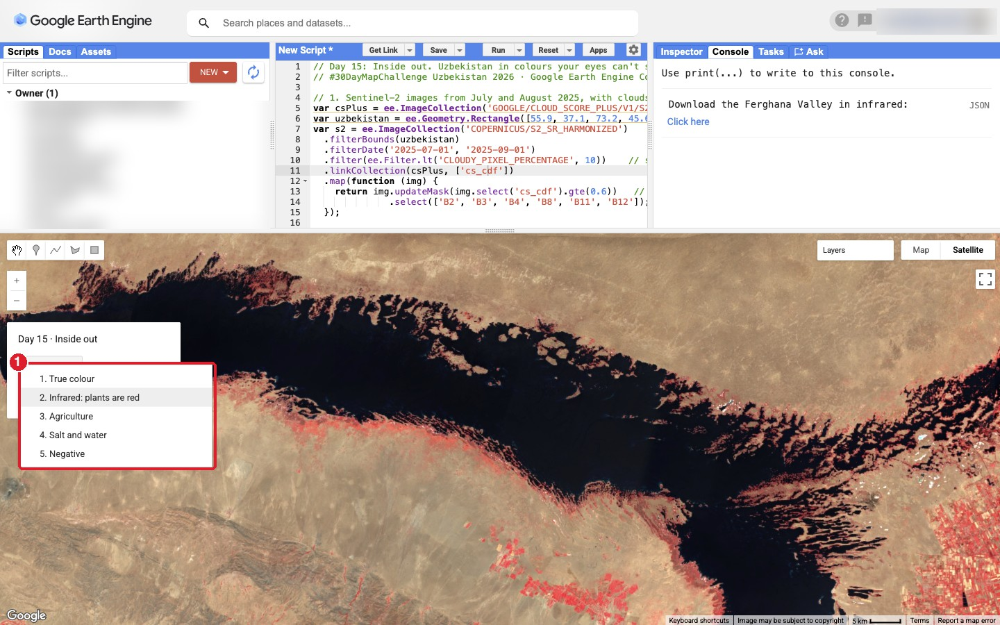
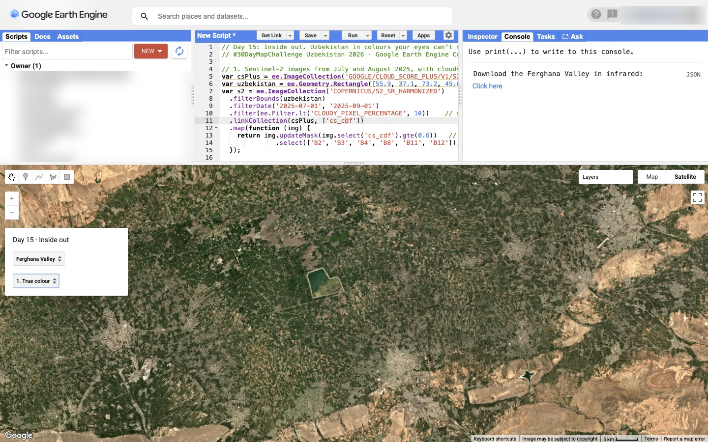
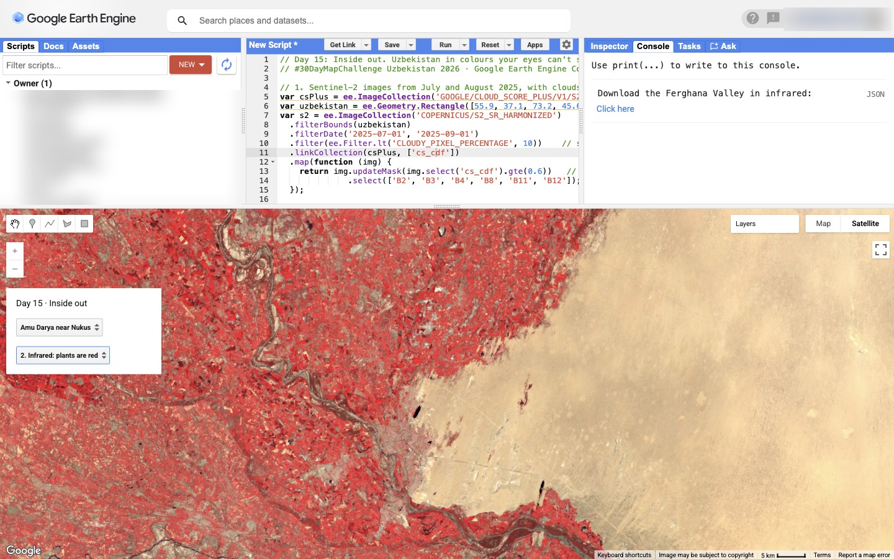
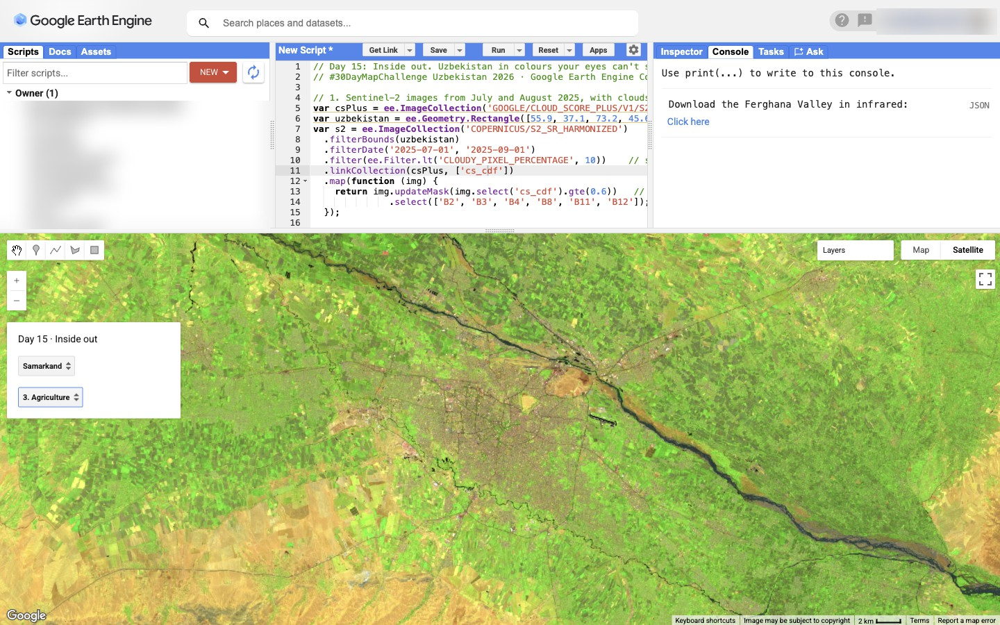
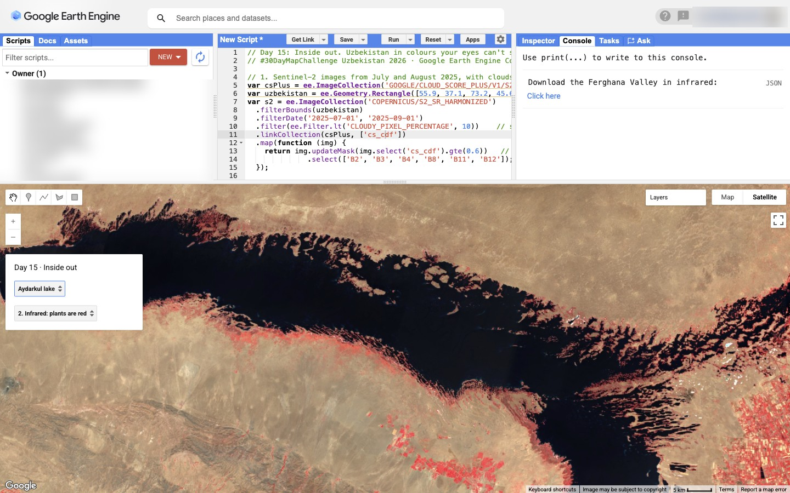
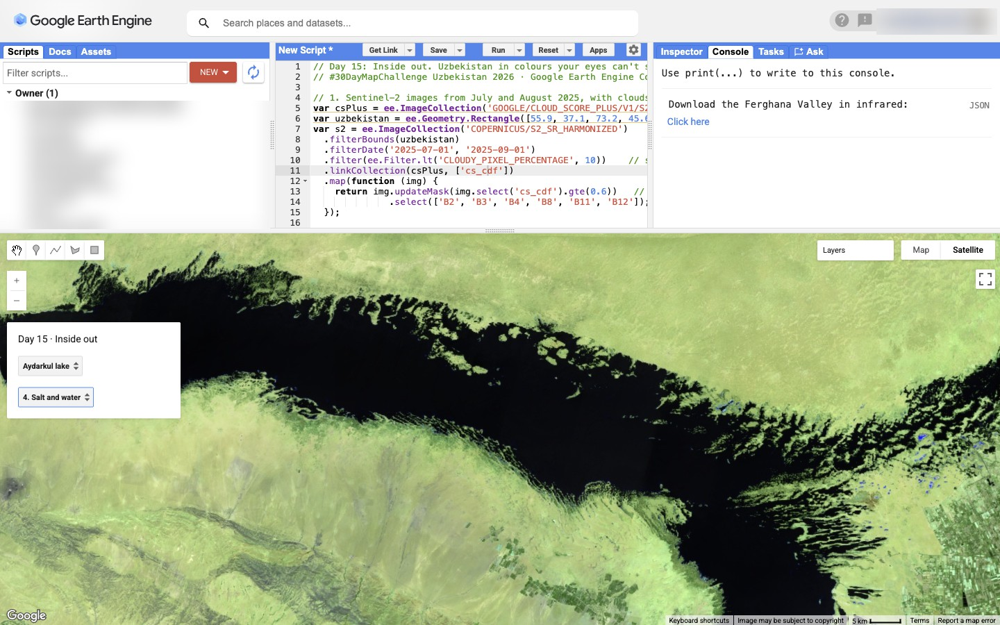
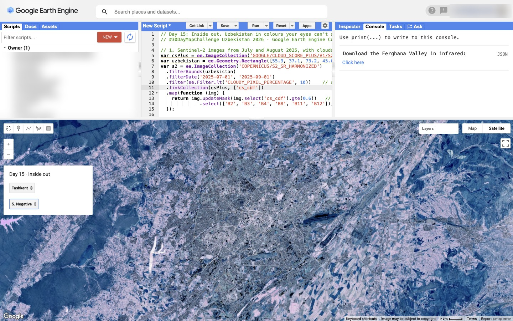

# Day 15 tutorial: Uzbekistan in colours your eyes can't see

**Theme: Inside out.** *Something on this map is not quite right.* Fields are bright red, a lake is black, Tashkent is blue. Every colour is "wrong", and yet these maps show things a normal photo hides: which fields are growing, where the soil is salty, where the water is. Satellites see light our eyes can't, **infrared**, and today you turn it into colours. You work in the **Google Earth Engine Code Editor** with Sentinel-2 images of summer 2025. It takes about 25 minutes.

📄 **Printable PDF:** [English](pdf/Day15_Tutorial_EN.pdf) · [Русский](pdf/Day15_Tutorial_RU.pdf) · [Oʻzbekcha](pdf/Day15_Tutorial_UZ.pdf)

**What you'll learn**
- What a satellite **band** is, and how a colour picture is made from three of them.
- How to make **false-colour** pictures that show plants, water and salt.
- How to remove clouds and make one clear picture from a whole summer.

## Part 0. Three ideas before you start

1. **Light you can't see.** Our eyes see red, green and blue light. **Sentinel-2**, a European satellite, measures 13 kinds of light, called **bands**, including **near-infrared** (NIR) and **short-wave infrared** (SWIR), which are invisible to us.
2. **Three bands make a picture.** A screen mixes red, green and blue. If you put the satellite's red band on red, green on green and blue on blue, you get a normal photo: **true colour**. If you put the near-infrared band on red instead, you get **false colour**: plants look bright red, because healthy leaves reflect a lot of near-infrared light.
3. **One summer, one picture.** Sentinel-2 photographs Uzbekistan every 5 days, and some pictures have clouds. Earth Engine removes the cloudy pixels (with Google's **Cloud Score+**) and, for every pixel, takes the **median**: the middle value of all clear pictures from July and August 2025.

## Part 1. Open the Code Editor

You need Earth Engine access. If you don't have it yet, follow **Part 1 of the [Day 09 tutorial](../../Day%2009%20Urban-rural/tutorial/README.md)**: create a Cloud project and register it for free noncommercial use. It takes about 10 minutes, once.

Then go to **[code.earthengine.google.com](https://code.earthengine.google.com)**.

## Part 2. Paste the script and run it

1. Open our script: **[day15_false_colour.js](data/day15_false_colour.js)**. On GitHub, click **Copy raw file** (the two-squares button).
2. Click into the middle panel of the Code Editor and paste (**Ctrl+V**, or **⌘V** on a Mac).
3. Click **Run** (**1**).

After 20–40 seconds the map shows the **Ferghana Valley** in infrared: every red patch is a field full of growing plants. A small panel appears on the map (**2**) with two drop-down menus. In the **Console** on the right, a link appears (**3**) to download a picture: we'll use it at the end.

> **Be patient.** Earth Engine makes the picture from hundreds of satellite images while you watch. When you move the map or change the colours, new squares (tiles) appear one by one, in 10–40 seconds.

## Part 3. What the script does

| Part of the script | What it does |
|---|---|
| `ee.ImageCollection('COPERNICUS/S2_SR_HARMONIZED')` | All Sentinel-2 images. |
| `.filterBounds(uzbekistan)` `.filterDate('2025-07-01', '2025-09-01')` | Only images of Uzbekistan from July and August 2025. |
| `.filter(ee.Filter.lt('CLOUDY_PIXEL_PERCENTAGE', 10))` | Skip images with more than 10% clouds. |
| `.linkCollection(csPlus, ['cs_cdf'])` and `updateMask(… .gte(0.6))` | Cloud Score+ gives each pixel a "how clear" score; we keep only pixels with 0.6 or more. |
| `.median()` | One picture: the middle value of each pixel over the whole summer. |
| `{bands: ['B8', 'B4', 'B3'], …}` | Which band goes on red, green and blue. `B8` is near-infrared, `B4` red, `B3` green, `B2` blue, `B11` and `B12` short-wave infrared. |
| `ee.Image(3000).subtract(…)` | The negative: bright becomes dark, dark becomes bright. |
| `ui.Select(…)` | The two drop-down menus on the map. |

## Part 4. Fly around Uzbekistan

Click the first menu, **Fly to…** (**1**), and choose a place: Ferghana Valley, Tashkent, Samarkand, the Bukhara oasis, Aydarkul lake or the Amu Darya near Nukus.

## Part 5. Five ways to see the same place

The second menu (**1**) switches between the five colour recipes.

| Recipe | Bands (red, green, blue) | What you see |
|---|---|---|
| **1. True colour** | B4, B3, B2 | What your eyes would see from space. |
| **2. Infrared: plants are red** | B8, B4, B3 | Plants bright red, cities grey-blue, water black. The classic false colour. |
| **3. Agriculture** | B11, B8, B2 | Fields bright green, bare soil orange-brown, water black. |
| **4. Salt and water** | B12, B11, B4 | Water black, dry and salty ground pale, plants dark green. |
| **5. Negative** | 3000 minus B4, B3, B2 | True colour turned inside out. |

**True colour vs infrared.** This is the Ferghana Valley in true colour. Compare it with the infrared picture at the top: the same fields, but now you can't tell well which are green and which are bare.

**The edge of the oasis.** Near Nukus, the infrared picture draws a sharp line: on one side the red fields watered by the Amu Darya, on the other side the desert.

**Agriculture.** Around Samarkand, the Zarafshan river runs through bright green fields. Orange-brown patches are bare or harvested land.

**A lake in the desert.** **Aydarkul** appeared in 1969, when flood water from the Syr Darya was let into a desert hollow. In infrared it's a black shape in the beige Kyzylkum, with a few red fields around it.

In **salt and water** the same lake is still black, but the land around it changes colour: dry desert turns pale green-yellow, and the wetter ground near the shore looks darker.

**Inside out.** The negative of Tashkent: bright roofs turn dark, dark trees and shadows turn light blue. It's useless for measuring anything, but it really looks like the theme.

## Part 6. Download your picture

In the **Console**, click **Click here** under *Download the Ferghana Valley in infrared*. Earth Engine makes a 2000-pixel JPEG of the valley and opens it in a new tab (it can take a minute). Right-click it → **Save image as…**. That's our picture at the top of this tutorial.

**Your own place:** change the four numbers in `ee.Geometry.Rectangle([70.9, 40.25, 72.3, 40.95])` (west, south, east, north) and `infrared` to another recipe, for example `agriculture`, then click **Run** again. Find the numbers on [bboxfinder.com](http://bboxfinder.com).

## Ideas for your own map

- **Same place, five colours:** put the five recipes side by side as five small maps.
- **Spring and summer:** change the dates to April–May. Which fields are already green?
- **Your own recipe:** try other bands, for example `['B12', 'B8', 'B4']`, and invent a name for it.
- **Find the salt:** in "salt and water", look at the Bukhara and Khorezm oases. Where do white patches appear between the fields?
- **A "wrong" map:** use a false-colour picture as the background and ask your friends what they think it shows.

## When you share

Please credit:
> Contains modified Copernicus Sentinel data (2025), processed in Google Earth Engine. Cloud Score+ by Google.

## Troubleshooting

| Problem | What to do |
|---|---|
| Earth Engine asks for a project. | Register one (Part 1 of Day 09), then choose it at the top right. |
| The map stays grey for a long time. | Wait: the first view can take up to a minute. Zoom in a little, so fewer pixels are calculated. |
| A red error says *memory capacity exceeded* | Zoom in (zoom 10 or closer) and wait. Far out, one tile covers too many images. |
| A yellow message says the quota is exceeded. | Your project used its monthly computing time. The map still works, but slowly. |
| The menus don't appear. | Make sure you pasted the whole script, to the last line, and clicked **Run**. |
| Some squares look patchy. | A few places had clouds on almost every day. Make the date range longer, or allow more clouds: change `10` to `30`. |
| **Click here** doesn't open anything. | Your browser blocked the new tab. Allow pop-ups for code.earthengine.google.com. |

## Credits

- **Satellite images:** Copernicus Sentinel-2 Level-2A (surface reflectance), Earth Engine ID `COPERNICUS/S2_SR_HARMONIZED`, July–August 2025. Contains modified Copernicus Sentinel data, provided free of charge by the European Union / ESA.
- **Cloud mask:** [Cloud Score+](https://developers.google.com/earth-engine/datasets/catalog/GOOGLE_CLOUD_SCORE_PLUS_V1_S2_HARMONIZED) by Google, `GOOGLE/CLOUD_SCORE_PLUS/V1/S2_HARMONIZED`.
- **Software:** [Google Earth Engine](https://earthengine.google.com) Code Editor.
