# Day 16 tutorial: Tashkent through strangers' eyes

**Theme: Collaborative map.** *Do a map with a friend, colleague or a stranger.* Today you work with both. **Mapillary** is a map of street photos taken by anyone with a phone. In Tashkent, **47 people**, most of whom never met, took **107,288 photos**, and together they made one map of the city. You find out who they are and when they walked, draw the city with one colour per person, look at their photos, and then go out with your friends to add your own streets. You work in **Google Colab** and on **mapillary.com**. It takes about 30 minutes, plus your walk.

📄 **Printable PDF:** [English](pdf/Day16_Tutorial_EN.pdf) · [Русский](pdf/Day16_Tutorial_RU.pdf) · [Oʻzbekcha](pdf/Day16_Tutorial_UZ.pdf)

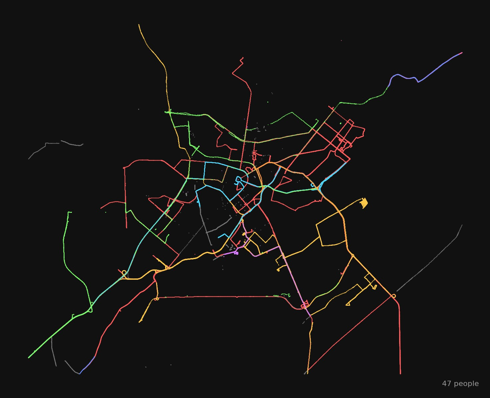

**What you'll learn**
- What street-level photo maps are, and how anyone can add to them.
- How to count, group and map data by **who** made it, with pandas.
- How to ask an online map service (an **API**) for data with a personal key.
- How to plan and make a map together with other people.

## Part 0. Three ideas before you start

1. **Street-level photos.** Google Street View is made by Google's cars. **Mapillary** is different: anybody can install a free phone app, walk or drive along a street, and upload the photos. They appear on one shared map, free for everyone to look at. Faces and car number plates are blurred automatically.
2. **A map by strangers.** Every photo knows *who* took it (a username), *when* and *where*. So the map tells two stories: what the streets look like, and who walked them.
3. **An API and a key.** An **API** is a door for programs into an online service. Mapillary's API gives you photos and their details if you show a free personal **key** (a *client token*). It's like a library card: free, but yours.

## Part 1. Look at Tashkent on Mapillary

Open **[mapillary.com/app](https://www.mapillary.com/app/?lat=41.305&lng=69.27&z=11.5)**. You don't need an account just to look. Every **green line** (**1**) is a street where someone took photos.

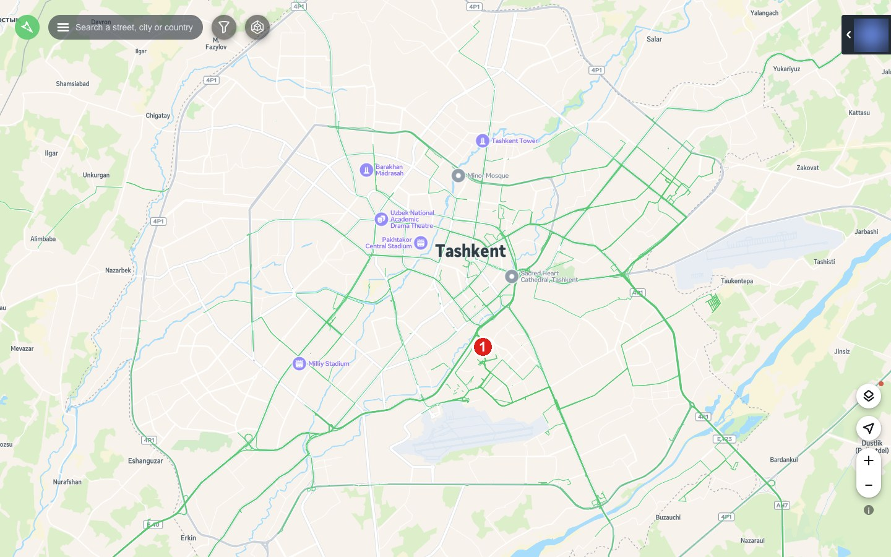

Zoom in and click a green line to see a photo. Here's the **Amir Timur statue**. At the bottom left you can see who took it and when (**1**). The arrows (**2**) walk you along the street, photo by photo. The clock button (**3**), *Time travel*, shows photos of the same place taken in other years.

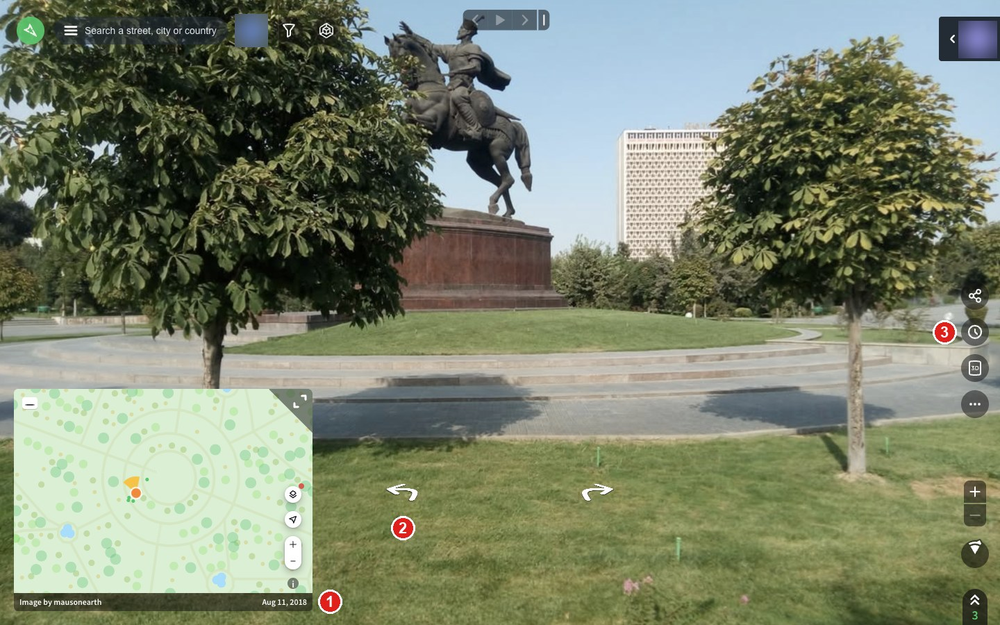

Notice what's missing: most lines are big roads, often photographed from a car. The small streets of the mahallas are almost empty. That's where your group comes in (Part 9).

## Part 2. Get your Mapillary key

You need the key for Steps 5 and 6 of the notebook. It takes about 3 minutes, once.

1. Sign up at **[mapillary.com/signup](https://www.mapillary.com/signup)** with an email, or with Facebook or Google.
2. Go to **[mapillary.com/dashboard/developers](https://www.mapillary.com/dashboard/developers)** and click **Register application**.
3. Fill in any name and description (for example *30DayMapChallenge*), any website (for example your GitHub page), and allow **Read**. Save.
4. In the list of your applications, copy the **Client Token**. It starts with `MLY|`.

> **Keep your key to yourself.** Don't put it in code you share or in screenshots. The notebook asks for it in a hidden box, so it isn't saved.

## Part 3. Open the notebook and run it

1. Click this button: 
2. Sign in with your Google account and click **Copy to Drive** (**1**), so your changes are saved.

   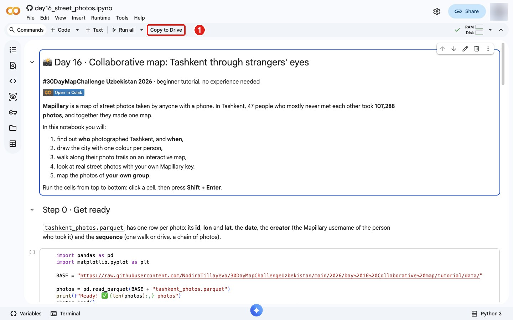

3. Click **Run all** (**1**), then **Run anyway** (**2**).

   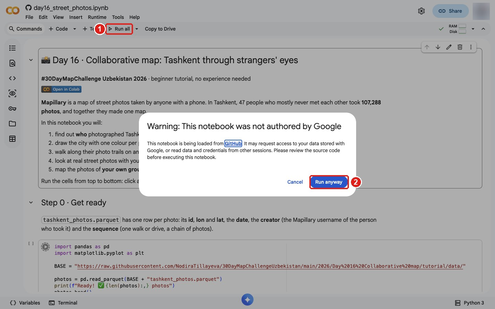

4. Step 0 reads **tashkent_photos.parquet** from this project (**1**): one row per photo, with its `id`, `lon`, `lat`, `date`, `creator` (the username) and `sequence` (one walk or drive, a chain of photos).

   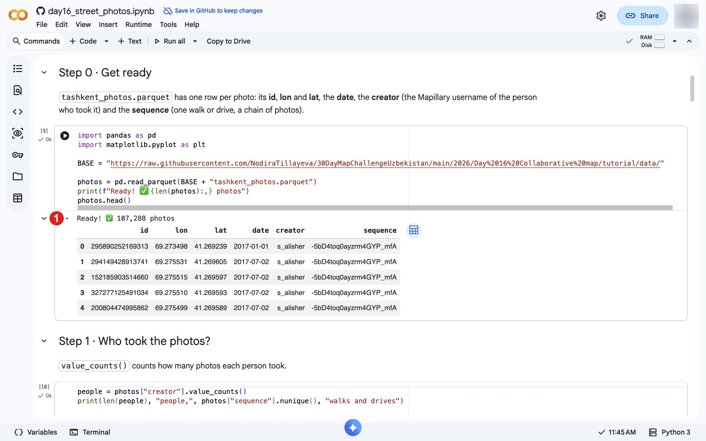

> **How we made the file.** We asked Mapillary for every photo in a box around Tashkent (69.12–69.45° E, 41.20–41.40° N), in November 2026, using its *vector tiles*: the same small squares of data that draw the green lines on the website. Then we looked up the username for each person.

## Part 4. Who took the photos?

`photos["creator"].value_counts()` counts photos per person: **47 people**, **877 walks and drives** (**1**). Three people took most of them: **sirojiddin520** (44,853), **Muhammadjon** (24,572) and **lvl5** (14,748). Most people added a few hundred or fewer. Every one of them still counts.

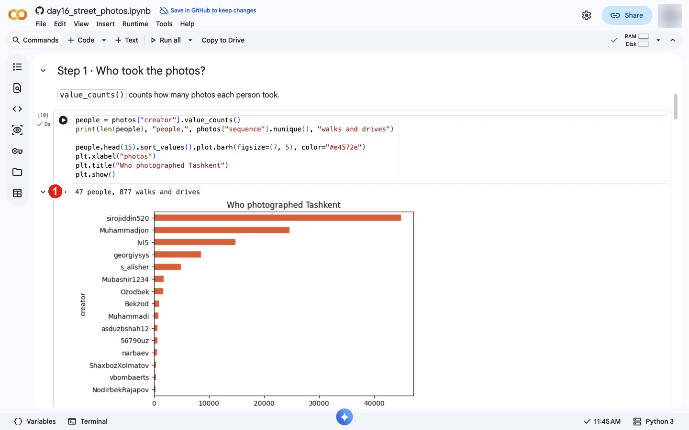

## Part 5. One colour per person

Each dot is one photo. The 8 people with the most photos get their own colour (**1**), everyone else is grey. Nobody planned this map: each line is one person's trip, and where two people drove the same road, their colours lie on top of each other.

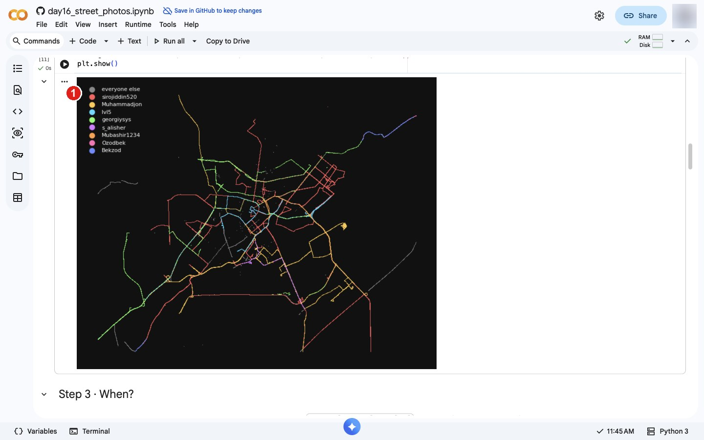

## Part 6. When?

`photos["date"].str[:4]` takes the year from each date. The busiest years are 2018, 2022, 2025 and **2026** (**1**). Many streets were photographed again years later, so with *Time travel* (Part 1) you can see how they changed.

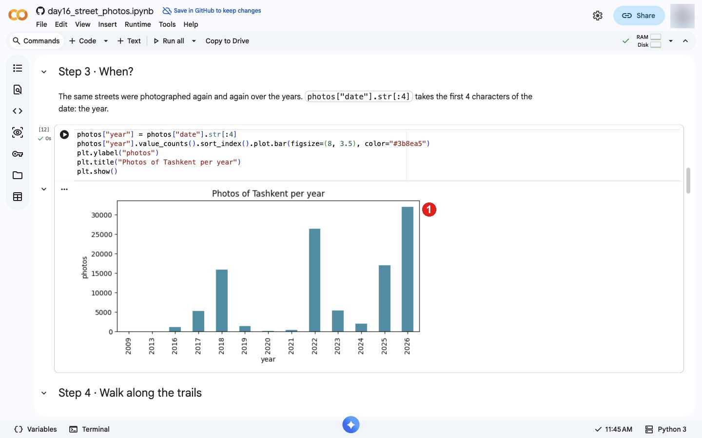

## Part 7. Walk along the trails

Step 4 draws each walk or drive as one line with **folium**, in the colour of the person who made it (**1**). Zoom in, click a line, and you'll see who made it, when, and a link, **Open the photos ↗**, that opens that walk on Mapillary.

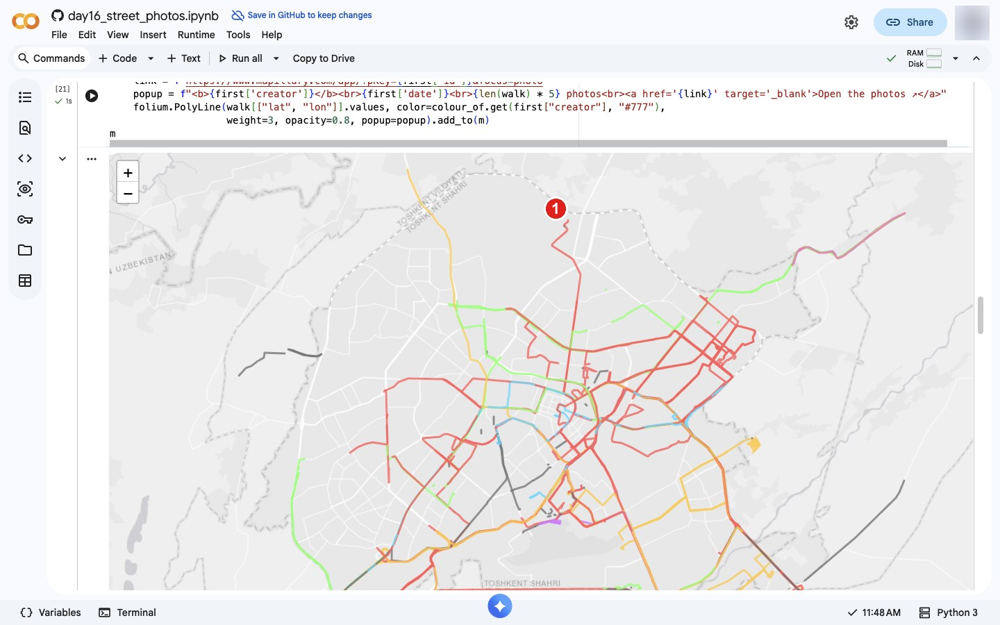

## Part 8. Look at real photos

Step 5 stops and asks for your key: paste it into the box (**1**) and press **Enter**. The dots hide it.

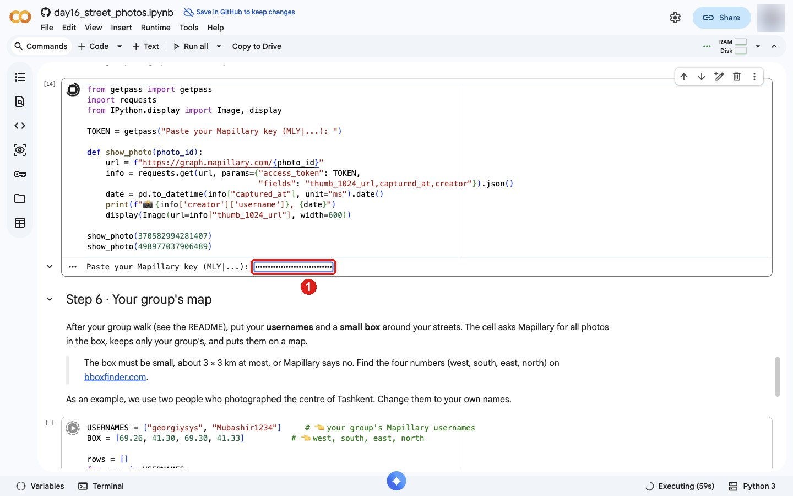

The notebook asks the API for two photos of the Amir Timur statue, taken by two different strangers: **s_alisher** in March 2017 and **mausonearth** in August 2018 (**1**).

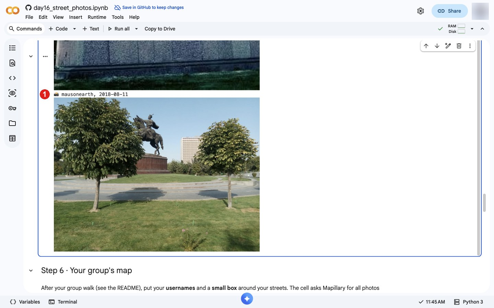

`show_photo(...)` works for any photo `id` from the table. Try a few!

## Part 9. Map with your group

Now make your own part of the map, with friends, classmates or colleagues.

1. **Choose your streets.** On mapillary.com, find an area near you with no green lines: your mahalla, your campus, a park. Give each person one or two streets, so you don't all walk the same one.
2. **Install the app.** Everyone installs **Mapillary** (free, Android and iPhone), signs up, and shares their username with the group.
3. **Walk.** Open the app, press the camera button, and walk at a normal speed, holding the phone steady and pointing forward along the street. The app takes a photo every few metres by itself. Go in daylight.
4. **Upload.** At home, on Wi-Fi, upload the photos in the app. Mapillary needs from a few hours to a couple of days to process them; then your green lines appear.
5. **Map your group.** In Step 6 of the notebook, put your usernames and a small box around your streets (**1**), then run the cell.

   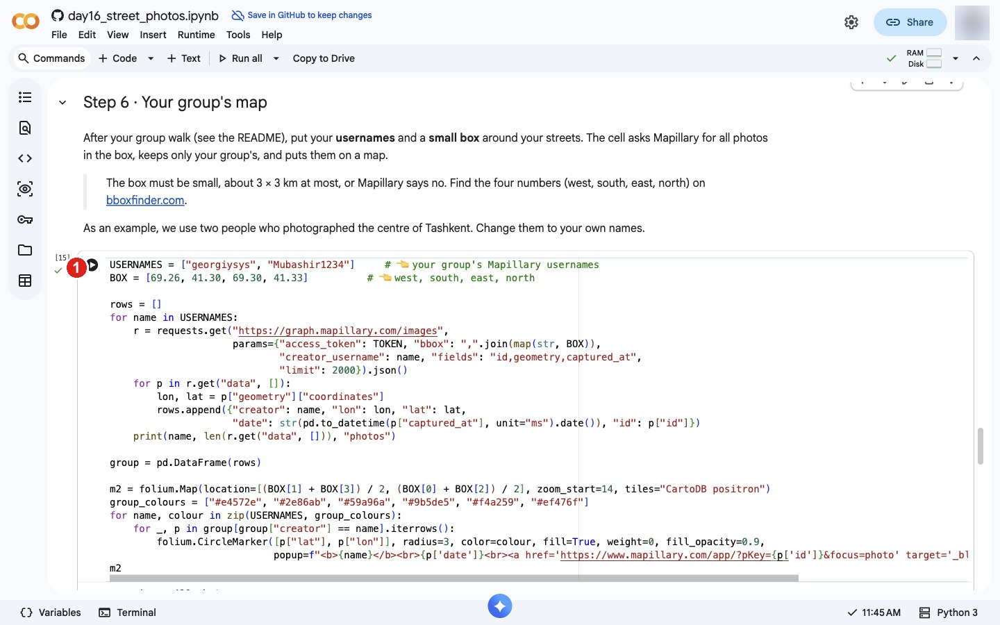

   The notebook asks Mapillary for every photo in the box, keeps only your group's, and puts each person's photos on a map in their own colour. In our example, two people who photographed the centre of Tashkent:

   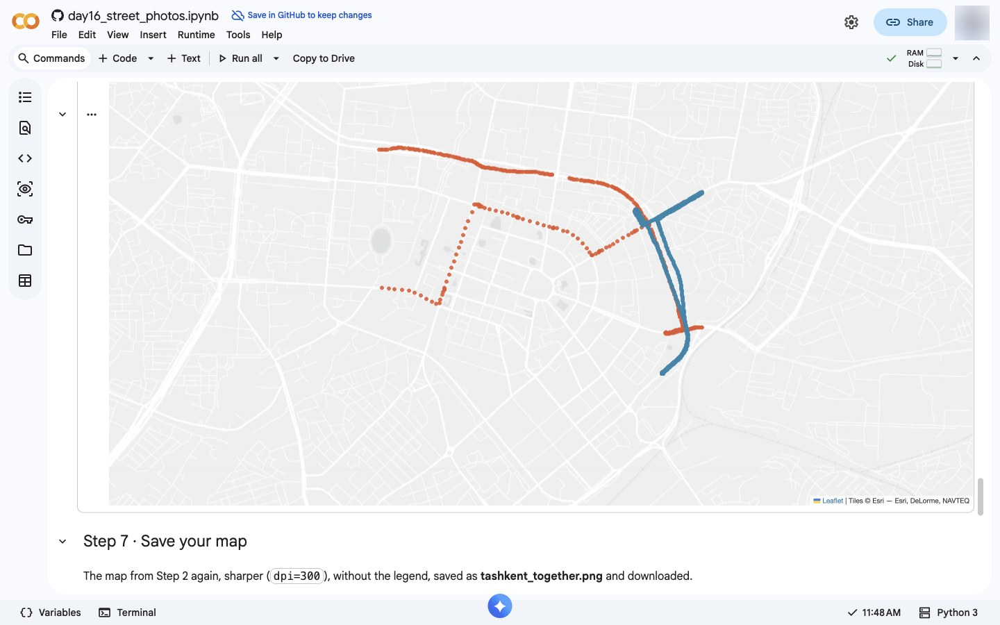

> **Be kind on the street.** Walk on the pavement, watch the traffic, and don't photograph into private courtyards or point the camera at people who don't want it. Mapillary blurs faces and number plates, but it's still polite to ask.

## Part 10. Save your map

Step 7 draws the map from Part 5 again, sharper (`dpi=300`) and without the legend, and downloads it as **tashkent_together.png**.

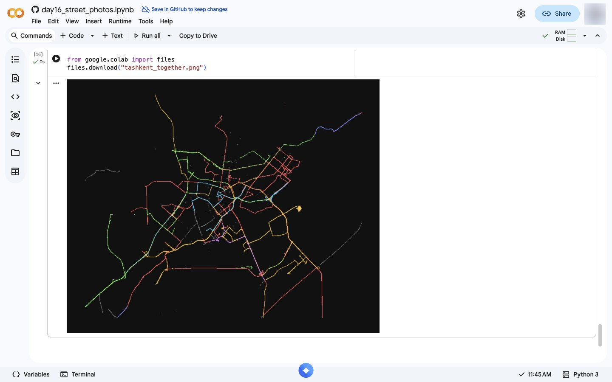

## Ideas for your own map

- **Before and after:** add your group's walk to the Tashkent map in a bright colour, on top of the 47 strangers.
- **Your city:** change the box in Step 6 to Samarkand, Bukhara, Ferghana or your town. Who mapped it?
- **Then and now:** find a street photographed in two different years, and put the two photos side by side.
- **Who's missing?** Compare the photo lines with the map of all streets. Which neighbourhoods has nobody walked yet?
- **One street, many people:** walk the same street with three friends, each with their own phone, and draw the three trails.

## When you share

Please credit:
> Street-level photos © Mapillary contributors, CC BY-SA 4.0.

## Troubleshooting

| Problem | What to do |
|---|---|
| `HTTP Error` when loading the photos | Colab couldn't reach GitHub. Wait a minute and run the cell again. |
| `KeyError: 'thumb_1024_url'` or `'captured_at'` in Step 5 | The key is wrong. Run the cell again and paste the whole key, starting with `MLY|`. |
| Step 6 says `0 photos` | Check the usernames (capital letters count), and that your photos are in the box. The box may be too big: make it smaller, about 3 × 3 km. New photos can take a day or two to appear. |
| Step 6 says `2000 photos` for someone | That's the most Mapillary gives at once. Make the box smaller to get all of them. |
| The maps are empty or grey | Wait a few seconds for the tiles, or run the cell again. |
| The file doesn't download | Your browser blocked it. Allow downloads for colab.research.google.com, or find **tashkent_together.png** in the **Files** panel on the left. |

## Credits

- **Street-level photos and their details:** [Mapillary](https://www.mapillary.com), photos by Mapillary contributors under [CC BY-SA 4.0](https://creativecommons.org/licenses/by-sa/4.0/). Photo points downloaded in November 2026 through the [Mapillary API](https://www.mapillary.com/developer/api-documentation).
- **Base map in folium:** Esri World Gray Canvas.
- **Software:** [pandas](https://pandas.pydata.org), [matplotlib](https://matplotlib.org), [folium](https://python-visualization.github.io/folium/), [Google Colab](https://colab.research.google.com).
