# Day 17 tutorial: Uzbekistan at night

**Theme: Light & dark.** *Play with visual effects. What can you map with just light and shadows?* Today your map has only one ingredient: **light**. Every night a NASA satellite photographs the Earth in the dark. Cities, roads and villages glow, while deserts and mountains stay black. You map Uzbekistan at night, compare **2016 and 2025**, find which regions got brighter, and zoom into Tashkent. You work in **Google Colab**. No account and no installs are needed. It takes about 25 minutes.

📄 **Printable PDF:** [English](pdf/Day17_Tutorial_EN.pdf) · [Русский](pdf/Day17_Tutorial_RU.pdf) · [Oʻzbekcha](pdf/Day17_Tutorial_UZ.pdf)

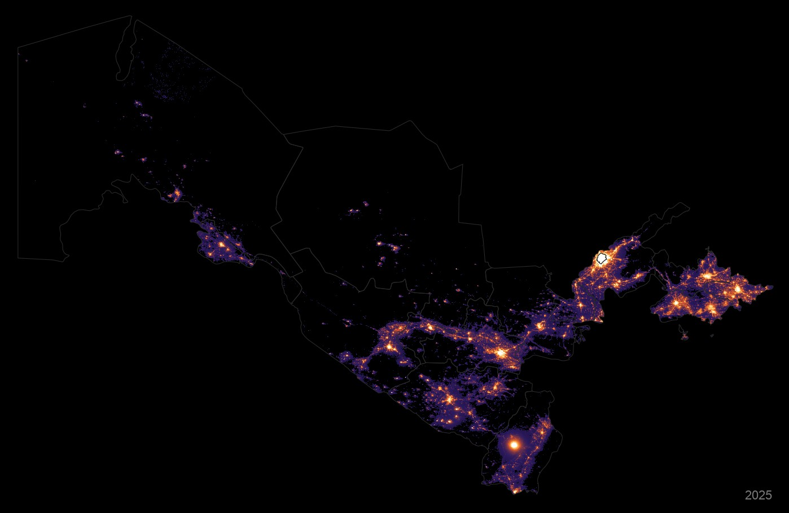

**What you'll learn**
- What night-light satellite data is, and what it can and can't tell you.
- How to open a **raster** (a grid of numbers) and draw it on a black background.
- How to stretch colours so both cities and small villages are visible.
- How to subtract two years to see change, and add up light per region.

## Part 0. Three ideas before you start

1. **Black Marble.** A NASA satellite called **Suomi NPP** flies over every place on Earth at about 1:30 at night. It has a camera so sensitive that, from 800 km up, it sees the lights of a small village. NASA removes the moonlight, the clouds and the snow, and makes **one clean picture per year**. It's called **Black Marble** (the product name is *VNP46A4*).
2. **A raster.** The picture is a grid of small squares called **pixels**. Here each one is about **450 m** wide. Every pixel holds one number: how much light came up from the ground. A dark desert is **0**, a village is about **1–5**, a city centre is **50 or more**.
3. **Light is not people.** Night light shows electricity being used outside: street lamps, roads, factories, gas flares. A large village with few lamps can look darker than a small factory. Keep that in mind when you read the maps.

## Part 1. Open the notebook and run it

1. Click this button: 
2. Sign in with your Google account and click **Copy to Drive** (**1**), so your changes are saved.

   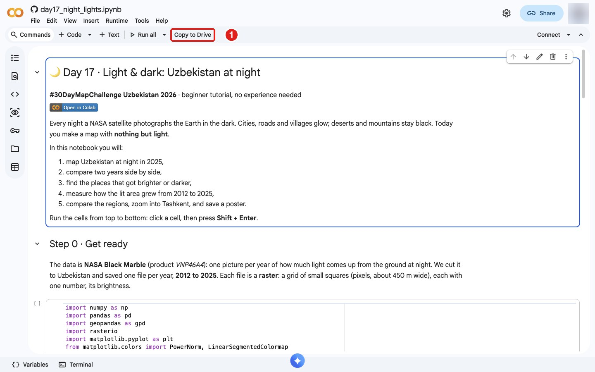

3. Click **Run all** (**1**), then **Run anyway** (**2**).

   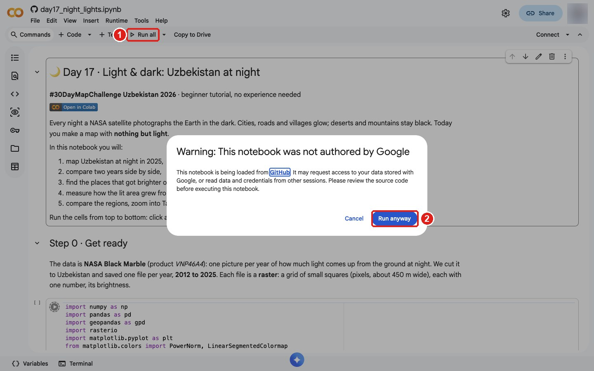

4. Step 0 downloads **14 files**, one per year from 2012 to 2025, and the borders of the regions. Each file is a grid of **4152 × 2040** pixels (**1**).

   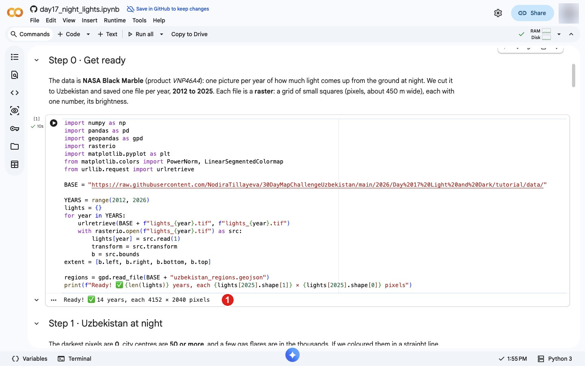

> **How we made the files.** We downloaded Black Marble *VNP46A4* for 2012–2025 from NASA's LAADS archive with **blackmarblepy** (5 squares of 10° × 10° cover Uzbekistan, about 9 GB in total). We used the *all-angle, snow-free* layer, put the 5 squares together, and cut out Uzbekistan. Each year is now about 1–2 MB.

## Part 2. Uzbekistan at night

Step 1 draws 2025. You can see the shape of the country without any borders: **Tashkent** (**1**), the Ferghana Valley to the east, the chain of cities along the old Silk Road through Samarkand and Bukhara, and the Amu Darya oases of Khorezm and Karakalpakstan in the north-west. The rest is desert and mountains, and it stays black.

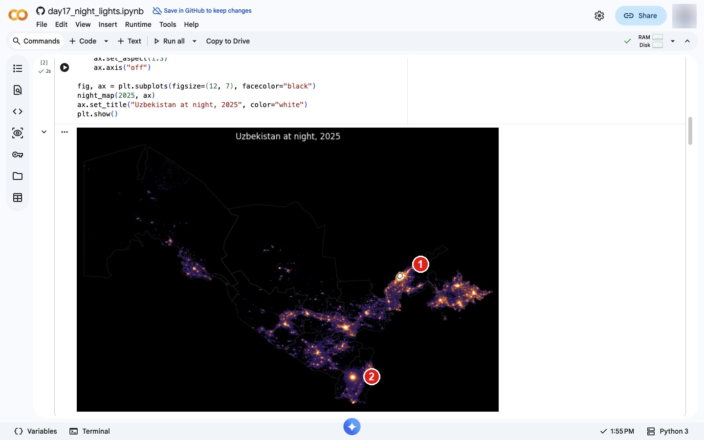

The very bright round spot in **Surkhandarya** (**2**) is not a city. It's almost certainly a **gas flare**: gas burned off at an oil or gas field, so bright that its glow spreads over several kilometres.

**Why the colours work.** The values go from 0 to over 20,000, but almost all pixels are below 10. If you coloured them in a straight line, everything except the flare would be black. `PowerNorm(0.4, vmin=0, vmax=40)` does two things:
- it **stretches** the low values, so a village at 2 already gets a visible purple;
- it treats everything above **40** as pure white, so cities don't steal all the colour.

Our colour ramp, `night`, goes from black, through purple and orange, to white, like real night lights. Try `vmax=10` or `PowerNorm(1.0, ...)` and see what changes.

## Part 3. Then and now

Step 2 puts two years side by side. We picked **2016**, the darkest year in the data, and **2025**. Look at the Samarkand–Bukhara road, Jizzakh, and the dots in Khorezm: whole areas that were dark are now glowing.

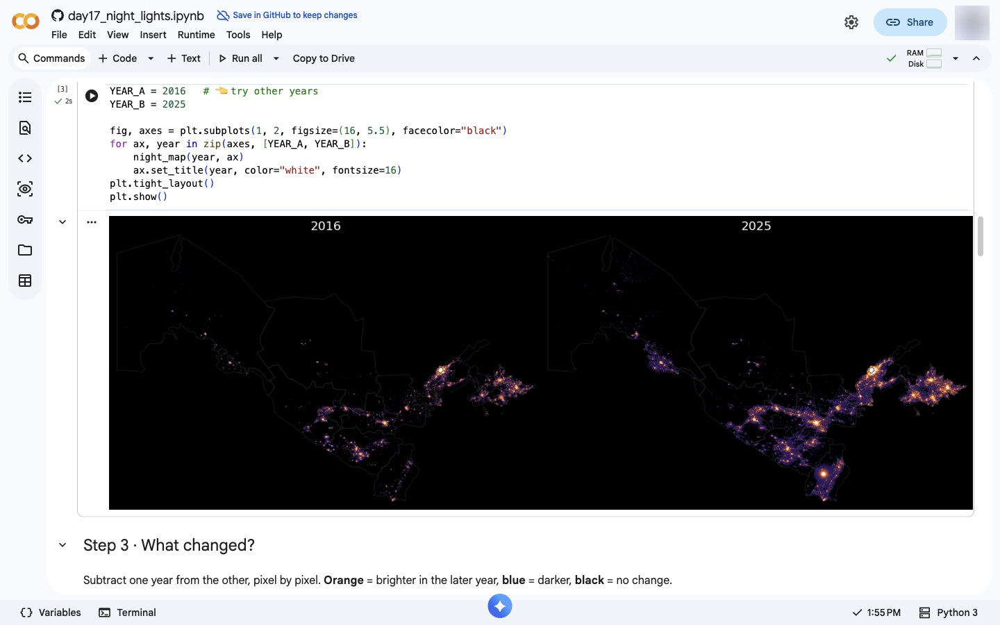

Change `YEAR_A` and `YEAR_B` to any years from 2012 to 2025 and run the cell again.

## Part 4. What changed?

Step 3 subtracts one year from the other, pixel by pixel: `change = lights[YEAR_B] - lights[YEAR_A]`. **Orange** means brighter in 2025, **blue** means darker, **black** means no change. Almost everything is orange. A few blue spots in the south-west (**1**) are places that got darker, often gas fields that burn less gas now.

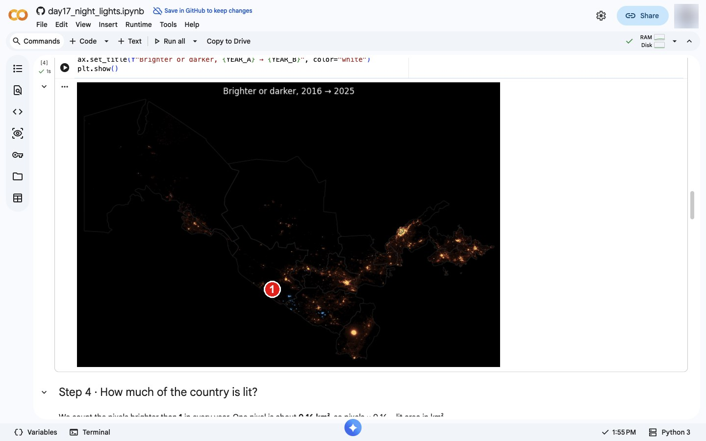

## Part 5. How much of the country is lit?

Step 4 counts the pixels brighter than **1** in every year and turns them into km² (one pixel is about 0.16 km²).

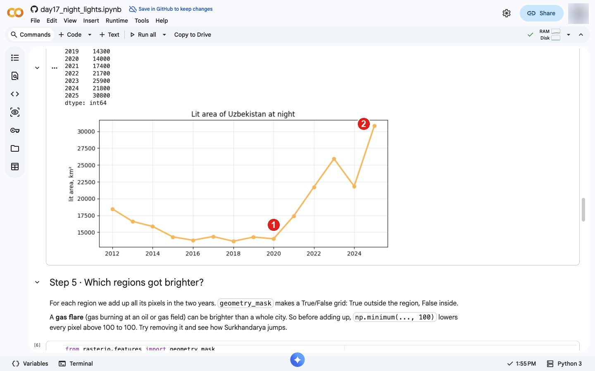

The line tells a story in two parts:
- **2012 to 2020**: the lit area **slowly shrank**, from about 18,500 to 14,000 km² (**1**). Part of this is real (less gas flaring, some lamps switched off), and part is the satellite: many cities replaced old orange street lamps with white **LED** lamps, and the satellite sees the blue part of LED light poorly.
- **2021 to 2025**: the lit area **more than doubled**, to about **30,800 km²** (**2**). New roads, new housing, new factories, and lights in villages that had none.

The dip in 2024 is a good reminder that satellite data is noisy: clouds, snow and the moon all have to be removed, and some years work out better than others. Look at the trend, not one year.

## Part 6. Which regions got brighter?

Step 5 adds up the light inside each region in both years. `geometry_mask` makes a True/False grid for each region, and `np.nansum` adds up the pixels inside.

One problem: a single gas flare can be brighter than all of Tashkent. So before adding up, `np.minimum(..., 100)` lowers every pixel above 100 to 100 (**1**).

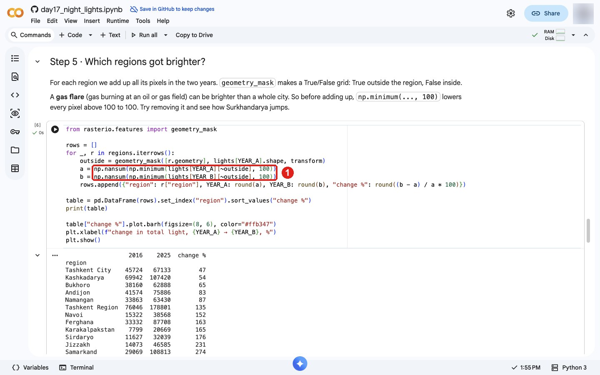

The result: **every region got brighter**. **Tashkent City** grew the least in percent (+47%), because it was already bright. The biggest jumps are in **Khorezm** (+473%) and **Surkhandarya** (+728%) (**1**). Surkhandarya still has the glow around its flare, but even without it the region more than tripled.

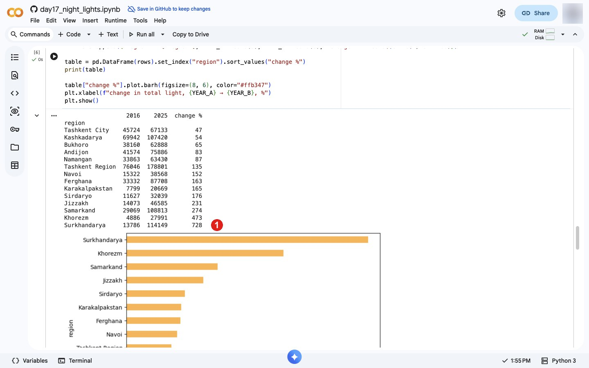

Try removing `np.minimum` and see how the numbers change.

## Part 7. Zoom into Tashkent

Step 6 zooms in by changing the edges of the map: `ax.set_xlim(68.9, 69.75)` for longitude and `ax.set_ylim(41.0, 41.55)` for latitude. The city centre is much brighter than 40, so we raise `brightest` to **150**. Otherwise the whole city would be one white blob.

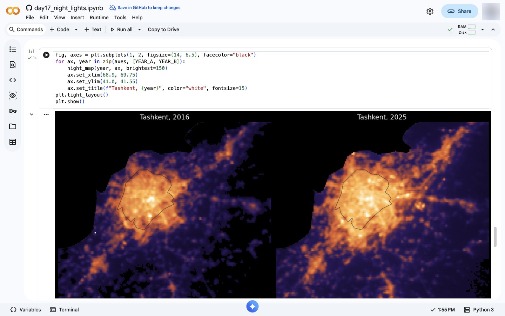

In 2025 the glow has spread far beyond the city border: the satellite towns, the roads to Chirchiq and Angren, and the new districts in the south.

## Part 8. Save your poster

Step 7 draws the 2025 map again, sharper (`dpi=300`), and downloads it as **uzbekistan_at_night.png**.

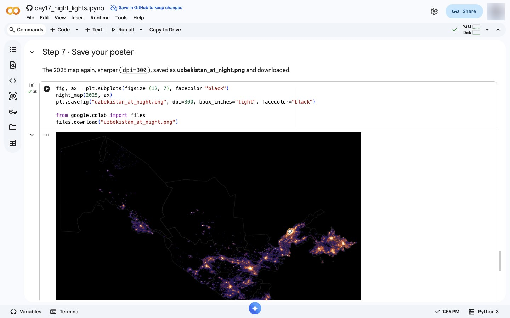

## Part 9. Extra: download Black Marble yourself

The last cell of the notebook shows how to download any place and any year yourself with **blackmarblepy**. It isn't run automatically. You need a free NASA key:

1. Make an account at **[urs.earthdata.nasa.gov](https://urs.earthdata.nasa.gov/users/new)**. Fill in your profile, including **Organization** (you can write your school or *self*).
2. Log in once at **[ladsweb.modaps.eosdis.nasa.gov](https://ladsweb.modaps.eosdis.nasa.gov)** with that account and accept the terms it asks about.
3. On Earthdata, open **Generate Token**, click **Generate Token**, and copy the long text.
4. In the notebook, copy the code from the **Extra** cell into a new code cell, run it, and paste the token into the box.

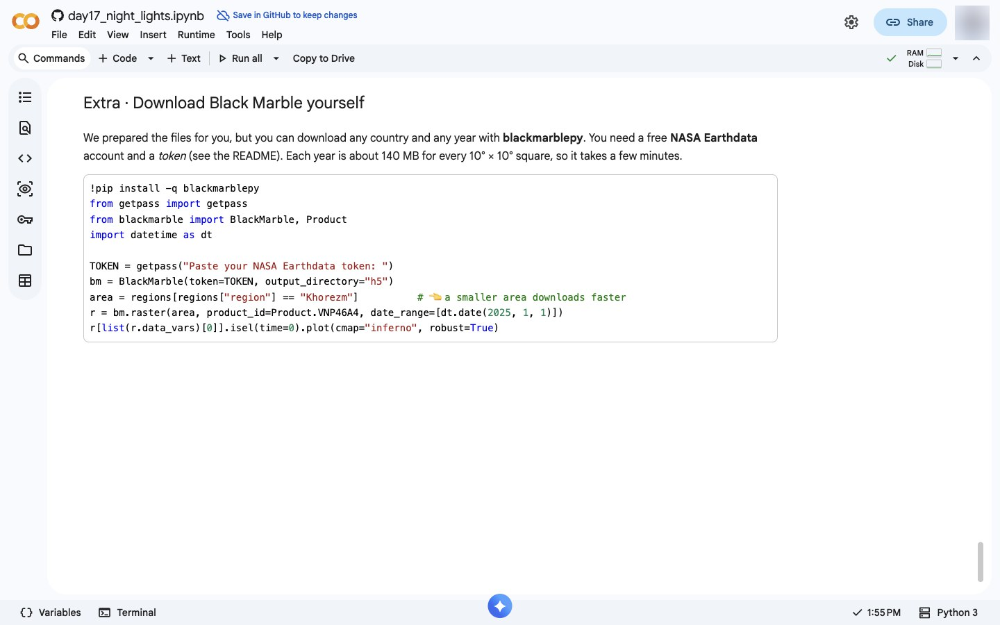

> **Keep your token to yourself.** Don't put it in code you share or in screenshots. `getpass` hides it, so it isn't saved in the notebook.

Each year is about **140 MB** for every 10° × 10° square, so start with one small region and one year.

## Ideas for your own map

- **Your town:** zoom into Samarkand, Nukus, Termez or your town, as you did with Tashkent in Step 6.
- **A flipbook:** draw all 14 years in a 2 × 7 grid and watch the country light up.
- **Only the new lights:** map only the pixels that were 0 in 2016 and above 1 in 2025.
- **Light and shadow:** put the night lights on top of a hillshade (mountain shadows) and show where people live between the mountains.
- **Neighbours:** download Kazakhstan, Tajikistan or Turkmenistan with blackmarblepy and compare.

## When you share

Please credit:
> Night lights: NASA Black Marble VNP46A4 (Román et al., 2018), via LAADS DAAC.

## Troubleshooting

| Problem | What to do |
|---|---|
| `HTTP Error` or `URLError` in Step 0 | Colab couldn't reach GitHub. Wait a minute and run the cell again. |
| The maps are all black | Check that you didn't make `vmax` very large. Try `brightest=20`. |
| The maps are all white | `vmax` (`brightest`) is too small. Try 40 or more. |
| `KeyError: 2030` | The data has only the years 2012–2025. |
| In the Extra cell, the download returns an HTML page or `401` | Your token is wrong or expired, or you haven't logged in to LAADS once and accepted the terms (Part 9, step 2). |
| The file doesn't download | Your browser blocked it. Allow downloads for colab.research.google.com, or find **uzbekistan_at_night.png** in the **Files** panel on the left. |

## Credits

- **Night lights:** NASA [Black Marble](https://blackmarble.gsfc.nasa.gov) VNP46A4 annual composites, Collection 2, [LAADS DAAC](https://ladsweb.modaps.eosdis.nasa.gov). Román, M.O. et al. (2018). *NASA's Black Marble nighttime lights product suite.* Remote Sensing of Environment, 210, 113–143. Downloaded in November 2026.
- **Download tool:** [blackmarblepy](https://github.com/worldbank/blackmarblepy), World Bank.
- **Region borders:** the same file as in Day 14.
- **Software:** [rasterio](https://rasterio.readthedocs.io), [geopandas](https://geopandas.org), [numpy](https://numpy.org), [pandas](https://pandas.pydata.org), [matplotlib](https://matplotlib.org), [Google Colab](https://colab.research.google.com).
