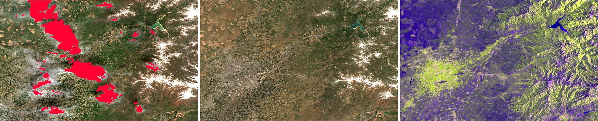
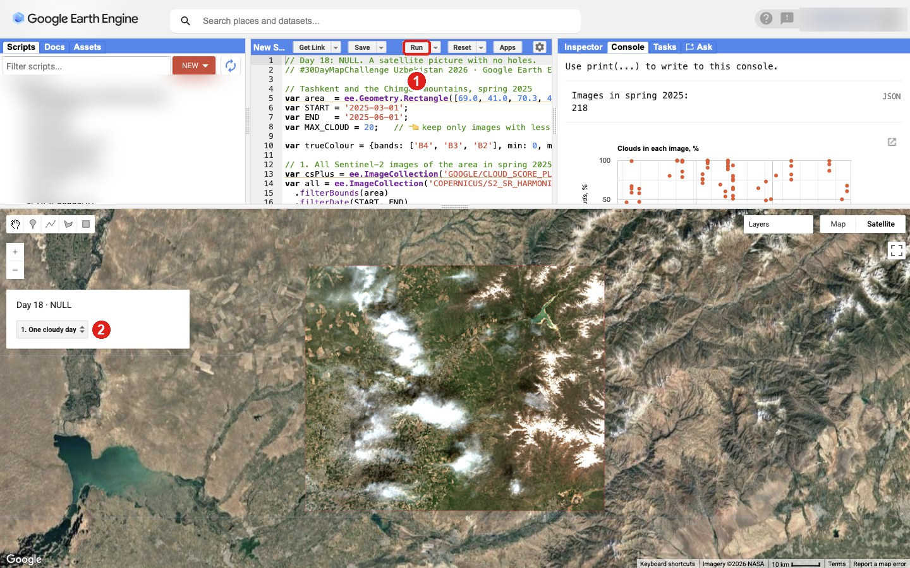
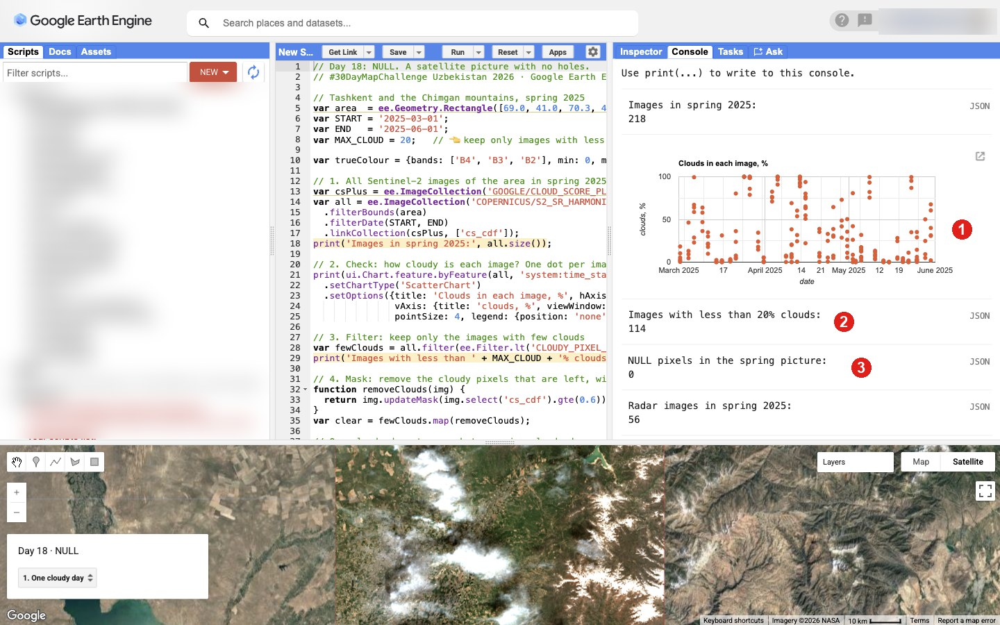
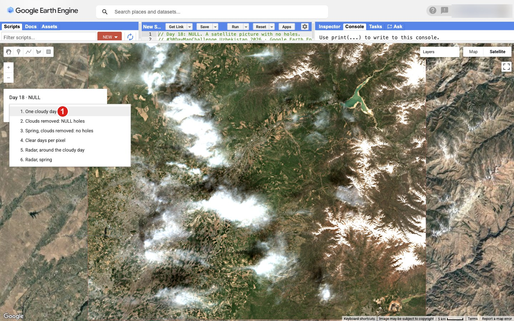
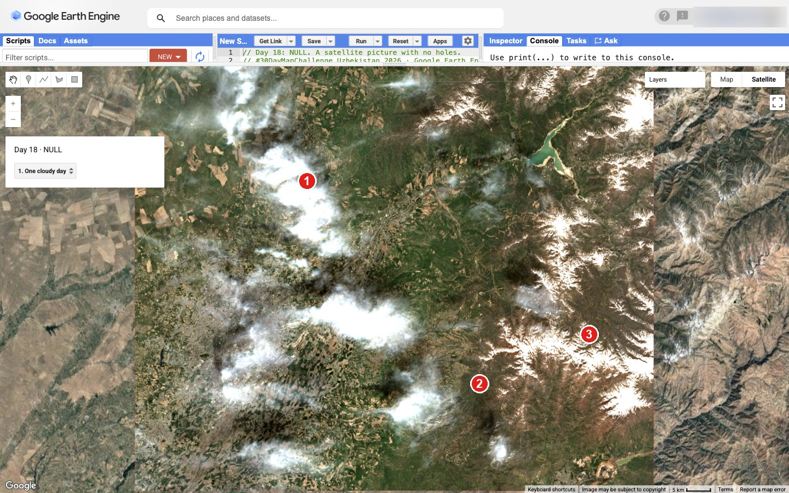
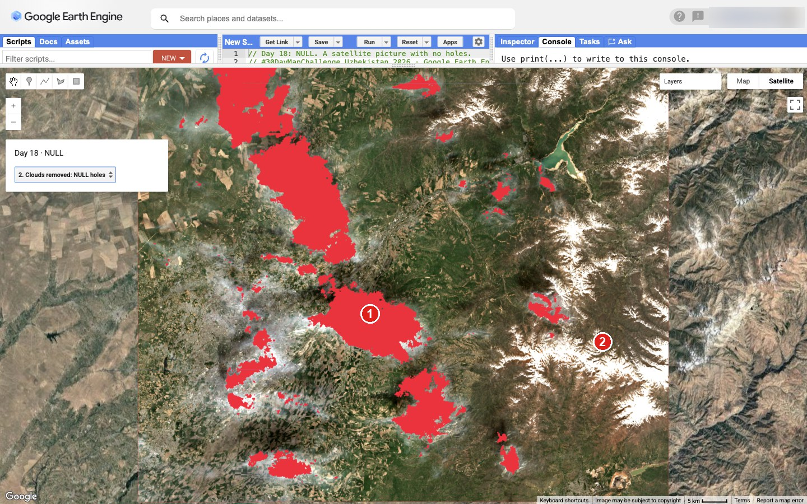
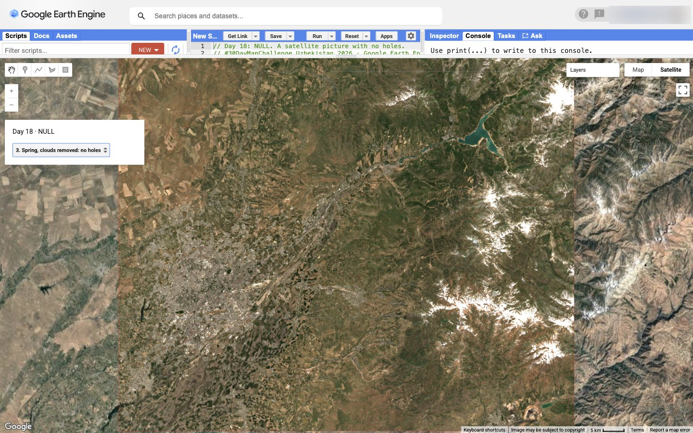
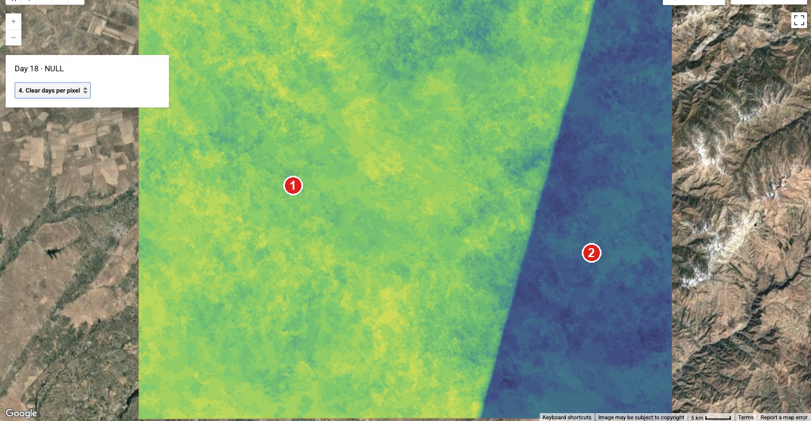
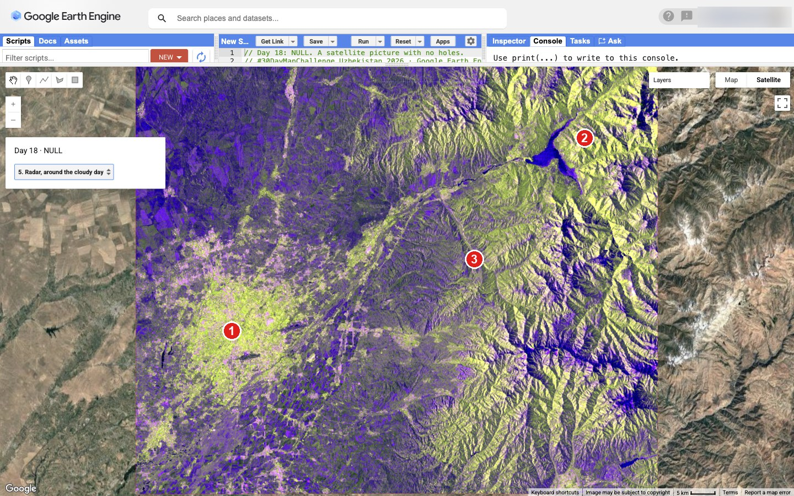

# Day 18 tutorial: A satellite picture with no holes

**Theme: NULL.** *No description: interpret it however you like.* In data, **NULL** means "nothing here, no value". In satellite pictures NULLs come from **clouds**: a satellite can't see the ground through them, and when we cut the clouds out, we leave holes. Today you learn to **check** how cloudy the pictures are, **filter** out the cloudy ones, **mask** the clouds that are left, and join many days into one picture with **no holes**. At the end you meet a satellite that doesn't care about clouds at all: **radar**. You work in the **Google Earth Engine Code Editor** with Tashkent and the Chimgan mountains in spring 2025. It takes about 25 minutes.

📄 **Printable PDF:** [English](pdf/Day18_Tutorial_EN.pdf) · [Русский](pdf/Day18_Tutorial_RU.pdf) · [Oʻzbekcha](pdf/Day18_Tutorial_UZ.pdf)



**What you'll learn**
- How to check how cloudy each satellite image is.
- How to keep only the clear images (**filter**) and cut out the clouds that are left (**mask**).
- Why masking makes **NULL** holes, and how a **composite** of many days fills them.
- How to check that no NULLs are left.
- What **radar** (SAR) is, and why it sees through clouds.

## Part 0. Three ideas before you start

1. **Sentinel-2 sees like a camera.** It photographs the ground in sunlight, every few days. When there are clouds, it photographs the clouds. In spring, Tashkent and the mountains around it are often cloudy.
2. **Filter and mask.** Every Sentinel-2 image (a square of about 110 × 110 km) comes with a number: `CLOUDY_PIXEL_PERCENTAGE`, how much of it is cloud. **Filtering** throws away the whole image if that number is too high. **Masking** goes pixel by pixel and hides only the cloudy pixels. A hidden pixel has no value: it's **NULL**. On our maps NULL is **red**.
3. **A composite.** If a pixel is cloudy on 12 April, it's probably clear on some other day. A **composite** takes, for every pixel, all its clear values from many days and keeps the middle one (the **median**). The holes from one day are filled with other days.

## Part 1. Open the Code Editor

You need Earth Engine access. If you don't have it yet, follow **Part 1 of the [Day 09 tutorial](../../Day%2009%20Urban-rural/tutorial/README.md)**: create a Cloud project and register it for free noncommercial use. It takes about 10 minutes, once.

Then go to **[code.earthengine.google.com](https://code.earthengine.google.com)**.

## Part 2. Paste the script and run it

1. Open our script: **[day18_no_nulls.js](data/day18_no_nulls.js)**. On GitHub, click **Copy raw file** (the two-squares button).
2. Click into the middle panel of the Code Editor and paste (**Ctrl+V**, or **⌘V** on a Mac).
3. Click **Run** (**1**).



After 20–40 seconds the map shows **12 April 2025**, a cloudy day over Tashkent. A small panel appears on the map (**2**) with a menu of 6 layers. We go through them one by one.

> **Be patient.** Earth Engine makes each layer from many satellite images while you watch. New squares (tiles) appear one by one, in 10–60 seconds. If a square stays red for a long time, move the map a little.

## Part 3. Check: how cloudy are the images?

Look at the **Console** on the right. You can drag the line between the code and the map down to see more of it.



- **The chart** (**1**) has one dot per image. Up is cloudy, down is clear. In spring 2025 there were **218 images** of our area, and many of them are more than half clouds.
- **The filter** (**2**) keeps only the images with less than 20% clouds: **114** are left.
- **The NULL check** (**3**) counts the pixels that are still empty in the final picture: **0**. We get there in Part 6.

The code for the check and the filter:

```javascript
print(ui.Chart.feature.byFeature(all, 'system:time_start', 'CLOUDY_PIXEL_PERCENTAGE'));
var fewClouds = all.filter(ee.Filter.lt('CLOUDY_PIXEL_PERCENTAGE', MAX_CLOUD));
```

`ee.Filter.lt` means "less than". `MAX_CLOUD` is set to **20** at the top of the script.

## Part 4. One cloudy day

Open the menu (**1**). The layers are numbered in the order of this tutorial.



Layer **1. One cloudy day** shows everything Sentinel-2 photographed on 12 April 2025. You can see three things:



1. **Clouds**, white and puffy.
2. **Cloud shadows**, dark patches next to each cloud. They hide the ground too.
3. **Snow** on the mountains. It's white like a cloud, but it is the ground, and we want to keep it.

## Part 5. Mask the clouds: NULL holes

Choose layer **2. Clouds removed: NULL holes**. Every cloudy pixel is gone, and the red layer underneath shows through: those pixels are now **NULL** (**1**). The snow (**2**) stays, because the mask knows it isn't a cloud.



The mask comes from **Cloud Score+**, a Google dataset that gives every Sentinel-2 pixel a score from 0 (cloud) to 1 (perfectly clear):

```javascript
function removeClouds(img) {
  return img.updateMask(img.select('cs_cdf').gte(0.6));
}
```

`updateMask` hides every pixel where the score isn't at least (`gte`, "greater than or equal") **0.6**. Look closely: the thin edges of the clouds and some shadows are still there. Try **0.7** or **0.8**: the mask gets stricter, and the holes get bigger.

## Part 6. A spring picture with no holes

Choose layer **3. Spring, clouds removed: no holes**. This is the **median** of all 114 filtered images, with their clouds masked:

```javascript
var spring = clear.median().clip(area);
```

Every pixel was clear on at least some days, so every hole is filled. No clouds, no shadows, no red.



**Check that no NULLs are left.** "It looks fine" is not a check. The script counts the empty pixels:

```javascript
var nulls = spring.select('B4').mask().not()
  .reduceRegion({reducer: ee.Reducer.sum(), geometry: area, scale: 100});
```

`mask()` is 1 where a pixel has a value and 0 where it is NULL. `.not()` turns that around, and `sum` adds up the NULLs. The Console says **0**.

## Part 7. How many clear days did each pixel have?

Choose layer **4. Clear days per pixel**. For every pixel it counts the spring days when it was photographed **and** clear. **Yellow** means many days, **dark blue** means few. A pixel with **0** clear days would be red: NULL.



There's a sharp line through the map. The western part (**1**) is photographed from **two** satellite paths (orbits), so it has about twice as many chances to be clear as the eastern part (**2**), which only one path covers. The mountains in the east are also cloudier. If you made a picture from only one week, the eastern part is where the red holes would stay.

## Part 8. Radar: a satellite that sees through clouds

Sentinel-2 is like a camera: it needs sunlight, and clouds block it. **Sentinel-1** is different. It is a **radar**, or **SAR** (*Synthetic Aperture Radar*). It sends its own microwave signal down to Earth and listens for the echo. Microwaves pass through clouds, and the radar brings its own "light", so it works at night too.

Choose layer **5. Radar, around the cloudy day**: the radar images from 3 days before to 3 days after 12 April. The same clouds were there, but radar doesn't see them: **no holes at all**.



Radar doesn't see colours. It measures how much of the signal bounces back:
1. **Cities** are bright yellow-green: walls and streets bounce the signal straight back, like a mirror in a corner.
2. **Water** is dark blue: a smooth lake surface reflects the signal away, like a mirror, so almost nothing comes back. Here it's the Charvak reservoir.
3. **Mountains** are bright on the slopes that face the satellite and dark on the slopes that face away.

Our colours are a recipe, like the false colours on Day 15. Sentinel-1 measures two kinds of echo, called **VV** and **VH**. We put VV on red, VH on green, and their difference on blue:

```javascript
var radar = {bands: ['VV', 'VH', 'VVminusVH'], min: [-20, -26, 2], max: [0, -8, 14]};
```

Layer **6. Radar, spring** is the median of all **56** radar images from spring 2025. It's smoother, because radar pictures are naturally grainy and the median calms the grain.

> **So why not always use radar?** Radar shows shape and roughness, not colour. You can't tell a green field from a brown one, or see what colour the water is. That's why we usually use both: Sentinel-2 when the sky is clear, Sentinel-1 when it isn't.

## Part 9. Download your picture

At the bottom of the Console there's a link: **Download the picture with no holes: Click here**. It opens the spring picture as a JPG. Right-click it and choose **Save image as…**.

## Try it yourself

- **A stricter filter:** set `MAX_CLOUD = 5`. How many images are left? Are there holes now?
- **A shorter time:** set `START = '2025-04-01'` and `END = '2025-04-08'`. With fewer days, run it and look at layer 4: are there red NULL pixels now? Where?
- **A really cloudy day:** set `CLOUDY_DAY = '2025-03-26'`. Almost everything turns red.
- **Your place:** change `area` to your town, for example Ferghana `[71.5, 40.3, 72.0, 40.6]`. Is it cloudier than Tashkent?

## Ideas for your own map

- **Before and after the mask:** one cloudy day next to its masked version, with the NULLs in red.
- **The cloudiest place in Uzbekistan:** a map of clear days per pixel for the whole country in winter.
- **Radar at night:** a map made only from Sentinel-1, with no sunlight and no colour.
- **Find the water:** in radar, water is the darkest thing. Map all the reservoirs and lakes from radar alone.

## When you share

Please credit:
> Contains modified Copernicus Sentinel-1 and Sentinel-2 data (2025), processed in Google Earth Engine. Cloud Score+ by Google.

## Troubleshooting

| Problem | What to do |
|---|---|
| `Error: Project … is not registered` | Your Cloud project isn't set up for Earth Engine. See Part 1 of the Day 09 tutorial. |
| The map stays empty or red for a long time | Wait up to a minute, or move the map a little. Earth Engine is computing. |
| `User memory limit exceeded` or `Computation timed out` | Your area or your dates are too big. Make the box smaller or the time shorter. |
| A layer looks the same as the one before | Check that you chose it in the panel menu, not in **Layers** at the top right. |
| The download link doesn't work | Run the script again: the link only lasts a short time. |

## Credits

- **Optical images:** [Copernicus Sentinel-2](https://developers.google.com/earth-engine/datasets/catalog/COPERNICUS_S2_SR_HARMONIZED) surface reflectance, ESA, via Google Earth Engine.
- **Cloud mask:** [Cloud Score+](https://developers.google.com/earth-engine/datasets/catalog/GOOGLE_CLOUD_SCORE_PLUS_V1_S2_HARMONIZED), Google. Pasquarella, V. et al. (2023), *Comprehensive Quality Assessment of Optical Satellite Imagery Using Weakly Supervised Video Learning*, CVPR Workshops.
- **Radar images:** [Copernicus Sentinel-1](https://developers.google.com/earth-engine/datasets/catalog/COPERNICUS_S1_GRD) GRD, ESA, via Google Earth Engine.
- **Software:** [Google Earth Engine](https://earthengine.google.com).
