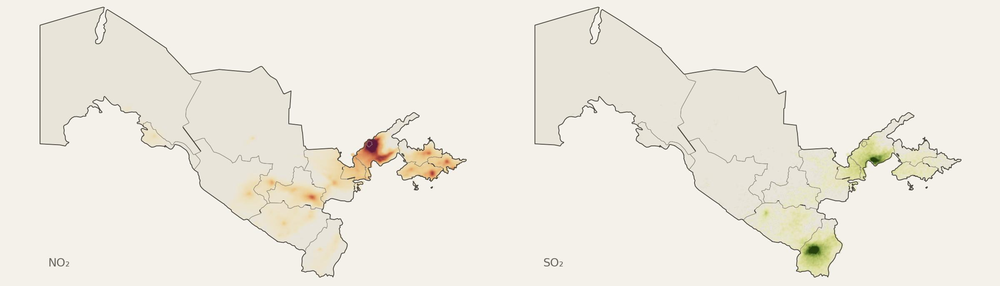
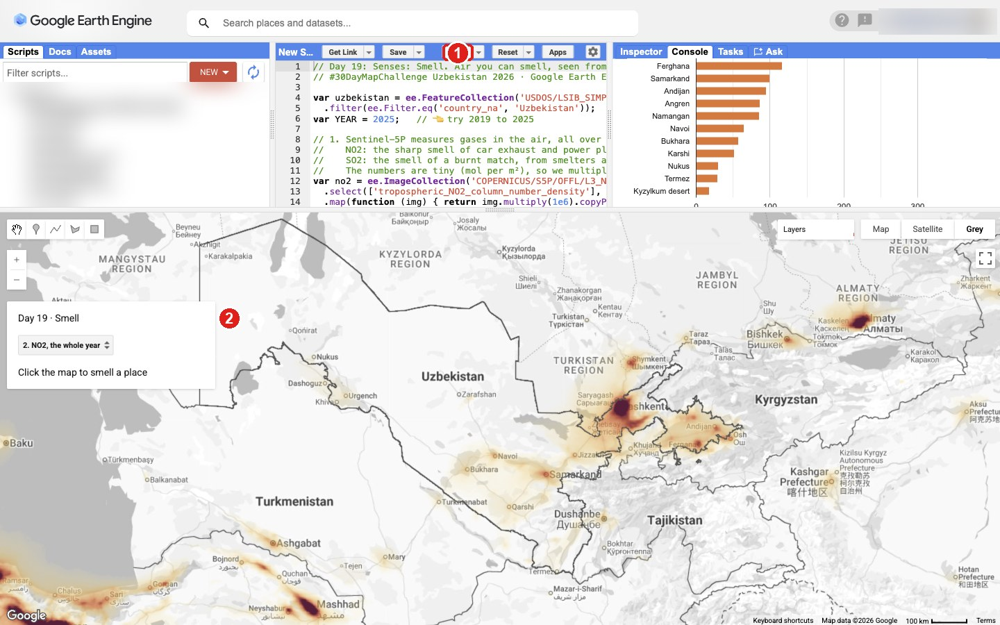
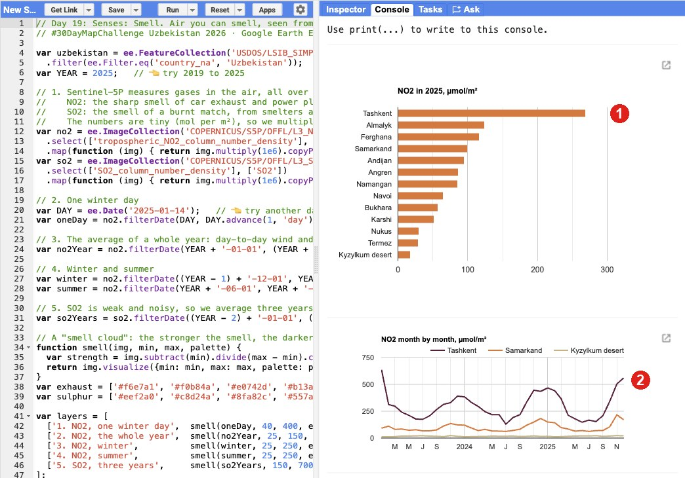
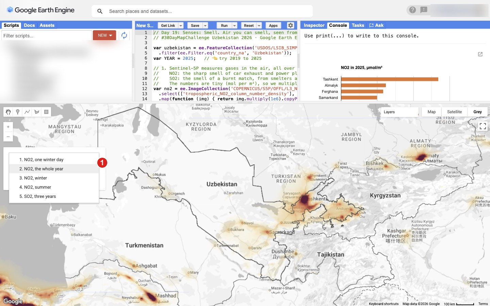
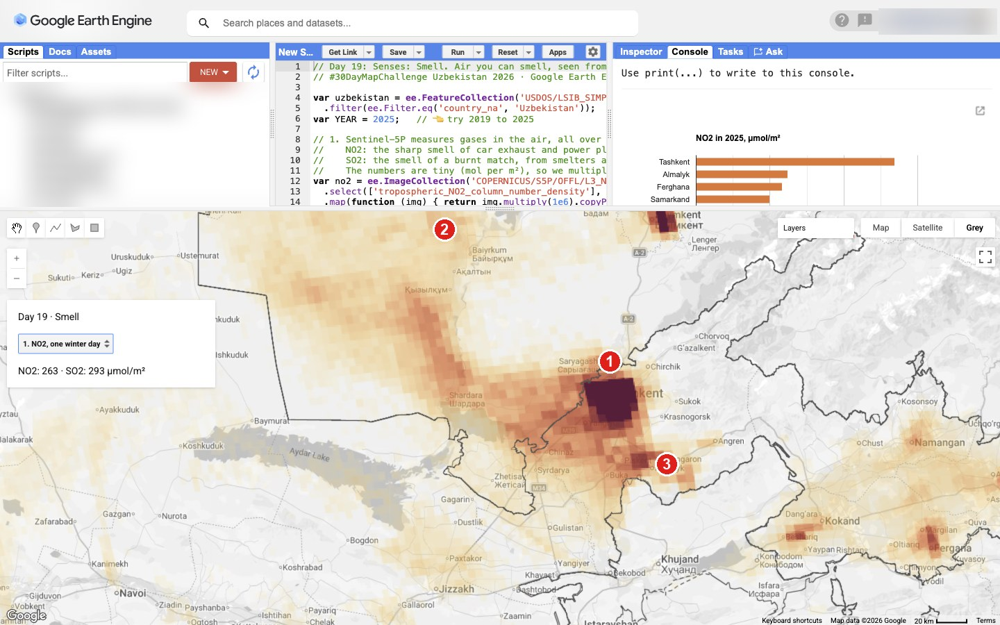
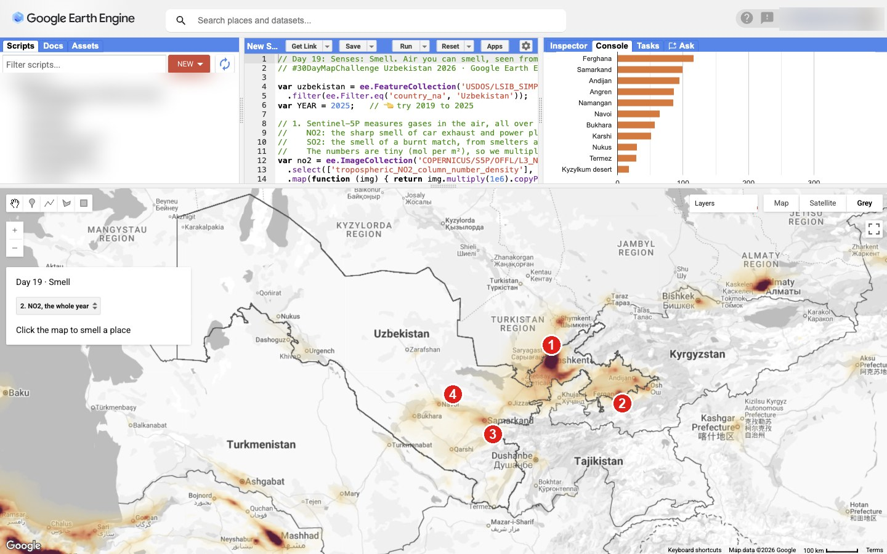
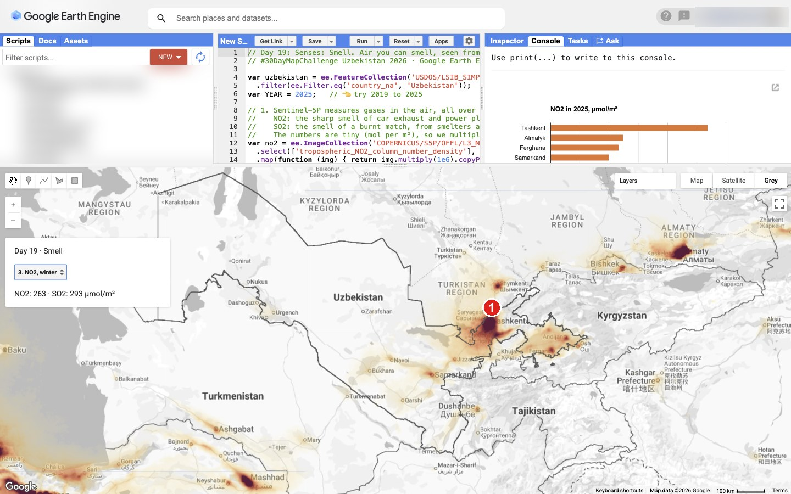
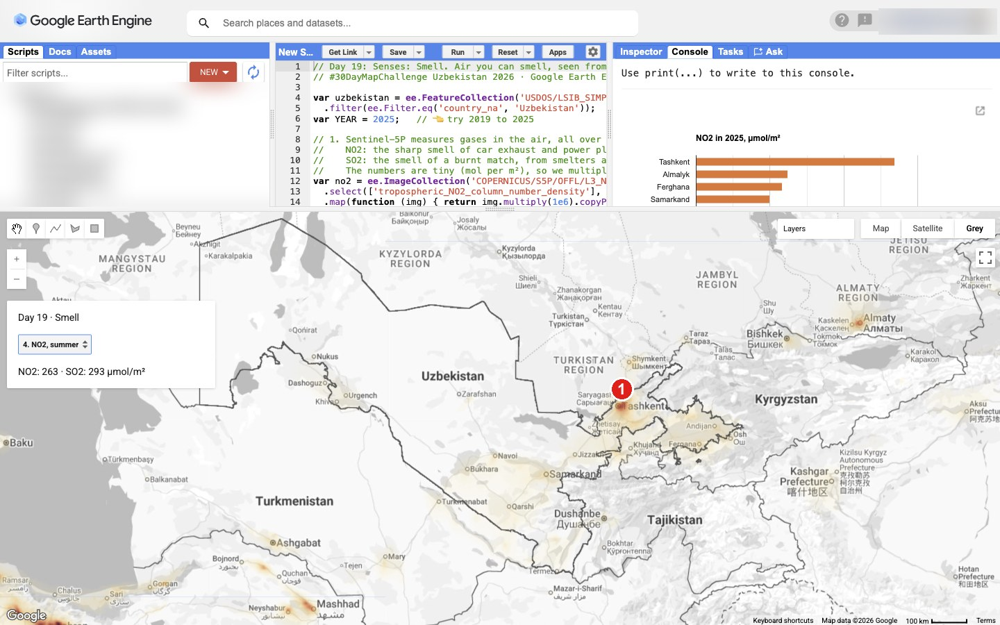
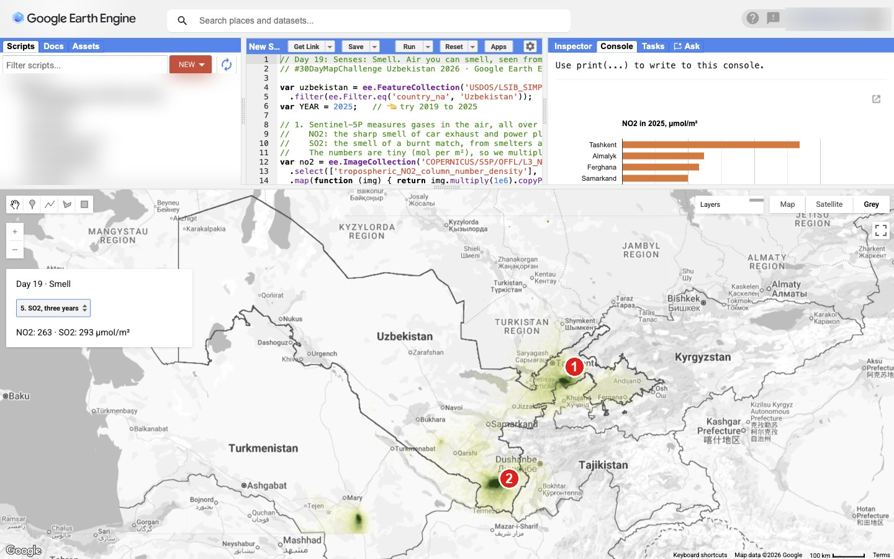
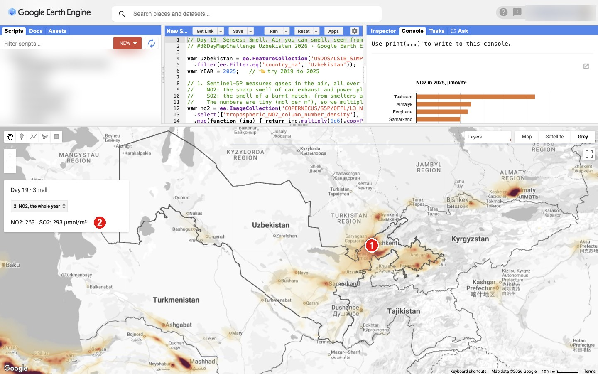

# Day 19 tutorial: Air you can smell, seen from space

**Theme: Senses: Smell.** *How do you map things which your nose can sense? What does a smelly map look like?* Some smells are gases in the air: the sharp smell of car exhaust, the burnt-match smell near a factory. A satellite called **Sentinel-5P** measures these gases every day, all over the Earth. Today you map the "smell" of Uzbekistan: which cities smell the most, how the smell drifts with the wind, why winter smells stronger than summer, and where the burnt-match smell comes from. You work in the **Google Earth Engine Code Editor**. It takes about 25 minutes.

📄 **Printable PDF:** [English](pdf/Day19_Tutorial_EN.pdf) · [Русский](pdf/Day19_Tutorial_RU.pdf) · [Oʻzbekcha](pdf/Day19_Tutorial_UZ.pdf)



**What you'll learn**
- What Sentinel-5P measures, and what it can and can't tell you about smell.
- How to average many days of satellite data into one map.
- How to compare seasons, and why the air is dirtier in winter.
- How to make charts that rank places and follow them month by month.
- How to make the map answer a click.

## Part 0. Three ideas before you start

1. **Smells are gases.** Two gases are easy to smell and easy to see from space:
   - **NO₂** (nitrogen dioxide) has a sharp, biting smell. It comes from burning fuel: cars, buses, power plants, heating.
   - **SO₂** (sulphur dioxide) smells like a **burnt match**. It comes from burning things that contain sulphur: coal, some kinds of natural gas, and metal smelters.
2. **Sentinel-5P.** This European satellite carries an instrument called **TROPOMI**. It flies over every place once a day, around 13:30, and measures how much of each gas is in the air between the ground and the satellite. Each pixel is about **5 × 3.5 km**, so it sees a whole neighbourhood, not one street.
3. **The numbers.** The amount is given in **mol per m²**: how many molecules of gas are in a tall column of air above one square metre. The numbers are tiny (0.0002), so we multiply them by a million and use **µmol/m²** (micromoles). Clean desert air has about **15–20 µmol/m²** of NO₂. The centre of Tashkent has more than **250**.

## Part 1. Open the Code Editor

You need Earth Engine access. If you don't have it yet, follow **Part 1 of the [Day 09 tutorial](../../Day%2009%20Urban-rural/tutorial/README.md)**: create a Cloud project and register it for free noncommercial use. It takes about 10 minutes, once.

Then go to **[code.earthengine.google.com](https://code.earthengine.google.com)**.

## Part 2. Paste the script and run it

1. Open our script: **[day19_smell.js](data/day19_smell.js)**. On GitHub, click **Copy raw file** (the two-squares button).
2. Click into the middle panel of the Code Editor and paste (**Ctrl+V**, or **⌘V** on a Mac).
3. Click **Run** (**1**).



After 20–60 seconds the map shows the **NO₂ of the whole year 2025**. A panel appears on the map (**2**) with a menu of 5 layers. We go through them one by one.

> **Be patient.** Earth Engine averages hundreds of satellite images while you watch. New squares (tiles) appear one by one, in 10–60 seconds.

## Part 3. Which places smell the most?

Look at the **Console** on the right. You can drag the line between the code and the map down to see more of it.



**The bar chart** (**1**) shows the average NO₂ in 2025 in a circle of 7 km around 13 places:
- **Tashkent** is far ahead, with about **270**: the biggest city, the most cars, and big power plants.
- **Almalyk**, **Ferghana**, **Samarkand** and **Andijan** come next, with about **100–125**.
- The **Kyzylkum desert** has about **17**. That is what air with almost no NO₂ looks like.

Each place is made with one line, for example `place('Tashkent', 69.28, 41.31)`: a name, a longitude and a latitude. The code draws a circle around each place and takes the average inside it:

```javascript
var placeNO2 = no2Year.reduceRegions({collection: places, reducer: ee.Reducer.mean(), scale: 2000});
```

**The line chart** (**2**) shows the NO₂ month by month for three years. We come back to it in Part 6.

## Part 4. One winter day: the smell drifts

Open the menu in the panel (**1**). The layers are numbered in the order of this tutorial.



Choose **1. NO2, one winter day** and zoom in on Tashkent. This is what Sentinel-5P saw on **14 January 2025**:



1. **Tashkent** is the dark square in the middle. The squares are the satellite's pixels, about 5 km wide.
2. A long **plume** goes more than 100 km to the north-west, over the steppe. That day the wind blew from the south-east and carried the city's air with it. If you stood there, you could smell Tashkent without seeing it.
3. **Almalyk**, with its factories, makes its own small cloud.

On a cloudy day you would see **holes** here: under a cloud the satellite can't measure the gas near the ground. Those pixels are **NULL**, like on Day 18.

## Part 5. A whole year

Choose **2. NO2, the whole year**. This is the **mean** (average) of every day of 2025:

```javascript
var no2Year = no2.filterDate(YEAR + '-01-01', (YEAR + 1) + '-01-01').mean();
```

The wind blows a different way every day, so the plumes cancel out, and what's left is where the gas comes **from**:



1. **Tashkent**, with **Chirchiq**, **Almalyk** and **Angren** around it.
2. The **Ferghana Valley**: Kokand, Ferghana, Margilan, Andijan and Namangan make one long cloud.
3. **Samarkand**.
4. **Navoi** and **Bukhara**.

The cities in the west, like **Nukus** and **Urgench**, are much fainter: fewer people, fewer cars, and fewer factories.

**How we drew a "smell cloud".** The `smell` function in the script does two things: it gives every pixel a colour from light yellow to dark purple, and it makes weak values **see-through**. Clean air disappears, and only the smell is left, like a cloud on top of the map:

```javascript
var strength = img.subtract(min).divide(max - min).clamp(0, 1);
return img.visualize({min: min, max: max, palette: palette}).updateMask(strength.sqrt());
```

`updateMask` here takes a number from 0 (invisible) to 1 (solid), not only yes or no.

## Part 6. Winter smells stronger

Choose **3. NO2, winter** (December 2024 to February 2025), then **4. NO2, summer** (June to August 2025). Both use the same colours, so you can compare them.





In the centre of Tashkent the winter average is about **456**, and the summer average is about **159**: **almost 3 times less**. Look at the line chart in the Console again: Tashkent goes up every winter and down every summer. Why?
- **Heating.** In winter, homes and power plants burn much more gas and coal.
- **A lid of cold air.** On cold, calm winter days, cold air stays near the ground under warmer air, like under a lid (an *inversion*). The smoke can't rise and stays in the city.
- **Sunlight.** In summer, strong sunlight breaks NO₂ apart within a few hours. In winter it lives longer.

## Part 7. The burnt-match smell: SO₂

Choose **5. SO2, three years**. SO₂ is much harder to measure than NO₂, and one year looks like noise, so here we average **three years** (2023 to 2025):

```javascript
var so2Years = so2.filterDate((YEAR - 2) + '-01-01', (YEAR + 1) + '-01-01').mean();
```



Only a few places stand out:
1. **Almalyk**. The Almalyk Mining and Metallurgical Complex melts copper ore, which is full of sulphur. Melting it releases SO₂.
2. **Surkhandarya**. This is the strongest SO₂ spot in Uzbekistan, and it's exactly where we found a **gas flare** on Day 17. Gas from Surkhandarya's fields is "sour": it contains **hydrogen sulphide**, the gas that smells like rotten eggs. When it's burned, it turns into SO₂.

Notice that Tashkent, the biggest NO₂ cloud, is not the biggest SO₂ cloud. Cars and gas heating make NO₂ but very little SO₂. Each smell has its own sources.

## Part 8. Smell a place

Click anywhere on the map (**1**). The panel shows the yearly NO₂ and the three-year SO₂ in that pixel (**2**):



The code asks Earth Engine for the values under your click, and `evaluate` writes them into the panel when they arrive:

```javascript
Map.onClick(function (c) {
  var here = ee.Geometry.Point([c.lon, c.lat]);
  ...
});
```

Click on your home, your school, a village, and the desert. Which one smells the most?

## Part 9. What the satellite can't smell

Your nose and Sentinel-5P measure different things, so read the maps with care:
- **The satellite measures the whole column of air**, from the ground up to the sky. Your nose smells only the air around your face. A street full of buses can smell much worse than the 5 km pixel it sits in.
- **It measures at about 13:30.** The morning and evening rush hours, when the air is often worst, aren't in the data.
- **Not every bad gas smells, and not every smell is bad.** Carbon monoxide (CO) has no smell at all. The smell of bread or plov is made of many gases the satellite doesn't measure.
- **A NULL line.** Add `Map.addLayer(no2Year, {min: 10, max: 60});` to the end of the script and run it. At **60° E**, in Karakalpakstan, you'll see a thin straight line. It isn't real: it's a column of missing pixels (NULL), left by the way the data was put on a grid. In our smell layers it hides, because clean air there is see-through. NULLs are everywhere!

## Part 10. Download your map

At the bottom of the Console there's a link: **Download the NO2 map: Click here**. It opens the yearly NO₂ of Uzbekistan as a PNG with a see-through background. Right-click it and choose **Save image as…**. You can put it on top of any base map in QGIS or a design program.

## Try it yourself

- **Another year:** set `YEAR = 2019`. Is the air cleaner or dirtier than in 2025?
- **Another day:** set `DAY` to a date from the line chart, for example a day in December. Where does the plume go?
- **Your place:** add your town to the list of places, for example `place('Jizzakh', 67.84, 40.12)`.
- **Other gases:** Sentinel-5P also measures `CO`, `HCHO` (formaldehyde) and `CH4` (methane). Search for **Sentinel-5P** in the search bar at the top and try one.

## Ideas for your own map

- **The smell of winter:** the winter and summer maps of Tashkent side by side.
- **A smell plume:** one windy day, with an arrow showing the wind, and the cities the smell reaches.
- **Two smells, two colours:** NO₂ in orange and SO₂ in green on the same map.
- **A smell walk:** walk around your neighbourhood, write down what you smell and where, and put your notes next to the satellite map.

## When you share

Please credit:
> Contains modified Copernicus Sentinel-5P data (2023–2025), processed in Google Earth Engine.

## Troubleshooting

| Problem | What to do |
|---|---|
| `Error: Project … is not registered` | Your Cloud project isn't set up for Earth Engine. See Part 1 of the Day 09 tutorial. |
| The map stays empty for a long time | Wait up to a minute, or move the map a little. Earth Engine is computing. |
| The charts say `Generating…` for a long time | They average hundreds of images. Wait a minute or two. |
| `Too Many Requests` or `concurrency limit` | Earth Engine is busy with too many things at once. Wait a little and run the script again. |
| The panel says `NO2: 0` after a click | You clicked outside the data, or the value is missing (NULL) there. Click somewhere else. |
| The download link doesn't work | Run the script again: the link only lasts a short time. |

## Credits

- **NO₂:** [Sentinel-5P OFFL NO₂](https://developers.google.com/earth-engine/datasets/catalog/COPERNICUS_S5P_OFFL_L3_NO2), tropospheric column, ESA / Copernicus, via Google Earth Engine.
- **SO₂:** [Sentinel-5P OFFL SO₂](https://developers.google.com/earth-engine/datasets/catalog/COPERNICUS_S5P_OFFL_L3_SO2), total column, ESA / Copernicus, via Google Earth Engine.
- **Country border:** [US Department of State LSIB](https://developers.google.com/earth-engine/datasets/catalog/USDOS_LSIB_SIMPLE_2017), simplified, 2017.
- **Software:** [Google Earth Engine](https://earthengine.google.com).
