# Day 20 tutorial: 45 years of cities, in bestagons

**Theme: Hexagons.** *The good old bestagons.* Satellites have photographed Uzbekistan since the 1970s, and from those pictures scientists mapped every place covered by **buildings**. Today you pour that data into **hexagons**: you cover the country with 10,000 of them, see how the cities grew from **1975 to 2020**, build a **3D map** where every hexagon is a tower, and zoom into Tashkent with smaller hexagons. You work in **Google Colab** with **H3**, a hexagon grid for the whole Earth. No account and no installs are needed. It takes about 25 minutes.

📄 **Printable PDF:** [English](pdf/Day20_Tutorial_EN.pdf) · [Русский](pdf/Day20_Tutorial_RU.pdf) · [Oʻzbekcha](pdf/Day20_Tutorial_UZ.pdf)

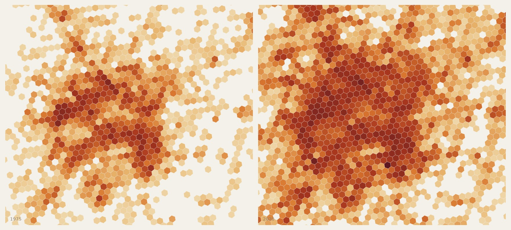

**What you'll learn**
- What **H3** is, and how its hexagons come in 16 sizes that fit into each other.
- Why hexagons are often better than squares for maps.
- How to turn a **raster** (a grid of pixels) into hexagons.
- How to compare years and regions with a table.
- How to make a 3D hexagon map with **pydeck**.

## Part 0. Three ideas before you start

1. **Built-up area from space.** The **GHSL** (*Global Human Settlement Layer*) is made by the European Commission. Its scientists looked at Landsat and Sentinel-2 satellite pictures of the whole Earth and found every roof, every factory and every paved yard. For every small square of land, the data says how many **m²** are covered by buildings. We use the years **1975, 1990, 2000, 2010 and 2020**.
2. **H3.** A company that needs to count things everywhere on Earth (Uber made H3 to count cars and riders) needs a grid. **H3** cuts the whole Earth into hexagons. Every hexagon has a **name** (its ID, like `8620a52d7ffffff`) and comes in **16 sizes**, called **resolutions**: resolution 0 is bigger than Uzbekistan, resolution 15 is smaller than a table.
3. **Why hexagons?** A square has 4 neighbours across its sides and 4 more at its corners, and the corner ones are further away. A hexagon has **6 neighbours, all at the same distance**. Hexagons also look round, so a map made of them doesn't show the stripes that squares make.

## Part 1. Open the notebook and run it

1. Click this button: [](https://colab.research.google.com/github/NodiraTillayeva/30DayMapChallengeUzbekistan/blob/main/2026/Day%2020%20Hexagons/tutorial/day20_cities_in_hexagons.ipynb)
2. Sign in with your Google account and click **Copy to Drive** (**1**), so your changes are saved.

   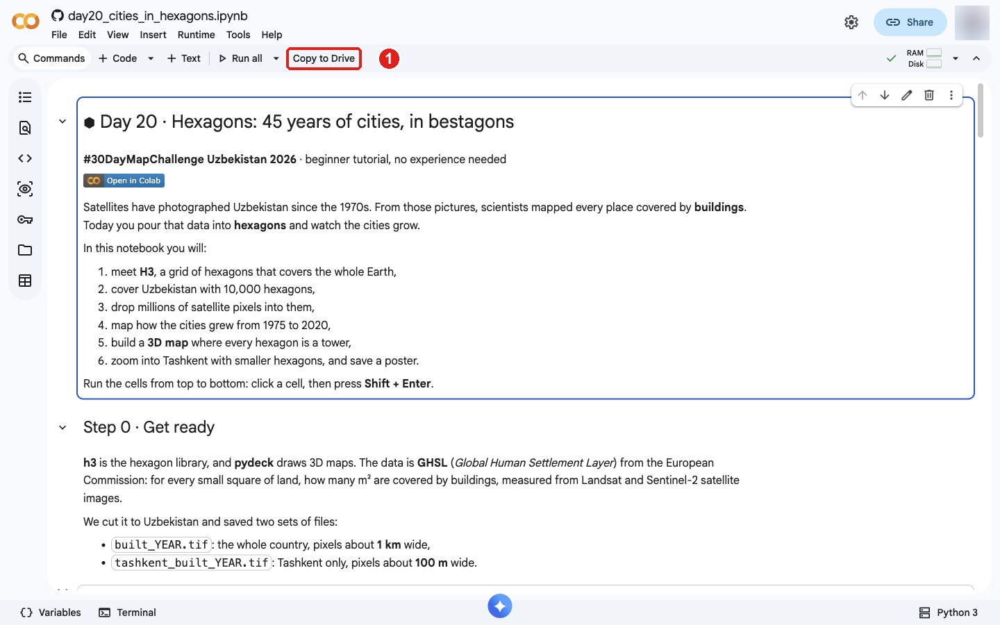

3. Click **Run all** (**1**), then **Run anyway** (**2**).

   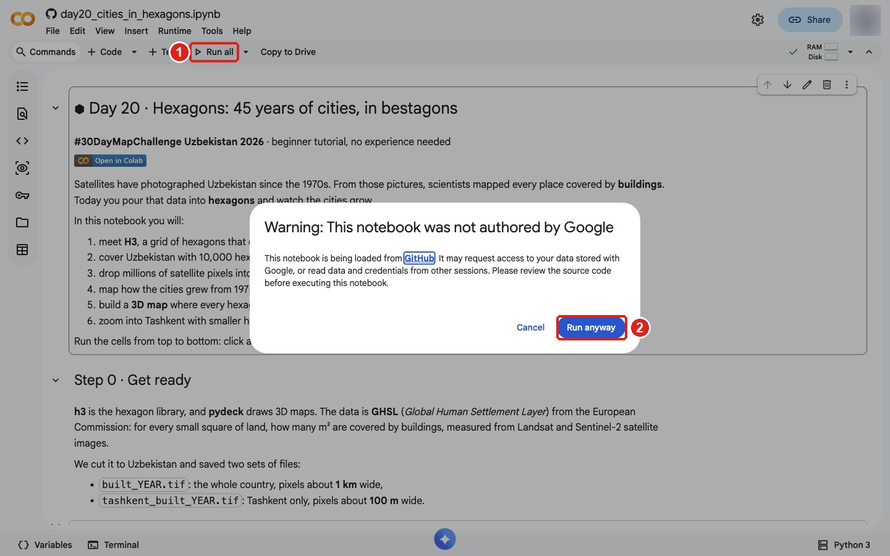

4. Step 0 installs two libraries, **h3** (hexagons) and **pydeck** (3D maps), and downloads 10 files: 5 years of the whole country (pixels about 1 km wide) and 5 years of Tashkent (pixels about 100 m wide). When it says **Ready!** (**1**), everything is loaded.

   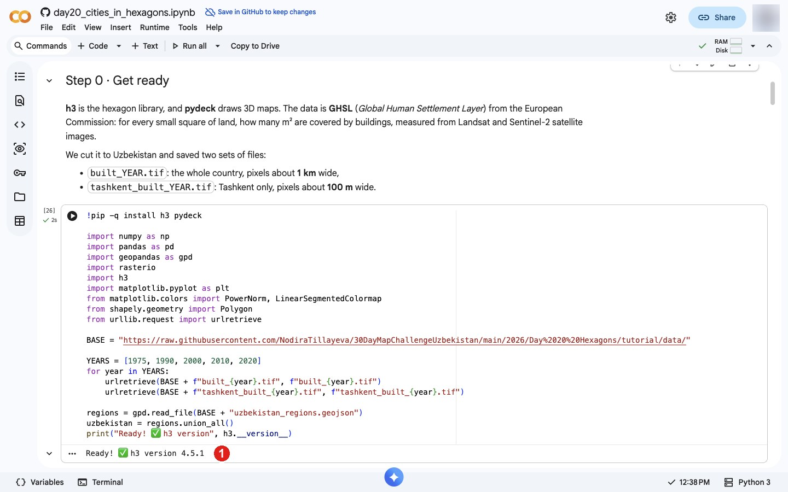

> **How we made the files.** We downloaded GHSL *GHS-BUILT-S R2023A* from the European Commission's website: 6 squares of 10° × 10° per year at 100 m. We put them together and cut out a box around Uzbekistan. For the whole country we added up every 10 × 10 pixels into one pixel of about 1 km. Each file is now about 1 MB.

## Part 2. One place, many hexagons

Step 1 asks H3 which hexagon the **Registan** in Samarkand falls into, at 6 resolutions:

```python
cell = h3.latlng_to_cell(lat, lng, res)
```

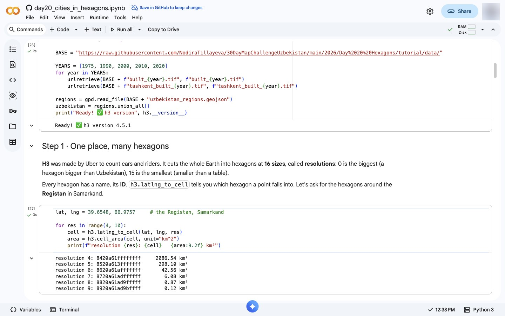

Each step down makes the hexagons about **7 times smaller**: about 2,000 km² at resolution 4, about 40 km² at resolution 6, and about 0.1 km² at resolution 9. Look at the IDs too: they all start the same way, and the number after `8` is the resolution.

The next cell draws the resolution-6 hexagon of the Registan (dark outline), its **7 children** at resolution 7 (colours) and its 49 grandchildren at resolution 8 (thin white lines). `h3.cell_to_children` finds them.

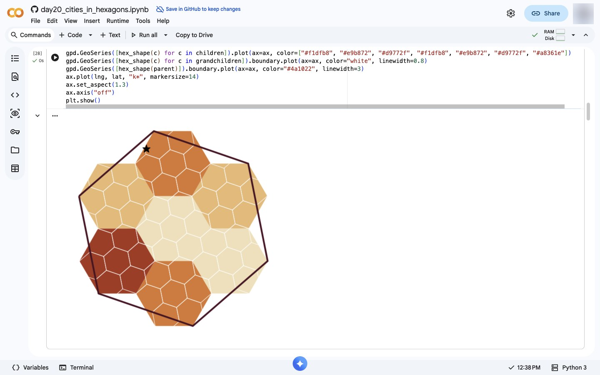

Look at the edges: the children stick out a little. A hexagon can't be cut into smaller hexagons exactly, so H3 turns each level a little to make them fit **almost** perfectly.

## Part 3. Cover Uzbekistan with hexagons

Step 2 fills the whole country with hexagons at **resolution 6**:

```python
cells = h3.geo_to_cells(uzbekistan, RES)
```

That's **10,405 hexagons** (**1**), each about **40 km²**, as big as a small town. The picture zooms into Tashkent: the dark hexagon is the city centre, and `h3.grid_disk(home, 1)` finds its 6 neighbours (**2**), all at the same distance.

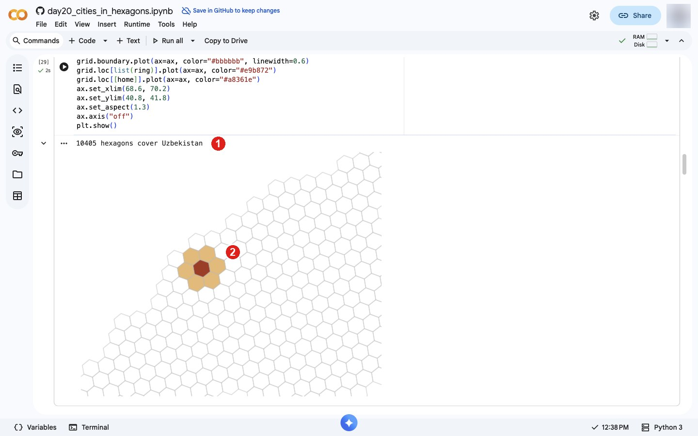

## Part 4. Pour the pixels into the hexagons

This is the most important step. Our country file has **1032 × 2088** pixels, and each pixel holds the m² of buildings inside it. The function `to_hexagons` does three things:
1. it finds the **centre** of every pixel that has buildings,
2. it asks H3 which hexagon that centre falls into (`h3.latlng_to_cell`),
3. it **adds up** the m² of all pixels that fall into the same hexagon (`groupby(...).sum()`).

At the end it divides by the area of each hexagon, so we get **%**: how much of the hexagon is covered by buildings. Then it does the same for all 5 years.

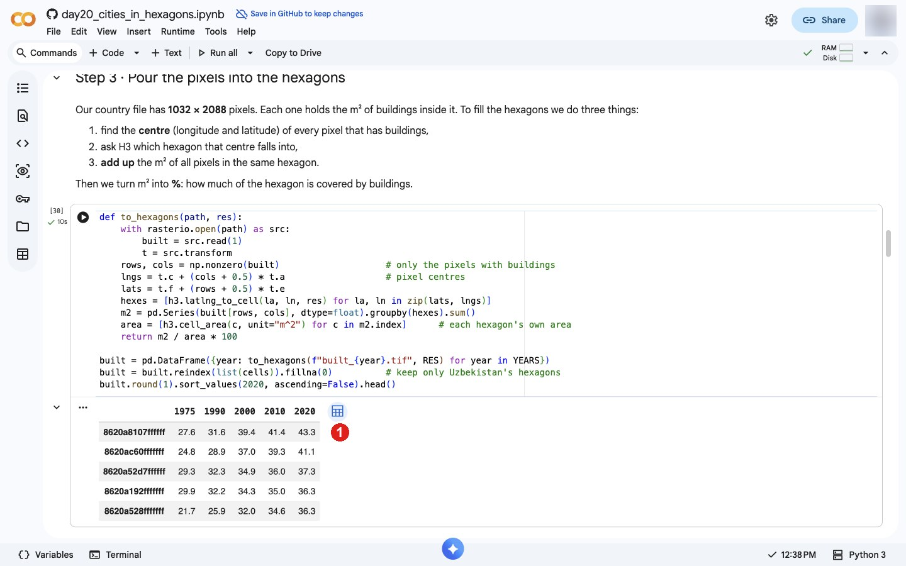

Each row is one hexagon, each column one year (**1**). The top hexagons are the centres of **Andijan**, **Namangan** and **Tashkent**: in 2020 about **40%** of each is covered by buildings. The rest is streets, yards, gardens and parks.

> **Why %?** A hexagon with 10 km² of buildings means something different at resolution 6 (40 km²) and at resolution 8 (less than 1 km²). A percentage can be compared across all sizes.

## Part 5. Uzbekistan in hexagons, 2020

Step 4 joins the numbers to the hexagon shapes and colours them, from light yellow (a few buildings) to dark red (a city centre). Empty hexagons are grey.

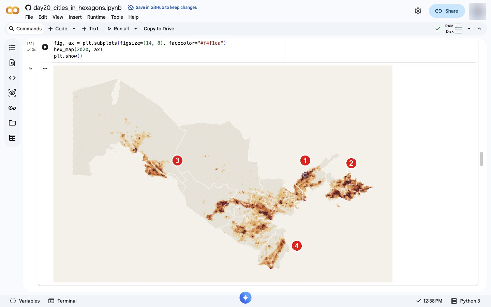

You can read the country from the hexagons alone:
1. **Tashkent** and the towns around it.
2. The **Ferghana Valley**, almost one long city.
3. **Khorezm** and the south of **Karakalpakstan**, along the Amu Darya.
4. **Surkhandarya**: a long, narrow line of towns along the river valley.

Between them, the Silk Road chain of **Samarkand**, **Navoi**, **Bukhara** and **Karshi**. Most of the country (deserts and mountains) is grey.

**How the colours work.** `PowerNorm(0.6, vmin=0, vmax=15)` stretches the low values, so villages are visible, and gives every hexagon above **15%** the darkest colour.

## Part 6. Five maps, 45 years

Step 5 draws the same map for every year, zoomed into the east, where most people live.

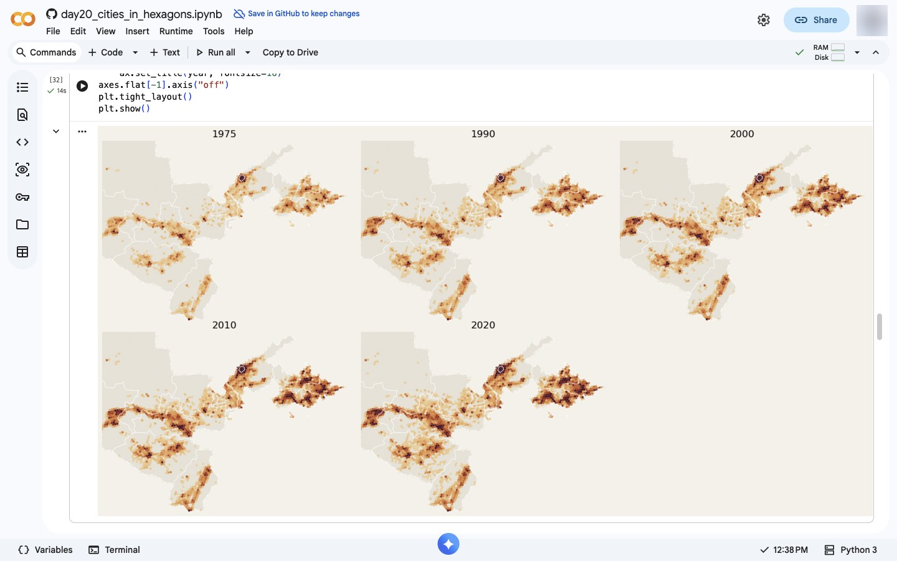

Watch the hexagons fill in: around Tashkent, in the Ferghana Valley, between Samarkand and Jizzakh, and in Kashkadarya. In 1975 many hexagons are light yellow, villages with a few houses. By 2020 they're orange and red.

## Part 7. How much did each region grow?

Step 6 puts every hexagon into the region its centre falls in (`sjoin`) and adds up the built-up **km²** per region.

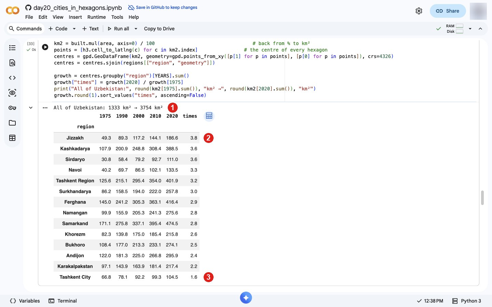

1. All of Uzbekistan: from about **1,333 km²** of buildings in 1975 to about **3,754 km²** in 2020: **2.8 times** more.
2. **Jizzakh** grew the most: **3.8 times**. Kashkadarya and Sirdaryo are close behind with 3.6.
3. **Tashkent City** grew the least, **1.6 times**. It isn't that Tashkent stopped growing: the city was already full, and its border is small. The new houses went **around** it, into **Tashkent Region**, which grew 3.2 times.

## Part 8. Hexagons in 3D

Step 7 uses **pydeck**, which knows H3: you give it a table with hexagon IDs, and it draws them. Every hexagon becomes a **tower** as tall as its buildings in 2020:

```python
layer = pdk.Layer("H3HexagonLayer", towers, get_hexagon="hex",
                  extruded=True, get_elevation="in_2020", elevation_scale=2500)
```

- **Drag** to move the map and **scroll** to zoom.
- Hold **Ctrl** (or press the right mouse button) and drag to **tilt and turn** it.
- **Point** at a tower to see its ID and its % in 1975 and 2020 (**1**).

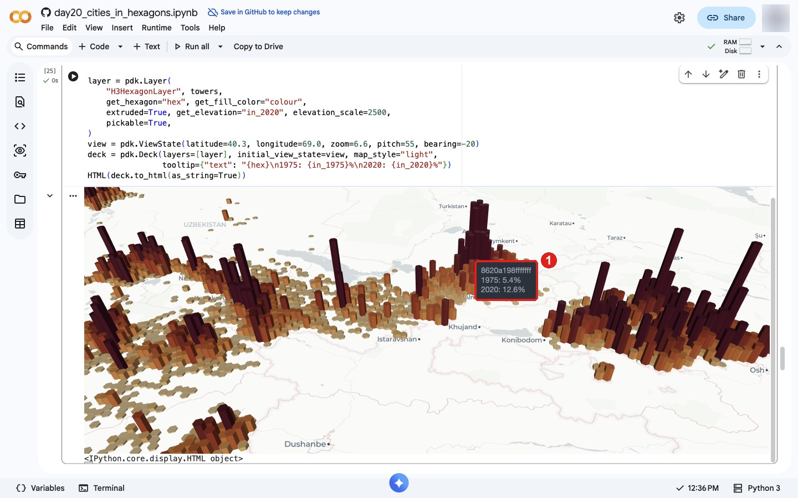

`elevation_scale=2500` makes every 1% of buildings **2.5 km** tall. Of course the real buildings aren't that tall: the height is only a way to show the number.

> **A trap we fell into.** At first we called the columns `"1975"` and `"2020"`. pydeck read `"2020"` as the **number** 2020, not as a column, and every tower became 5,000 km tall. That's why our columns are called `in_1975` and `in_2020`. Column names that start with a letter are always safer.

## Part 9. Tashkent with smaller hexagons

For one city we can go smaller. The Tashkent files have 100 m pixels, so Step 8 uses **resolution 8**: hexagons of less than **1 km²**, 49 times smaller than the country ones. It's the same `to_hexagons` function, with a different file and a different resolution.

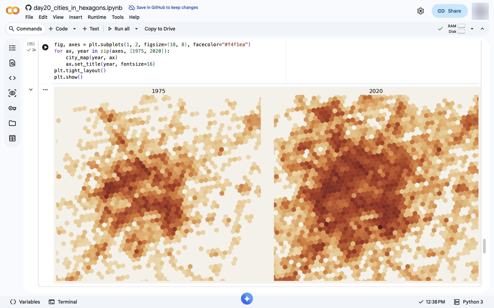

In **1975** Tashkent is a dense centre with villages and fields around it. By **2020** the dark hexagons have filled almost the whole picture: the city has grown into the villages around it.

**Small hexagons fit into big ones.** Every hexagon knows its **parent**, the bigger hexagon it belongs to:

```python
h3.cell_to_parent(small, 6)
```

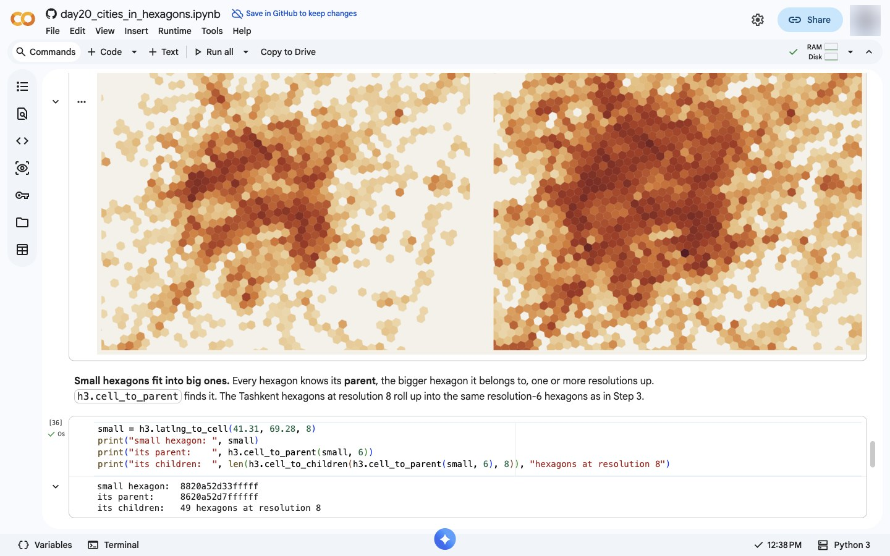

So you can count with small hexagons and add them up into big ones later, without going back to the pixels.

## Part 10. Save your poster

Step 9 draws Tashkent in 1975 and 2020 again, without titles, and downloads it as **tashkent_hexagons.png**.

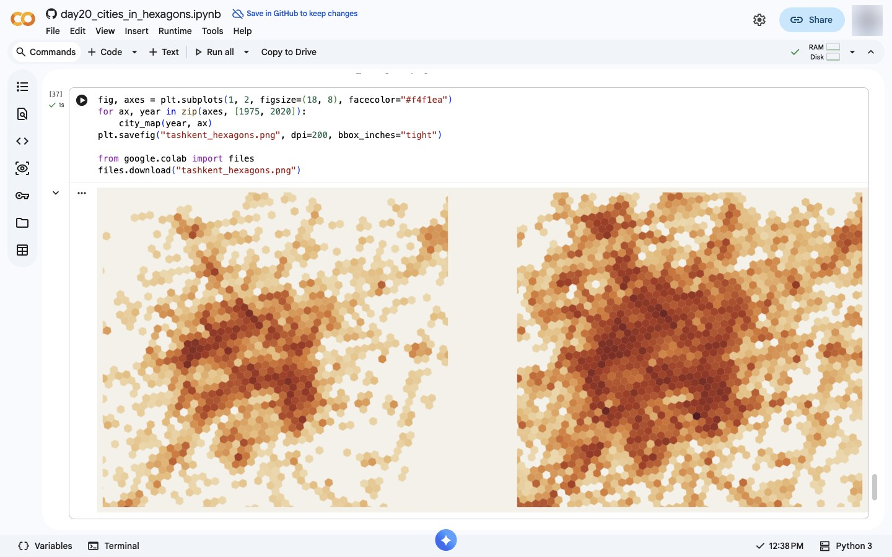

## What the data can't tell you

- **Not every year is measured.** GHSL measured built-up area from Landsat in 1975, 1990, 2000 and 2014, and from Sentinel-2 in 2018. The other years, like **2010** and **2020**, are **estimated** between and after those. Small changes from year to year aren't real measurements.
- **1975 is blurrier.** Landsat pictures from the 1970s have bigger pixels (about 60 m) than today's (10–30 m), so small villages are easier to miss in 1975. Part of the "growth" is better eyes, not new houses.
- **Buildings, not height.** GHSL counts the ground that buildings cover. A 16-storey block and a one-storey house count the same.
- **A hexagon can cross a border.** Hexagons don't care about borders: a hexagon at the edge of a region is counted in the region where its centre is.

## Try it yourself

- **Another size:** set `RES = 5` or `RES = 7` in Step 2 and run everything below again. How does the map change? Resolution 7 has about 70,000 hexagons, so drawing the maps takes about a minute.
- **Your town:** in Step 1, change `lat, lng` to your school or your house. Which hexagon are you in?
- **Only the new buildings:** in Step 4, add `hexmap["new"] = hexmap[2020] - hexmap[1975]` and map `"new"` instead of `2020`.
- **Taller towers:** in Step 7, change `elevation_scale` or use `pitch=70` for a dramatic view.

## Ideas for your own map

- **The growth map:** colour each hexagon by how many times its buildings grew from 1975 to 2020.
- **Three cities, one size:** Tashkent, Samarkand and Andijan at resolution 8, side by side.
- **A hexagon poster:** the whole country at resolution 5, with big, bold hexagons and no borders.
- **Hexagons and night lights:** pour the Day 17 night-light pixels into the same hexagons and compare buildings and light.

## When you share

Please credit:
> Built-up area: GHSL GHS-BUILT-S R2023A, European Commission, Joint Research Centre. Hexagons: H3.

## Troubleshooting

| Problem | What to do |
|---|---|
| `HTTP Error` or `URLError` in Step 0 | Colab couldn't reach GitHub. Wait a minute and run the cell again. |
| `module 'h3' has no attribute 'geo_to_cells'` | You have an old h3 (version 3). Run `!pip install -U h3`, then **Runtime → Restart session**, and run everything again. |
| The 3D map is empty or white | Wait a few seconds, or scroll inside it. If it stays empty, run the Step 7 cell again. |
| All the towers are huge | Check that `get_elevation` is `"in_2020"`, not `"2020"` (Part 8). |
| The maps take a long time at resolution 7 | Drawing 70,000 hexagons is slow. Wait about a minute, or go back to `RES = 6`. |
| The file doesn't download | Your browser blocked it. Allow downloads for colab.research.google.com, or find **tashkent_hexagons.png** in the **Files** panel on the left. |

## Credits

- **Built-up area:** Pesaresi, M., Politis, P. (2023). *GHS-BUILT-S R2023A: GHS built-up surface grid, derived from Sentinel-2 composite and Landsat, multitemporal (1975–2030).* European Commission, Joint Research Centre. [GHSL website](https://human-settlement.emergency.copernicus.eu). Downloaded in November 2026.
- **Hexagons:** [H3](https://h3geo.org), first made by Uber, open source.
- **3D map:** [pydeck](https://deckgl.readthedocs.io), with a base map from [CARTO](https://carto.com) and [OpenStreetMap](https://www.openstreetmap.org/copyright) contributors.
- **Region borders:** the same file as in Day 14.
- **Software:** [rasterio](https://rasterio.readthedocs.io), [geopandas](https://geopandas.org), [numpy](https://numpy.org), [pandas](https://pandas.pydata.org), [matplotlib](https://matplotlib.org), [Google Colab](https://colab.research.google.com).
