# Day 21 tutorial: old city, new city

**Theme: OpenStreetMap.** *The awesome data source for mapping.* OpenStreetMap is a map of the whole world drawn by volunteers. Today you download every **building** around three places and compare them: the old walled city of **Khiva**, the Soviet blocks of **Chilanzar** in Tashkent, and the new towers of **Tashkent City**. You measure every building in m², colour them by size, compare the three "fingerprints", and find out which buildings OSM still knows little about, so you can fix them yourself. You work in **Google Colab** with **osmnx**. No account and no installs are needed. It takes about 25 minutes.

📄 **Printable PDF:** [English](pdf/Day21_Tutorial_EN.pdf) · [Русский](pdf/Day21_Tutorial_RU.pdf) · [Oʻzbekcha](pdf/Day21_Tutorial_UZ.pdf)

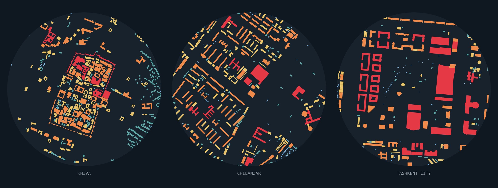

**What you'll learn**
- What **OpenStreetMap** is, and what its **tags** are.
- How to download OSM data for any place with **osmnx**.
- Why you can't measure areas in degrees, and how to switch to metres.
- How to sort buildings into size groups and compare places with a histogram.
- How to check how complete OSM is, and how to improve it.

## Part 0. Three ideas before you start

1. **OpenStreetMap (OSM).** A map of the world made by volunteers, like a Wikipedia for maps. Anyone can add a road, a shop or a house, and anyone can download the data for free. Many apps you use every day (Maps.me, Organic Maps, many taxi and delivery apps) are built on it.
2. **Tags.** In OSM, everything is described by **tags**: a key and a value, like `building=house`, `building=mosque` or `amenity=school`. Today we ask for everything that has the key `building`.
3. **Overpass.** A free server that answers questions about OSM data, like "give me every building within 700 m of this point". **osmnx** asks Overpass for you and turns the answer into a table with shapes.

## Part 1. Open the notebook and run it

1. Click this button: [](https://colab.research.google.com/github/NodiraTillayeva/30DayMapChallengeUzbekistan/blob/main/2026/Day%2021%20OpenStreetMap/tutorial/day21_old_city_new_city.ipynb)
2. Sign in with your Google account and click **Copy to Drive** (**1**), so your changes are saved.

   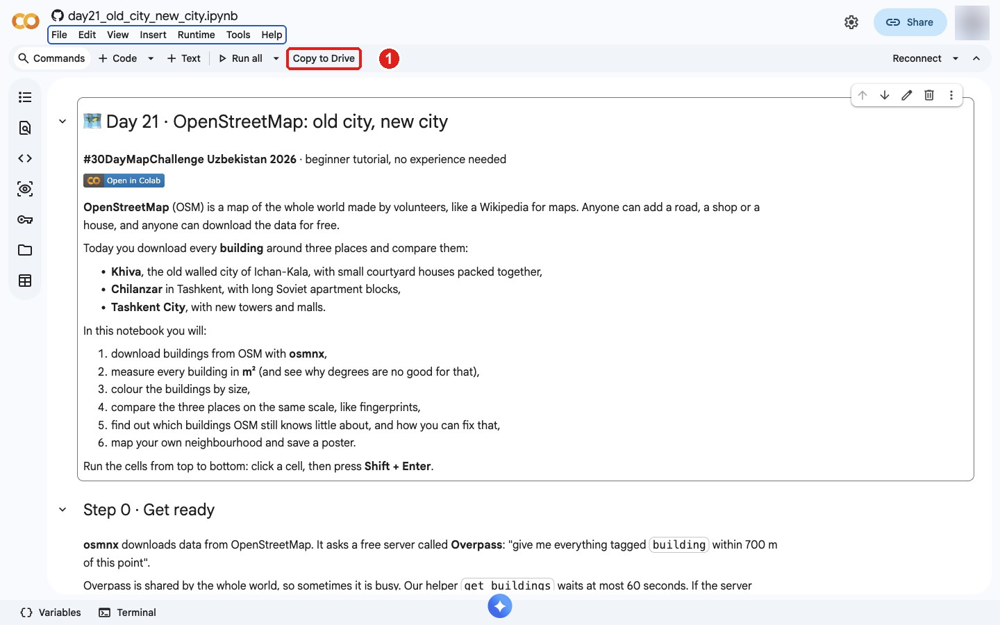

3. Click **Run all** (**1**), then **Run anyway** (**2**).

   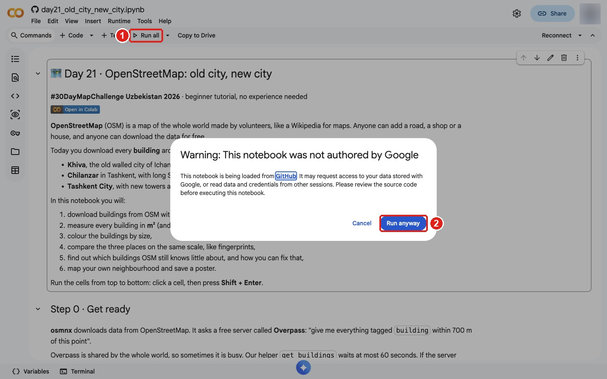

4. Step 0 installs **osmnx** and sets up the three places and a helper called `get_buildings`. When it says **Ready!** (**1**), everything is loaded.

   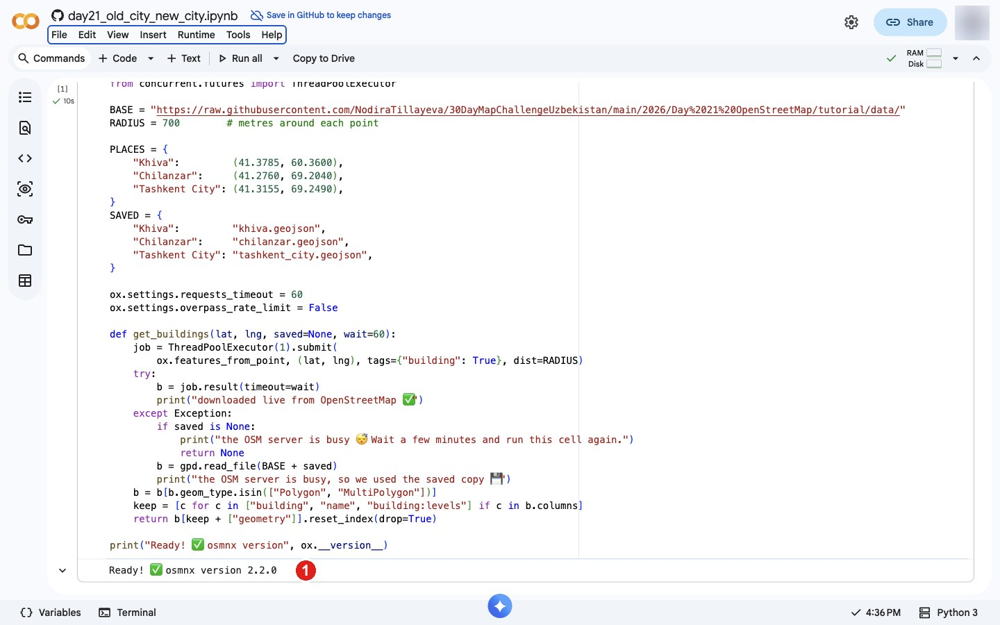

> **Why a saved copy?** Overpass is one free server shared by the whole world, and Colab users share their internet addresses, so sometimes it is busy. `get_buildings` waits at most 60 seconds. If Overpass doesn't answer, it loads a **saved copy** of the same buildings that we downloaded in November 2026 from this repository. Either way, the rest of the notebook works the same.

## Part 2. Download the buildings of Khiva

Step 1 downloads every building within 700 m of Ichan-Kala, the old walled city of Khiva:

```python
buildings = get_buildings(lat, lng, SAVED["Khiva"])
```

It says whether it got the data **live** (**1**) or from the saved copy. Then it shows the first 10 rows.

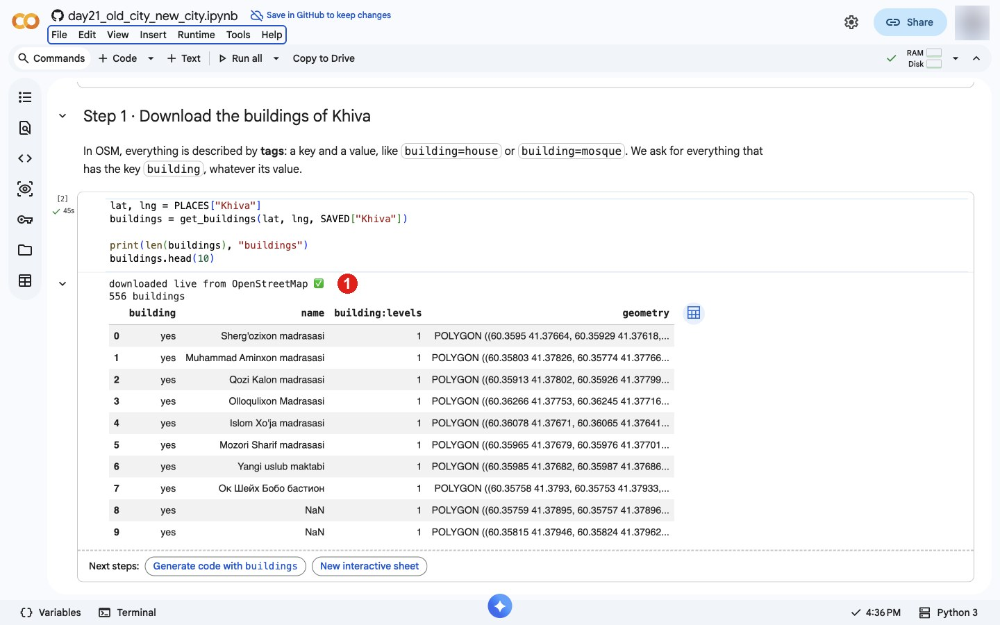

Each row is one building: `building` is its type, `name` is filled in only for famous ones, `building:levels` is the number of floors, and `geometry` is its outline, a list of corners in longitude and latitude. Look: madrasas, a bastion of the city wall… and most of them are just `yes`. We come back to that in Part 7.

The next cell draws them. You can already see the rectangle of the city wall.

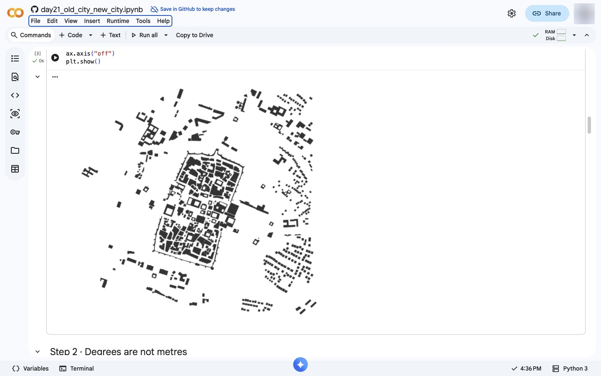

## Part 3. Degrees are not metres

Step 2 asks for the area of the first building, twice:

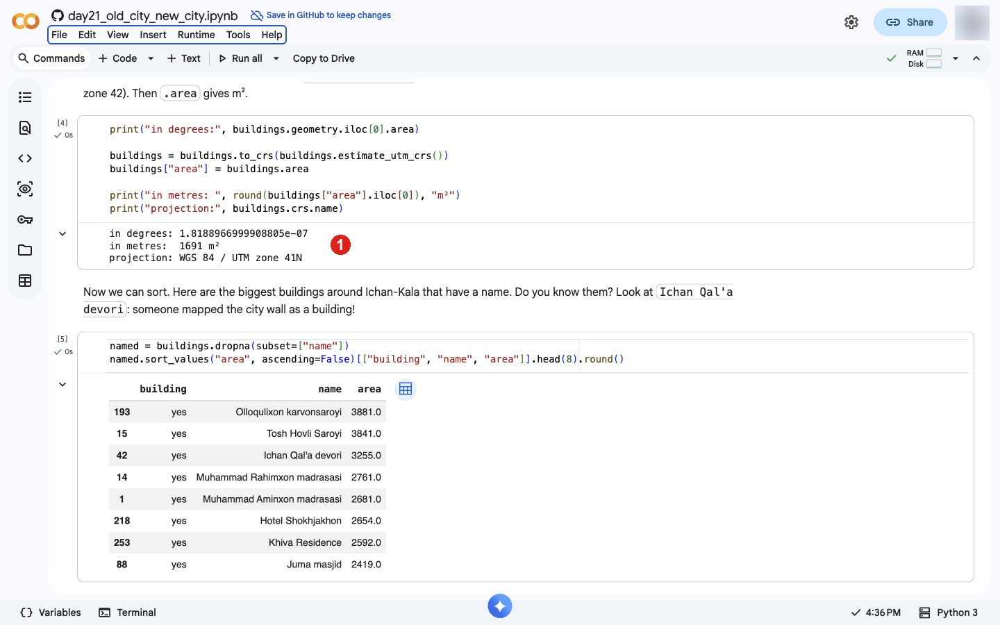

In degrees, the answer is 0.00000018, which means nothing: a degree of longitude is about 84 km in Khiva but 0 km at the North Pole. So we **project** the buildings to metres first:

```python
buildings = buildings.to_crs(buildings.estimate_utm_crs())
buildings["area"] = buildings.area
```

`estimate_utm_crs` picks the right **UTM** zone (Khiva is in zone 41N, Tashkent in 42N). Now the same building is **1,691 m²** (**1**).

The next cell sorts the buildings that have a name, biggest first: caravanserais, the Tosh Hovli palace, madrasas, the Juma mosque. Look for `Ichan Qal'a devori`: someone mapped the city wall as a building!

## Part 4. Colour the buildings by size

Step 3 sorts every building into one of five size groups with `pd.cut`: **under 100 m²** (a shed or a small house), **100–300**, **300–1,000**, **1,000–3,000** and **over 3,000 m²** (a mall, a big school, a palace). It also cuts a **circle** of 700 m with `.clip`, so all three places have exactly the same shape.

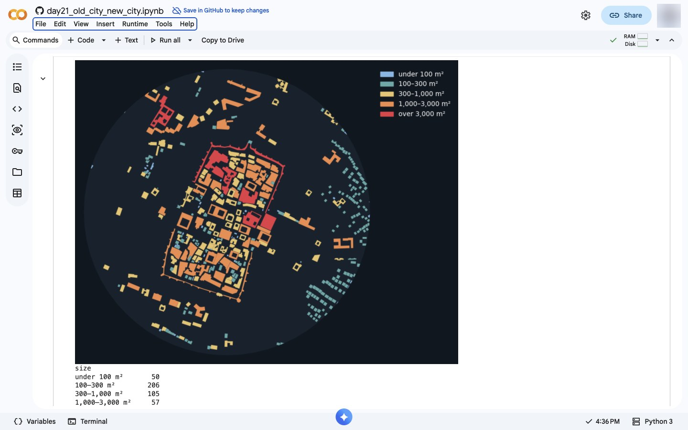

Inside the wall, the houses are packed together with courtyards. Outside, to the east, are rows of small new houses.

## Part 5. Three places, one scale

Step 4 does the same for Chilanzar and Tashkent City. Each place says whether it came live or from the saved copy (**1**).

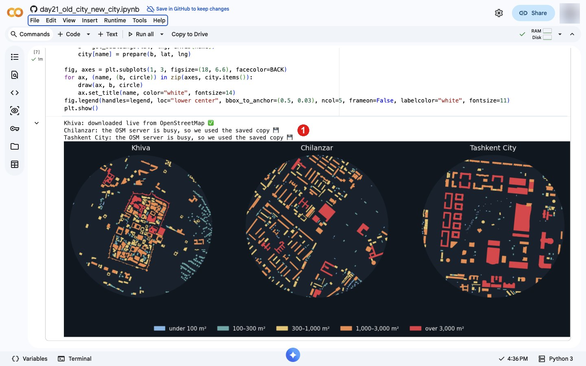

Every circle is **1.4 km across**, so you can compare them directly:
- **Khiva**: many medium buildings, packed tight, with no straight lines.
- **Chilanzar**: long, thin apartment blocks in parallel rows, all turned the same way, with green space between them.
- **Tashkent City**: few buildings, but huge ones. The big red block on the right is Tashkent City Mall, almost 39,000 m².

## Part 6. Three fingerprints

Step 5 puts numbers on it:

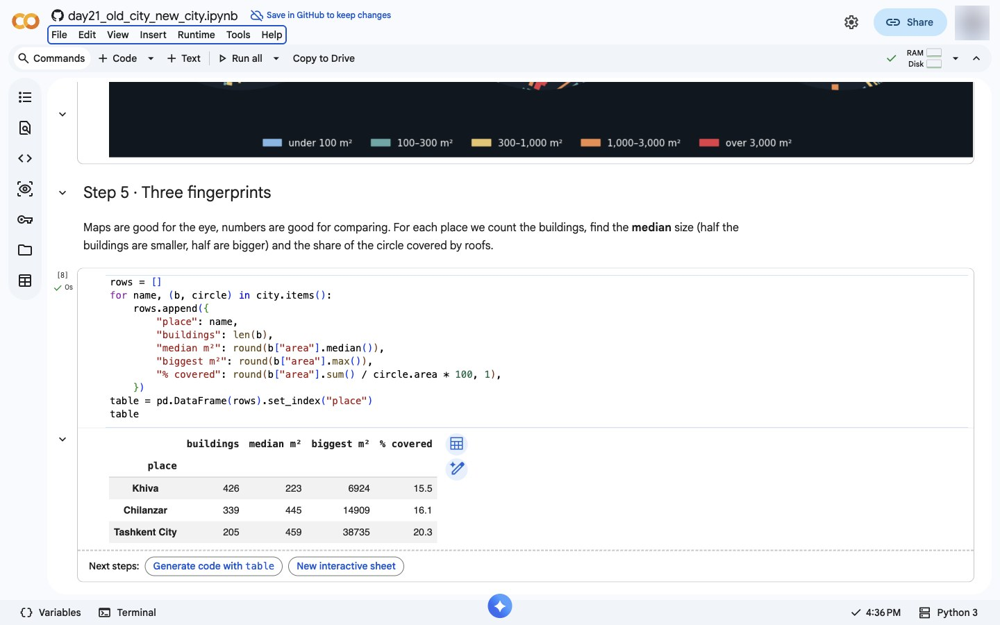

| | Khiva | Chilanzar | Tashkent City |
|---|---|---|---|
| buildings | 426 | 339 | 205 |
| median size | 223 m² | 445 m² | 459 m² |
| biggest | 6,924 m² | 14,909 m² | 38,735 m² |
| % of the circle under roofs | 15.5 | 16.1 | 20.3 |

The **median** means half the buildings are smaller and half are bigger. Khiva has the most buildings, but the smallest. Tashkent City has the fewest, but covers the most ground.

The **histogram** shows the whole "fingerprint". The x axis is a **log scale**: each step is 10 times bigger than the one before.

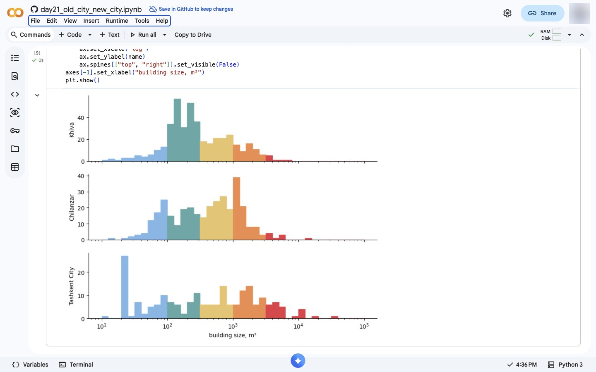

Khiva peaks at 100–300 m², Chilanzar at about 1,000 m² (one Soviet block), and Tashkent City is spread out, with a long tail of giant buildings. The tall bar on the left of Tashkent City is about 30 tiny kiosks and shelters, mostly in the park.

## Part 7. What kind of building is it?

The tag `building=yes` means "there is a building here, but nobody said what kind". Mappers often trace the outline from a satellite picture first, and the type comes later from someone who has been there. Step 6 counts the tags:

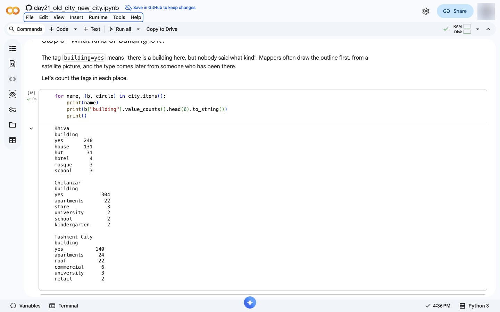

Then it draws them: grey buildings are only `yes`, yellow ones have a type.

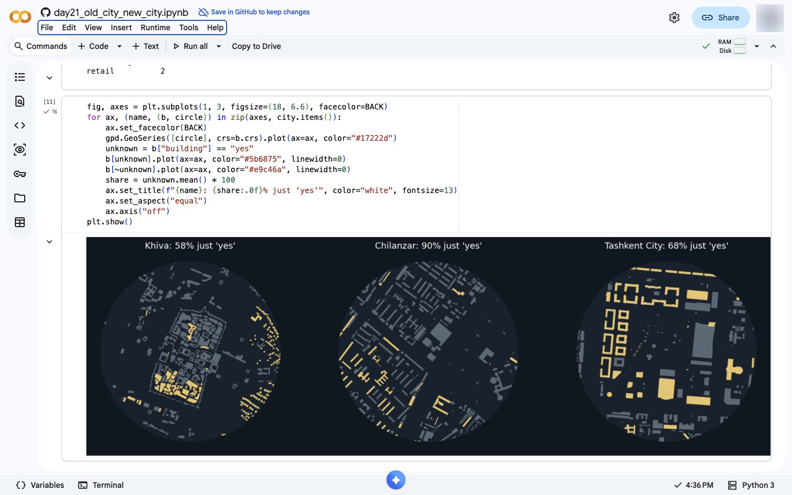

In Khiva, 58% are just `yes`; in Tashkent City, 68%; in Chilanzar, **90%**. Thousands of people live in those blocks, but OSM doesn't know they are apartments.

### You can fix this

1. Go to [openstreetmap.org](https://www.openstreetmap.org) and create a free account.
2. Zoom in to a place you know well, like your street or your school, and click **Edit**. The editor (called **iD**) opens with a short tutorial. Do it, it takes 10 minutes.
3. Click a building, choose its type (*House*, *Apartment building*, *School*…), add the number of floors if you know it, and click **Save**.

Only add what you know from being there, or what you can see on the satellite picture inside the editor. **Don't copy from Google Maps or Yandex Maps**: their data isn't free to use, and OSM will delete it. On an Android phone, the free app **StreetComplete** asks you simple questions about the buildings around you.

## Part 8. Save your poster

Step 7 draws the three circles again, with only small names under them, and downloads **old_city_new_city.png**.

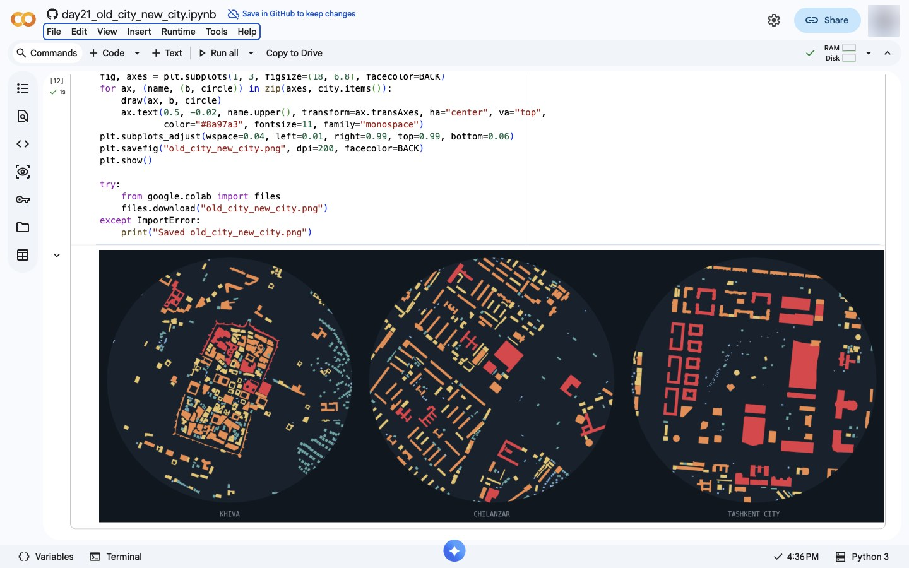

## Part 9. Your own neighbourhood

Step 8 does everything for any place you choose. Change `my_lat, my_lng` to your house or school: on [openstreetmap.org](https://www.openstreetmap.org), right-click the place and choose **Show address** to see its coordinates.

There is no saved copy for your place, so if Overpass is busy you'll see a message (**1**). Wait a few minutes and run the cell again.

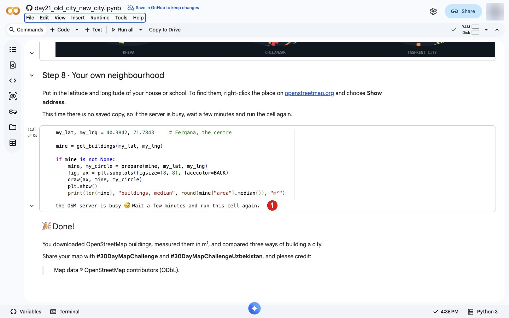

## What the data can't tell you

- **OSM is only as good as its mappers.** If a building isn't drawn, it doesn't exist in our numbers. Some neighbourhoods are mapped house by house, others are almost empty. Before you compare two places, look at them on the map first.
- **The saved copy is a snapshot.** We downloaded it in November 2026. OSM changes every day, so a live download may show a few more (or fewer) buildings.
- **Footprints, not floors.** The area is the ground a building covers. A 9-storey block and a 1-storey shop of the same size look the same. `building:levels` would help, but it's filled in for very few buildings.
- **One outline isn't always one building.** Some mappers draw a whole row of houses as one shape, others draw every house separately. That changes the counts and the sizes.

## Try it yourself

- **Bigger circles:** set `RADIUS = 1000` in Step 0 and run everything again. Does the fingerprint change?
- **Another old city:** add `"Bukhara": (39.7775, 64.4150)` to `PLACES`. There's no saved copy, so use `get_buildings(lat, lng)` without the third argument.
- **Only one type:** in Step 4, draw only `b[b["building"] == "apartments"]`.
- **Other tags:** ask osmnx for `tags={"amenity": "school"}` or `tags={"leisure": "park"}` instead of buildings.

## Ideas for your own map

- **Your mahalla, by size:** your own neighbourhood in the poster style.
- **Before and after mapping:** map the `yes` buildings around your school, fix them in OSM, and map them again a week later.
- **Five cities, one scale:** Nukus, Samarkand, Fergana, Termez and Andijan as five circles.
- **Floors:** colour Tashkent City by `building:levels` instead of area.

## When you share

Please credit:
> Map data © OpenStreetMap contributors, available under the Open Database License (ODbL).

## Troubleshooting

| Problem | What to do |
|---|---|
| A place says **the OSM server is busy, so we used the saved copy** | That's fine: the saved copy is the same data. Run the cell again later to try the live server. |
| **The OSM server is busy 😴** in Step 8 | Overpass is busy and there's no saved copy for your place. Wait a few minutes and run the cell again. |
| Step 1 or Step 4 takes a long time | Each place waits up to 60 seconds for Overpass. In the worst case, Step 4 takes 3 minutes. |
| Your place has almost no buildings | That part of OSM isn't mapped yet. Try a bigger city, or map it yourself (Part 7). |
| The file doesn't download | Your browser blocked it. Allow downloads for colab.research.google.com, or find **old_city_new_city.png** in the **Files** panel on the left. |

## Credits

- **Buildings:** © [OpenStreetMap](https://www.openstreetmap.org/copyright) contributors, ODbL. Downloaded through the [Overpass API](https://overpass-api.de) in November 2026.
- **Download tool:** Boeing, G. (2025). *Modeling and Analyzing Urban Networks and Amenities with OSMnx.* Geographical Analysis. [osmnx](https://osmnx.readthedocs.io).
- **Software:** [geopandas](https://geopandas.org), [pandas](https://pandas.pydata.org), [numpy](https://numpy.org), [matplotlib](https://matplotlib.org), [Google Colab](https://colab.research.google.com).
