# Day 22 tutorial: how big is Uzbekistan, really?

**Theme: Projections.** *The different ways of representing a globe on a flat surface.* The map you see every day on your phone makes Uzbekistan look almost **twice** its real size. Today you find out why: you draw the world in different **projections**, measure how much each one stretches, **move Uzbekistan** to the equator, Scandinavia and Greenland to watch it grow, and draw **Tissot circles** that show the stretching everywhere at once. You work in **Google Colab** with **geopandas**. No account and no installs are needed. It takes about 20 minutes.

📄 **Printable PDF:** [English](pdf/Day22_Tutorial_EN.pdf) · [Русский](pdf/Day22_Tutorial_RU.pdf) · [Oʻzbekcha](pdf/Day22_Tutorial_UZ.pdf)

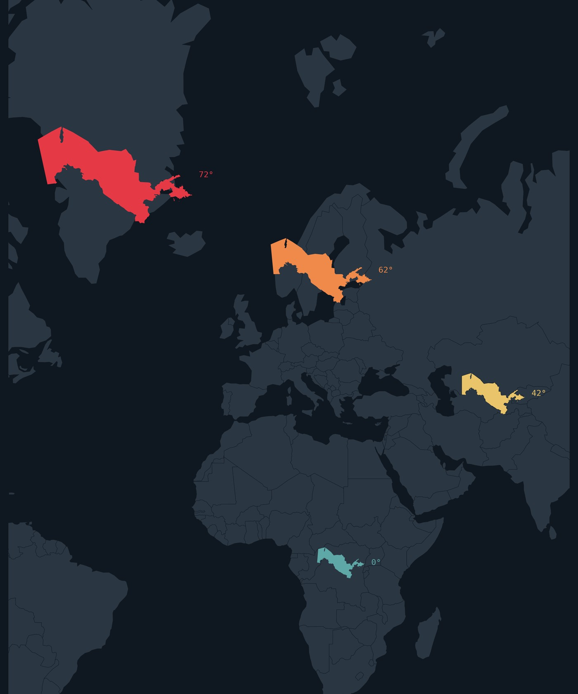

**What you'll learn**
- What a **projection** and a **CRS** are, and how to change them with `to_crs`.
- Why the **Mercator** projection of web maps makes the north look bigger.
- How to measure areas correctly with an **equal-area** projection.
- How to move a shape around the globe while keeping its true size.
- How to read **Tissot circles**.

## Part 0. Three ideas before you start

1. **A projection.** The Earth is round, and a map is flat. You can't flatten an orange peel without stretching or tearing it, and you can't flatten the Earth either. A **projection** is a recipe for flattening it, and every recipe stretches something: areas, shapes, distances or directions. No flat map keeps them all.
2. **Mercator.** Made by Gerardus Mercator in 1569 for sailors: a straight line on his map is a constant compass direction. It keeps **shapes** right, but makes everything far from the equator **bigger**. Google Maps, Yandex Maps and OpenStreetMap all use a version of it, **Web Mercator**.
3. **CRS and EPSG codes.** In geopandas, every layer knows its **CRS** (*coordinate reference system*): how its numbers relate to places on the Earth. Each CRS has a code: **EPSG:4326** is longitude and latitude in degrees, **EPSG:3857** is Web Mercator in metres. `to_crs` changes from one to another.

## Part 1. Open the notebook and run it

1. Click this button: [](https://colab.research.google.com/github/NodiraTillayeva/30DayMapChallengeUzbekistan/blob/main/2026/Day%2022%20Projections/tutorial/day22_how_big_is_uzbekistan.ipynb)
2. Sign in with your Google account and click **Copy to Drive** (**1**), so your changes are saved.

   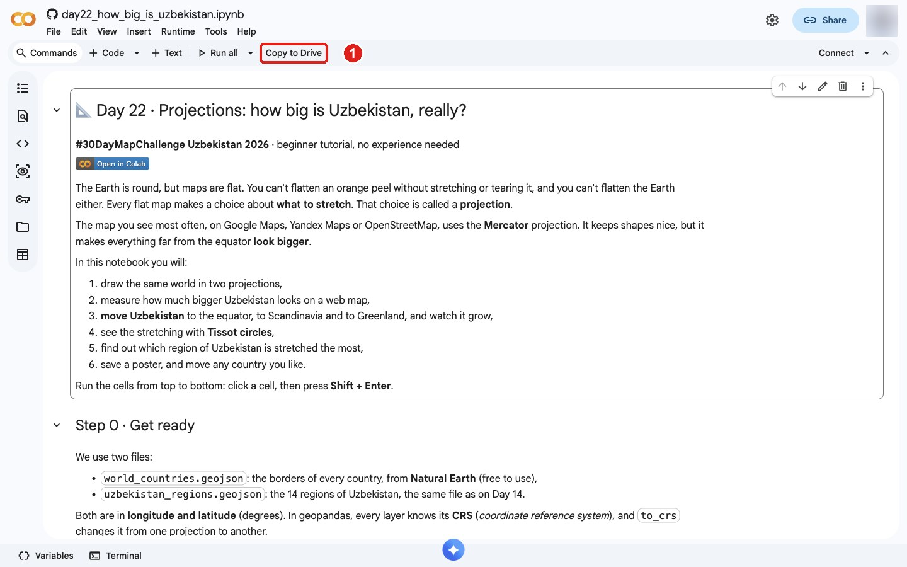

3. Click **Run all** (**1**), then **Run anyway** (**2**).

   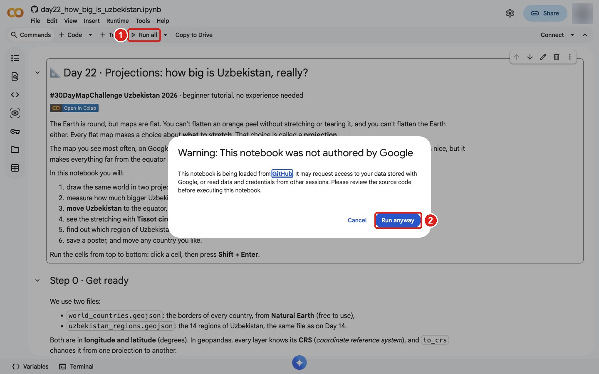

4. Step 0 loads two small files: the borders of 176 countries from **Natural Earth**, and the 14 regions of Uzbekistan. When it says **Ready!** (**1**), everything is loaded. The whole notebook runs in less than a minute.

   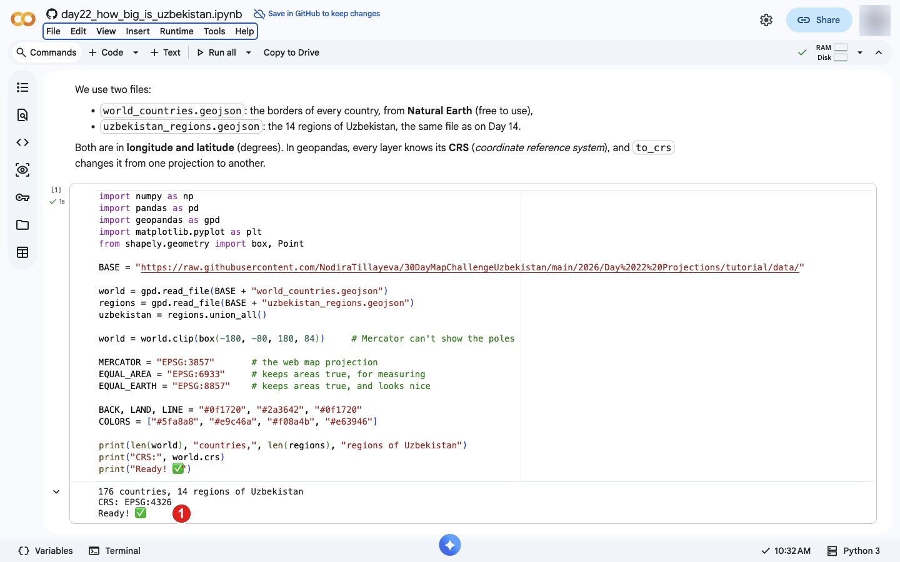

## Part 2. The same world, two ways

Step 1 draws the world twice: in plain longitude and latitude (EPSG:4326), and in **Web Mercator** (EPSG:3857). Uzbekistan is yellow.

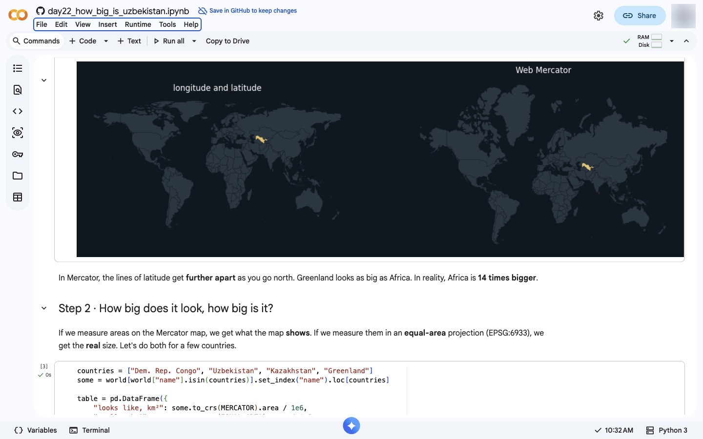

In Mercator, the lines of latitude get **further apart** as you go north, so everything up there is blown up. Greenland looks as big as Africa, but in reality Africa is **14 times bigger**.

## Part 3. How big does it look, how big is it?

Step 2 measures four countries twice: on the Mercator map (what the map **shows**) and in an **equal-area** projection, EPSG:6933 (the **real** size).

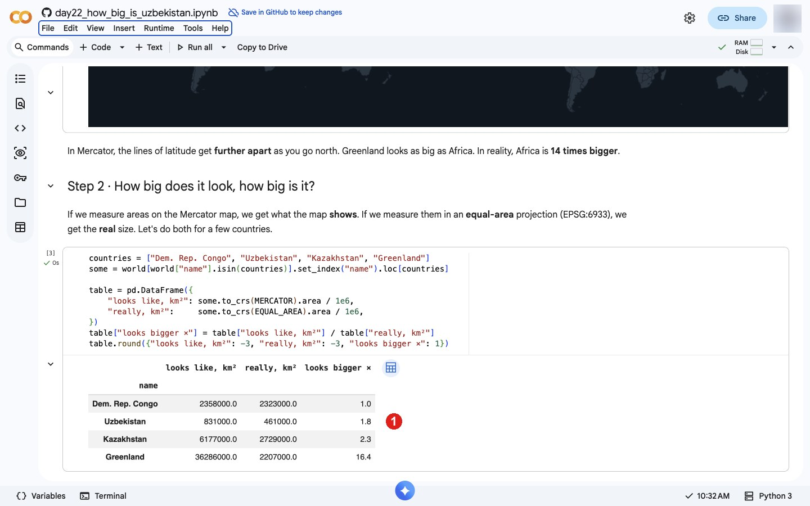

The DR Congo is on the equator, so Mercator shows it at its true size. **Uzbekistan looks 1.8 times bigger** than it is (**1**). Kazakhstan, further north, looks 2.3 times bigger, and Greenland **16 times**.

There's a simple rule behind it: at latitude φ, Mercator makes areas bigger by **1 / cos²(φ)**. The next cell prints it:

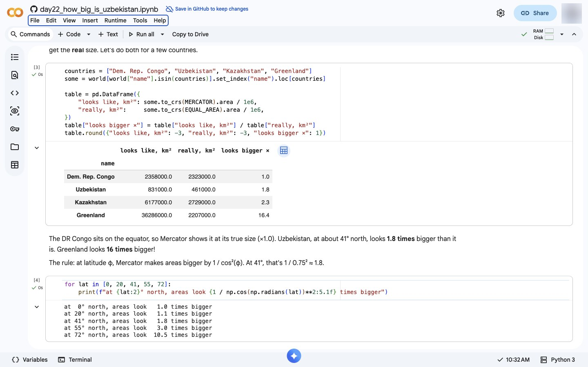

> **Why 461,000 km²?** The official area of Uzbekistan is about 449,000 km². Natural Earth draws simplified borders for the whole world, so its numbers are a few % off. That's fine for comparing, because both columns use the same shape.

## Part 4. Move Uzbekistan

Step 3 is the fun part. `move_to` takes the real outline of Uzbekistan and puts it somewhere else on the Earth, at its true size:

```python
def move_to(shape, lat, lng):
    c = shape.centroid
    here  = f"+proj=laea +lat_0={c.y} +lon_0={c.x} +datum=WGS84"
    there = f"+proj=laea +lat_0={lat} +lon_0={lng} +datum=WGS84"
    flat = gpd.GeoSeries([shape], crs=4326).to_crs(here)
    return flat.set_crs(there, allow_override=True).to_crs(4326).iloc[0]
```

How does it work? **LAEA** (*Lambert azimuthal equal-area*) is a projection centred on one point. First we flatten Uzbekistan around its own centre, so it becomes a shape in metres around (0, 0). Then `set_crs` **pretends** those same metres are around the new point, and `to_crs(4326)` turns them back into longitude and latitude. Same shape, same size, new place.

We make four copies: on the equator in the Congo, at home, in Scandinavia and on Greenland.

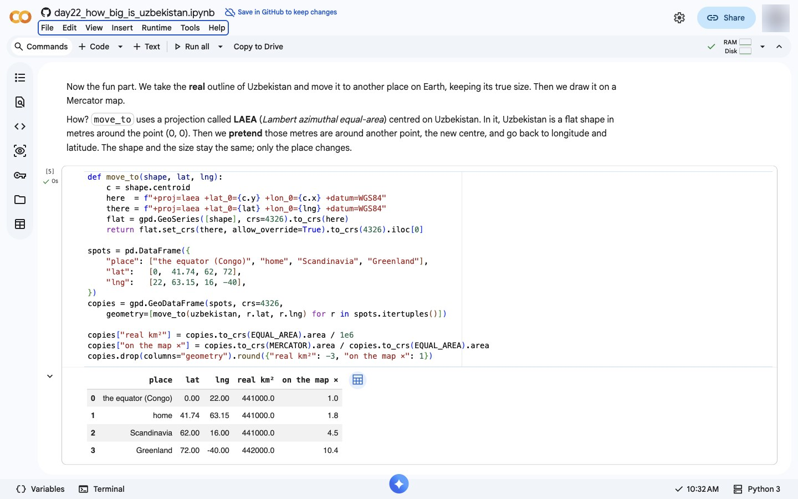

All four are about **441,000 km²** in reality. But on the Mercator map, the copy in Scandinavia looks **4.5 times** bigger, and the copy on Greenland **10.4 times** bigger:

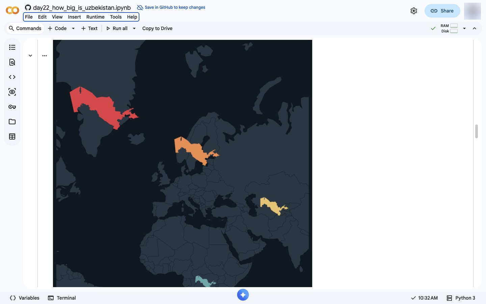

On the equator, Uzbekistan fits inside the Congo. In Scandinavia, it covers Sweden and part of Norway. On Greenland, it's a giant. **Same country, same size. Only the map changed.**

## Part 5. The fair map: equal area

Step 4 draws the same four copies on **Equal Earth** (EPSG:8857), an equal-area projection created in 2018 by Bojan Šavrič, Tom Patterson and Bernhard Jenny.

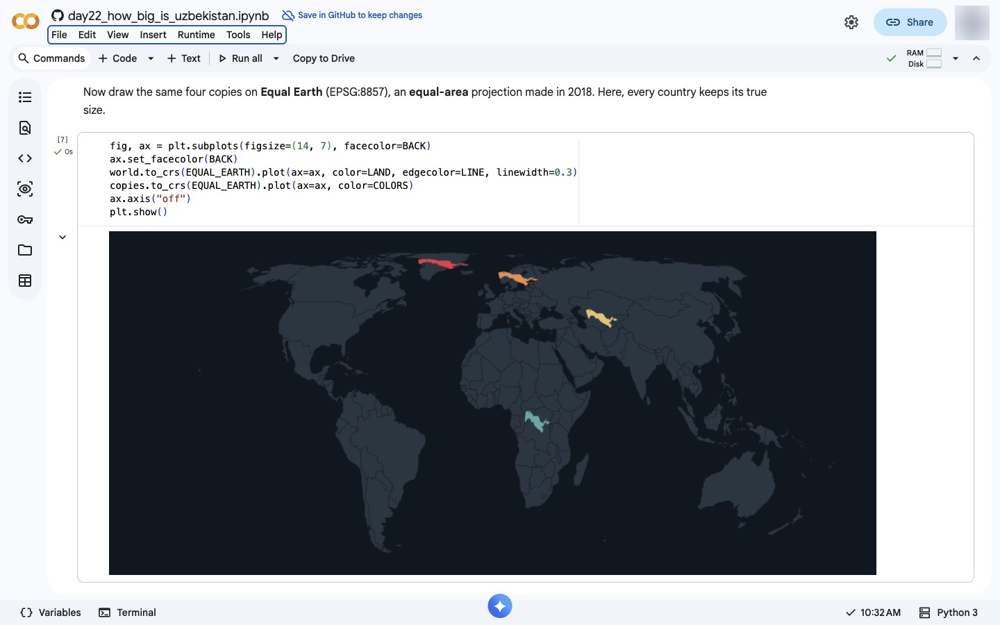

Now all four copies are the same size. But look at the one on Greenland: it's **squashed**. Equal-area projections keep sizes but bend shapes. You always have to choose.

## Part 6. Tissot circles

In the 19th century, the French mathematician **Nicolas Auguste Tissot** found a simple way to see how a map stretches: draw **identical circles** all over the Earth and see what the map does to them. Step 5 draws circles with a radius of 400 km, every 15° of latitude and 30° of longitude. Each circle is made with the same LAEA trick as `move_to`.

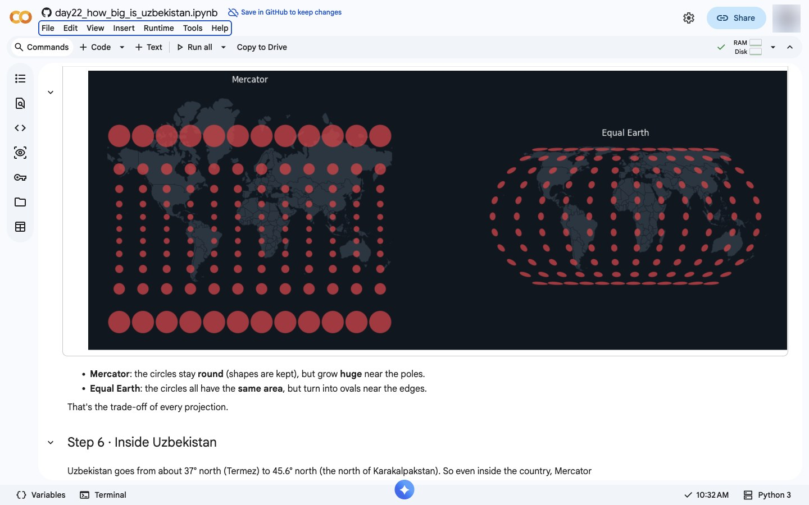

- **Mercator**: the circles stay **round** (shapes are kept), but grow **huge** near the poles.
- **Equal Earth**: all the circles have the **same area**, but they turn into ovals near the edges.

## Part 7. Inside Uzbekistan

Uzbekistan goes from about 37° north (Termez) to 45.6° north (the north of Karakalpakstan). So even inside the country, Mercator stretches some regions more than others. Step 6 measures all 14:

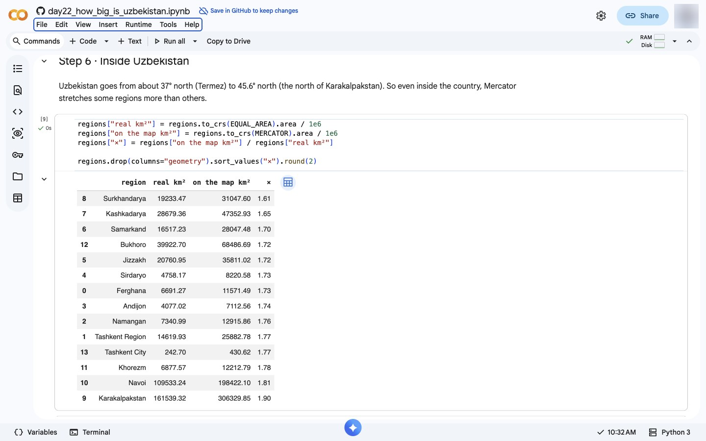

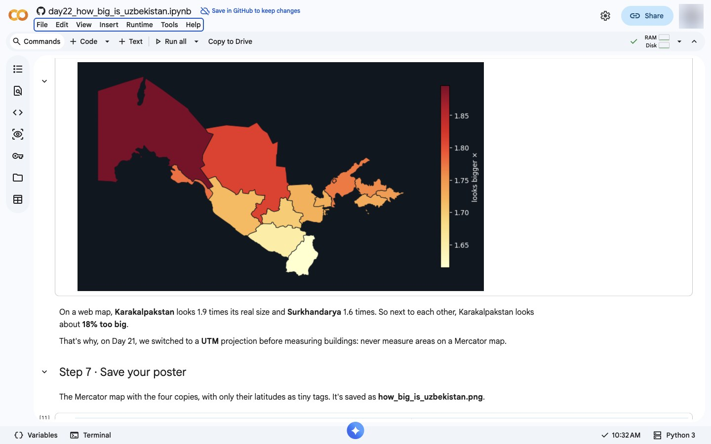

On a web map, **Karakalpakstan** looks **1.9** times its real size and **Surkhandarya 1.6** times. So side by side, Karakalpakstan looks about **18% too big** compared to Surkhandarya.

That's why, on Day 21, we switched to a **UTM** projection before measuring buildings. **Never measure areas on a Mercator map.**

## Part 8. Save your poster

Step 7 draws the Mercator map with the four copies again, with only their latitudes as tiny tags, and downloads **how_big_is_uzbekistan.png**.

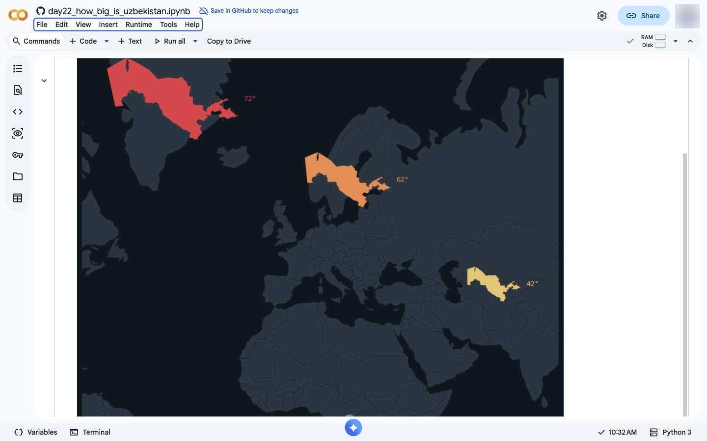

## Part 9. Move anything, anywhere

Step 8 moves any country. By default, it moves **Greenland** to the equator: the grey shape is where Greenland is drawn on the Mercator map, and the red one is its real size.

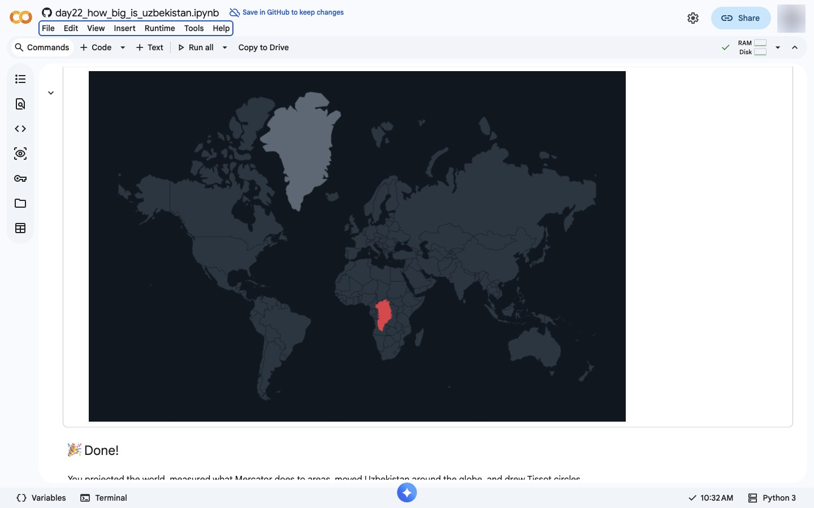

Change `name` and `lat, lng`, and run the cell again. Country names are the English ones from Natural Earth, like `"Kazakhstan"`, `"Russia"` or `"United States of America"`.

## What the data can't tell you

- **Simplified borders.** Natural Earth's world map at this scale is simplified, so country areas are a few % off. For exact areas, use detailed borders, like our regions file.
- **Moved shapes aren't perfect.** LAEA keeps areas exactly, but bends shapes a little far from its centre. A country as big as Uzbekistan barely changes; a country as big as Russia would.
- **Mercator isn't "wrong".** It's the right choice for navigation and for zooming into streets, because it keeps shapes and angles. It's only wrong for **comparing sizes**.

## Try it yourself

- **Go south:** move Uzbekistan to `lat = -60`. Is the south as stretched as the north?
- **Other projections:** in Step 1, change `"EPSG:4326"` to `"ESRI:54030"` (Robinson, used in many school atlases) or `"ESRI:54009"` (Mollweide, equal-area).
- **Bigger circles:** in Step 5, change `400_000` to `800_000`.
- **Your region:** in Step 3, move only Karakalpakstan: `regions[regions["region"] == "Karakalpakstan"].union_all()`.

## Ideas for your own map

- **The true size of Central Asia:** move all five Central Asian countries to the equator together.
- **Uzbekistan everywhere:** a grid of copies of Uzbekistan from 70° south to 80° north, all on one Mercator map.
- **Your favourite projection:** the same map of Uzbekistan in six projections, side by side ([which one says what about you?](https://xkcd.com/977/)).
- **A globe poster:** an orthographic projection centred on Tashkent.

## When you share

Please credit:
> Borders: Natural Earth. Idea inspired by The True Size Of… (thetruesize.com).

## Troubleshooting

| Problem | What to do |
|---|---|
| `HTTP Error` or `URLError` in Step 0 | Colab couldn't reach GitHub. Wait a minute and run the cell again. |
| `CRSError: Invalid projection` | Check the spelling of the EPSG code, like `"EPSG:3857"` with a colon. |
| `KeyError` or an empty map in Step 8 | The country name isn't in Natural Earth. Print `sorted(world["name"])` to see all the names. |
| The moved copy is split into two pieces | You moved it across the 180° line, where the map wraps around. Choose a `lng` a bit further from 180. |
| The file doesn't download | Your browser blocked it. Allow downloads for colab.research.google.com, or find **how_big_is_uzbekistan.png** in the **Files** panel on the left. |

## Credits

- **Country borders:** [Natural Earth](https://www.naturalearthdata.com), 1:110m Admin 0 Countries, public domain.
- **Region borders:** the same file as in Day 14.
- **Equal Earth:** Šavrič, B., Patterson, T., Jenny, B. (2019). *The Equal Earth map projection.* International Journal of Geographical Information Science, 33(3), 454–465.
- **Idea:** [The True Size Of…](https://www.thetruesize.com) by James Talmage and Damon Maneice.
- **Software:** [geopandas](https://geopandas.org), [pyproj](https://pyproj4.github.io/pyproj), [shapely](https://shapely.readthedocs.io), [pandas](https://pandas.pydata.org), [numpy](https://numpy.org), [matplotlib](https://matplotlib.org), [Google Colab](https://colab.research.google.com).
