# Day 23 tutorial: the water Tashkent drinks, seen from space

**Theme: Senses: Taste.** *Food, drink or something else which you can taste.* High in the mountains, 70 km from Tashkent, the **Pskem** and **Chatkal** rivers meet in the **Charvak reservoir**. The water that leaves it becomes the **Chirchik** river, and much of Tashkent's tap water comes from the Chirchik. You can't taste water from space, but a satellite can see one thing that changes how water looks and tastes: **mud**. Today you use **Sentinel-2** pictures to find the water, measure its area, measure how muddy it is, find out where the mud comes from, and follow the reservoir from spring to autumn. You work in **Google Colab** with the **Microsoft Planetary Computer**. No account and no installs are needed. It takes about 25 minutes.

📄 **Printable PDF:** [English](pdf/Day23_Tutorial_EN.pdf) · [Русский](pdf/Day23_Tutorial_RU.pdf) · [Oʻzbekcha](pdf/Day23_Tutorial_UZ.pdf)

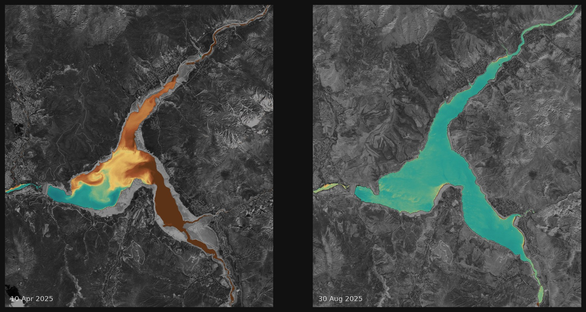

**What you'll learn**
- How to find clear days in a satellite archive, and make sure the picture covers your whole place.
- How to find water with a **water index** (MNDWI) and measure its area in km².
- How to measure how muddy water is from its **red reflectance**.
- How to load many days at once and follow a lake through the seasons.

## Part 0. Three ideas before you start

1. **Reflectance.** A satellite measures how much sunlight each place sends back, in different colours (**bands**). 0 means black, 1 means white. Sentinel-2 has 13 bands: blue, green and red like our eyes, plus infrared that we can't see.
2. **Water absorbs infrared.** Water swallows almost all **short-wave infrared** light, but sends back a little green light. Land does the opposite. That's how we find water.
3. **Mud is bright.** Clean water is dark. Tiny bits of soil floating in the water (**turbidity**) send back much more light, especially red light. That's why muddy rivers look brown.

## Part 1. Open the notebook and run it

1. Click this button: [](https://colab.research.google.com/github/NodiraTillayeva/30DayMapChallengeUzbekistan/blob/main/2026/Day%2023%20Senses%20Taste/tutorial/day23_charvak_water.ipynb)
2. Sign in with your Google account and click **Copy to Drive** (**1**), so your changes are saved.

   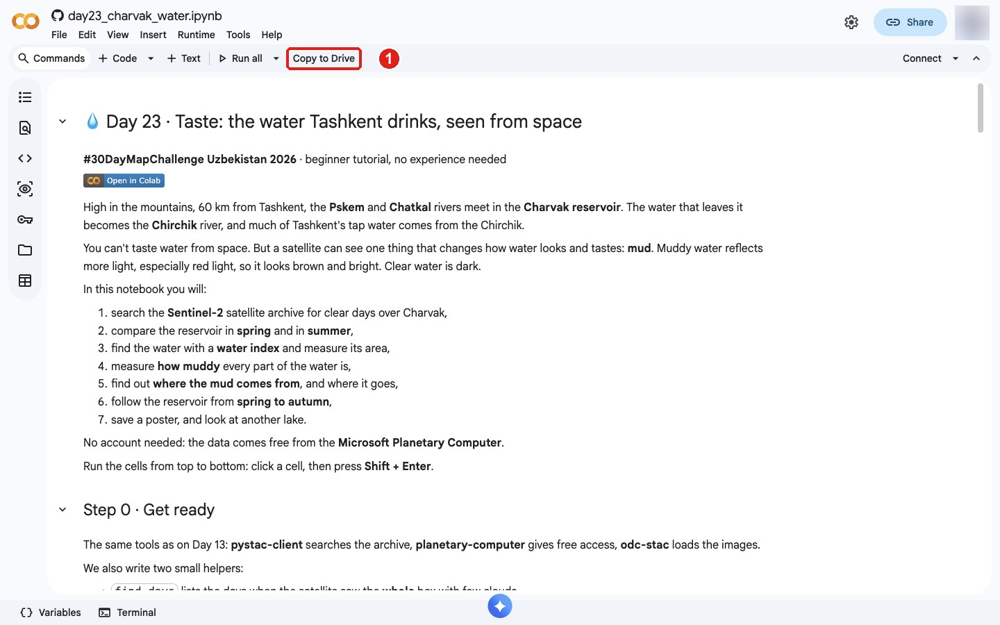

3. Click **Run all** (**1**), then **Run anyway** (**2**). The whole notebook takes about 3 minutes.

   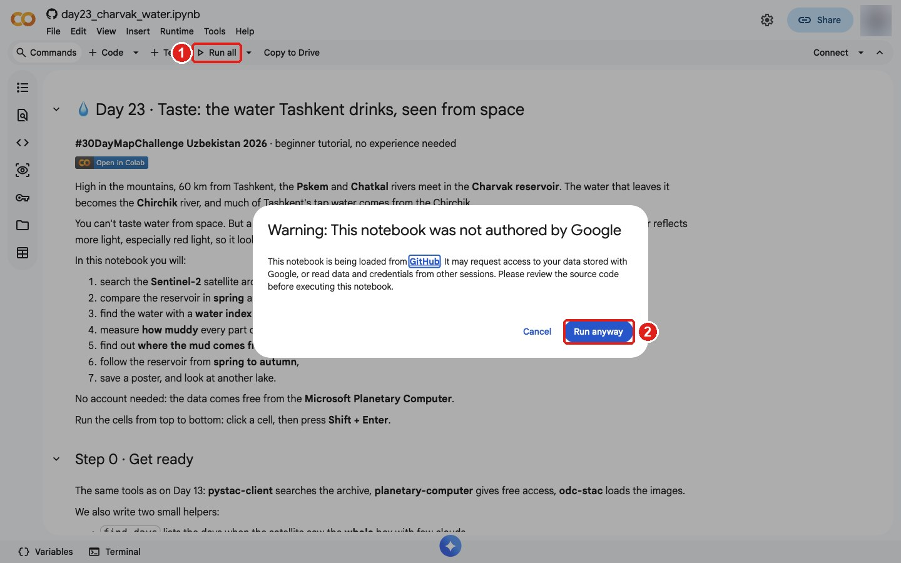

4. Step 0 installs three tools (the same ones as on Day 13) and writes two helpers: `find_days` and `load_day`. When it says **Ready!** (**1**), everything is loaded.

   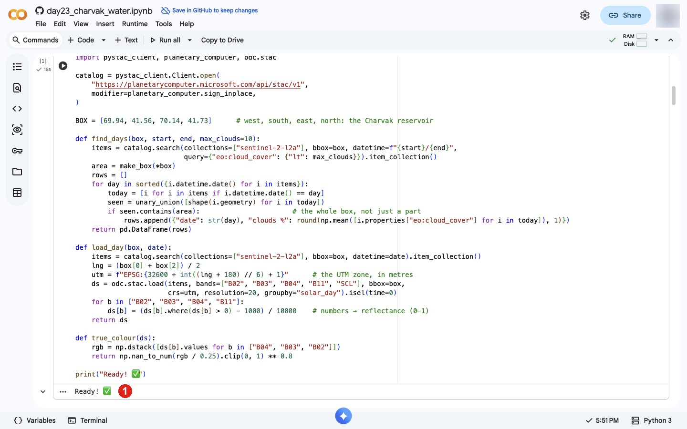

`BOX = [69.94, 41.56, 70.14, 41.73]` is the box around Charvak: west, south, east and north, in degrees.

## Part 2. Find the clear days

Sentinel-2 is a pair of European satellites that photograph every place on Earth about every 5 days. But on many days there are clouds, and on some days the picture covers only part of our box. `find_days` keeps only the days with **less than 10% clouds** that cover the **whole box**:

```python
seen = unary_union([shape(i.geometry) for i in today])
if seen.contains(area):
```

Each picture (`item`) knows the outline of the ground it covers. We join the outlines of all the pictures from one day and check that they contain our box.

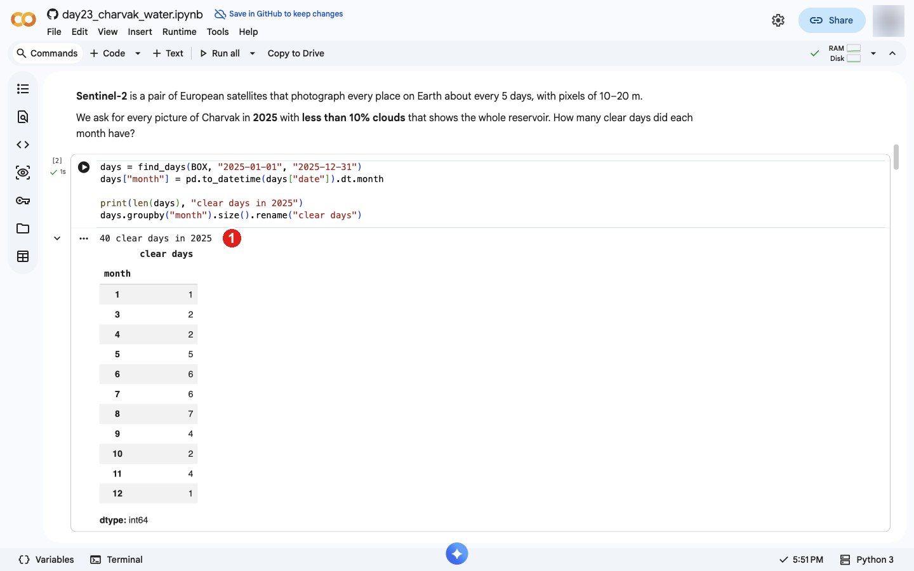

2025 had **40 clear days** (**1**). Summer has the most; February has none.

## Part 3. Spring and summer

Step 2 loads **10 April** and **30 August 2025** and shows them in true colour.

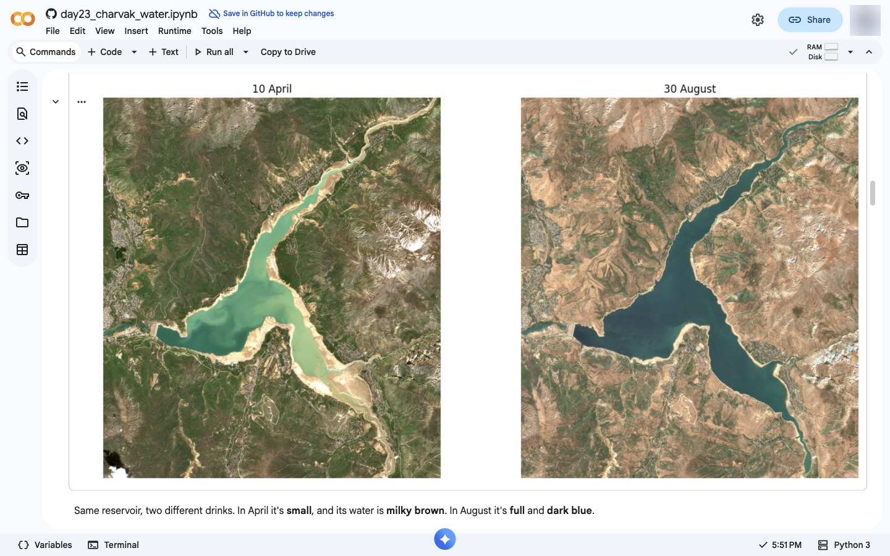

Same reservoir, two different drinks. In April, it's small, and its water is milky brown. In August, it's full and dark blue.

## Part 4. Find the water

Step 3 uses the **water index MNDWI**:

```python
mndwi = (green - swir) / (green + swir)
return (mndwi > 0.1) & (green < 0.25) & ~ds["SCL"].isin([3, 8, 9, 10])
```

Water is above 0. Snow is above 0 too, but it's very bright, so we also ask for `green < 0.25`. `SCL` is a map that comes with every picture; classes 3, 8, 9 and 10 are cloud shadows and clouds.

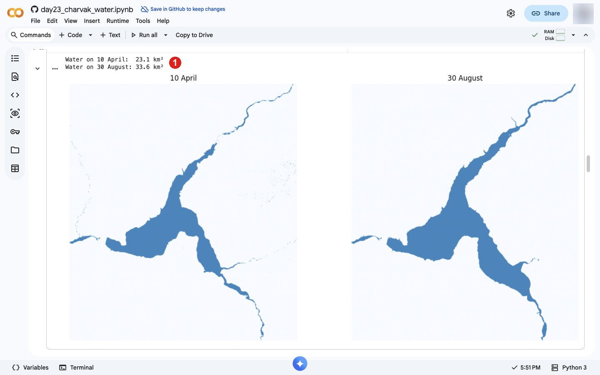

Each pixel is 20 m × 20 m = 400 m², so counting the pixels gives the area: **23.1 km²** on 10 April and **33.6 km²** on 30 August (**1**). Over winter, water is let out to make electricity and to keep the Chirchik flowing. In May and June, melting snow fills the reservoir again.

## Part 5. How muddy is the water?

Step 4 uses the **red reflectance of the water**, in %, as a simple **mud index**: under 3% is clear, 3–6% a bit cloudy, over 6% muddy.

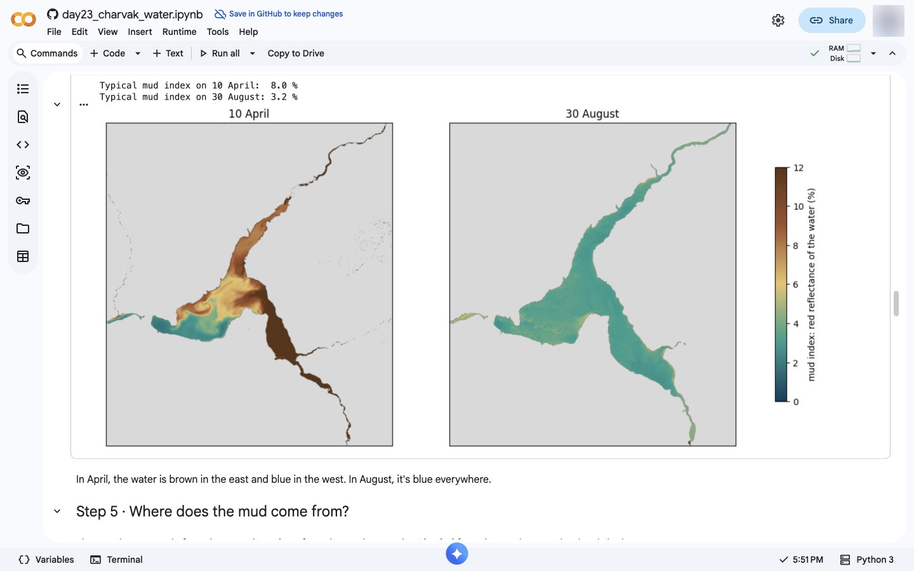

In April, the water is brown in the east and blue in the west. In August, it's blue everywhere.

## Part 6. Where does the mud come from?

Step 5 measures the mud index at three places:

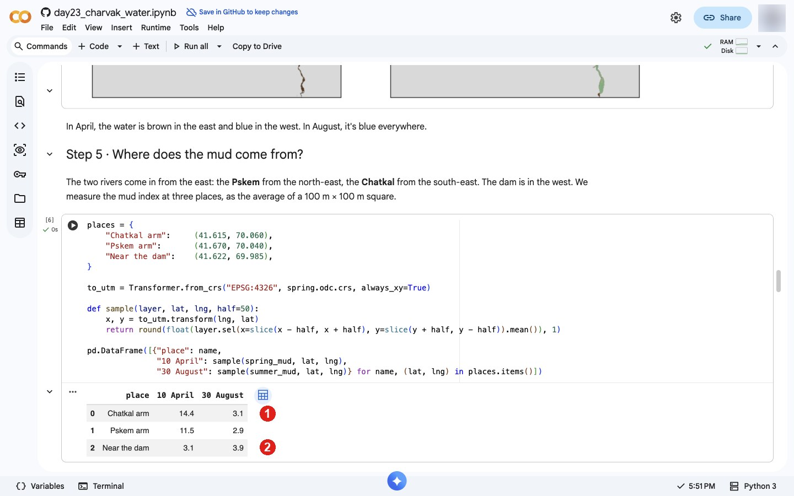

In April, the **Chatkal** arm is the muddiest, at **14.4%** (**1**), and the Pskem arm has 11.5%. But **near the dam**, it's only **3.1%** (**2**), as clear as in summer. The reservoir works like a **settling tank**: the water slows down, and the mud sinks to the bottom before it reaches the dam.

Why April? Most likely because spring is the rainy season, and the first snow melts on the lower slopes: water runs over bare soil and carries it into the rivers.

## Part 7. From spring to autumn

If we took only the clearest day of each month, for April we would get 25 April, and by then the mud had already settled. So Step 6 loads **every clear day** from April to November 2025 at once. It uses bigger pixels (40 m) and loads the days **in parallel**:

```python
cube = odc.stac.load(items, ..., resolution=40, groupby="solar_day", chunks={})
cube = cube.compute()
```

`chunks={}` means "don't load yet, just plan". `.compute()` then loads everything, many pieces at the same time. Days with more than 5% clouds are left out, because a cloud over the lake would hide some of the water. That leaves 32 days. The first is our muddy 10 April (**1**).

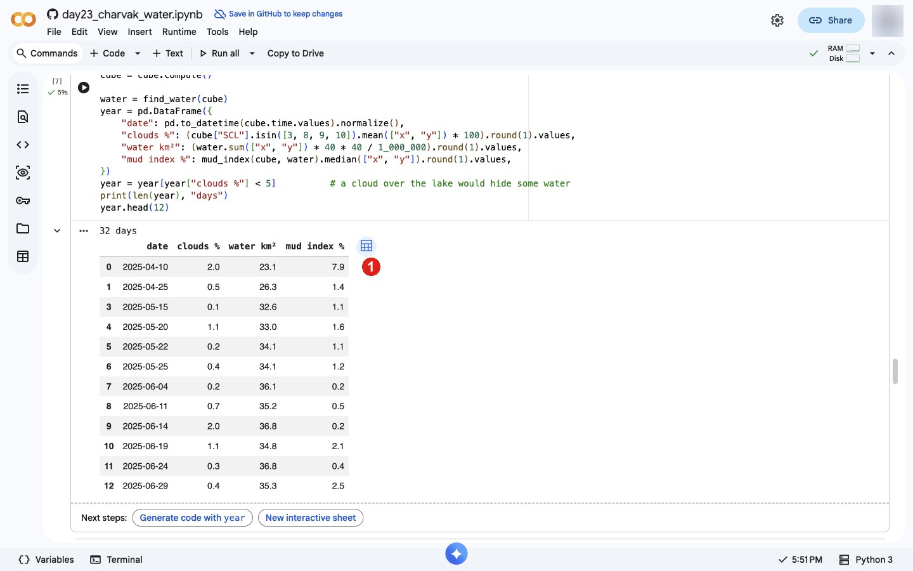

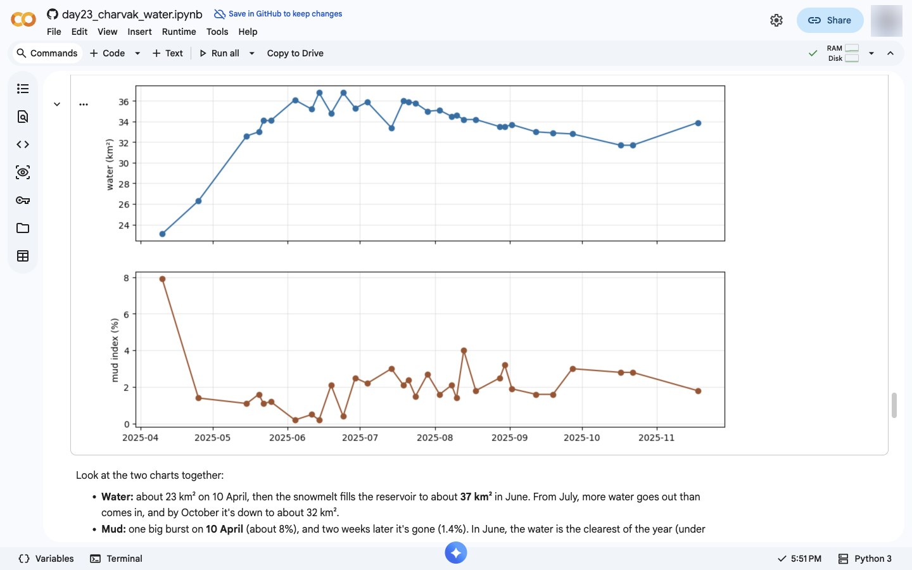

- **Water:** about 23 km² on 10 April, then the snowmelt fills the reservoir to about **37 km²** in June. From July, more water goes out than comes in, and by October it's down to about 32 km².
- **Mud:** one big burst on **10 April** (about 8%), and two weeks later it's gone (1.4%). In June, the water is the clearest of the year (under 1%). In summer and autumn it stays low, 1.5–3%.

So if you want to *see* the taste of spring, you have to catch the right day.

## Part 8. Save your poster

Step 7 draws both days again: the land in grey, the water coloured by the mud index, with only tiny dates. It downloads **charvak_water.png**.

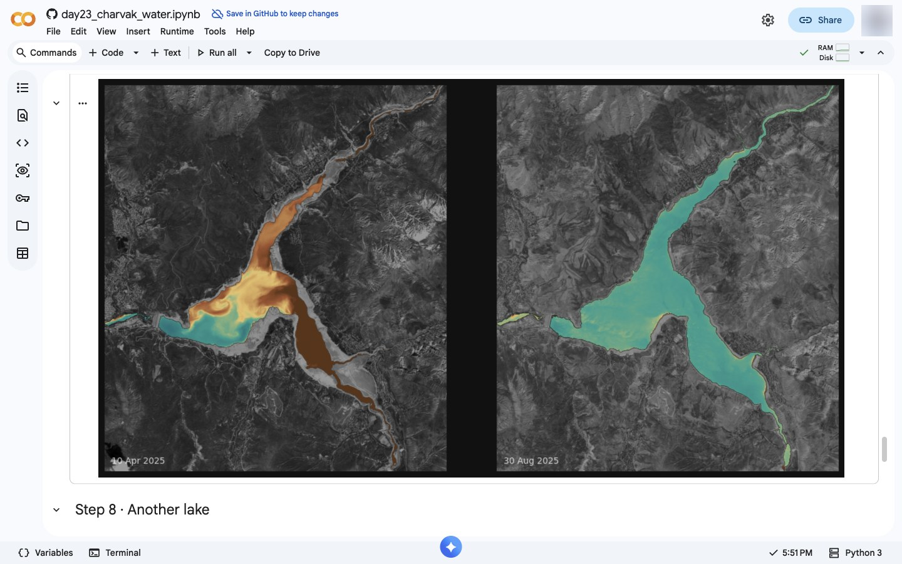

## Part 9. Another lake

Step 8 does the same for any lake. By default, it compares April and August at **Tuyabuguz**, the "Tashkent Sea", south of Tashkent. Change `lake` to another one from the list, or change `months`.

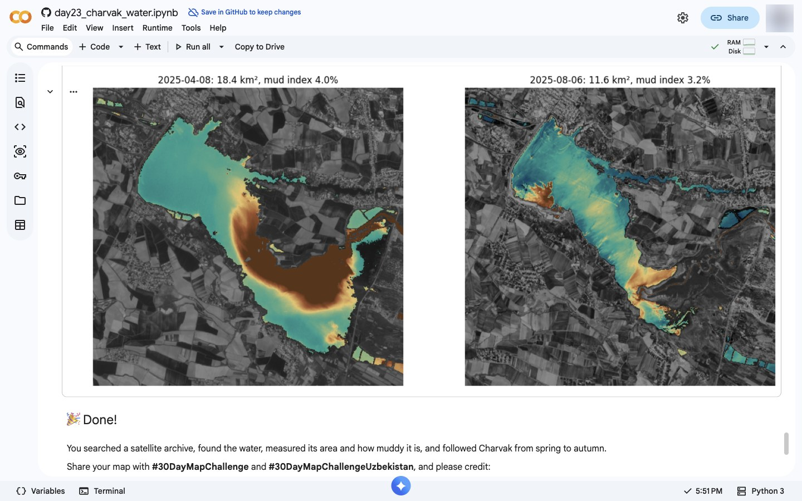

Tuyabuguz is shallow, and it behaves very differently from Charvak: in April it's muddy along its eastern side, and by August it has **shrunk** from 18.4 to 11.6 km², because its water goes to the fields in summer.

## What the data can't tell you

- **A satellite can't taste.** It can't see salt, chlorine, minerals or bacteria. The mud index only tells you how much light the water sends back. Tap water is cleaned at a treatment plant before it reaches you.
- **Only the surface.** Sentinel-2 sees only the top layer of the water. The bottom of a deep reservoir can be muddier.
- **The mud index isn't a lab measurement.** Scientists measure turbidity in NTU, with a sample of water. To turn our % into NTU, you need measurements from the same lake on the same days.
- **Other things can look like mud.** Algae (green), a shallow sandy bottom, sun glint on waves and thin clouds can all make water brighter.

## Try it yourself

- **Another year:** change `2025` to `2024` in Step 1 and in Step 6 (twice in the same line). Was April muddy that year too? (Use years from 2022: older pictures use different numbers.)
- **Another muddy day:** in Step 2, try `"2025-04-30"`. Is the mud back?
- **Your own place:** add a point near the Chirchik river below the dam to `places` in Step 5.
- **Your own lake:** draw a box around it on [bboxfinder.com](http://bboxfinder.com), copy the four numbers (west, south, east, north) and add it to `LAKES` in Step 8.

## Ideas for your own map

- **Charvak, every clear day:** a grid of small mud maps, one for each of the 32 days.
- **The Chirchik from the mountains to Tashkent:** the mud index along the whole river.
- **Lakes of Uzbekistan:** a table and a map of every reservoir in the list, April against August.
- **Before and after the rain:** find a big spring storm and map the reservoir before and after it.

## When you share

Please credit:
> Contains modified Copernicus Sentinel-2 data (2025), accessed through the Microsoft Planetary Computer.

## Troubleshooting

| Problem | What to do |
|---|---|
| `APIError` or `timed out` while searching | The Planetary Computer is busy. Wait a minute and run the cell again. |
| Step 6 is slow | It loads 30+ pictures. In Colab, it usually takes 1–3 minutes. Don't click anything until it's done. |
| `no clear day 😶` in Step 8 | That month had no picture with less than 10% clouds. Choose another month, or use `find_days(box, start, end, max_clouds=30)`. |
| The water area is much too big in winter | Snow and ice confuse the water index. Use pictures from April to November. |
| The file doesn't download | Your browser blocked it. Allow downloads for colab.research.google.com, or find **charvak_water.png** in the **Files** panel on the left. |

## Credits

- **Satellite pictures:** Copernicus Sentinel-2 Level-2A (2025), European Space Agency, accessed through the [Microsoft Planetary Computer](https://planetarycomputer.microsoft.com).
- **Water index:** Xu, H. (2006). *Modification of normalised difference water index (NDWI) to enhance open water features in remotely sensed imagery.* International Journal of Remote Sensing, 27(14), 3025–3033.
- **Turbidity from red reflectance:** Nechad, B., Ruddick, K. G., Park, Y. (2010). *Calibration and validation of a generic multisensor algorithm for mapping of total suspended matter in turbid waters.* Remote Sensing of Environment, 114(4), 854–866.
- **Software:** [pystac-client](https://pystac-client.readthedocs.io), [odc-stac](https://odc-stac.readthedocs.io), [xarray](https://xarray.dev), [shapely](https://shapely.readthedocs.io), [pandas](https://pandas.pydata.org), [numpy](https://numpy.org), [matplotlib](https://matplotlib.org), [Google Colab](https://colab.research.google.com).
