# Day 24 tutorial: where does a raindrop go?

**Theme: Network.** *Route network, transit network, human network or something completely different.* Rivers are a network: every stream flows into a bigger one, all the way to the end. Today you download **HydroRIVERS**, a map of every river on Earth, turn the rivers of Central Asia into a **network** with **networkx**, follow raindrops **downstream** from six places, go **upstream** to draw the basin of the Chirchik, and find out which countries the water of the Amu Darya and the Syr Darya comes from. You work in **Google Colab**. No account and no installs are needed. It takes about 20 minutes.

📄 **Printable PDF:** [English](pdf/Day24_Tutorial_EN.pdf) · [Русский](pdf/Day24_Tutorial_RU.pdf) · [Oʻzbekcha](pdf/Day24_Tutorial_UZ.pdf)

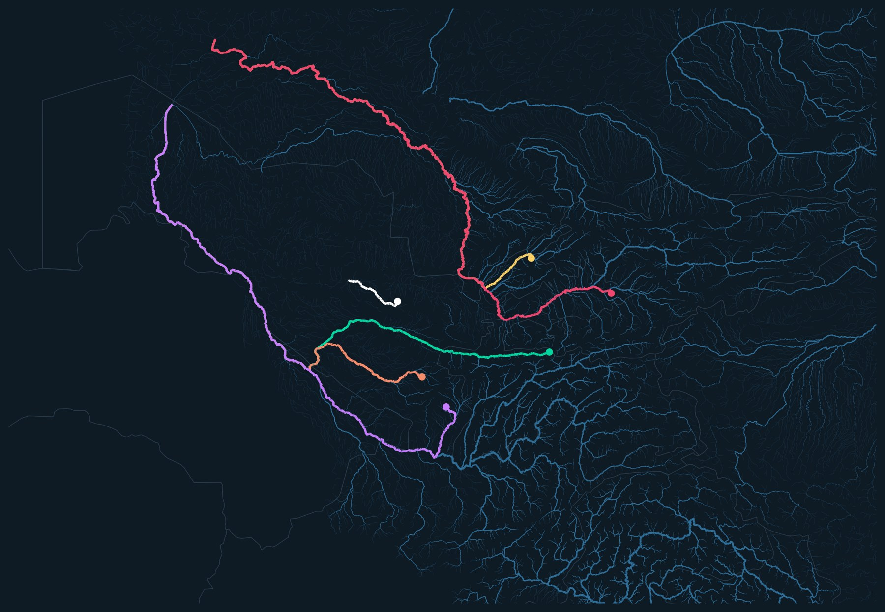

**What you'll learn**
- What a **network** (graph) is: nodes, edges and directions.
- How to build a network from a table with **networkx**.
- How to walk a network **downstream** (successors) and **upstream** (ancestors).
- How to add up values along a network, by country.

## Part 0. Three ideas before you start

1. **A network.** A network (or **graph**) is made of **nodes** (things) and **edges** (connections between them). Metro stations and the lines between them, friends and friendships, river pieces and "flows into".
2. **A directed network.** In a river network, every edge has a **direction**: water flows only downhill. Each piece flows into at most one piece, but many pieces can flow into one. This kind of network is called a **tree**.
3. **A basin.** All the land whose water ends up in one place is that place's **basin** (or catchment). A drop that falls anywhere in it will, sooner or later, flow past that place.

## Part 1. Open the notebook and run it

1. Click this button: [](https://colab.research.google.com/github/NodiraTillayeva/30DayMapChallengeUzbekistan/blob/main/2026/Day%2024%20Network/tutorial/day24_where_does_a_raindrop_go.ipynb)
2. Sign in with your Google account and click **Copy to Drive** (**1**), so your changes are saved.

   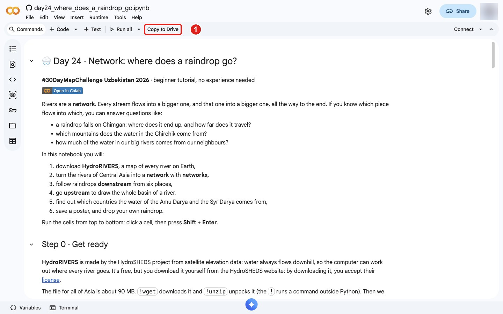

3. Click **Run all** (**1**), then **Run anyway** (**2**). The whole notebook takes about a minute.

   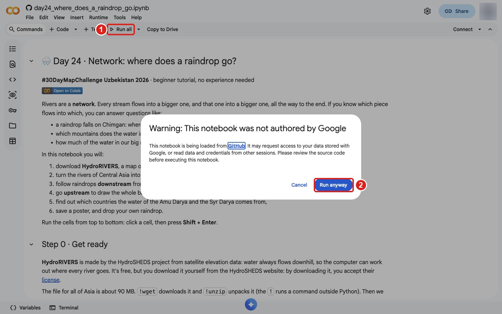

4. Step 0 downloads HydroRIVERS for Asia (90 MB) with `!wget`, unpacks it with `!unzip`, and reads only Central Asia. When it says **39551 river pieces. Ready!** (**1**), everything is loaded.

   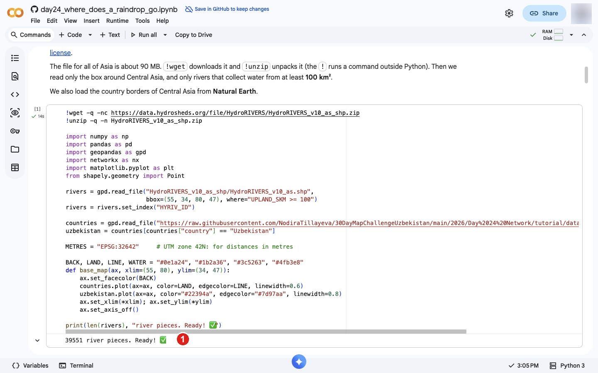

> **Why don't we keep a copy of the rivers in this repository?** HydroRIVERS is free, but its license doesn't allow sharing the data on its own. So you download it yourself from the HydroSHEDS website, and by doing that you accept [their license](https://www.hydrosheds.org/products/hydrorivers).

We read only the box from 55° to 80° east and 34° to 47° north, and only rivers that collect water from at least **100 km²**:

```python
rivers = gpd.read_file("HydroRIVERS_v10_as_shp/HydroRIVERS_v10_as.shp",
                       bbox=(55, 34, 80, 47), where="UPLAND_SKM >= 100")
```

## Part 2. Look at the rivers

Each row is one **piece** of river, a few km long. Step 1 shows the 5 pieces with the most water:

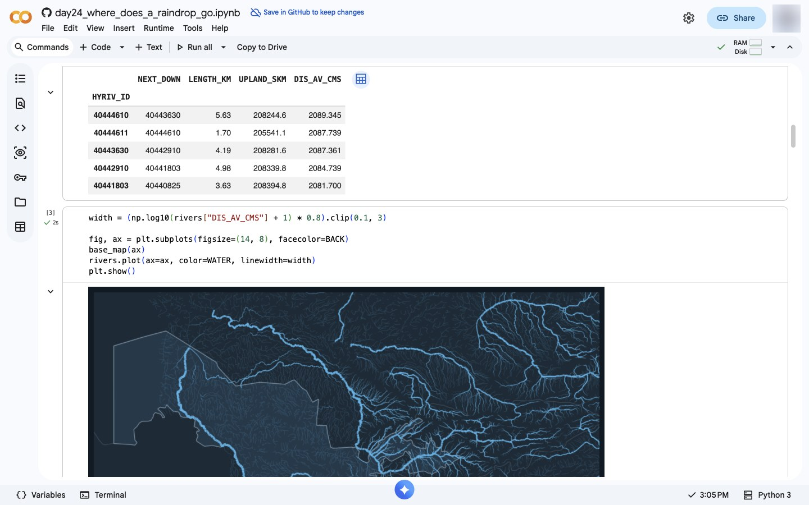

- `NEXT_DOWN`: the ID of the piece this one flows into (0 = the river ends here). **This column is the whole network.**
- `LENGTH_KM`: the length of the piece.
- `UPLAND_SKM`: how much land drains into it, in km².
- `DIS_AV_CMS`: how much water flows in it on average, in m³ per second.

The next cell draws all of them, with thicker lines for more water:

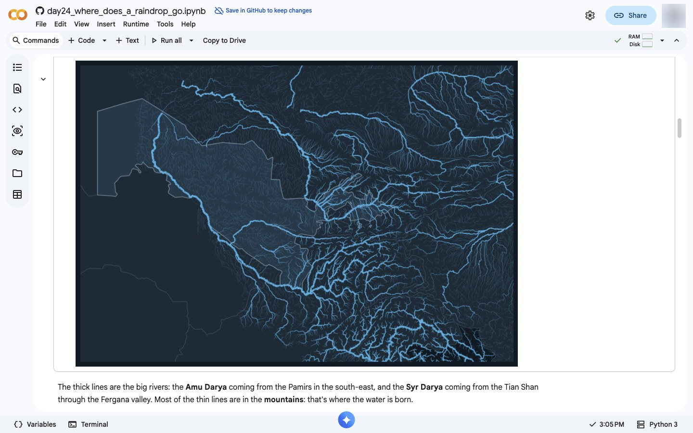

The thick lines are the **Amu Darya**, coming from the Pamirs, and the **Syr Darya**, coming from the Tian Shan through the Fergana valley. The thin lines crowd in the **mountains**: that's where the water is born.

## Part 3. Rivers as a network

Step 2 builds the network:

```python
G = nx.DiGraph()
G.add_nodes_from(rivers.index)
G.add_edges_from((piece, down) for piece, down in rivers["NEXT_DOWN"].items() if down in rivers.index)
```

`DiGraph` means a **directed** graph: every edge is an arrow from a piece to the piece it flows into.

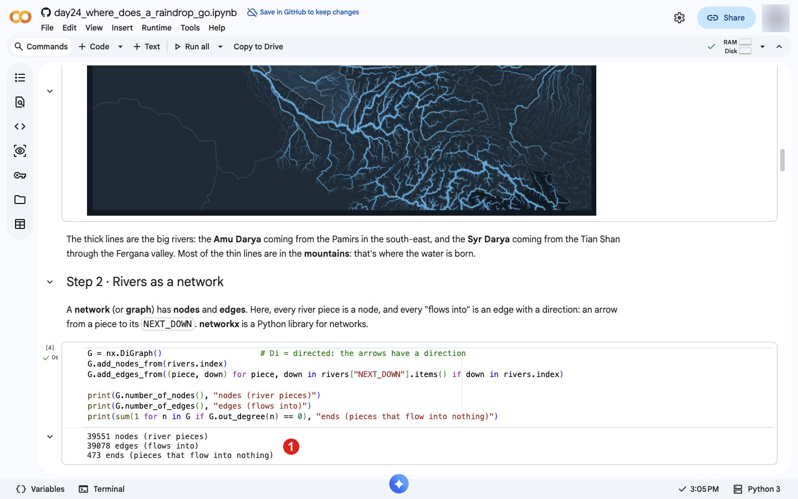

**39,551** nodes, **39,078** edges, and **473** ends (**1**). Some ends are real: a river runs into a lake or disappears in the desert. Others are only at the edge of our box.

## Part 4. A raindrop on Chimgan

Step 3 drops a raindrop on Chimgan, finds the nearest river piece, and follows the arrows:

```python
def downstream(lat, lng):
    start = nearest_piece(lat, lng)
    return list(nx.dfs_preorder_nodes(G, start))
```

`nx.dfs_preorder_nodes` walks along the arrows from the start. In a river network there's only one way down, so the walk is exactly the raindrop's path.

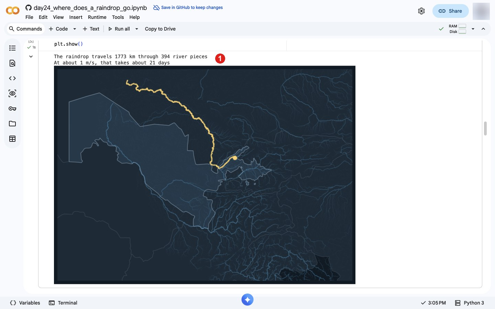

The raindrop travels **1,773 km** (**1**): into the **Chirchik**, past Tashkent into the **Syr Darya**, through Kazakhstan, and to the end of the Syr Darya. If the water moved at about 1 m/s, the trip would take about three weeks.

## Part 5. A raindrop race

Step 4 drops six raindrops:

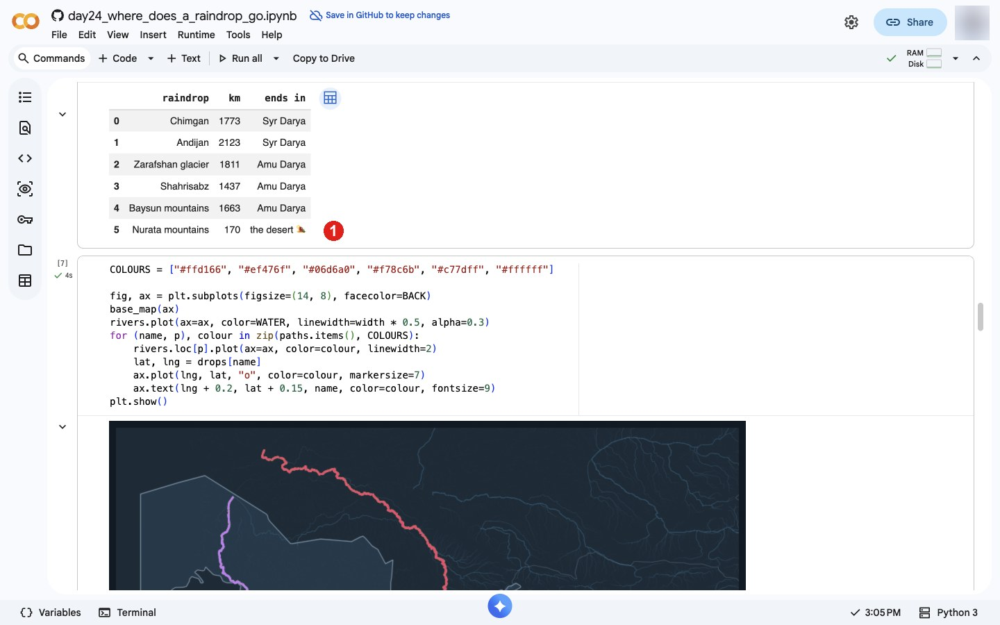

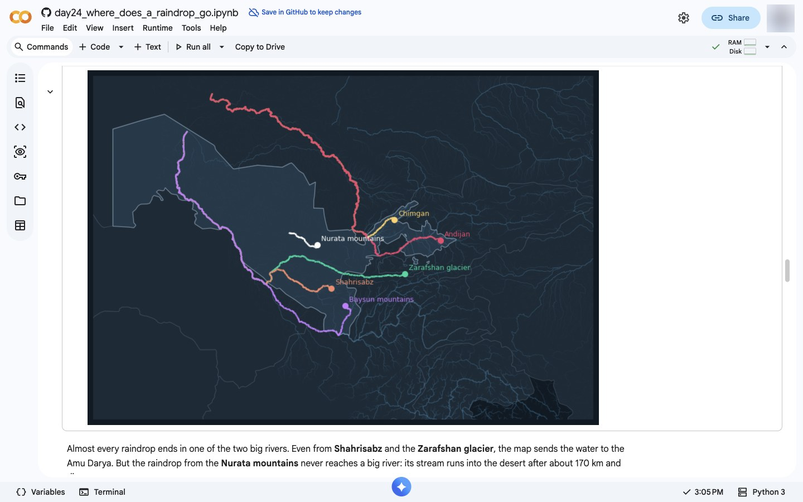

From **Andijan**, a raindrop travels the farthest: 2,123 km, through the whole Fergana valley. From the **Zarafshan glacier**, the river takes it past Samarkand and Bukhara to the Amu Darya. But the raindrop from the **Nurata mountains** never reaches a big river: its stream runs into the desert after **170 km** (**1**).

> ⚠️ **This is the natural network.** HydroRIVERS shows where water would flow **downhill**, as if there were no people. In reality, the Zarafshan and the Kashkadarya are almost all taken into canals and fields, and they don't reach the Amu Darya any more.

## Part 6. Go upstream: the basin of the Chirchik

Step 5 goes the other way. `nx.ancestors(G, piece)` gives **every** piece that flows into a piece, however far away.

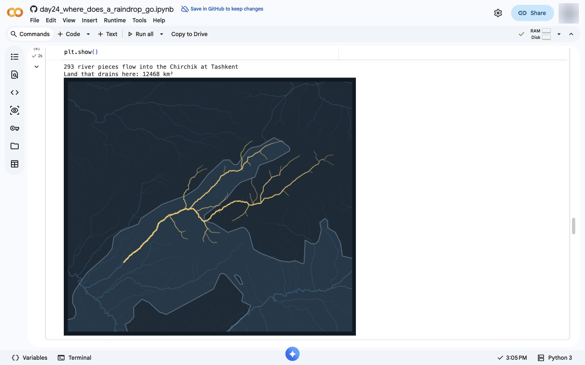

**293** river pieces flow into the Chirchik at Tashkent, collecting water from about **12,500 km²** of mountains: the Pskem and the Ugam in the north, and the Chatkal in the east, which starts in **Kyrgyzstan**. Charvak, from Day 23, is where they meet.

## Part 7. Whose water is it?

The water in a river piece is the water from upstream plus the water from its own little piece of land. So for each piece, Step 6 calculates:

**local water = its own flow − the flow of the pieces that flow into it**

```python
from_upstream = pd.Series({p: sum(flow[q] for q in G.predecessors(p)) for p in rivers.index})
rivers["local"] = (flow - from_upstream).clip(lower=0)
```

Then it finds which country the middle of each piece is in (a **spatial join**) and adds up the local water by country.

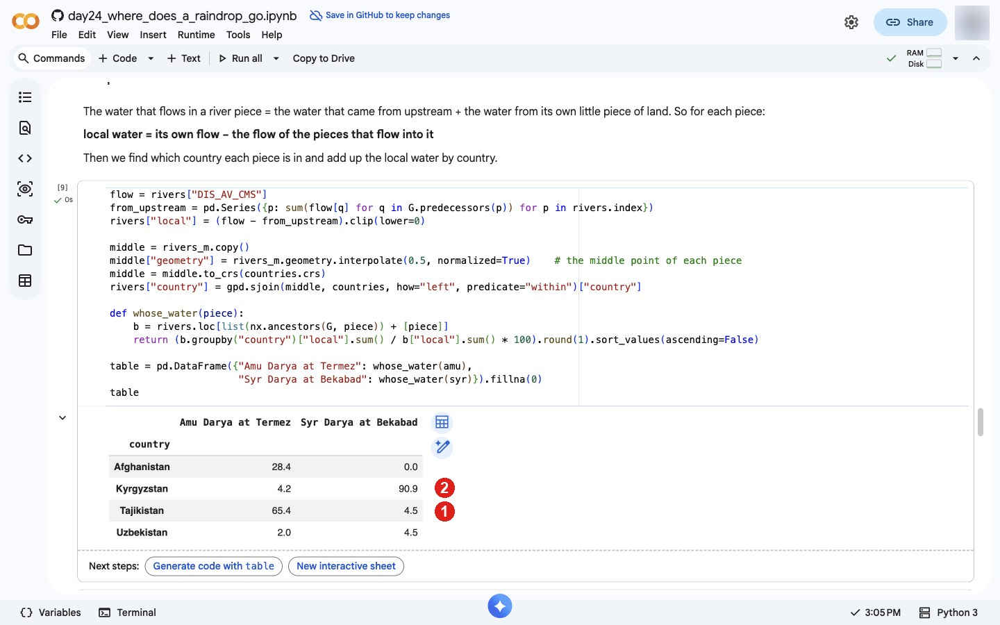

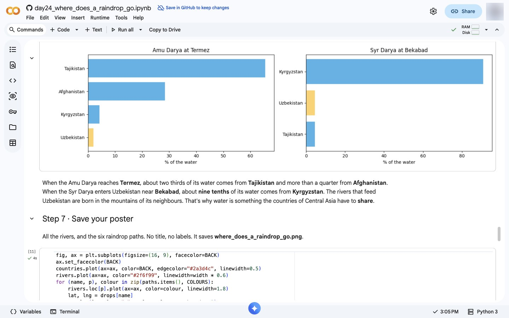

When the Amu Darya reaches **Termez**, about **two thirds** of its water comes from **Tajikistan** (**1**) and more than a quarter from **Afghanistan**. When the Syr Darya enters Uzbekistan near **Bekabad**, about **nine tenths** of its water comes from **Kyrgyzstan** (**2**). The rivers that feed Uzbekistan are born in the mountains of its neighbours. That's why the countries of Central Asia have to **share** their water.

## Part 8. Save your poster

Step 7 draws all the rivers and the six raindrop paths, with no title and no labels, and downloads **where_does_a_raindrop_go.png**.

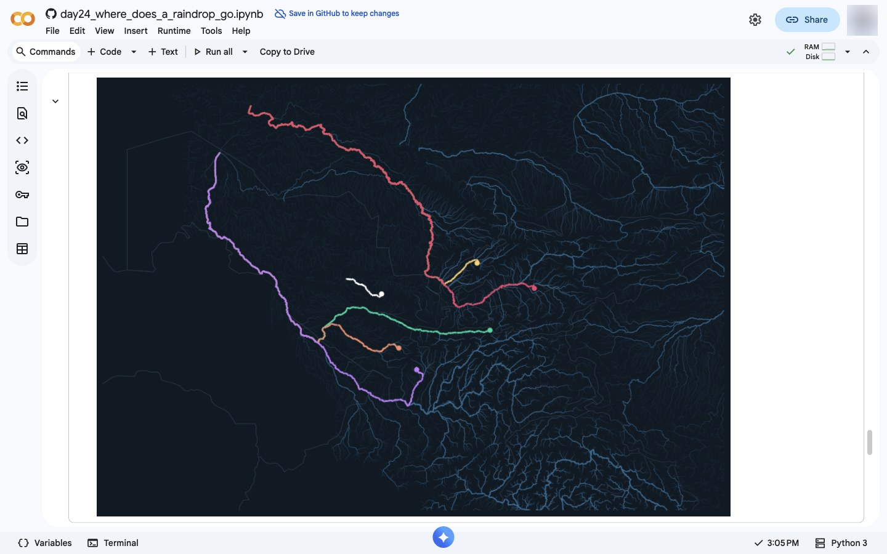

## Part 9. Your own raindrop

Step 8 drops a raindrop wherever you like. Change `lat, lng` to your town or school: on [openstreetmap.org](https://www.openstreetmap.org), right-click the place and choose **Show address** to see its coordinates. By default, it's Samarkand: the nearest river is 3 km away, and the raindrop travels 1,434 km to the Amu Darya.

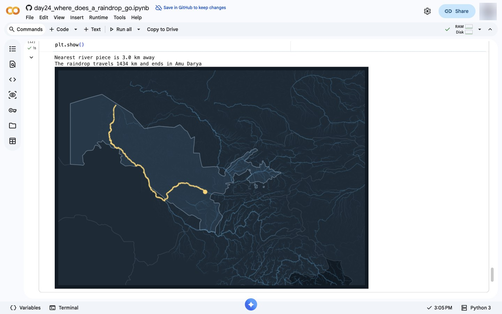

## What the data can't tell you

- **No canals, no dams.** HydroRIVERS is made from elevation data: it knows where water flows downhill, but not where people send it. The Great Fergana Canal, the Amu-Bukhara canal and thousands of small canals aren't in it.
- **Modelled water, not measured.** `DIS_AV_CMS` is an average for 1971–2000 from a computer model of rain, snow and evaporation (WaterGAP). The model follows the elevation map, so it sends water down rivers that today are emptied by canals. Real rivers in Uzbekistan carry much less water, especially in their lower parts.
- **Small streams are missing.** We kept only rivers that drain at least 100 km². A raindrop on a small hill first runs down a stream that isn't on our map.
- **Borders are simplified.** The country of each piece is found from its middle point, with simplified borders. The percentages are a good picture, not exact numbers.

## Try it yourself

- **More detail:** change `UPLAND_SKM >= 100` to `>= 20` in Step 0. How many pieces now?
- **Another city:** in Step 5, draw the basin of the Zarafshan at Samarkand: `nearest_piece(39.70, 66.95, min_upland=5_000)`.
- **Whose Zarafshan?** In Step 6, add a column for the same piece. How much of Samarkand's river comes from Tajikistan?
- **The longest trip:** which place in Central Asia sends a raindrop the farthest? Hint: `rivers["DIST_DN_KM"].idxmax()`.

## Ideas for your own map

- **Every raindrop of your region:** drop a raindrop on every town of your region and draw all the paths.
- **Basins of Uzbekistan:** colour every river piece by the big river it ends in.
- **The water tower map:** colour every piece by its `local` water, to show where the water is born.
- **Network distance:** a map of how many km every piece is from the end of its river (`DIST_DN_KM`).

## When you share

Please credit:
> Rivers: HydroRIVERS (Lehner & Grill 2013), www.hydrosheds.org. Borders: Natural Earth.

## Troubleshooting

| Problem | What to do |
|---|---|
| `DataSourceError` or "No such file" in Step 0 | The download didn't finish. Run Step 0 again. |
| The download is very slow | The file is 90 MB. On a slow connection it can take a few minutes. Colab downloads it on Google's internet, not yours, so usually it takes about 15 seconds. |
| Your raindrop starts far from where you clicked | Step 8 prints how far away the nearest river is. In the desert, the nearest river can be 50 km away. Try a place in the hills. |
| `the desert 🏜️` for a place you know has a river | That river ends in a lake or in the desert in the natural network, or it's outside our box. |
| The file doesn't download | Your browser blocked it. Allow downloads for colab.research.google.com, or find **where_does_a_raindrop_go.png** in the **Files** panel on the left. |

## Credits

- **Rivers:** Lehner, B., Grill, G. (2013). *Global river hydrography and network routing: baseline data and new approaches to study the world's large river systems.* Hydrological Processes, 27(15), 2171–2186. Data available at [www.hydrosheds.org](https://www.hydrosheds.org).
- **Country borders:** [Natural Earth](https://www.naturalearthdata.com), 1:50m Admin 0 Countries, public domain.
- **Software:** [networkx](https://networkx.org), [geopandas](https://geopandas.org), [shapely](https://shapely.readthedocs.io), [pandas](https://pandas.pydata.org), [numpy](https://numpy.org), [matplotlib](https://matplotlib.org), [Google Colab](https://colab.research.google.com).
