# Day 25 tutorial: is this a map? Chimgan in 3D

**Theme: Is this a map?** *Stretch the limits of maps and blend your map with an artwork or some creative data visualization.* A map is usually flat and seen from straight above. Today you cut a piece out of the Earth like a **slice of cake** and look at it from the side. You load the **heights** of Chimgan and the Charvak reservoir from satellite elevation data, turn them into a **3D map** you can rotate with your mouse, lay a **Sentinel-2** picture on top, save it as a web page, and finally draw the same mountains with **lines only**. Is that still a map? You work in **Google Colab** with **plotly**. No account and no installs are needed. It takes about 20 minutes.

📄 **Printable PDF:** [English](pdf/Day25_Tutorial_EN.pdf) · [Русский](pdf/Day25_Tutorial_RU.pdf) · [Oʻzbekcha](pdf/Day25_Tutorial_UZ.pdf)

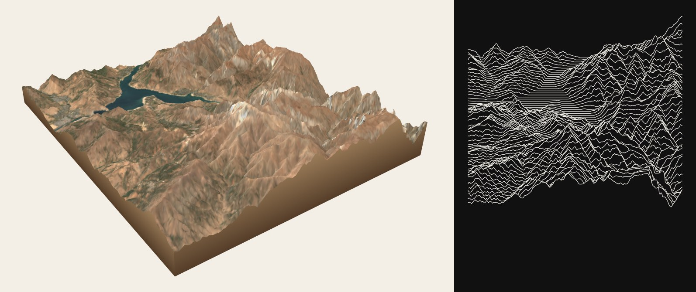

**What you'll learn**
- What a **DEM** (digital elevation model) is.
- How to draw a 3D surface with **plotly**, and rotate it with your mouse.
- What **vertical exaggeration** is, and why almost every 3D map uses it.
- How to lay a satellite picture on a 3D surface with a **mesh** of triangles.
- How to save a 3D map as a web page anyone can open.

## Part 0. Three ideas before you start

1. **A DEM.** A digital elevation model is a picture where every pixel is a **height** instead of a colour. Ours is the **Copernicus DEM**: a pair of satellites measured the height of every place on Earth, every 30 m.
2. **A 3D surface.** Put a point at the height of every pixel and join the points: you get a skin over the land, like a sheet laid over the mountains.
3. **Vertical exaggeration.** Mountains are much lower than they are wide. To see them better, 3D maps often multiply the heights by 2, 3 or more. It looks dramatic, but it isn't the real Earth.

## Part 1. Open the notebook and run it

1. Click this button: [](https://colab.research.google.com/github/NodiraTillayeva/30DayMapChallengeUzbekistan/blob/main/2026/Day%2025%20Is%20this%20a%20map/tutorial/day25_chimgan_in_3d.ipynb)
2. Sign in with your Google account and click **Copy to Drive** (**1**), so your changes are saved.

   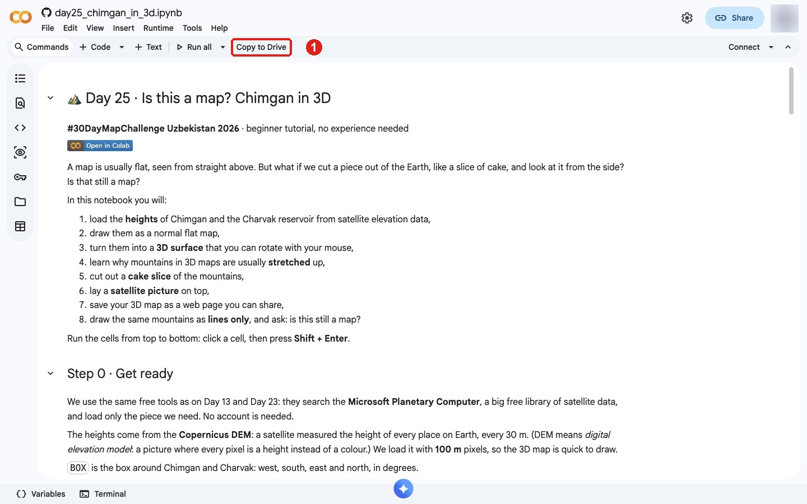

3. Click **Run all** (**1**), then **Run anyway** (**2**). The whole notebook takes about 2 minutes.

   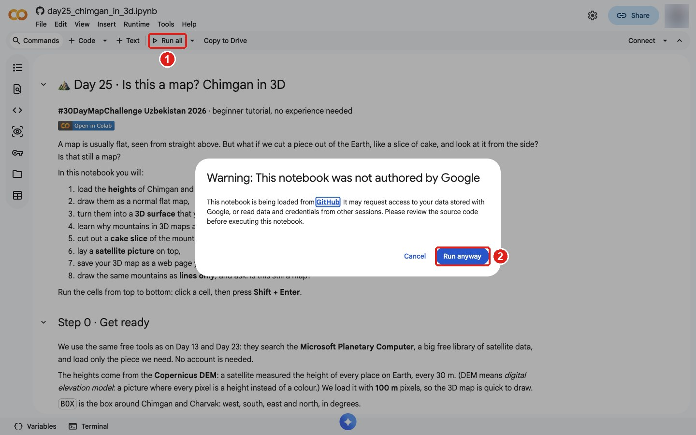

4. Step 0 installs three tools (the same ones as on Day 13 and Day 23) and loads the heights from the **Microsoft Planetary Computer**. When it says **Ready!** (**1**), everything is loaded.

   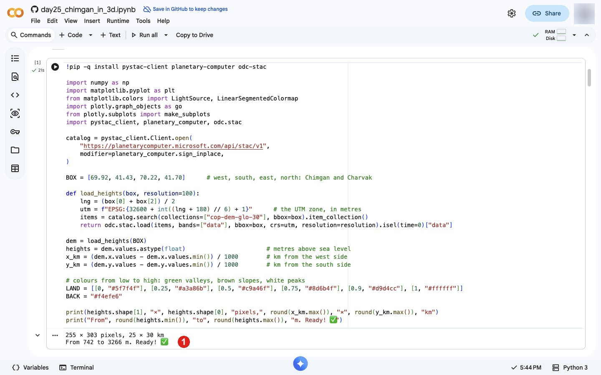

`BOX = [69.92, 41.43, 70.22, 41.70]` is the box around Chimgan and Charvak: west, south, east and north, in degrees. We load it with **100 m** pixels: 255 × 303 pixels, a piece of land 25 km × 30 km, from **742 m** to **3,266 m** above sea level.

```python
items = catalog.search(collections=["cop-dem-glo-30"], bbox=box).item_collection()
odc.stac.load(items, bands=["data"], bbox=box, crs=utm, resolution=100)
```

## Part 2. A flat map first

Step 1 draws the map you know: seen from straight above, colours for heights, and shadows as if the sun shone from the north-west (a **hillshade**).

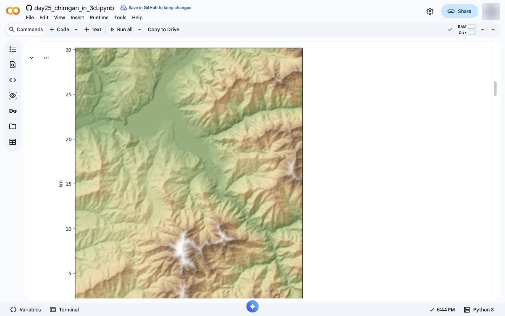

The white massif in the south is **Big Chimgan**. The flat green floor in the north is **Charvak**: the elevation data sees only the top of the water.

## Part 3. Your first 3D map

Step 2 gives the heights to plotly's `Surface`:

```python
fig = go.Figure(go.Surface(x=x_km, y=y_km, z=heights / 1000, colorscale=LAND))
fig.update_layout(scene=dict(aspectmode="data"))
```

We give the heights **in km**, like the sides of the box, and `aspectmode="data"` means "keep the real proportions". **Drag** the map with your mouse to rotate it, and **scroll** to zoom.

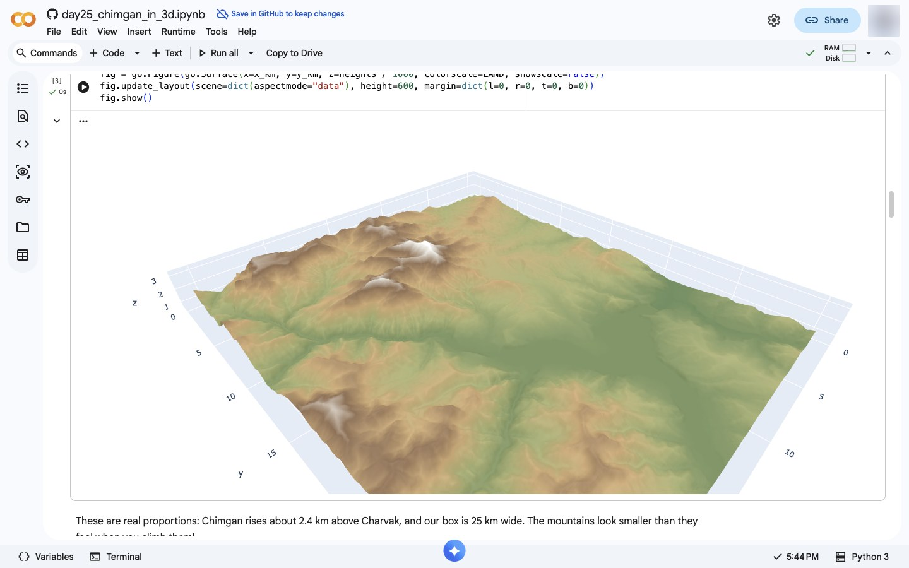

Chimgan rises about 2.4 km above Charvak, but our box is 25 km wide, so with real proportions the mountains look quite low.

## Part 4. Stretch it up

Step 3 draws the same mountains twice: real (×1), and with the heights multiplied by 3 (×3).

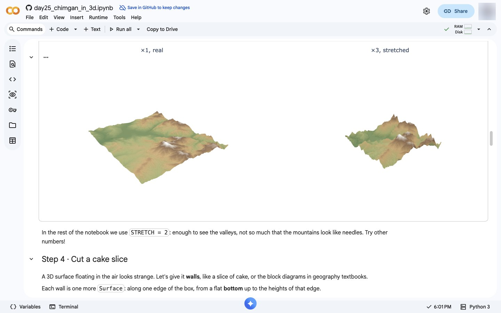

At ×3, the valleys and ridges are much easier to see, but the mountains look like needles. In the rest of the notebook we use `STRETCH = 2`. When you share a 3D map, it's honest to say how much you stretched it.

## Part 5. Cut a cake slice

A surface floating in the air looks strange. Step 4 gives it four brown **walls**, like a slice of cake, or the block diagrams in geography textbooks. Each wall is one more `Surface`, along one edge of the box, from a flat bottom up to the heights of that edge.

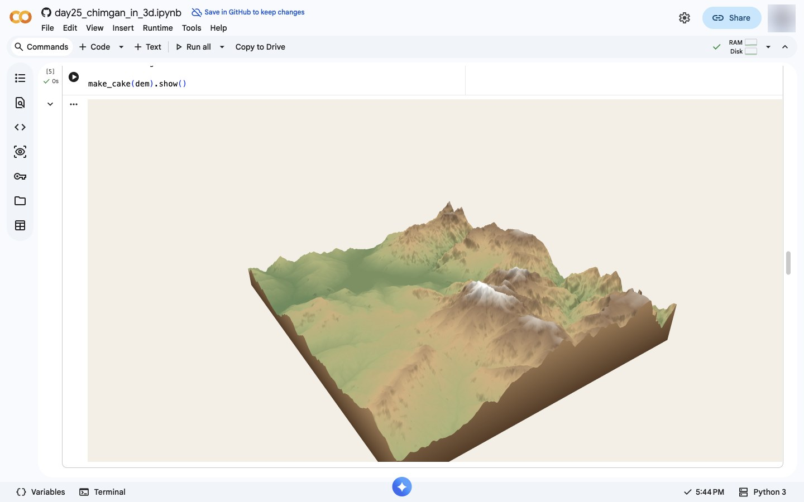

`make_cake(dem)` does all of this in one line, so you can use it again in Part 9.

## Part 6. Lay a satellite picture on top

Step 5 loads a **Sentinel-2** picture of the same box from **30 August 2025**, a clear day from Day 23:

```python
photo = odc.stac.load(items, bands=["B04", "B03", "B02"], like=dem, resampling="average")
```

`like=dem` puts the picture on exactly the same 100 m pixels as the heights, so every height gets its own colour.

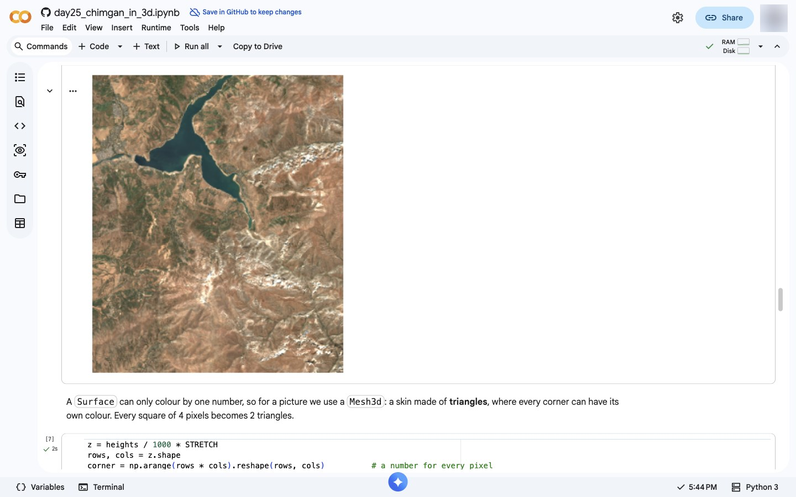

A `Surface` can colour by only one number. For a picture, we use a `Mesh3d`: a skin made of **triangles**, where every corner can have its own colour. Every square of 4 pixels becomes 2 triangles.

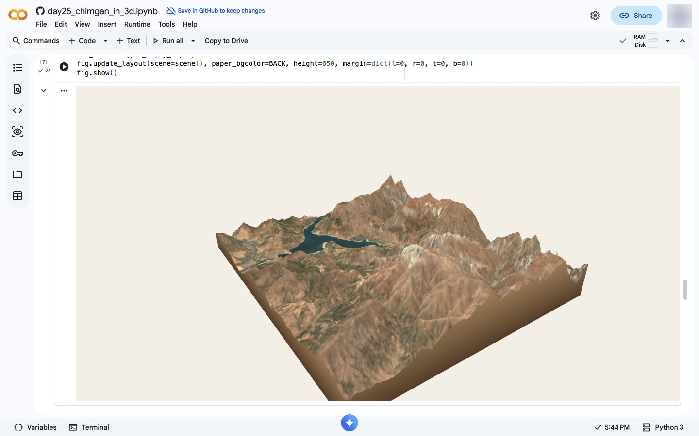

Now the reservoir is blue, and you can see the villages along its shore, the roads up the valleys and the bare brown slopes at the end of summer. Big Chimgan is in front, on the right. Rotate it to look at Charvak from Chimgan!

## Part 7. Save your 3D map

Step 6 saves the 3D map as a web page with `fig.write_html` and downloads **chimgan_3d.html**. Anyone can open it in a browser and rotate it, with no Python. Send it to a friend!

## Part 8. Is this a map?

Step 7 draws the same mountains with almost nothing: one **line** for every 4th row of pixels, from north to south, each line lifted by its heights. Each line covers the lines behind it, so the front lines look closer. It downloads **chimgan_lines.png**.

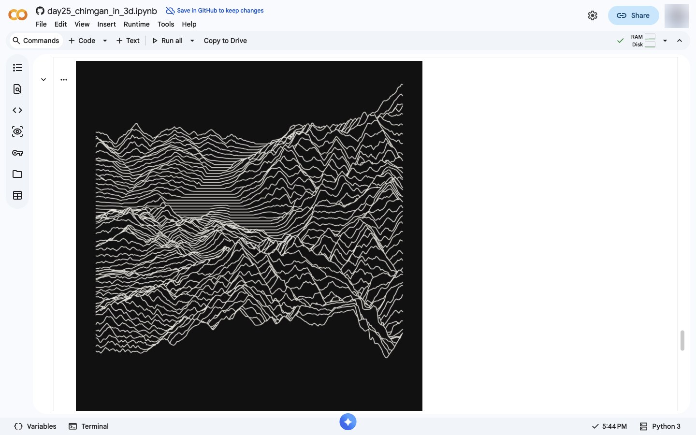

There's no colour, no satellite picture and no labels. But it has a real place, real heights and a real north. Can you find Charvak? (It's the flat, straight lines near the top.) Is it still a map? You decide!

## Part 9. Your own mountain

Step 8 makes a cake slice of another place. By default, it's the Turkestan range above **Zaamin**, from 1,109 to 4,219 m (**1**). Change `place` to another name from the list, or add your own box: draw it on [bboxfinder.com](http://bboxfinder.com) and copy the four numbers (west, south, east, north).

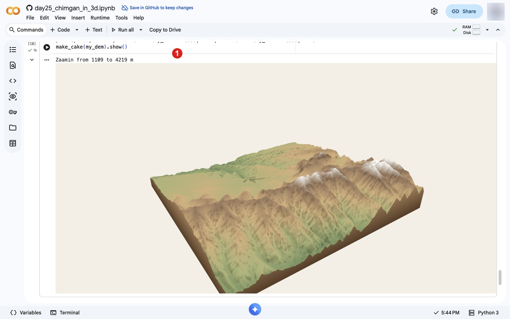

## What the data can't tell you

- **Not the real top of the mountain.** With 100 m pixels, each pixel is the height of one point, so sharp peaks get cut off. Our Chimgan is 3,266 m; its official height is 3,309 m.
- **Roofs and trees, not the ground.** The Copernicus DEM measures the top of whatever is there: in a forest or a town, the height includes the trees and the buildings.
- **Two different times.** The heights were measured from 2011 to 2015, and the picture is from 2025. The water level of Charvak changes every month, so the blue water and the flat floor don't always match.
- **Stretched on purpose.** At `STRETCH = 2`, every slope looks twice as steep as it is.

## Try it yourself

- **More detail:** in Step 0, change `load_heights(BOX)` to `load_heights(BOX, resolution=50)`. The 3D map gets sharper, but slower.
- **Another stretch:** change `STRETCH = 2` to `1` or `5` in Step 4, and run the next cells again.
- **Another day:** in Step 5, change the date to another clear day from the list in Day 23. If part of the picture is black, the satellite didn't see the whole box that day.
- **More lines:** in Step 7, change `LINES = 70` to `150`, or the colours to white lines on a blue background.

## Ideas for your own map

- **Your region as a cake:** a 3D slice of the mountains near your town, with a satellite picture on top.
- **Before and after:** the same 3D slice of a reservoir in spring and in autumn, side by side.
- **Lines of Uzbekistan:** the line poster for the whole Fergana valley, or for all of Uzbekistan (use `resolution=1000`).
- **A 3D map with rivers:** lay the rivers from Day 24 on the cake slice with `go.Scatter3d`.

## When you share

Please credit:
> Heights: Copernicus DEM GLO-30, © DLR e.V. 2010–2014 and © Airbus Defence and Space GmbH 2014–2018, provided under COPERNICUS by the European Union and ESA. Picture: contains modified Copernicus Sentinel-2 data (2025). Both accessed through the Microsoft Planetary Computer.

## Troubleshooting

| Problem | What to do |
|---|---|
| `APIError` or `timed out` while loading | The Planetary Computer is busy. Wait a minute and run the cell again. |
| The 3D map is empty or grey | Your browser needs WebGL for 3D. Try Chrome or Firefox, and run the cell again. |
| The 3D map is very slow to rotate | You loaded too many pixels. Use `resolution=100` or bigger. |
| Step 8 is slow | Big boxes take longer. Keep your box about 0.3–0.4° wide, or use `resolution=200`. |
| The file doesn't download | Your browser blocked it. Allow downloads for colab.research.google.com, or find **chimgan_3d.html** and **chimgan_lines.png** in the **Files** panel on the left. |

## Credits

- **Heights:** Copernicus DEM GLO-30, European Space Agency, © DLR e.V. 2010–2014 and © Airbus Defence and Space GmbH 2014–2018, accessed through the [Microsoft Planetary Computer](https://planetarycomputer.microsoft.com).
- **Satellite picture:** Copernicus Sentinel-2 Level-2A (2025), European Space Agency, accessed through the Microsoft Planetary Computer.
- **Line idea:** the "ridgeline" or "joy plot" style, made famous by the 1979 album cover *Unknown Pleasures*, drawn from radio signals of a pulsar.
- **Software:** [plotly](https://plotly.com/python), [pystac-client](https://pystac-client.readthedocs.io), [odc-stac](https://odc-stac.readthedocs.io), [numpy](https://numpy.org), [matplotlib](https://matplotlib.org), [Google Colab](https://colab.research.google.com).
